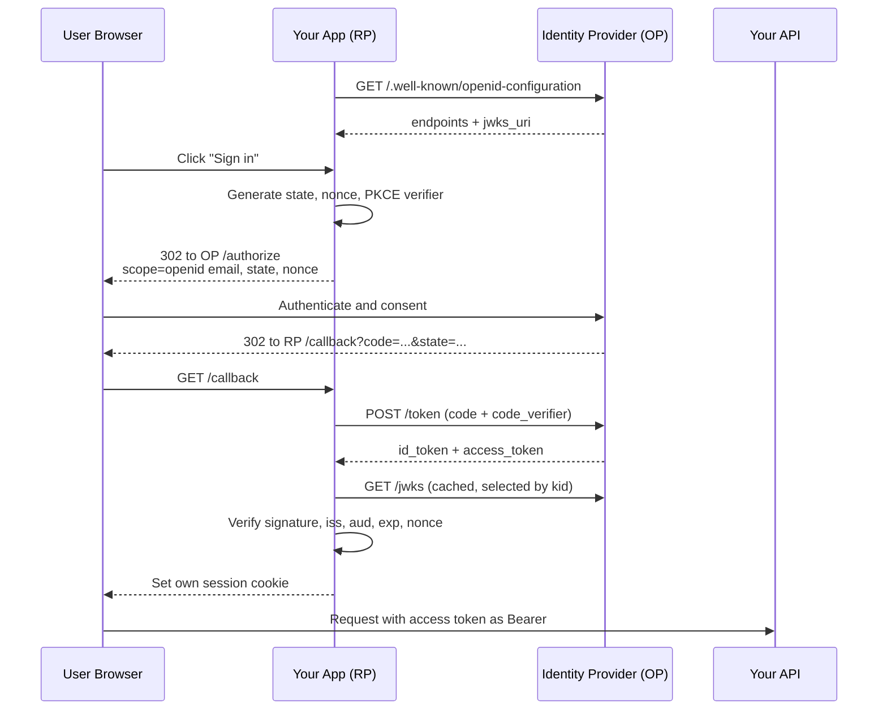
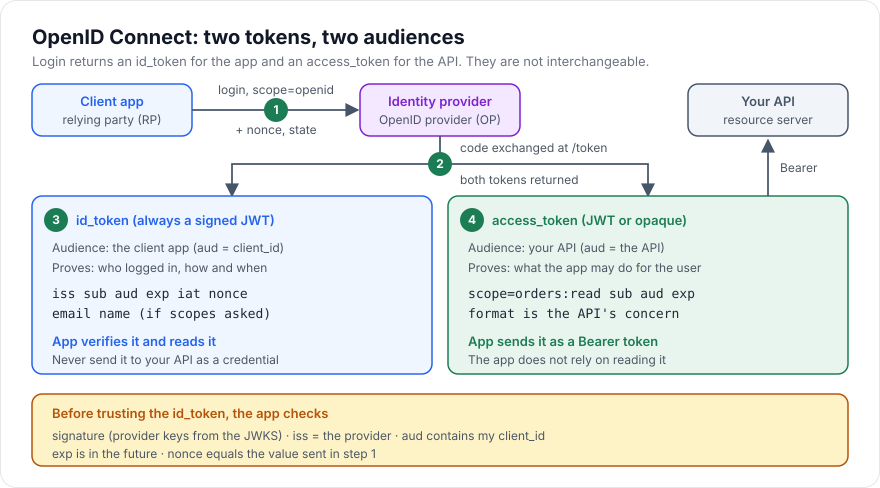

# OpenID Connect

> [!TIP]
> **In one line:** OpenID Connect adds a signed id_token to OAuth 2.0 so an app learns who just logged in, while the access_token stays a permission slip for the API.
>
> **In plain English:** Think of a conference. Your lanyard says who you are, and that is useful to the people you meet. A separate wristband says which rooms you may enter, and that is useful to the door staff. OpenID Connect hands the app the lanyard, and OAuth hands it the wristband.
>
> **You'll be able to:** tell an id_token from an access_token and say who each one is for · validate an id_token's signature, iss, aud, exp and nonce · build a login callback that uses state, nonce and PKCE correctly

## Why This Matters

[OAuth 2.0](oauth2.md) was designed to answer one question: "may this application call that API on the user's behalf?" It deliberately says nothing about who the user is. The access token is a credential for the API, and the client application is not supposed to open it, interpret it, or treat it as proof of anything.

Yet applications constantly need an identity. A "Sign in with Google" button must end with your backend knowing a stable user id and an email address. Before OpenID Connect (OIDC), teams filled that gap by calling a provider's proprietary profile endpoint with the access token and assuming that a successful response meant "this person just logged in." That has a real flaw: an access token issued to a *different* app, for a *different* purpose, would also get a successful profile response. A malicious app could take a token it obtained from a user and replay it into your login endpoint. This is the confused-deputy problem, and it is why "OAuth for login" was a known source of account-takeover bugs.

OIDC fixes this by standardising an identity layer on top of OAuth 2.0. It introduces one new artifact, the **id_token**, whose entire purpose is to say "user X authenticated at the provider at time T, and this assertion was issued for *your* client." It also standardises scopes, claim names, a discovery document, key publication, and a userinfo endpoint, so one client library can talk to any compliant provider (Google, Microsoft Entra, Okta, Auth0, Keycloak). If you integrate any social login or enterprise single sign-on, you are almost certainly using OIDC.

## Core Concept

OIDC is a thin profile of OAuth 2.0. You run the normal Authorization Code flow, but you include the scope `openid`. That single scope switches the provider into identity mode, and the token response contains an extra field, `id_token`.

The key vocabulary:

- **OpenID Provider (OP)**: the authorization server that authenticates the user and issues tokens.
- **Relying Party (RP)**: your client application, which *relies* on the provider to authenticate users.
- **id_token**: a [JWT](jwt-deeply-explained.md) signed by the provider. It is **for the RP**. Its `aud` claim is your `client_id`.
- **access_token**: the OAuth token. It is **for the API**. Its audience is the resource server, and the RP treats it as an opaque string.
- **Scopes**: `openid` (required) turns on OIDC. `profile` requests name and picture style claims. `email` requests `email` and `email_verified`. `offline_access` usually requests a refresh token.
- **Claims**: facts about the user or the authentication event. The core id_token claims are `iss` (who issued it), `sub` (a stable, provider-scoped user id), `aud` (who it is for), `exp` and `iat` (lifetime), `nonce` (replay binding), and optionally `auth_time`, `acr` and `amr` (how the user authenticated).
- **Discovery document**: JSON at `{issuer}/.well-known/openid-configuration` that lists every endpoint and the `jwks_uri`.
- **JWKS**: a JSON Web Key Set, the provider's public signing keys, fetched from `jwks_uri` and selected by the `kid` header in the token.
- **UserInfo endpoint**: an API, called with the access token, that returns up-to-date claims about the user.

The most important sentence in this chapter: **`sub` is the identity, and it is only unique together with `iss`.** The pair `(iss, sub)` is what you store as the external identity key. Emails change and are reassigned; `sub` does not.

## Mental Model

Think of an airport. Your **passport** (the id_token) is issued by a government you trust, names *you*, and is addressed to border control. Officials check that it is genuine, that it has not expired, and that it was issued by a country they recognise. Your **boarding pass** (the access_token) is issued by the airline, says what you may do (board flight 214), and is meant for the gate agent. The gate agent does not need your passport's details, and border control does not care about your seat. If you handed the airline's boarding pass to border control as proof of identity, they would rightly refuse it. If someone stole *another* traveller's boarding pass and showed it as an identity document, they would be turned away at the passport desk, because the nonce-and-audience checks are exactly the stamps that prove the document was issued for this journey and this checkpoint.

## How It Works

1. **Discovery.** At startup (and periodically), the RP fetches `{issuer}/.well-known/openid-configuration` and caches `authorization_endpoint`, `token_endpoint`, `jwks_uri`, `userinfo_endpoint`, and the supported algorithms. Hard-coding endpoints is allowed but loses automatic key and endpoint changes.
2. **Authentication request.** The RP redirects the browser to the authorization endpoint with `response_type=code`, `client_id`, `redirect_uri`, `scope=openid profile email`, a random `state`, a random `nonce`, and a PKCE `code_challenge`.
3. **User authenticates** at the provider and consents. The provider redirects back to the `redirect_uri` with `code` and the same `state`.
4. **RP checks `state`.** It must match the value stored for this browser session. This defends the callback against cross-site request forgery.
5. **Code exchange.** The RP POSTs to the token endpoint from its backend with `code`, `redirect_uri`, `code_verifier` (PKCE) and its client credentials. The response contains `access_token`, `id_token`, often `refresh_token`, and `expires_in`.
6. **Validate the id_token.** This is the step that makes it login rather than just a string: verify the signature against the provider's JWKS (using the `kid` header), and require the algorithm to be one you expect. Then check `iss` equals the issuer you configured, `aud` contains your `client_id`, `exp` is in the future (allowing small clock skew), and `nonce` equals the value you stored in step 2. If the token has multiple audiences, also check `azp`.
7. **Establish your own session.** After validation, look up or create the local user by `(iss, sub)`, then issue *your* session cookie or *your* API tokens. See [Sessions and Cookies](sessions-and-cookies.md). The id_token is not your session.
8. **Optionally call UserInfo.** If you need claims that are not in the id_token (many providers keep it small), call `userinfo_endpoint` with the access token. Verify that the `sub` returned there matches the id_token's `sub`; otherwise a swapped response could attach someone else's profile to the session.

### Why both `state` and `nonce`?

They defend different seams. `state` binds the *browser redirect* to the *browser session* that started it, so an attacker cannot make your callback process a code they obtained. `nonce` binds the *id_token* to the *authentication request*, so a captured id_token cannot be replayed into a different login. PKCE binds the *code* to the party that started the flow, so an intercepted code is useless without the verifier. They overlap in places, and using all three is normal and cheap.

### Where does the id_token go afterwards?

Mostly nowhere. A common rule: validate it once at login, extract `sub`, `email` and similar, create your own session, and discard it. If you keep it, keep it server-side. Do not forward it to downstream APIs as a bearer credential. Its audience is your client, so a well-configured API will (and should) reject it, as covered in [Bearer Tokens](bearer-tokens.md) and [Access vs Refresh Tokens](access-vs-refresh-tokens.md).

## Architecture





## Request / Response Example

The authentication request (line-wrapped for readability):

```http
GET /authorize?response_type=code
  &client_id=orders-web
  &redirect_uri=https%3A%2F%2Fapp.example.com%2Fcallback
  &scope=openid%20profile%20email
  &state=Zp3q8mXc1V
  &nonce=n-0S6_WzA2Mj
  &code_challenge=E9Melhoa2OwvFrEMTJguCHaoeK1t8URWbuGJSstw-cM
  &code_challenge_method=S256 HTTP/1.1
Host: login.example.com
```

The token response after the code exchange:

```http
HTTP/1.1 200 OK
Content-Type: application/json
Cache-Control: no-store

{
  "token_type": "Bearer",
  "access_token": "SlAV32hkKG...",
  "expires_in": 900,
  "scope": "openid profile email",
  "id_token": "eyJhbGciOiJSUzI1NiIsImtpZCI6IjIwMjYtMDUifQ.eyJpc3MiOiJodHRwczovL2xvZ2luLmV4YW1wbGUuY29tIiwic3ViIjoiMjQ4Mjg5NzYxMDAxIiwiYXVkIjoib3JkZXJzLXdlYiIsImV4cCI6MTc2Mjc3MDAwMCwiaWF0IjoxNzYyNzY5MTAwLCJub25jZSI6Im4tMFM2X1d6QTJNaiJ9.signature"
}
```

The decoded id_token payload, which is what the RP actually reads after verifying the signature:

```json
{
  "iss": "https://login.example.com",
  "sub": "248289761001",
  "aud": "orders-web",
  "exp": 1762770000,
  "iat": 1762769100,
  "nonce": "n-0S6_WzA2Mj",
  "email": "alice@example.com",
  "email_verified": true,
  "name": "Alice Nguyen"
}
```

Note `aud` is the client (`orders-web`), not the API. The access token for the API would carry a different audience, such as `https://api.example.com`.

## Code Example

A minimal relying party in FastAPI. It uses `httpx` for discovery and the token exchange and PyJWT for verification. Secrets come from the environment. Pending login state is kept in an in-process dict for clarity; with more than one server process it must live in a shared store (Redis) or a signed, HttpOnly cookie.

```python
import base64
import hashlib
import hmac
import os
import secrets
import time
from urllib.parse import urlencode

import httpx
import jwt  # PyJWT >= 2.x, with the "cryptography" extra installed
from fastapi import FastAPI, HTTPException
from fastapi.responses import RedirectResponse

ISSUER = os.environ["OIDC_ISSUER"]            # e.g. https://login.example.com
CLIENT_ID = os.environ["OIDC_CLIENT_ID"]
CLIENT_SECRET = os.environ["OIDC_CLIENT_SECRET"]
REDIRECT_URI = os.environ["OIDC_REDIRECT_URI"]
ALLOWED_ALGS = ["RS256"]                       # pin the algorithm; never trust the token's own header

app = FastAPI()

# state -> (nonce, code_verifier, created_at). Single-process demo only.
PENDING: dict[str, tuple[str, str, float]] = {}
_discovery: dict | None = None
_jwk_client: jwt.PyJWKClient | None = None


async def discovery() -> dict:
    """Fetch and cache the provider's discovery document."""
    global _discovery, _jwk_client
    if _discovery is None:
        async with httpx.AsyncClient(timeout=5) as client:
            resp = await client.get(f"{ISSUER}/.well-known/openid-configuration")
            resp.raise_for_status()
            doc = resp.json()
        # The discovery document must name the issuer we configured, otherwise
        # a misconfigured or hijacked URL could redirect our trust elsewhere.
        if doc["issuer"] != ISSUER:
            raise RuntimeError("issuer mismatch in discovery document")
        _discovery = doc
        # PyJWKClient caches keys and re-fetches when it sees an unknown kid.
        _jwk_client = jwt.PyJWKClient(doc["jwks_uri"])
    return _discovery


def pkce_pair() -> tuple[str, str]:
    verifier = secrets.token_urlsafe(64)
    digest = hashlib.sha256(verifier.encode()).digest()
    challenge = base64.urlsafe_b64encode(digest).rstrip(b"=").decode()
    return verifier, challenge


@app.get("/login")
async def login() -> RedirectResponse:
    doc = await discovery()
    state, nonce = secrets.token_urlsafe(24), secrets.token_urlsafe(24)
    verifier, challenge = pkce_pair()
    PENDING[state] = (nonce, verifier, time.time())
    query = urlencode({
        "response_type": "code",
        "client_id": CLIENT_ID,
        "redirect_uri": REDIRECT_URI,
        "scope": "openid profile email",
        "state": state,
        "nonce": nonce,
        "code_challenge": challenge,
        "code_challenge_method": "S256",
    })
    return RedirectResponse(f"{doc['authorization_endpoint']}?{query}")


def verify_id_token(id_token: str, expected_nonce: str) -> dict:
    """Return verified claims or raise. Runs blocking JWKS I/O, so call it
    with run_in_threadpool in a busy service."""
    assert _jwk_client is not None
    signing_key = _jwk_client.get_signing_key_from_jwt(id_token)
    claims = jwt.decode(
        id_token,
        signing_key.key,
        algorithms=ALLOWED_ALGS,
        audience=CLIENT_ID,            # checks aud contains our client_id
        issuer=ISSUER,                 # checks iss
        leeway=30,                     # small clock-skew allowance, in seconds
        options={"require": ["exp", "iat", "iss", "aud", "sub"]},
    )
    # PyJWT does not check nonce: that is application logic.
    if not hmac.compare_digest(str(claims.get("nonce", "")), expected_nonce):
        raise jwt.InvalidTokenError("nonce mismatch")
    return claims


@app.get("/callback")
async def callback(code: str, state: str):
    pending = PENDING.pop(state, None)   # pop: a state value works once
    if pending is None or time.time() - pending[2] > 600:
        raise HTTPException(400, "Unknown or expired state")
    nonce, verifier, _ = pending
    doc = await discovery()

    async with httpx.AsyncClient(timeout=10) as client:
        resp = await client.post(doc["token_endpoint"], data={
            "grant_type": "authorization_code",
            "code": code,
            "redirect_uri": REDIRECT_URI,
            "client_id": CLIENT_ID,
            "client_secret": CLIENT_SECRET,
            "code_verifier": verifier,
        })
    if resp.status_code != 200:
        raise HTTPException(401, "Token exchange failed")
    tokens = resp.json()

    try:
        claims = verify_id_token(tokens["id_token"], nonce)
    except jwt.PyJWTError:
        raise HTTPException(401, "Invalid id_token")

    # Identity key is the pair (iss, sub): never the email address alone.
    external_identity = (claims["iss"], claims["sub"])
    # ... look up or create the local user, then set YOUR OWN session cookie ...
    return {"logged_in_as": claims.get("email"), "identity": external_identity}
```

Two details deserve attention. `algorithms=ALLOWED_ALGS` stops an attacker choosing `none` or switching an RSA token to a symmetric algorithm. And `PENDING.pop(state)` makes each `state` single-use, so a replayed callback fails.

## Production Considerations

- **Cache discovery and JWKS, but refresh on unknown `kid`.** Providers rotate signing keys. Cache the key set for minutes to hours, and when a token arrives with an unfamiliar `kid`, re-fetch once (rate-limited so a flood of bad tokens cannot make you hammer the provider). PyJWT's `PyJWKClient` does this for you, but its fetches are synchronous, so run them in a threadpool or use an async-friendly library in a high-throughput service.
- **Provider outages block logins, not existing sessions.** Because you mint your own session after the callback, an identity-provider incident does not log out users who are already in. Keep that property.
- **Handle `email` carefully.** Only treat `email` as verified if `email_verified` is true, and never link accounts by email alone across providers without a verification step; "same email" is a classic account-takeover path.
- **Multi-tenant providers.** With Microsoft Entra's common endpoint, the `iss` differs per tenant. Validate the issuer against an allow-list or the tenant id rather than disabling issuer checks.
- **Logout and session lifetime.** Decide whether your local session should end when the provider session does. OIDC defines RP-initiated logout and back-channel logout, but support varies; many apps simply use a short local session and re-authenticate silently.
- **Clock skew.** Allow a small `leeway` (tens of seconds) but not minutes; a large leeway silently extends token lifetimes.
- **Redirect URI hygiene.** Register exact `redirect_uri` values with the provider. Wildcards turn a code-interception bug into a login bypass.
- **Audit logging.** Log `iss`, `sub`, `jti` if present, and the validation outcome for every login, never the raw tokens.

## Common Mistakes

- **Sending the id_token to your API as the credential.** Its audience is the client, not the API. Use the access token for API calls, as described in [OAuth 2.0](oauth2.md).
- **Reading claims without verifying the signature** because "it's just base64 JSON." Anyone can write base64 JSON. See [JWT Deeply Explained](jwt-deeply-explained.md).
- **Skipping `aud`, `iss` or `nonce` checks.** Each one blocks a distinct attack: tokens meant for other clients, tokens from other issuers, and replayed tokens.
- **Using the access token as proof of login** by calling a profile endpoint. That is the pre-OIDC pattern and it is vulnerable to token substitution.
- **Identifying users by `email` instead of `(iss, sub)`.** Addresses are mutable and can be recycled.
- **Omitting `state` or reusing it.** The callback then accepts forged or replayed redirects.
- **Trusting the discovery URL or JWKS URL taken from a token header.** Take them only from configuration you control, never from the token being verified (`jku` and `x5u` header values included).
- **Treating a long-lived id_token as a session.** It is a statement about one authentication event, not a revocable session.

## Best Practices

- Use the Authorization Code flow with PKCE for every client, including confidential web backends. Do not use the implicit flow.
- Pin `algorithms`, `issuer` and `audience` in verification code; reject anything else.
- Store `(iss, sub)` as the external identity key and treat all other claims as mutable profile data.
- Create your own short-lived session after login and use the provider only for authentication.
- Prefer a maintained OIDC library over hand-rolled flows, and keep this chapter's checks as the checklist for reviewing what the library is configured to do.
- Request the minimum scopes. Ask for `email` only if you need it.
- Test failure paths: wrong nonce, wrong audience, expired token, unknown `kid`, replayed `state`.

## AI Engineering Perspective

OIDC is how an AI product answers "which human is behind this chat?" The id_token gives the application layer a verified `sub` that can partition conversation history, retrieval indexes and usage quotas per user, which matters for [RAG APIs](../16-rag-apis/README.md) where a vector search must be filtered to documents that user may see. Do not paste id_tokens into prompts or tool arguments: a model context is not a safe place for credentials, and the token's audience makes it useless to a tool anyway.

For agents and [MCP servers](../17-ai-agents-and-mcp/README.md), the pattern is delegation: the user logs in via OIDC, the agent platform obtains an access token with narrow scopes for each tool, and tool calls carry that token so downstream services see the *user's* authority, not an all-powerful service key. Short-lived tokens plus an audit trail that records `sub` and the agent identity let you answer "who authorised this action" after an incident.

## Exercises

**Beginner**
1. Fetch the discovery document of a public provider and list its `issuer`, `authorization_endpoint`, `jwks_uri`, and supported `id_token_signing_alg_values`.
2. Explain in two sentences why an id_token must not be sent to your API as a Bearer token.

**Intermediate**
3. Decode (without trusting) a real id_token and identify each claim. Then write the exact list of checks a relying party must perform before accepting it.
4. Extend the code example to call the UserInfo endpoint and reject the response if its `sub` differs from the id_token's `sub`.

**Advanced**
5. Design key-rotation handling for the JWKS cache: what happens on an unknown `kid`, how do you rate-limit refreshes, and how do you avoid a thundering herd across many API instances?
6. Plan account linking when a user signs in with two providers that report the same email. What must you verify before merging the accounts?

## Key Takeaways

- OIDC is OAuth 2.0 plus the `openid` scope and an id_token that tells the app who authenticated.
- The id_token is for the client (`aud` is your `client_id`). The access_token is for the API. Never swap them.
- Validate signature (via JWKS), `iss`, `aud`, `exp` and `nonce`, with a pinned algorithm, before trusting any claim.
- Use `state`, `nonce` and PKCE together, and identify users by `(iss, sub)`, not by email.

### Check Yourself

<details markdown="1">
<summary>1. What does the id_token contain that the access_token does not need to, and who is it meant for?</summary>

The id_token carries identity claims (`sub`, `iss`, `aud`, `nonce`, optionally email and name) and is addressed to the client app, whose `client_id` is the `aud`. The access_token is addressed to the API and only has to express what the app may do.

</details>

<details markdown="1">
<summary>2. Why is the nonce check needed if you already verify the signature and use state?</summary>

A validly signed id_token captured from one login could be replayed into another. The nonce ties the token to the specific authentication request this browser session started, so a token minted for a different request fails the comparison even though its signature is perfect.

</details>

<details markdown="1">
<summary>3. Your API receives an id_token in the Authorization header from a mobile app and accepts it because the signature is valid. What is wrong, and what should happen?</summary>

The id_token's audience is the mobile client, not your API, so accepting it breaks audience restriction and lets any app holding a user's id_token act as that user. The API should require an access token whose `aud` is the API and reject tokens meant for other audiences with 401.

</details>

---
Back to the [Part 5 README](README.md).
