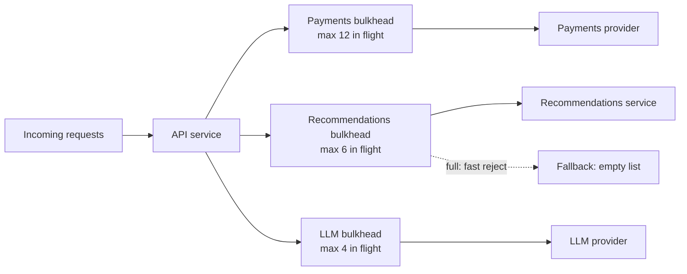

# Bulkheads

> [!TIP]
> **In one line:** A bulkhead gives each dependency or tenant its own bounded pool of workers, connections or slots, so one slow or greedy consumer cannot use up resources everyone else needs.
>
> **In plain English:** Supermarkets keep a separate express lane for small baskets. One shopper with a trolley of 200 items stalls their own lane, not the entire store. Bulkheads give each part of your service its own lane, so a slow dependency only blocks the lane it uses.
>
> **You'll be able to:** explain how a shared pool turns one slow dependency into a full outage · build and size a semaphore-based bulkhead that fails fast · decide how bulkheads and circuit breakers work together

## Why This Matters

Timeouts, retries and breakers protect a single call. They say nothing about the *shared resources* those calls draw on: worker threads, an async concurrency limit, an HTTP connection pool, a database connection pool. When these are shared across everything the service does, one misbehaving dependency can consume all of them.

A concrete case: your API has 50 worker slots. `GET /home` calls a recommendations service, `POST /checkout` calls a payments provider. Recommendations starts responding in 25 seconds instead of 50 ms. Each `/home` request now holds a slot for 25 seconds. At 5 requests per second that is 125 slots of demand against 50 available, so within about ten seconds every slot is waiting on recommendations. `/checkout`, which depends only on a healthy payments provider, now queues behind them and times out. A non-critical feature has taken down the revenue path, and no individual call did anything wrong. The service was slow to *fail*.

The name comes from ships. Hulls are divided into watertight compartments so a breach floods one section instead of sinking the vessel. The reliability version divides your resources into compartments so a breach in one dependency floods only its own.

## Core Concept

A **bulkhead** is a hard limit on how much of a shared resource one *group of work* may use. The group is chosen by what you want to isolate: a downstream dependency, a feature, a tenant, a priority class. The limit is typically one of:

- **A concurrency limit** (an `asyncio.Semaphore` or a thread pool of a fixed size): at most N calls in flight.
- **A separate connection pool** per dependency, so database or HTTP connections are not shared.
- **A separate queue and consumer group** per tenant or job type in background processing.
- **Separate processes or deployments** for the strongest isolation, such as running low-priority batch traffic on its own replicas.

Two properties make a bulkhead more than a limit. It is **partitioned** (compartments do not borrow from each other under stress) and it **fails fast**: when a compartment is full, the next caller is rejected immediately or after a very short wait, rather than queueing without bound. An unbounded queue in front of a bulkhead only moves the pile-up from the slots to the queue, and latency still explodes.

## Mental Model

Imagine a call centre with one phone line group. If a single enormous client occupies every line with long calls, other customers get a busy signal. Now split the lines: 20 for premium accounts, 10 for everyone else, 5 for a particularly chatty partner. The partner can still saturate its own 5 lines, but everyone else's lines are untouched. Nobody got more lines in total, and capacity may even be slightly underused at times. You traded peak utilisation for predictability, which is the right trade for failure containment.

## How It Works

**Choose the compartments.** Start with one per external dependency (payments, search, recommendations, the LLM provider) because that is where slowness originates. Add per-tenant or per-priority compartments when fairness matters: a "noisy neighbour" tenant should not exhaust capacity for others.

**Size each compartment with Little's Law.** The number of requests in flight equals arrival rate times latency: `concurrency = rate × latency`. If payments normally receives 40 calls per second at 150 ms, steady-state concurrency is `40 × 0.15 = 6`. Provide headroom for bursts and slow tails, perhaps 2 to 3 times, so 12 to 20 slots. If recommendations takes 80 ms at 100 calls per second, that is 8 in flight, so 12 to 16 slots. Then check the sum: the compartments plus overhead must fit within what the process or database can actually support. Sizing is an approximation: measure real in-flight counts and latency percentiles, then adjust.

**Decide what happens when full.** Options, from most to least common: reject immediately with a typed error (`BulkheadFull`), wait a very short bounded time for a slot and then reject, or run a degraded fallback. A small waiting room (a few callers for tens of milliseconds) smooths bursts; a large one just hides the problem. Rejection should map to something meaningful at the edge: `503 Service Unavailable` with `Retry-After` for a critical call that cannot be skipped, or a degraded response for an optional one (see [Graceful Degradation](graceful-degradation.md)).

**Always keep an inner timeout.** A bulkhead limits how many calls hold slots, not how long each one holds a slot. If calls can hang for 30 seconds, a compartment of 10 slots is still dead for 30 seconds. Every call inside a bulkhead needs its own [timeout](timeouts.md), and the timeout should be short relative to the compartment's capacity maths.

**Bulkheads and circuit breakers are complements.** A [circuit breaker](circuit-breakers.md) observes failure *rates* and stops calling a dependency that is failing, which saves capacity once it has detected the problem. A bulkhead acts *before* detection and *regardless of the failure mode*: it limits the blast radius from the first slow call, including when calls are merely slow rather than failing, which breakers with error-based thresholds may be slow to notice. Put them together: the breaker sits inside or around the compartment, so a tripped breaker returns instantly without even taking a slot, and the bulkhead caps the damage in the window before the breaker trips and while it is half-open. Retries interact too: retries consume slots, so count them toward concurrency, and do not retry on `BulkheadFull`, since that is a local overload signal, not a transient remote fault (see [Retries](retries.md)).

**Trade-offs.** Isolation costs flexibility. Idle capacity in one compartment cannot help another, so total capacity needed rises. Too many tiny compartments waste resources and create their own rejections. Too few reintroduces coupling. Static sizes can be wrong after traffic changes; adaptive concurrency limits (for example AIMD-style limits that grow while latency is healthy and shrink on slowdown) are an advanced alternative that removes some manual tuning.

## Architecture




## Request / Response Example

When the recommendations compartment is full, the optional call degrades quietly and the page still renders:

```http
GET /home/u_42 HTTP/1.1
Host: api.example.com
```

```http
HTTP/1.1 200 OK
Content-Type: application/json
X-Degraded: recommendations

{"user_id": "u_42", "recommendations": []}
```

When the *payments* compartment is full, the call cannot be skipped, so the service says so honestly and quickly instead of hanging:

```http
POST /checkout HTTP/1.1
Host: api.example.com
Idempotency-Key: 6f1c2d0e-5b0a-4f6e-9d3a-1c2b3a4d5e6f

{"cart_id": "c_981"}
```

```http
HTTP/1.1 503 Service Unavailable
Retry-After: 1
Content-Type: application/json

{"detail": "Payments busy, retry shortly"}
```

## Code Example

A small asyncio bulkhead with a bounded wait, used per dependency in a FastAPI app. The recommendations route degrades; the checkout route returns `503`. The tests at the bottom check that excess calls are rejected, slots are released, and one compartment's saturation does not affect another (these were run with `asyncio.run`; with pytest, mark them with `pytest.mark.asyncio`). The upstream URL comes from the environment.

```python
import asyncio
import os
from typing import Awaitable, Callable, TypeVar

import httpx
from fastapi import FastAPI, HTTPException

T = TypeVar("T")


class BulkheadFull(Exception):
    """Raised immediately when a compartment has no room: fail fast instead of queueing."""


class Bulkhead:
    """A bounded compartment: at most `max_concurrent` calls run, at most `max_waiting` wait."""

    def __init__(self, name: str, max_concurrent: int, max_waiting: int = 0,
                 wait_timeout: float = 0.05) -> None:
        self.name = name
        self.max_waiting = max_waiting
        self.wait_timeout = wait_timeout
        self._sem = asyncio.Semaphore(max_concurrent)
        self._waiting = 0

    async def run(self, fn: Callable[[], Awaitable[T]]) -> T:
        if self._sem.locked():                      # no free slot right now
            if self._waiting >= self.max_waiting:   # waiting room is full too: reject
                raise BulkheadFull(self.name)
            self._waiting += 1
            try:
                await asyncio.wait_for(self._sem.acquire(), self.wait_timeout)
            except asyncio.TimeoutError:
                raise BulkheadFull(self.name) from None
            finally:
                self._waiting -= 1
        else:
            await self._sem.acquire()               # free slot: does not suspend
        try:
            return await fn()                       # the call should ALSO have its own timeout
        finally:
            self._sem.release()


# One compartment per dependency. Sizes come from capacity maths, not guesses
# (see "Sizing" above): here the payments provider gets 20 slots, recommendations 5.
BULKHEADS = {
    "payments": Bulkhead("payments", max_concurrent=20, max_waiting=10),
    "recommendations": Bulkhead("recommendations", max_concurrent=5, max_waiting=0),
}

app = FastAPI()
client = httpx.AsyncClient(timeout=httpx.Timeout(2.0))   # every call is time-bounded
RECS_URL = os.environ["RECS_URL"]                        # config from the environment


@app.get("/home/{user_id}")
async def home(user_id: str):
    async def fetch() -> list[str]:
        r = await client.get(f"{RECS_URL}/users/{user_id}/recs")
        r.raise_for_status()
        return r.json()

    try:
        recs = await BULKHEADS["recommendations"].run(fetch)
    except (BulkheadFull, httpx.HTTPError):
        recs = []                                   # degrade: page still renders (see graceful-degradation.md)
    return {"user_id": user_id, "recommendations": recs}


@app.post("/checkout")
async def checkout():
    async def charge() -> dict:
        await asyncio.sleep(0.1)                    # stand-in for the payment provider call
        return {"status": "ok"}

    try:
        return await BULKHEADS["payments"].run(charge)
    except BulkheadFull:
        # Honest, fast overload signal; the slow recommendations service cannot cause this.
        raise HTTPException(503, "Payments busy, retry shortly", headers={"Retry-After": "1"})


# --- tests (pytest + pytest-asyncio style) ---
async def test_rejects_beyond_capacity_and_recovers():
    bh = Bulkhead("t", max_concurrent=2, max_waiting=0)
    gate = asyncio.Event()

    async def slow() -> str:
        await gate.wait()
        return "done"

    running = [asyncio.create_task(bh.run(slow)) for _ in range(2)]
    await asyncio.sleep(0)                          # let both acquire a slot
    try:
        await bh.run(slow)
        raise AssertionError("expected BulkheadFull")
    except BulkheadFull:
        pass
    gate.set()
    assert await asyncio.gather(*running) == ["done", "done"]
    assert await bh.run(slow) == "done"             # slots were released


async def test_other_compartments_are_unaffected():
    a, b = Bulkhead("a", 1), Bulkhead("b", 1)
    gate = asyncio.Event()

    async def block() -> None:
        await gate.wait()

    t = asyncio.create_task(a.run(block))
    await asyncio.sleep(0)

    async def quick() -> str:
        return "ok"

    assert await b.run(quick) == "ok"               # b still has room while a is saturated
    gate.set()
    await t
```

Notes on the design. `Semaphore.locked()` is true when a slot cannot be acquired immediately, which lets the fast path avoid any waiting-room bookkeeping. The `finally` blocks guarantee slots and waiting counts are returned even on cancellation or error. The compartment protects *this process only*: with 10 replicas, the effective limit on the dependency is 10 times the per-process limit, so size per-process limits as `dependency capacity / replicas` with headroom.

## Production Considerations

- **Per-process versus global.** In-process semaphores isolate within one instance. For a global limit across replicas, use a shared limiter (a Redis-backed counter) or limit at a gateway, accepting extra latency and a new dependency.
- **Connection pools are bulkheads too.** Give slow, large or batch queries their own database pool or read replica so they cannot starve interactive queries. Set pool size, `max_overflow` and acquire timeouts explicitly (see [Part 4](../04-databases-and-apis/README.md)).
- **Thread pools in async code.** If you offload blocking calls with `run_in_executor` or `to_thread`, a single shared executor is a shared pool. Use separate executors for separate dependencies.
- **Metrics.** Export in-flight count, rejected count and wait time per compartment. A compartment that is permanently near full is undersized or its dependency is sick; one that is never above 10% may be oversized.
- **Alert on rejections,** not only errors. A rise in `BulkheadFull` is an early warning that precedes user-visible failures.
- **Tenant isolation.** Per-tenant bulkheads need a bounded number of compartments (tenant tiers rather than one per tenant ID) so the bookkeeping itself does not grow without limit.
- **Test it.** Inject latency into one dependency in a staging environment and confirm other endpoints keep their latency. A bulkhead you have never exercised is an assumption.

## Common Mistakes

- **No inner timeout.** The compartment fills with hung calls and stays full.
- **Unbounded or huge waiting room.** Callers queue for seconds, latency soars, and you have rebuilt the shared pool with extra steps.
- **One bulkhead around everything.** That is just a lower global limit, not isolation.
- **Sizing by guess.** Too small rejects healthy traffic; too large provides no protection. Use rate times latency and measure.
- **Ignoring retries.** Retried calls take slots too; a retry storm inside a compartment can fill it with duplicates.
- **Forgetting shared hidden resources.** Separate semaphores on top of one tiny connection pool or one shared executor still couple everything underneath.
- **Treating rejection as an error to retry.** `BulkheadFull` means "back off", not "try again immediately".

## Best Practices

- Isolate per dependency first, then add per-tenant or per-priority compartments where fairness matters.
- Size with `concurrency = rate × latency` plus headroom, and re-check after traffic changes.
- Fail fast with a short bounded wait, and give every call inside a compartment its own timeout.
- Pair bulkheads with circuit breakers, and degrade optional features instead of failing the whole request.
- Instrument in-flight, queued and rejected counts per compartment, and load test with an injected slow dependency.

## AI Engineering Perspective

LLM calls are the textbook case for bulkheads: they are slow (seconds to tens of seconds), expensive, rate-limited, and their latency varies widely with prompt and output length. If chat completions share a worker pool or connection pool with ordinary CRUD endpoints, a provider slowdown or a burst of long generations can starve everything else. Give each provider its own compartment, and consider separate compartments by *priority* (interactive chat versus background summarization or embedding backfills) so a batch job cannot crowd out a user waiting on a response. Streaming responses hold a slot for the entire stream, so count open streams, not just request starts. Gateways typically implement this as per-model, per-tenant concurrency and token budgets (see [Part 15 — Production AI Systems](../15-production-ai-systems/README.md)). For agents, cap concurrent tool calls per run and per tenant so one runaway agent loop cannot saturate shared tools (see [Part 17](../17-ai-agents-and-mcp/README.md)).

## Exercises

**Beginner**
1. A service has one shared pool of 20 workers. Endpoint A calls a dependency that now takes 10 s instead of 100 ms at 5 requests per second. How many workers does A occupy at steady state, and what happens to endpoint B?

**Intermediate**
2. Size the compartments for three dependencies: payments at 30 req/s and 200 ms, search at 120 req/s and 50 ms, recommendations at 60 req/s and 80 ms. Use a 2.5 times headroom factor and state the total.
3. Extend the `Bulkhead` class to expose in-flight, rejected and total counts, and write a test that checks the counters after a mix of accepted and rejected calls.

**Advanced**
4. Your API runs on 12 replicas and a downstream service allows 200 concurrent requests in total. Choose per-process limits, explain what happens during a rolling deploy that temporarily runs 18 replicas, and describe how a shared limiter would change the design.

## Key Takeaways

- A shared pool lets one slow dependency exhaust everyone's resources; bulkheads partition resources so failures stay inside their compartment.
- Size each compartment from `rate × latency` with headroom, fail fast when full, and keep a per-call timeout inside.
- Bulkheads cap the damage before a circuit breaker notices; breakers then remove load once a failure is detected. Use both.
- Isolation trades some peak efficiency for predictability, and in-process limits only isolate one replica.

### Check Yourself

<details markdown="1">
<summary>1. What is a bulkhead, and what problem does it solve that a timeout alone does not?</summary>

A bulkhead is a bounded, separate pool of resources per dependency or tenant. A timeout limits how long one call can take, but without a bulkhead many slow calls can still occupy every shared worker at once and starve unrelated work.

</details>

<details markdown="1">
<summary>2. Why should a full bulkhead reject quickly instead of queueing callers until a slot frees up?</summary>

A long queue just moves the pile-up from the slots to the queue, so latency grows and callers time out anyway. Rejecting quickly returns a clear overload signal, frees the caller to degrade or back off, and protects the rest of the service.

</details>

<details markdown="1">
<summary>3. Recommendations is slow but returning 200s, so your circuit breaker never trips. How does a bulkhead still protect checkout?</summary>

The recommendations compartment fills with slow calls and then rejects extra ones immediately, so it can only ever hold its own slots. Checkout's separate compartment is untouched. A failure-rate breaker would not react because nothing is technically failing.

</details>

---
Back to the [Part 6 README](README.md).
