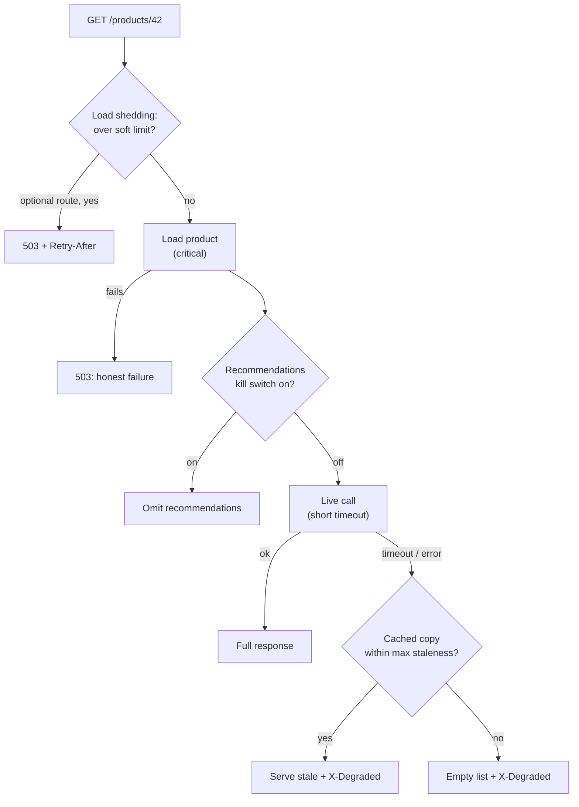

# Graceful Degradation

> [!TIP]
> **In one line:** When a dependency or the system itself is under stress, deliberately serve a reduced but useful response instead of failing completely, and tell clients what was reduced.
>
> **In plain English:** When a restaurant's card reader breaks, a good restaurant still serves dinner and asks for cash. When the dessert chef is out, the menu shrinks, but nobody is turned away at the door. Graceful degradation is deciding, ahead of time, what your service drops first.
>
> **You'll be able to:** rank features into must-have and nice-to-have · implement stale-while-error fallbacks, kill switches and load shedding · signal degraded responses clearly to clients and to dashboards

## Why This Matters

Every technique in this part so far, timeouts, retries, circuit breakers and bulkheads, ends in the same place: some call has failed and your code must decide what to do next. If the only answer is "return a 500", then every dependency is a hard requirement and your availability is the *product* of all your dependencies' availabilities. Ten dependencies at 99.9% each give you roughly 99% for any request that needs all ten, about seven hours of downtime a month instead of forty-four minutes.

Most dependencies are not equally important. A product page needs the product, but not necessarily the recommendations, the review summary, the live stock count or the personalised banner. A checkout needs payment, but not the loyalty-points preview. If those optional pieces fail, a degraded page that loads in 200 ms is almost always better for the user and for the business than an error page. Graceful degradation is the practice of designing that downgrade path on purpose, rather than discovering at 3 a.m. what your service does by accident when something breaks.

## Core Concept

**Graceful degradation** means a system keeps delivering its *core* function, with reduced quality, completeness or freshness, when parts of it fail or when it is overloaded. It differs from simply "handling errors" in that the fallback is a designed, tested, product-approved behaviour, not an incidental `try/except`.

Four families of degradation cover most cases:

1. **Fallback data.** Serve something else when live data is unavailable: a cached copy, the last known good value, a precomputed default, or a simpler computation. Serving expired cache data when the origin errors is called **stale-while-error** (formalised for HTTP caches in `stale-if-error`, RFC 5861).
2. **Feature removal.** Omit an optional component: return the page without recommendations, hide the "similar items" panel, skip enrichment.
3. **Reduced quality.** Return an approximate answer: a cheaper algorithm, lower image resolution, a smaller model, an unpersonalised ranking.
4. **Load shedding.** Under overload, deliberately reject a fraction of work, starting with the least valuable, so that the rest completes. This protects the system itself rather than one dependency.

The unifying prerequisite is a **ranking of your functionality**: what is critical (must work or fail honestly), what is important (degrade to stale or reduced), and what is optional (drop first). That ranking is a product decision, not just an engineering one, and it should be written down.

## Mental Model

A ship in a storm jettisons cargo, not the engine room. Sailors have decided in advance what goes over the side first, and everyone agrees the lifeboats and the engine are last. If nobody had thought about it, the choice would be made in a panic, or by the waves. Your service's "cargo list" is the ordered set of features you will shed to keep the core afloat.

## How It Works

**Step 1: classify.** For each endpoint, list its dependencies and mark each as critical, degradable or optional. For degradable ones, write the fallback: "recommendations: serve last good result up to one hour old, else an empty list". For critical ones, define the honest failure: a fast `503` with `Retry-After`, not a hang.

**Step 2: bound the wait.** A fallback only helps if you reach it quickly. Each dependency call needs a short [timeout](timeouts.md) well below the user's patience, otherwise the "fallback" arrives after the page has already timed out. Pair this with [bulkheads](bulkheads.md) so a slow optional dependency cannot hold shared resources, and with [circuit breakers](circuit-breakers.md) so an open breaker routes straight to the fallback without waiting.

**Step 3: stale-while-error.** Keep recent good responses (in-process, in [Redis](../07-caching-performance/README.md) or at a CDN). On failure, serve a cached value if it is within a maximum staleness you have agreed is acceptable, and mark the response as stale. Freshness is a business parameter: a stock price may tolerate seconds, a product description days, a country list months.

**Step 4: kill switches and feature flags.** Operators need to be able to turn a feature off *without a deploy*: a flag that skips the recommendations call entirely. During an incident, the fastest mitigation is often removing load by disabling the optional feature that is hammering a struggling dependency. Flags need defaults that are safe if the flag service itself is down, and they need to be exercised, since a switch that has never been flipped may not work.

**Step 5: load shedding.** When in-flight requests or queue depth or latency cross a threshold, reject new work early and cheaply, optional first. For example, shed anything marked low priority above 80% of capacity and everything but critical routes above 100%. Rejecting at the front is far cheaper than accepting work you will time out on halfway, and prevents the overload spiral where queues grow, latencies rise, clients retry, and load increases further. Return `503` with `Retry-After` so well-behaved clients back off (and add [jitter](jitter.md) to that value). Load shedding differs from [rate limiting](rate-limiting.md): a rate limit is a per-client fairness rule applied under normal conditions, while shedding is a global survival response to overload.

**Step 6: communicate the degraded state.** Silent degradation is dangerous: users and downstream systems may assume complete data. Tell them, in both machine- and human-readable forms. A header such as `X-Degraded: recommendations`, a `degraded` array in the JSON body, or a `Warning`-style field lets clients render "recommendations unavailable" instead of an empty, misleading panel. For stale HTTP responses, the `Age` header and `Cache-Control: stale-if-error` describe how old a copy is. Also tell *yourselves*: emit a metric and a log field for every fallback taken, because a service that degrades silently for a week is a service with an undetected outage.

**Step 7: never degrade correctness for critical writes.** Degrade reads, enrichment and quality; do not degrade invariants. You can skip the loyalty-points preview, but you must not skip the balance check on a payment or serve a stale authorisation decision. Fallbacks that fail *open* on security checks, such as "if the auth service is down, let everyone in", are not graceful degradation; they are vulnerabilities. Decide explicitly, per check, whether to fail open or closed, and prefer closed for authorisation and payments.

## Architecture



## Request / Response Example

A healthy response, and the same endpoint while the recommendation service is down, serving a copy cached 12 minutes ago:

```http
GET /products/42 HTTP/1.1
Host: shop.example.com
Accept: application/json
```

```http
HTTP/1.1 200 OK
Content-Type: application/json

{"id": "42", "name": "Widget", "recommendations": ["77", "81"], "degraded": []}
```

```http
HTTP/1.1 200 OK
Content-Type: application/json
X-Degraded: recommendations
Age: 720

{"id": "42", "name": "Widget", "recommendations": ["77", "81"], "degraded": ["recommendations"]}
```

Under severe overload an optional route is shed before critical routes:

```http
GET /optional/trending HTTP/1.1
Host: shop.example.com
```

```http
HTTP/1.1 503 Service Unavailable
Retry-After: 2
Content-Type: application/json

{"detail": "Shedding load, retry shortly"}
```

## Code Example

FastAPI with a stale-while-error helper, an environment-controlled kill switch, priority-aware load shedding and a degraded-state header. The last function sketches degrading an LLM feature with a pseudo-SDK (comments mark where a provider call would go). The tests cover live, stale and default paths, timeouts and shedding order. They were run with `asyncio.run`; with pytest use `pytest.mark.asyncio`.

```python
import asyncio
import os
import time
from dataclasses import dataclass, field
from typing import Any, Awaitable, Callable

from fastapi import FastAPI, Request, Response
from fastapi.responses import JSONResponse


@dataclass
class StaleCache:
    """Tiny in-process cache that can serve fresh OR stale values (stale-while-error)."""
    clock: Callable[[], float] = time.monotonic
    _data: dict[str, tuple[Any, float]] = field(default_factory=dict)

    def put(self, key: str, value: Any) -> None:
        self._data[key] = (value, self.clock())

    def get(self, key: str, max_age: float) -> Any | None:
        item = self._data.get(key)
        if item is None or self.clock() - item[1] > max_age:
            return None
        return item[0]


CACHE = StaleCache()
MAX_STALE = 3600.0     # a cached value may be served as a fallback for up to 1 hour


async def fetch_with_fallback(
    key: str, fetch: Callable[[], Awaitable[Any]], default: Any, timeout: float = 0.3,
) -> tuple[Any, str]:
    """Return (value, source). source is one of: live, stale, default."""
    try:
        value = await asyncio.wait_for(fetch(), timeout)   # short, per-dependency timeout
        CACHE.put(key, value)
        return value, "live"
    except Exception:                                      # timeout, connection error, 5xx mapped to an exception
        stale = CACHE.get(key, MAX_STALE)
        if stale is not None:
            return stale, "stale"                          # last known good beats nothing
        return default, "default"                          # static, safe fallback


class LoadShedder:
    """Reject optional work first when the process is busy, protected work last."""
    def __init__(self, soft_limit: int, hard_limit: int) -> None:
        self.soft_limit, self.hard_limit, self.in_flight = soft_limit, hard_limit, 0

    def admit(self, optional: bool) -> bool:
        limit = self.soft_limit if optional else self.hard_limit
        return self.in_flight < limit


SHEDDER = LoadShedder(soft_limit=80, hard_limit=100)
app = FastAPI()


@app.middleware("http")
async def shed_load(request: Request, call_next):
    # Convention: paths under /optional/ are nice-to-have (recommendations, previews).
    optional = request.url.path.startswith("/optional/")
    if not SHEDDER.admit(optional):
        return JSONResponse({"detail": "Shedding load, retry shortly"}, status_code=503,
                            headers={"Retry-After": "2"})
    SHEDDER.in_flight += 1
    try:
        return await call_next(request)
    finally:
        SHEDDER.in_flight -= 1


async def fetch_recommendations(product_id: str) -> list[str]:
    await asyncio.sleep(0.05)                    # stand-in for a remote call
    return [f"{product_id}-related-1", f"{product_id}-related-2"]


@app.get("/products/{product_id}")
async def product(product_id: str, response: Response):
    degraded: list[str] = []
    # Kill switch: ops can turn the feature off without a deploy (env var here; a flag service in real life).
    if os.getenv("DISABLE_RECOMMENDATIONS") == "1":
        recs, source = [], "disabled"
    else:
        recs, source = await fetch_with_fallback(f"recs:{product_id}",
                                                 lambda: fetch_recommendations(product_id), default=[])
    if source in ("stale", "default", "disabled"):
        degraded.append("recommendations")
    if degraded:
        response.headers["X-Degraded"] = ",".join(degraded)   # machine-readable signal
    return {"id": product_id, "name": "Widget", "recommendations": recs,
            "degraded": degraded}                              # human/UI-readable signal


# --- LLM feature degradation (pseudo-SDK, not a real vendor API) ---
async def summarize(text: str) -> tuple[str, str]:
    try:
        # summary = await llm.complete(model="large-model", prompt=..., timeout=8)
        raise TimeoutError                      # simulate provider trouble
    except Exception:
        pass
    try:
        # summary = await llm.complete(model="small-fast-model", prompt=..., timeout=3)
        raise TimeoutError
    except Exception:
        return text[:200].rsplit(" ", 1)[0] + "...", "extractive-fallback"   # no model, still useful


# --- tests ---
async def test_live_then_stale_then_default():
    ok = True

    async def flaky() -> list[str]:
        if not ok:
            raise ConnectionError
        return ["a"]

    assert await fetch_with_fallback("k1", flaky, []) == (["a"], "live")
    ok = False
    assert await fetch_with_fallback("k1", flaky, []) == (["a"], "stale")     # last known good
    assert await fetch_with_fallback("never-seen", flaky, ["x"]) == (["x"], "default")


async def test_timeout_triggers_fallback():
    async def hang() -> list[str]:
        await asyncio.sleep(5)
        return ["late"]

    value, source = await fetch_with_fallback("k2", hang, [], timeout=0.05)
    assert (value, source) == ([], "default")


def test_shedder_drops_optional_first():
    s = LoadShedder(soft_limit=2, hard_limit=4)
    s.in_flight = 2
    assert not s.admit(optional=True) and s.admit(optional=False)
    s.in_flight = 4
    assert not s.admit(optional=False)
```

A few details. `fetch_with_fallback` catches `Exception` deliberately at this boundary because *any* failure of an optional dependency should degrade; for critical dependencies you would let errors propagate. The in-process cache is per replica and unbounded as written; a real one needs a size limit (an LRU) and ideally a shared store. The in-flight counter in the middleware is safe in a single asyncio event loop because it is only changed between awaits. And `X-Degraded` is a convention, not a standard header; choose a name and document it.

## Production Considerations

- **Test the fallbacks.** Degradation paths rot because they rarely run. Exercise them with fault injection (kill a dependency in staging), game days, and unit tests that force each branch.
- **Bound staleness explicitly.** "Serve stale on error" without a maximum age can serve week-old prices. Set a per-field limit and expire beyond it.
- **Cache poisoning of fallbacks.** Do not cache the *fallback* as if it were real data, or the empty list will be served long after the dependency recovers. Cache only live results, as the helper does.
- **Alert on degradation.** Track the fraction of responses with each degraded flag. Make "recommendations degraded for more than 10 minutes" page someone, or it will quietly become the new normal.
- **Cascading degradation.** A degraded response from service A may be an input to service B. Propagate the degraded signal so B does not treat fallback data as authoritative.
- **Client behaviour.** Document what clients should do on `X-Degraded` and on `503 + Retry-After`, including backing off with jitter. Mobile and web clients should render an explicit "unavailable" state, not a blank.
- **Capacity under fallback.** Serving from cache or defaults is usually cheaper, but a thundering herd returning when the dependency recovers can knock it over again; ramp recovery with jittered cache expiry and a half-open breaker.
- **Compliance and correctness.** For regulated data (balances, medical, pricing contracts), stale data may be unacceptable. Mark such fields non-degradable.

## Common Mistakes

- **No ranking of features,** so everything is treated as critical and any failure is a total failure.
- **Fallbacks that take as long as the failure.** A degraded path that waits 30 seconds for a timeout before falling back is not graceful.
- **Silent degradation.** No header, no metric, no log, so nobody notices the service has been partly broken for days.
- **Failing open on security.** Treating an unavailable authorisation service as "allow".
- **Serving unbounded-stale data** as if it were current.
- **Untested kill switches,** or flags whose evaluation depends on the very system that is failing.
- **Shedding the wrong traffic,** such as health checks or the critical write path, while optional work continues.
- **Confusing load shedding with rate limiting,** and applying per-client limits as the response to a global overload.

## Best Practices

- Write down a criticality ranking per endpoint and the fallback for each degradable dependency.
- Use short timeouts so fallbacks are reached quickly, and combine with bulkheads and circuit breakers.
- Prefer stale-while-error with an explicit maximum age, and never cache the fallback itself.
- Provide runtime kill switches with safe defaults, and rehearse them.
- Shed optional load first, reject early and cheaply with `503` and `Retry-After`.
- Surface degraded state to clients and to metrics, and keep security and payment invariants strict.

## AI Engineering Perspective

LLM features are the most degradable, and most failure-prone, parts of many products, so they reward a deliberate ladder of fallbacks. A typical ladder: the primary large model, then a smaller or faster model, then a second provider, then a cached answer for a similar question (see semantic caching in [Part 15](../15-production-ai-systems/README.md)), then a non-LLM fallback such as keyword search results or an extractive summary, and finally an honest "this feature is temporarily unavailable". Each rung trades quality for availability, and the response should say which rung served it, since users and evaluators care. Cost is another trigger: when a token budget is nearly exhausted, degrade to a cheaper model or shorter output rather than failing. In RAG, if the vector store is slow, fall back to keyword search; if reranking times out, return the unranked top-k (see [Part 16](../16-rag-apis/README.md)). Streaming helps degradation too, because partial output can be shown while the rest is still generating. In agent systems (see [Part 17](../17-ai-agents-and-mcp/README.md)), a failed optional tool should produce a clear tool-error message the model can reason about, not crash the run. Always keep safety filters and authorisation checks fail-closed, even when everything else is degrading.

## Exercises

**Beginner**
1. For an e-commerce product page, list five components (title, price, stock level, reviews, recommendations) and classify each as critical, degradable or optional. State the fallback for each degradable one.

**Intermediate**
2. A service depends on ten components, each 99.9% available and all required. Compute the combined availability. Then make four of them optional with fallbacks and compute it again. What is the difference in expected monthly downtime?
3. Add a maximum-age check and an LRU size limit to `StaleCache`, then write a test proving that a value older than the maximum is not served.

**Advanced**
4. Design load shedding for an API with three priority classes. Choose the signals (in-flight count, queue delay, CPU), the thresholds, and how you prevent flapping. Explain how clients should behave on receiving the `503`s.

## Key Takeaways

- Rank functionality as critical, degradable or optional, and decide the fallback for each before an incident.
- Reach fallbacks fast with short timeouts, and use stale-while-error, kill switches, reduced quality and load shedding as the main tools.
- Always signal degraded state to clients and metrics; silent degradation hides outages.
- Degrade enrichment and quality, never correctness or security: fail closed for authorisation and payments.

### Check Yourself

<details markdown="1">
<summary>1. What is the difference between stale-while-error and ordinary caching?</summary>

Ordinary caching serves fresh-enough data to save work. Stale-while-error serves an expired copy only when the live call fails, trading freshness for availability within a maximum staleness you have chosen.

</details>

<details markdown="1">
<summary>2. Why should load shedding reject optional traffic before critical traffic, and why reject early?</summary>

Under overload not all work can finish, so you want the capacity spent on the most valuable work. Rejecting at the front is cheap, whereas accepting work that will time out wastes capacity and fuels a retry-driven overload spiral.

</details>

<details markdown="1">
<summary>3. Your recommendation fallback returns an empty list and a developer caches that result for an hour. What goes wrong and how do you avoid it?</summary>

After the service recovers, users keep getting empty recommendations until the cache entry expires, so the degradation outlasts the failure. Cache only live results, never the fallback, and keep the degraded flag out of the cached value.

</details>

---
Back to the [Part 6 README](README.md).
