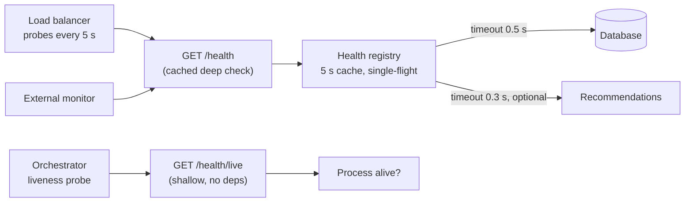

# Health Checks

> [!TIP]
> **In one line:** A health endpoint says whether an instance can do its job right now; its depth, speed and audience decide whether it helps or causes outages.
>
> **In plain English:** A doctor asking "are you breathing?" gets a quick yes. A full blood test tells you much more but takes time, costs money, and you would not run it on every patient every second. Health checks need both kinds of question, asked at the right frequency by the right people.
>
> **You'll be able to:** design shallow and deep health endpoints and decide what each should check · avoid the dependency-check traps that turn a blip into an outage · implement timeouts, caching and safe response formats

## Why This Matters

Something has to decide whether an instance should receive traffic: a load balancer, a service mesh, an orchestrator, a deploy script, an uptime monitor, an on-call engineer with `curl`. All of them ask the service the same kind of question, and all of them act on the answer automatically and at scale. A health endpoint is therefore not documentation; it is a *control signal* wired into systems that remove instances from rotation, restart them, or roll back a release.

That makes it unusually easy to cause damage. A check that is too shallow reports "healthy" for an instance whose database connection is dead, so the load balancer keeps sending it requests that all fail. A check that is too deep reports "unhealthy" on every instance the moment a shared dependency blips, so the load balancer removes the *entire* fleet and a ten-second hiccup becomes a full outage. A check that is slow, or expensive, or unbounded can overload the very dependency it is measuring. Getting health checks right means thinking about what each check is *for* and what will happen when it returns the wrong answer.

This chapter covers the design of the endpoints and their checks. The next chapter, [Readiness and Liveness Probes](readiness-and-liveness-probes.md), covers how Kubernetes uses them and the specific mistakes that trigger restarts and traffic loss.

## Core Concept

A **health check** is a cheap, bounded request whose response says whether a service instance is in a state where it can usefully do its work. It returns a status code (conventionally `200` for healthy, `503` for unhealthy) and optionally a small body with detail.

The central design axis is **depth**:

- **Shallow check (liveness-style):** verifies only that the process is running and can serve an HTTP request: the event loop is turning, the web server answers. It touches no external dependencies. It cannot tell you the database is down, but it also cannot fail because the database is down.
- **Deep check (dependency-aware):** verifies that the instance can reach and use the things it needs: a database query, a cache ping, a downstream API call. It can tell you the instance is *useless* even though the process is alive.

Neither is "better". They answer different questions and are consumed by different actors, which is why mature services expose more than one endpoint or more than one level. A useful framing is to ask, for each consumer, *what action will it take on a failure?*

| Consumer | Action on failure | Wants |
|---|---|---|
| Orchestrator restart (liveness) | Kill and restart the process | Shallow only: fail only if restarting would help |
| Load balancer / readiness | Stop sending traffic to this instance | Checks of dependencies this instance *specifically* needs |
| Uptime monitor / dashboard | Page a human | Deep or end-to-end, run from outside, at modest frequency |
| Deploy tooling | Halt or roll back a rollout | Deep, plus a version/build identifier |

## Mental Model

Think of an aircraft's pre-flight and in-flight indicators. The "engine running" light is shallow and instant; a pilot glances at it constantly. The full pre-flight checklist walks through fuel, flaps, instruments and takes minutes, so it is done at specific moments, not every second. And no one designs the system so that a faulty cabin reading-light sensor grounds the whole airline. Match the depth of the check to the importance of the decision and how often it is made.

## How It Works

**What a shallow check does.** It returns `200 {"status":"ok"}` from a handler that touches nothing. It proves the process is up and the server is accepting and answering connections. Because it has no dependencies, it is safe to call very often (every second), safe to wire to automatic restarts, and it will not flap when a downstream service has trouble.

**What a deep check does.** It runs a small set of named checks, usually concurrently:

- **Database:** acquire a connection from the *application's own pool* and run `SELECT 1`. Using the real pool tests the real path, including pool exhaustion; opening a private connection would test something your requests do not use.
- **Cache / message broker:** a `PING` or equivalent no-op.
- **Critical downstream APIs:** only if the instance truly cannot serve without them, using a lightweight endpoint, not a full business call.
- **Local prerequisites:** required configuration loaded, migrations at the expected version, a model or index loaded into memory, disk space and file descriptors, an expected feature of the host.

Each check has its own **timeout**, shorter than the caller's probe timeout, and the endpoint reports per-check status, for example `ok`, `degraded` (optional dependency failing) and `fail` (critical dependency failing). Only critical failures turn the HTTP status into `503`. The decision "is this dependency critical?" is the same ranking you make for [graceful degradation](graceful-degradation.md): if the service can still serve useful responses without it, a failure there must not take the instance out of rotation.

**The dangers of dependency checks.** These are the heart of the topic.

1. **Correlated failure.** If every instance reports unhealthy when a *shared* dependency (the database) is down, every instance is removed at once. The load balancer now has zero healthy targets. Even if some requests (cached reads, health pages, static content) could have been served, none are. Many load balancers have a "panic" or fail-open mode that routes to all targets when none are healthy, but you should not rely on that to rescue a bad design. Rule of thumb: an instance's *readiness* should depend on things that are **local to that instance** (it can reach the database *and* has finished warming up), and shared-dependency outages should be handled by degradation and fast failure, not by emptying the fleet.
2. **Self-inflicted load.** Suppose 200 instances are probed every 2 seconds by 3 different systems and each probe runs a database query: that is 300 queries per second of pure health overhead, and it rises as you scale out. Under stress, when the database is slow, the probes compete with real queries. Keep probes cheap, cache their results, and probe less often than you think.
3. **Cascading restarts.** Wiring a deep check to a *liveness* probe means a database outage makes the orchestrator restart every pod, which then boots, reconnects and loads the database again. Never restart a healthy process because something else is broken.
4. **Probes that hang.** A check without a timeout can block a worker for as long as the dependency hangs. A pile of hung probes then saturates the server, and the instance looks dead because of the health check itself.
5. **Leaking information.** Verbose health output (hostnames, versions, connection strings, dependency topology) is reconnaissance material for attackers. Keep detail minimal on public paths.

**Timeouts, layered.** Keep a strict ordering: each individual check timeout (for example 300 to 500 ms) is below the endpoint's total budget, which is below the prober's timeout (for example 1 to 2 seconds), which is below its interval. If the prober gives up before the endpoint does, you get ambiguous failures and wasted work. Run checks concurrently so the endpoint's worst-case time is the slowest check, not the sum.

**Cache the result.** Compute the deep result at most once every few seconds (for instance 5) and return the cached value to all probes in between. Use a single-flight lock so that concurrent probes share one real run instead of each launching a query. The trade-off is staleness equal to the TTL, which is acceptable for health signals that are polled on a timescale of seconds. For latency-critical failover, keep TTLs short (1 to 2 seconds).

**Response format.** The status code is what machines act on. A small JSON body helps humans. There is an IETF Internet-Draft for a `application/health+json` format (fields like `status`, `checks`, `version`), which is a reasonable shape to borrow but is not a finished standard. Return `Cache-Control: no-store` so intermediaries do not cache a health answer.

**Passive and synthetic signals complement active checks.** Real traffic is the best health signal: outlier detection in a proxy or mesh ejects an instance that returns many 5xx. A synthetic monitor that runs a real end-to-end transaction from outside the cluster catches failures (DNS, certificates, routing, auth) that no in-process check can see. Use active checks for fast, local decisions, and external synthetic checks for "does it actually work for users".

## Architecture



## Request / Response Example

Shallow:

```http
GET /health/live HTTP/1.1
Host: orders-7f9c.internal:8000
```

```http
HTTP/1.1 200 OK
Content-Type: application/json

{"status": "ok"}
```

Deep, all good, with an optional dependency failing (still `200`, flagged as degraded):

```http
GET /health HTTP/1.1
Host: orders-7f9c.internal:8000
```

```http
HTTP/1.1 200 OK
Content-Type: application/json
Cache-Control: no-store

{"status": "degraded",
 "checks": {"database": {"status": "ok", "latency_ms": 4},
            "recommendations": {"status": "degraded", "latency_ms": 300}}}
```

Deep, with the critical database unreachable (the check timed out at 500 ms):

```http
HTTP/1.1 503 Service Unavailable
Content-Type: application/json
Cache-Control: no-store

{"status": "fail",
 "checks": {"database": {"status": "fail", "latency_ms": 500},
            "recommendations": {"status": "ok", "latency_ms": 12}}}
```

## Code Example

A FastAPI health registry: named checks with individual timeouts and a criticality flag, concurrent execution, a short single-flight cache, a shallow endpoint with no dependencies, and exception text deliberately not exposed. The database check borrows a connection from the application's pool; the URL comes from the environment. Tests (run with `asyncio.run`; with pytest use `pytest.mark.asyncio`) verify caching under 20 concurrent probes, expiry, timeouts on a hung dependency, and that an optional failure only degrades.

```python
import asyncio
import os
import time
from dataclasses import dataclass
from typing import Any, Awaitable, Callable

from fastapi import FastAPI, Response
from sqlalchemy import text
from sqlalchemy.ext.asyncio import create_async_engine


@dataclass(frozen=True)
class Check:
    name: str
    fn: Callable[[], Awaitable[None]]   # raises on failure, returns None on success
    critical: bool = True               # critical failures make the service "fail"
    timeout: float = 0.5                # seconds; a hung dependency must not hang the probe


class HealthRegistry:
    def __init__(self, checks: list[Check], ttl: float = 5.0,
                 clock: Callable[[], float] = time.monotonic) -> None:
        self.checks, self.ttl, self.clock = checks, ttl, clock
        self._lock = asyncio.Lock()
        self._cached: tuple[float, dict[str, Any]] | None = None

    async def _run_one(self, c: Check) -> tuple[str, dict[str, Any]]:
        start = self.clock()
        try:
            await asyncio.wait_for(c.fn(), c.timeout)
            status = "ok"
        except Exception:                 # includes TimeoutError; never leak exception text publicly
            status = "fail" if c.critical else "degraded"
        return c.name, {"status": status, "latency_ms": round((self.clock() - start) * 1000)}

    async def report(self) -> dict[str, Any]:
        async with self._lock:            # single-flight: concurrent probes share one run
            if self._cached and self.clock() - self._cached[0] < self.ttl:
                return self._cached[1]
            results = dict(await asyncio.gather(*(self._run_one(c) for c in self.checks)))
            statuses = {r["status"] for r in results.values()}
            overall = "fail" if "fail" in statuses else "degraded" if "degraded" in statuses else "ok"
            body = {"status": overall, "checks": results}
            self._cached = (self.clock(), body)
            return body


engine = create_async_engine(os.environ["DATABASE_URL"], pool_pre_ping=True)


async def check_database() -> None:
    async with engine.connect() as conn:          # uses the same pool the app uses
        await conn.execute(text("SELECT 1"))      # cheap query: proves a connection and a round trip


async def check_recommendations() -> None:
    # Optional dependency: probe with a very cheap call, e.g. await client.get(url + "/ping")
    await asyncio.sleep(0)


REGISTRY = HealthRegistry([
    Check("database", check_database, critical=True, timeout=0.5),
    Check("recommendations", check_recommendations, critical=False, timeout=0.3),
])

app = FastAPI()


@app.get("/health/live")
async def live() -> dict[str, str]:
    # Shallow: no dependencies. Answers "is this process able to serve HTTP at all?"
    return {"status": "ok"}


@app.get("/health")
async def health(response: Response) -> dict[str, Any]:
    body = await REGISTRY.report()
    response.status_code = 503 if body["status"] == "fail" else 200   # "degraded" is still 200
    response.headers["Cache-Control"] = "no-store"
    return body


# --- tests (pytest-asyncio style; run here with asyncio.run) ---
class FakeClock:
    def __init__(self) -> None:
        self.t = 0.0

    def __call__(self) -> float:
        return self.t


async def test_results_are_cached_and_critical_failure_is_reported():
    calls = {"db": 0}

    async def db() -> None:
        calls["db"] += 1
        raise ConnectionError("down")

    clock = FakeClock()
    reg = HealthRegistry([Check("database", db)], ttl=5.0, clock=clock)
    first = await reg.report()
    await asyncio.gather(*(reg.report() for _ in range(20)))   # 20 probes inside the TTL
    assert first["status"] == "fail" and calls["db"] == 1      # only one real check ran
    clock.t = 6.0
    await reg.report()
    assert calls["db"] == 2                                    # cache expired, rechecked


async def test_hung_dependency_times_out_and_optional_only_degrades():
    async def hang() -> None:
        await asyncio.sleep(10)

    async def fine() -> None:
        return None

    reg = HealthRegistry([Check("db", fine), Check("recs", hang, critical=False, timeout=0.05)])
    body = await reg.report()
    assert body["status"] == "degraded"
    assert body["checks"]["recs"]["status"] == "degraded"
```

Two choices to notice. `degraded` still returns `200`, so an optional dependency never removes the instance from rotation. And the shallow `/health/live` shares no code with the registry, so a bug or hang in a dependency check cannot make the liveness endpoint fail. A caveat on the cache: the clock and TTL are per instance, so with many replicas the dependency still sees roughly `replicas / TTL` checks per second; that is the figure to budget for.

## Production Considerations

- **Separate endpoints by purpose.** At minimum, one shallow endpoint for liveness and one dependency-aware endpoint for readiness and monitoring. Do not point every consumer at one path.
- **Budget probe load.** Calculate `instances × probers × (1 / interval)` and confirm the dependency can absorb it, then cache to cut it.
- **Make the check representative but cheap.** `SELECT 1` through the pool proves connectivity but not that a specific table is readable or that queries are fast. Add a deeper scheduled synthetic check rather than slowing the fast one.
- **Protect the endpoint.** Expose health on an internal port or network path where possible, strip verbose detail from public responses, and rate-limit it (see [Rate Limiting](rate-limiting.md)) if it is reachable from outside.
- **Include the build.** Returning a version or git SHA in an authenticated or internal response lets deploy tooling confirm *which* build is answering.
- **Fail closed at startup.** During boot, report unhealthy until configuration is loaded and critical resources are connected, so an instance never takes traffic early. (Kubernetes models this explicitly; see the next chapter.)
- **Graceful shutdown.** On SIGTERM, flip the readiness answer to unhealthy before stopping, so the load balancer drains you first.
- **Observe the checks.** Export per-check latency and status as metrics. A dependency check that is slowly getting slower is an early warning no one will see if you only look at the boolean.

## Common Mistakes

- **Always returning `200`.** The endpoint exists, but it checks nothing; the load balancer happily routes to a broken instance.
- **Checking every dependency, critical or not.** One flaky optional service takes the whole instance out of rotation.
- **Deep checks on the liveness path,** which restarts healthy processes during a dependency outage.
- **No per-check timeout,** so a hung dependency hangs the health endpoint and then the server.
- **Opening a fresh database connection per probe** instead of using the pool, or running an expensive query such as a `COUNT(*)` on a large table.
- **Probing too often, with no cache,** turning health checks into a measurable share of database load.
- **Leaking detail publicly,** such as hostnames, library versions or raw exception messages.
- **Returning `200` with `{"status": "fail"}` in the body.** Automated consumers read the status code, not your JSON.

## Best Practices

- Provide a shallow no-dependency endpoint and a bounded, dependency-aware one, and wire each consumer to the right one.
- Mark dependencies critical or optional, and fail the instance only for critical, instance-local prerequisites.
- Time-box each check, run them concurrently, and cache the result for a few seconds with single-flight.
- Use the status code as the signal (`200` or `503`), and keep the body small and non-sensitive.
- Add external synthetic checks for end-to-end behaviour, and rely on real-traffic outlier detection too.
- Track per-check latency and status as metrics, and test failure modes by actually breaking a dependency.

## AI Engineering Perspective

AI services have prerequisites that ordinary web health checks miss. A service that serves a local model must not report ready until the weights are loaded into memory (or onto the GPU) and a tiny warm-up inference has run, which can take tens of seconds or minutes. A GPU instance may be alive but unable to allocate memory or have a faulted device, so a lightweight CUDA or inference smoke test belongs in its deep check. For a gateway in front of LLM providers (see [Part 15 — Production AI Systems](../15-production-ai-systems/README.md)), do not probe the paid provider API from every instance on every interval: that costs money, burns rate-limit quota, and creates its own load. Instead infer provider health from real traffic (error rate and latency windows) and expose it as per-provider state that drives routing and fallback. A vector store or index that is still building should mark retrieval as `degraded` so the system can fall back to keyword search (see [Part 16](../16-rag-apis/README.md)) rather than failing readiness for every request. And treat an MCP server or tool dependency as optional for the agent runtime unless the product is useless without it (see [Part 17](../17-ai-agents-and-mcp/README.md)).

## Exercises

**Beginner**
1. Write the response (status code and body) your service should return for each case: all dependencies up; the optional recommendations service down; the database down. Explain why the second case is not a `503`.

**Intermediate**
2. You have 150 replicas, an external load balancer probing each every 5 seconds and a monitoring system probing each every 10 seconds. Each deep probe runs one database query. Compute queries per second with no cache, and with a 5 second cache and single-flight.
3. Add a startup gate to the registry: until a one-time `load_model()` finishes, `/health` returns `503` with a `starting` status while `/health/live` stays `200`. Write a test.

**Advanced**
4. Design health signalling for a service with a shared database where a 20-second database failover is routine. Decide what readiness checks, what degradation behaviour, and what load balancer settings (probe interval, failure threshold) avoid both a fleet-wide eviction and a long delay in removing a genuinely broken instance.

## Key Takeaways

- Health endpoints are control signals acted on automatically, so their depth, speed and failure behaviour matter more than their format.
- Keep a shallow no-dependency check for liveness and a bounded dependency-aware one for readiness and monitoring; do not restart processes because something else is broken.
- Per-check timeouts, concurrency and a short single-flight cache keep checks from hanging or overloading dependencies.
- Only critical, instance-relevant prerequisites should fail the instance; shared and optional dependencies should degrade it.

### Check Yourself

<details markdown="1">
<summary>1. What is the difference between a shallow and a deep health check, and what can each not tell you?</summary>

A shallow check only proves the process can answer HTTP, so it cannot detect a dead database connection. A deep check exercises dependencies, so it can detect an unusable instance, but it can also fail for reasons a restart cannot fix.

</details>

<details markdown="1">
<summary>2. Why can a deep health check that includes the shared database cause a total outage?</summary>

When the database blips, every instance fails its check at the same time and the load balancer removes them all, leaving no healthy targets even for requests that could have been served. The remedy is to limit what counts as critical and handle shared-dependency failures with degradation and fast failures.

</details>

<details markdown="1">
<summary>3. Your service has 80 replicas and the load balancer probes each every 2 seconds with a database query. What is the load, and how do you reduce it?</summary>

That is 80 / 2 = 40 queries per second just from health checks, growing with replicas and probers. Cache the deep result for about 5 seconds with single-flight per instance, and keep the check to a trivial query through the existing pool.

</details>

---
Back to the [Part 6 README](README.md).
