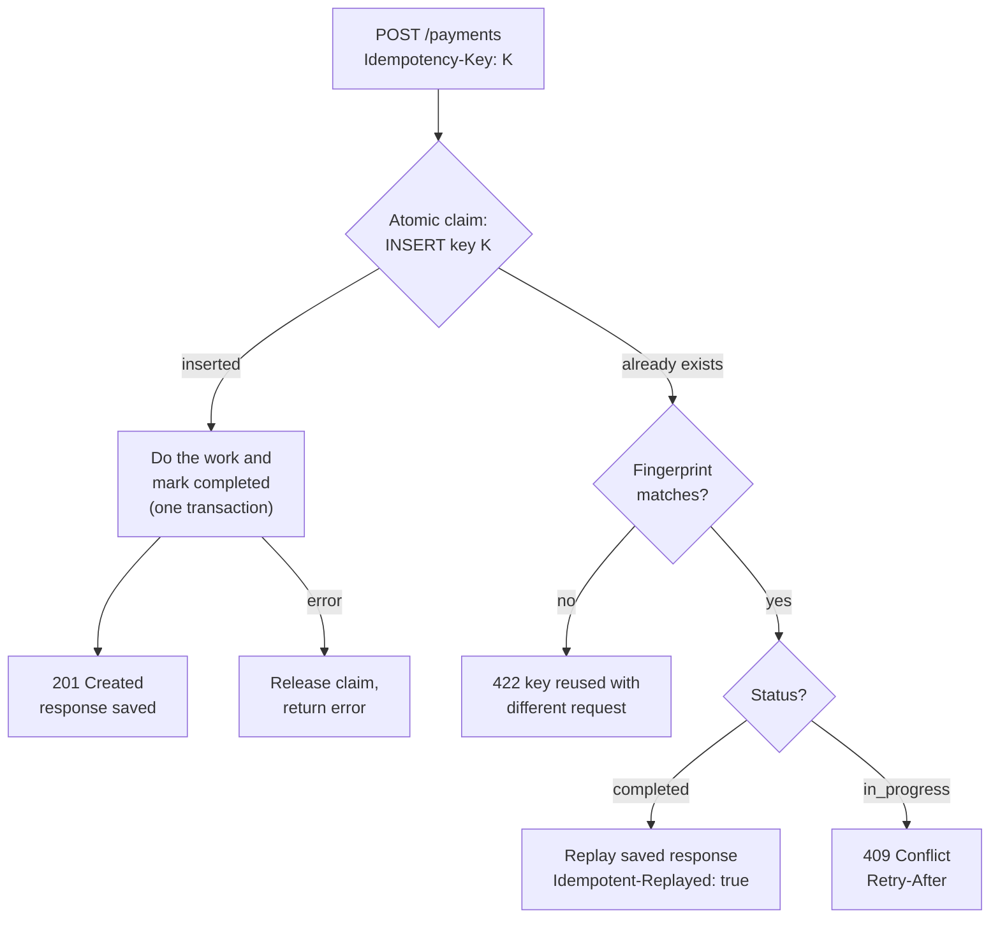

# Idempotency in Practice

> [!TIP]
> **In one line:** Store each request's Idempotency-Key with an atomic insert, replay the saved response on retries, and reject reuse of a key with a different payload.
>
> **In plain English:** A restaurant that stamps each order slip with a number can tell "the same order, sent twice" from "a new order". The kitchen cooks once and the waiter just repeats what was already served. An idempotency key is that order number for API requests.
>
> **You'll be able to:** design an idempotency-key table with a unique constraint · handle in-progress, completed and mismatched replays with the right status codes · name what idempotency keys do not protect you from

## Why This Matters

[Part 2's idempotency chapter](../02-rest-api-design/idempotency.md) explains *why* `POST` is not idempotent and why a client that times out cannot know whether the server acted. This chapter is the implementation half. The failure it prevents is concrete: a client calls `POST /payments`, the server charges the card and commits, the response is lost in a proxy, the client times out and retries (exactly what [Retries](retries.md) tells it to do), and the customer is charged twice. Two engineers following good advice, retrying on the client and committing on the server, together produced the bug.

The fix is cheap compared with the damage, but easy to get subtly wrong. Naive implementations do `SELECT` the key, find nothing, then `INSERT`, which lets two concurrent retries both pass the check. They store the key but not what request it belonged to, so a bug that reuses a key silently returns the wrong response. They never expire keys, so the table grows forever. This chapter walks through a design that avoids those traps.

## Core Concept

An **idempotency key** is a unique, client-generated identifier (a UUID is typical) sent in an `Idempotency-Key` header with a state-changing request. The server promises: *for a given key, the effect happens at most once, and every retry gets the same answer as the first attempt.* To keep that promise the server needs three things.

1. **An atomic claim.** The first request to present a key must be able to say "this is mine" in a way no concurrent request can also say. The reliable tool is a database **unique constraint** (or primary key): `INSERT` either succeeds or fails, and the database serializes the race for you. A check-then-insert in application code is not atomic.
2. **A fingerprint of the request.** The server stores a hash of what the key was first used for (method, path, canonical body). A retry must match it. If it does not, the client has a bug (key reuse), and replaying the old response would hide it.
3. **A saved outcome.** Once the work is done, the server stores the response status and body so later retries can be answered without redoing the work.

The key's lifecycle has two states that matter: **in progress** (claimed, work underway) and **completed** (result saved). Distinguishing them is what lets the server answer a concurrent duplicate sensibly.

## Mental Model

Think of a hotel front desk handing out one room key per booking reference. If the same reference is presented twice, the desk does not cut a second key; it looks up the booking and hands back the first one. If someone presents the same reference but asks for a different room or dates, the clerk says "that reference is for a different booking", not silently giving them the old room. And if two people present the same reference at the same instant, one of them waits at the desk while the other is served. The booking reference is the key, the ledger is the table, and "different dates" is the fingerprint mismatch.

## How It Works

**Request arrives.** The server requires `Idempotency-Key` on the endpoints that need it (missing key: `400`). It computes the fingerprint: `sha256(method + path + canonical_body)`. Canonicalization matters, because `{"a":1,"b":2}` and `{ "b": 2, "a": 1 }` are the same request.

**Claim.** One SQL statement inserts a row `(user_id, key, request_hash, status='in_progress', locked_at, expires_at)`. The primary key `(user_id, key)` is the unique constraint. Scoping by user (or API client or tenant) matters: it stops one customer's key from colliding with, or probing, another's. If the insert succeeds, this request owns the key.

**Not the owner.** If the row already exists, read it and branch:

| Existing row | Response |
|---|---|
| fingerprint differs | `422 Unprocessable Content`. The key was used for a different request. |
| `completed` | Replay the stored status and body. Add a header such as `Idempotent-Replayed: true`. |
| `in_progress`, claim is fresh | `409 Conflict` with `Retry-After`. The first attempt is still running. |
| `in_progress`, claim is stale | A crash left it behind. Take it over (see below). |

The `409` for in-flight and `422` for mismatched payloads follow the IETF draft for the `Idempotency-Key` header and are also common in public APIs; some providers use `400` or `409` for mismatches. Pick one convention, document it, and keep it stable.

**Do the work, then complete atomically.** The business write (insert the payment) and the update that marks the key `completed` with the saved response should commit in **one transaction**. Then there is no state where the money moved but the key is not marked done. This is only fully possible for effects inside your own database. If the work calls an external provider, the call happens before the commit and you cannot roll the provider back, so forward the *same* key to the provider (most payment APIs accept one) so that a replay after a crash is deduplicated downstream too.

**Failure handling.** If the work fails with an exception you know did not complete it, delete the claim (or mark it failed) so the client's retry can run. If the process crashes, nothing runs `except`, so the row stays `in_progress`. That is why the row carries `locked_at`: after a lock timeout (longer than your longest legitimate request, say 60 seconds), a retry with the same fingerprint may take over the claim. This is a deliberate trade-off. Takeover can fire while the original is merely slow, so the work itself should still be protected against duplicates, for example by a unique constraint on the payment's own business reference.

**Expiry.** Keys are not forever. A TTL (commonly 24 hours; Stripe documents 24 hours for its keys) bounds table growth and defines how long a retry is guaranteed to be deduplicated. Clean up with a periodic `DELETE WHERE expires_at < now()` (batched), or table partitioning by day. Clients must not reuse a key after the TTL expecting dedupe.

**Status of results.** Store failures that are deterministic too. If the first attempt returned `422 insufficient funds`, a replay should return the same `422`, not re-run. Do not store transient `5xx` outcomes; delete the claim so a retry re-executes.

## Architecture



## Request / Response Example

First attempt. The response is lost on the way back to the client:

```http
POST /payments HTTP/1.1
Host: api.example.com
Authorization: Bearer <token>
Idempotency-Key: 6f1c2d0e-5b0a-4f6e-9d3a-1c2b3a4d5e6f
Content-Type: application/json

{"amount_cents": 4999, "currency": "USD", "source": "tok_visa"}
```

```http
HTTP/1.1 201 Created
Content-Type: application/json

{"id": 8812, "status": "succeeded", "amount_cents": 4999}
```

The client times out and retries with the identical key and body. The server replays instead of charging again:

```http
HTTP/1.1 201 Created
Idempotent-Replayed: true
Content-Type: application/json

{"id": 8812, "status": "succeeded", "amount_cents": 4999}
```

Reusing the key with a different amount is a client bug:

```http
HTTP/1.1 422 Unprocessable Content
Content-Type: application/json

{"detail": "Idempotency-Key was already used with a different request"}
```

And a duplicate that arrives while the first is still running:

```http
HTTP/1.1 409 Conflict
Retry-After: 2
Content-Type: application/json

{"detail": "A request with this key is still in progress"}
```

## Code Example

FastAPI, Pydantic v2 and SQLAlchemy 2.0 async on PostgreSQL. The claim is one `INSERT ... ON CONFLICT DO UPDATE ... WHERE ... RETURNING` statement: it inserts when the key is new, takes over only a stale in-progress claim with the same fingerprint, and otherwise returns no rows. In that case the caller reads the existing row. The connection string comes from the environment. (Exercised against SQLite's equivalent upsert with concurrent duplicates, mismatch, in-progress and stale takeover cases; on PostgreSQL use `asyncpg` and `timestamptz`.)

```python
import hashlib
import json
import os
from datetime import datetime, timedelta, timezone
from typing import Annotated

from fastapi import Depends, FastAPI, Header, HTTPException
from fastapi.responses import JSONResponse
from pydantic import BaseModel, Field
from sqlalchemy import JSON, DateTime, Integer, String, delete, select, update
from sqlalchemy.dialects.postgresql import insert as pg_insert
from sqlalchemy.ext.asyncio import AsyncSession, async_sessionmaker, create_async_engine
from sqlalchemy.orm import DeclarativeBase, Mapped, mapped_column

engine = create_async_engine(os.environ["DATABASE_URL"])  # e.g. postgresql+asyncpg://...
SessionLocal = async_sessionmaker(engine, expire_on_commit=False)

LOCK_TIMEOUT = timedelta(seconds=60)   # how long an in_progress claim is trusted
KEY_TTL = timedelta(hours=24)          # how long completed results are replayable


def now() -> datetime:
    return datetime.now(timezone.utc)


class Base(DeclarativeBase):
    pass


class IdempotencyKey(Base):
    __tablename__ = "idempotency_keys"
    # Composite PK = the unique constraint that makes the claim atomic.
    # Scoping by user means two customers can never collide on the same key string.
    user_id: Mapped[str] = mapped_column(String(64), primary_key=True)
    key: Mapped[str] = mapped_column(String(128), primary_key=True)
    request_hash: Mapped[str] = mapped_column(String(64))
    status: Mapped[str] = mapped_column(String(16))          # in_progress | completed
    locked_at: Mapped[datetime] = mapped_column(DateTime(timezone=True))
    expires_at: Mapped[datetime] = mapped_column(DateTime(timezone=True))
    response_status: Mapped[int | None] = mapped_column(Integer)
    response_body: Mapped[dict | None] = mapped_column(JSON)


class Payment(Base):
    __tablename__ = "payments"
    id: Mapped[int] = mapped_column(primary_key=True)
    user_id: Mapped[str] = mapped_column(String(64))
    amount_cents: Mapped[int] = mapped_column(Integer)
    currency: Mapped[str] = mapped_column(String(3))
    provider_ref: Mapped[str] = mapped_column(String(64))


class PaymentIn(BaseModel):
    amount_cents: int = Field(gt=0)
    currency: str = Field(min_length=3, max_length=3)
    source: str


async def get_session():
    async with SessionLocal() as session:
        yield session


async def current_user_id() -> str:
    return "user_123"  # stand-in: derive from your auth dependency (see Part 5)


def fingerprint(method: str, path: str, body: BaseModel) -> str:
    # Canonical JSON so key order and whitespace do not change the hash.
    canonical = json.dumps(body.model_dump(mode="json"), sort_keys=True, separators=(",", ":"))
    return hashlib.sha256(f"{method}\n{path}\n{canonical}".encode()).hexdigest()


async def claim(session: AsyncSession, user_id: str, key: str, req_hash: str) -> bool:
    """Atomically claim the key. True = we own it and must do the work.

    One statement, one round trip: insert if absent; if present, take over ONLY a
    stale in_progress claim with the same fingerprint. Otherwise zero rows come back.
    """
    stmt = pg_insert(IdempotencyKey).values(
        user_id=user_id, key=key, request_hash=req_hash, status="in_progress",
        locked_at=now(), expires_at=now() + KEY_TTL,
    )
    stmt = stmt.on_conflict_do_update(
        index_elements=["user_id", "key"],
        set_={"locked_at": now()},
        where=(IdempotencyKey.status == "in_progress")
        & (IdempotencyKey.locked_at < now() - LOCK_TIMEOUT)
        & (IdempotencyKey.request_hash == req_hash),
    ).returning(IdempotencyKey.key)
    result = await session.execute(stmt)
    await session.commit()                      # make the claim visible to other requests
    return result.first() is not None


async def charge_provider(body: PaymentIn, idempotency_key: str) -> str:
    # Pseudo-SDK: forward the SAME key downstream so the provider also dedupes.
    # return await provider.charges.create(amount=..., idempotency_key=idempotency_key)
    return f"ch_{idempotency_key[:8]}"


app = FastAPI()


@app.post("/payments", status_code=201)
async def create_payment(
    body: PaymentIn,
    idempotency_key: Annotated[str, Header(min_length=8, max_length=128)],
    user_id: str = Depends(current_user_id),
    session: AsyncSession = Depends(get_session),
):
    req_hash = fingerprint("POST", "/payments", body)

    if not await claim(session, user_id, idempotency_key, req_hash):
        # Someone already holds or finished this key. Read their row and decide.
        row = (await session.execute(
            select(IdempotencyKey).where(
                IdempotencyKey.user_id == user_id, IdempotencyKey.key == idempotency_key)
        )).scalar_one_or_none()
        if row is None or row.expires_at < now():
            raise HTTPException(409, "Key state changed, retry the request")
        if row.request_hash != req_hash:
            raise HTTPException(422, "Idempotency-Key was already used with a different request")
        if row.status == "completed":
            return JSONResponse(row.response_body, status_code=row.response_status,
                                headers={"Idempotent-Replayed": "true"})
        raise HTTPException(409, "A request with this key is still in progress",
                            headers={"Retry-After": "2"})

    try:
        ref = await charge_provider(body, idempotency_key)
        payment = Payment(user_id=user_id, amount_cents=body.amount_cents,
                          currency=body.currency, provider_ref=ref)
        session.add(payment)
        await session.flush()                   # assigns payment.id
        response = {"id": payment.id, "status": "succeeded", "amount_cents": body.amount_cents}
        # Business write and "completed" marker commit in ONE transaction.
        await session.execute(
            update(IdempotencyKey)
            .where(IdempotencyKey.user_id == user_id, IdempotencyKey.key == idempotency_key)
            .values(status="completed", response_status=201, response_body=response))
        await session.commit()
    except Exception:
        await session.rollback()
        # Release the claim so the client's retry can run. A crash (no except) leaves it
        # in_progress until LOCK_TIMEOUT, after which claim() lets a retry take over.
        await session.execute(delete(IdempotencyKey).where(
            IdempotencyKey.user_id == user_id, IdempotencyKey.key == idempotency_key,
            IdempotencyKey.status == "in_progress"))
        await session.commit()
        raise
    return response
```

Points worth noticing. The primary key is the only thing that makes the claim safe; nothing in Python decides who won. The `claim` commit happens *before* the work so that concurrent requests see the in-progress row. The completion update and the `Payment` insert share one commit. A `409` from a concurrent duplicate tells a well-behaved client to wait and retry, at which point it receives the replay.

## Production Considerations

- **Index and cleanup.** The primary key covers lookups. Add an index on `expires_at` and delete expired rows in batches; unbounded growth is the most common operational surprise.
- **Choose the lock timeout deliberately.** It must exceed your p99.9 request time, or takeover will run duplicates. Log every takeover and alert on it.
- **Response size.** Storing full response bodies is simple but can be large. Store the minimum needed to rebuild the response (such as the resource id and status) if bodies are big.
- **Sensitive data.** Saved responses may contain personal or payment data; apply the same retention and encryption rules as the primary data, and never log the key alongside secrets.
- **Key validation.** Bound the length, restrict the character set, and scope keys by authenticated principal. Never let a client choose another user's scope.
- **Which endpoints.** Require keys on `POST` operations that create or charge or send. `PUT` and `DELETE` are idempotent by definition, so a key is optional there.
- **Where to enforce.** Implement it as a dependency or middleware used by every protected route so no handler forgets, and make the behavior identical across routes.
- **Metrics.** Count replays, mismatches and in-flight conflicts. A spike in replays is a signal that clients are timing out and [timeouts](timeouts.md) or latency need attention.

### What idempotency keys do not cover

Be honest with yourself and your clients about the limits.

- **Different keys, same intent.** A user who double-clicks and the front end generates two keys creates two payments. Keys deduplicate *retries of one request*, not duplicate intent. Generate the key once per user action and reuse it on retries, or add a business-level uniqueness rule (one open order per cart).
- **Side effects outside your transaction.** Sending an email, publishing an event, or calling a provider that does not take a key cannot be rolled back. Use an outbox table or downstream dedupe for those.
- **Responses after expiry.** After the TTL, the same key is a new request.
- **Semantic changes between attempts.** The fingerprint catches changed bodies, but not a changed world (the price changed between the first attempt and the replay). Replays return the original result by design.
- **Exactly-once processing in general.** Keys give at-most-once *effect* for one request. Message consumers and job queues need their own deduplication (see [Part 8](../08-async-systems/README.md)).

## Common Mistakes

- **Check-then-insert.** `SELECT` the key, then `INSERT` if missing, is a race. Two simultaneous retries both pass. Use the unique constraint.
- **Storing the key but not the fingerprint.** A reused key then replays the wrong response with a success status.
- **Marking completed in a separate transaction from the business write.** A crash between them either duplicates the work on retry or loses the result.
- **Never expiring keys,** or expiring them so early that a legitimate slow retry is treated as a new request.
- **Scoping keys globally.** Two tenants generating the same short key collide, and one can learn about the other's requests.
- **Caching transient errors.** Replaying a stored `503` forever means a client can never succeed with that key.
- **Treating the key as authentication or as a lock for unrelated requests.** It identifies one logical operation only.

## Best Practices

- Use a database unique constraint for the atomic claim, scoped per principal.
- Hash a canonical form of method, path and body, and return `422` on mismatch.
- Distinguish in-progress (`409` with `Retry-After`) from completed (replay) from stale (takeover).
- Commit the business write and the completed marker in one transaction wherever the effect is in your own database.
- Forward the key to downstream providers that support it, and put a natural unique constraint on the business entity as a second line of defense.
- Document the TTL, the status codes and the header names so clients can implement retries correctly.

## AI Engineering Perspective

LLM and agent systems make this problem sharper because the operations are slow, expensive and have side effects. A tool call from an agent, such as "create ticket", "send email" or "charge card", may be retried by the agent framework, by a gateway, or by the model re-issuing the call after a timeout, and a duplicated action is often irreversible. Give every tool invocation a deterministic idempotency key derived from the run id and step id, so a replayed step returns the recorded result instead of acting again (see [Part 17 — AI Agents & MCP](../17-ai-agents-and-mcp/README.md)). For paid model calls, a saved completion keyed by request fingerprint avoids paying twice for a retried long-running generation, which relates to the caching techniques in [Part 15](../15-production-ai-systems/README.md). Be careful that LLM output is non-deterministic: replaying a stored result is the *point*, because re-running the call would produce a different answer, so store the response rather than recomputing it.

## Exercises

**Beginner**
1. List which of these need an `Idempotency-Key` and why: `GET /orders/5`, `POST /orders`, `PUT /orders/5`, `POST /orders/5/refund`.

**Intermediate**
2. Two requests with the same key arrive at the same millisecond. Trace exactly which database statement decides the winner and what the loser returns, both when the winner is still running and after it has finished.
3. Add a background job that deletes expired keys in batches of 1,000 without locking the table for long. What index does it need?

**Advanced**
4. The payment provider call succeeds, then your process is killed before the commit. Describe what the retry does with the code in this chapter, what the customer experiences, and what extra protection (provider-side key, unique business reference, reconciliation) closes the gap.

## Key Takeaways

- The safe way to implement idempotency keys is an atomic insert guarded by a unique constraint, scoped per user, not a read-then-write check.
- Store a request fingerprint: replay the saved response on a match, return `422` on a mismatch, and `409` with `Retry-After` while the first attempt is in progress.
- Commit the business write and the completed marker together, expire keys with a TTL, and recover from crashed claims with a lock timeout.
- Keys deduplicate retries of one request. They do not fix double-clicks with new keys, external side effects, or non-idempotent consumers.

### Check Yourself

<details markdown="1">
<summary>1. Why must the key claim be a database insert with a unique constraint rather than a SELECT followed by an INSERT?</summary>

Between the SELECT and the INSERT, a concurrent retry can run the same SELECT and also find nothing, so both proceed and the work happens twice. A unique constraint makes the database itself decide a single winner atomically.

</details>

<details markdown="1">
<summary>2. What goes wrong if you store the key and response but not a fingerprint of the request?</summary>

A client that accidentally reuses a key for a different request gets the old response back with a success status, silently hiding the bug and never performing the new operation. The fingerprint lets the server reject the mismatch with `422`.

</details>

<details markdown="1">
<summary>3. Your service crashes mid-request, leaving a key in progress. The client retries 5 seconds later. What happens, and what should happen after 90 seconds with a 60 second lock timeout?</summary>

At 5 seconds the claim is still fresh, so the retry gets `409` with `Retry-After`. After the lock timeout the claim is stale, so the retry with the same fingerprint takes it over and runs the work, which is why the work should also be protected by its own unique constraint or a downstream key.

</details>

---
Back to the [Part 6 README](README.md).
