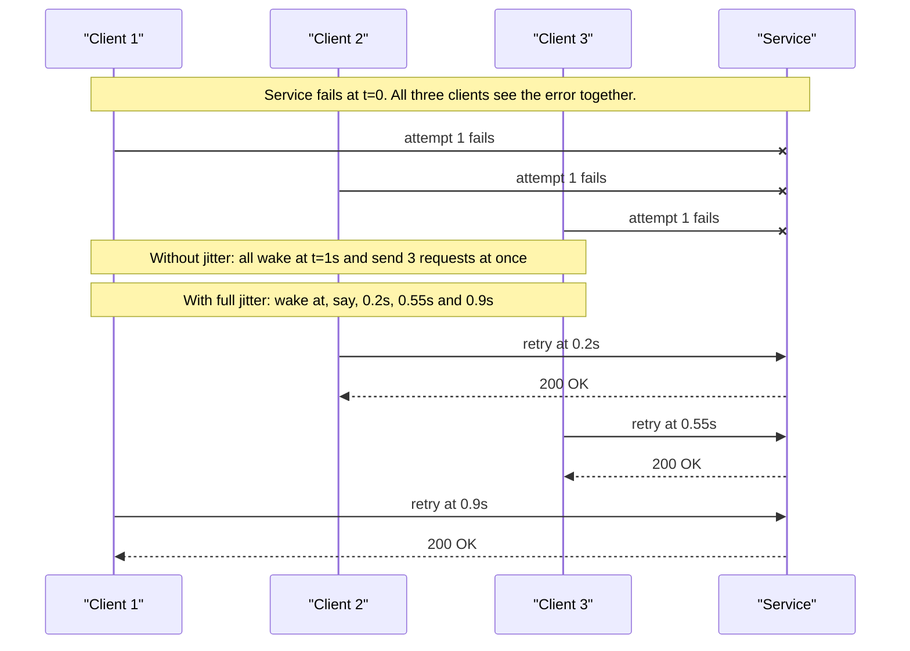

# Jitter

> [!TIP]
> **In one line:** Jitter adds deliberate randomness to waits, retries and expiry times so that many clients stop acting in lockstep and a recovering service is not hit by a synchronized wave.
>
> **In plain English:** If a whole office is told "lunch at noon sharp", the lift jams at 11:59. If everyone drifts out anywhere between 11:45 and 12:30, nobody queues. Jitter is that drift, applied to the moments when software decides to try again or refresh something.
>
> **You'll be able to:** choose between full, equal and decorrelated jitter and say why · write and test a small jitter helper · spot synchronization hazards beyond retries, such as cache TTLs and cron schedules

## Why This Matters

[Exponential Backoff](exponential-backoff.md) spaces retries further apart after each failure, which lowers the *average* load on a struggling dependency. It does nothing about *correlation*. If 5,000 clients all received an error at the same moment, say when a database failed over, then deterministic backoff tells every one of them to wake at exactly 1 second, then 2, then 4. Each wave is as sharp as the first one, only less frequent. The dependency comes back up, immediately meets 5,000 simultaneous requests, falls over again, and the cycle repeats.

This is the **thundering herd**, and it is not limited to retries. Anything that makes many independent processes act at the same instant produces one: a cache key that expires for every node at the top of the hour, a cron job that every instance runs at `:00`, a fleet of mobile apps that reconnect the moment a network returns, a deploy that restarts all pods together. The cost is paid in the one place you can least afford it: at the moment a shared resource is already weakest. Jitter is the cheapest known fix, a single call to a random number generator, and it is one of the highest-leverage lines of code in a reliability toolkit.

## Core Concept

**Jitter** means replacing a fixed time with a randomized one drawn from a range. The goal is not to make any individual client faster or more polite. The goal is to turn a spike into a smear: if N clients would have arrived in one instant, jitter spreads them over a window of width W, so the arrival rate drops from "N at once" to roughly N / W per unit of time.

Three retry-jitter strategies are widely used. They all start from the same ceiling, `ceiling = min(cap, base × 2^(attempt−1))`, which is the plain exponential backoff value from the previous chapter.

- **Full jitter:** `sleep = random(0, ceiling)`. The most spread out. Some clients retry almost immediately and some wait the full ceiling.
- **Equal jitter:** `sleep = ceiling/2 + random(0, ceiling/2)`. Keeps a guaranteed minimum wait of half the ceiling, then randomizes the other half.
- **Decorrelated jitter:** `sleep = min(cap, random(base, previous_sleep × 3))`. Each delay depends on the *previous delay* rather than the attempt number, so a client's sequence drifts away from every other client's sequence over time.

Analysis and simulation published by AWS engineers (the "Exponential Backoff and Jitter" write-up) found that full jitter and decorrelated jitter completed contended workloads with the least total work, while equal jitter was somewhat worse and no-jitter was by far the worst. Treat the exact numbers as workload-specific, but the ranking is a good default: **start with full jitter**.

## Mental Model

Picture a stadium emptying after a match. If the gates all open at the final whistle, the exits jam, and people who leave early still wait in the same crush as everyone else. If instead each section is released at a random moment within a 20-minute window, the same crowd leaves through the same gates without any jam. The gates did not get wider and the crowd did not shrink. Only the *timing* changed. That is all jitter does: it does not add capacity, it removes the synchronization that turns finite capacity into a failure.

## How It Works

**The synchronization problem, quantified.** Suppose 1,000 clients fail at t = 0 and the service can handle 100 requests per second. With deterministic backoff of 1 s, 2 s, 4 s, the service sees 1,000 requests at t = 1, which is ten times its capacity, so most fail again. At t = 3 it sees the same ~1,000 again. With full jitter and a ceiling of 1 s on the first retry, those 1,000 arrivals are spread across one second, roughly 1,000 per second, still too many. But the next ceiling is 2 s (about 500/s of the remaining clients), then 4 s (about 250/s), and so on. The load on the service falls geometrically *and* arrives smoothly, so each wave can be partly served instead of all of it being rejected. Backoff reduces the area under the load curve and jitter flattens its peaks. You need both.

**Full vs equal vs decorrelated.** Full jitter has the widest spread and the lowest contention, but it can pick a delay near zero, so a single unlucky client can retry almost immediately. That is usually fine because the herd as a whole is still dispersed. Equal jitter guarantees a minimum pause, which is valuable when each attempt is expensive (a payment provider call, an LLM request that costs money) and you do not want any client to retry quickly. The trade-off is a narrower spread, which means more collisions. Decorrelated jitter needs a little state per retrying client and has no attempt counter, which makes it convenient for long-running loops such as reconnecting workers: the sequence grows on average but never settles into a pattern shared with others.

**Always cap, and keep the budget in mind.** Jitter changes the *distribution* of delays but not the ceiling, so the total retry budget still has to fit inside your overall deadline (see [Timeouts](timeouts.md) and [Retries](retries.md)). With full jitter the expected total wait is about half the no-jitter total, so a policy that fit before will still fit, but individual runs vary, so plan against the worst case, not the mean.

**Honor the server first.** If a response carries `Retry-After` (see [Rate Limiting](rate-limiting.md)), that value is the server's explicit instruction. Use it as a floor and add jitter *on top*: `sleep = retry_after + random(0, small_spread)`. If a thousand clients are all told `Retry-After: 30` and all obey exactly, you have manufactured a herd at t = 30. Servers can help by jittering the `Retry-After` values they hand out.

**Jitter beyond retries.** The same idea applies anywhere a fixed interval is shared across a fleet:

- **Cache TTLs:** if a batch of keys is written at the same time with `ttl=300`, they all expire together and the next requests stampede the database. Use `ttl × (1 ± 10%)`.
- **Scheduled jobs and polling:** do not run every instance's refresh at `:00`. Offset each instance by a random startup delay, or sleep `interval + random(0, interval × 0.1)` between runs.
- **Token and credential refresh:** refresh at a random point in the last 10–20% of a token's lifetime rather than at expiry, so a fleet does not hit the identity provider together.
- **Health-check and heartbeat intervals,** **reconnect delays after a deploy,** and **staggered rollouts** all benefit for the same reason.

Jitter is a mitigation for *synchronization*, not for *overload*. If genuine demand exceeds capacity, spreading it out only delays the failure; that needs [Rate Limiting](rate-limiting.md), load shedding or [Circuit Breakers](circuit-breakers.md).

## Architecture



The three-client picture is the same story told by [the backoff diagram](exponential-backoff.md) with a finer timeline: the only difference between the lockstep case and the healthy case is where each client's wake-up time comes from. The service's capacity is identical in both.

## Request / Response Example

A rate-limited API returns a plain `Retry-After` to many clients at once:

```http
HTTP/1.1 429 Too Many Requests
Retry-After: 2
Content-Type: application/json

{"error": "rate_limited", "detail": "Too many requests. Retry after 2 seconds."}
```

A client that obeys this literally retries at exactly t + 2 s along with every other client that received the same header. A better client computes `retry_after + random(0, 0.5 × retry_after)`, producing a spread such as 2.31 s, 2.04 s, 2.87 s, 2.55 s across four clients. A better server also randomizes the header it sends, for example drawing it from 2 to 3 seconds per client, which spreads the herd even for clients that obey it to the letter.

## Code Example

A small, dependency-free helper with all four behaviors and a deterministic way to test them. The `rng` argument lets tests inject a fake random function so assertions are exact.

```python
import asyncio
import random
from dataclasses import dataclass
from typing import Awaitable, Callable, Literal, TypeVar

T = TypeVar("T")
Strategy = Literal["none", "full", "equal", "decorrelated"]


@dataclass
class Backoff:
    """Computes retry delays in seconds. One instance per retry loop (decorrelated keeps state)."""

    base: float = 0.5
    cap: float = 30.0
    strategy: Strategy = "full"
    rng: Callable[[float, float], float] = random.uniform  # injectable for tests
    _prev: float = 0.0

    def delay(self, attempt: int) -> float:
        """Seconds to sleep before retry number `attempt` (1-based)."""
        ceiling = min(self.cap, self.base * 2 ** (attempt - 1))
        if self.strategy == "none":
            return ceiling                                  # synchronized: for comparison only
        if self.strategy == "full":
            return self.rng(0.0, ceiling)                   # anywhere in [0, ceiling]
        if self.strategy == "equal":
            return ceiling / 2 + self.rng(0.0, ceiling / 2)  # at least half the ceiling
        # decorrelated: next delay depends on the previous delay, not the attempt number
        prev = self._prev or self.base
        self._prev = min(self.cap, self.rng(self.base, prev * 3))
        return self._prev


def jittered_ttl(ttl: float, spread: float = 0.1, rng=random.uniform) -> float:
    """Cache TTL +/- spread, so keys written together do not all expire together."""
    return ttl * (1 + rng(-spread, spread))


async def retry_with_jitter(op: Callable[[], Awaitable[T]], attempts: int = 5,
                            backoff: Backoff | None = None) -> T:
    backoff = backoff or Backoff()
    for attempt in range(1, attempts + 1):
        try:
            return await op()
        except (ConnectionError, TimeoutError):        # retry only transient errors
            if attempt == attempts:
                raise
            await asyncio.sleep(backoff.delay(attempt))
    raise RuntimeError("unreachable")


# --- tests (pytest style; run with `pytest jitter_helper.py`) ---
def test_bounds_hold_for_every_strategy():
    for strategy in ("none", "full", "equal", "decorrelated"):
        for _ in range(500):
            b = Backoff(strategy=strategy)
            for attempt in range(1, 12):
                assert 0 <= b.delay(attempt) <= b.cap


def test_none_is_plain_exponential_then_capped():
    b = Backoff(strategy="none")
    assert [b.delay(a) for a in (1, 2, 3, 8)] == [0.5, 1.0, 2.0, 30.0]


def test_equal_never_below_half_the_ceiling():
    for _ in range(500):
        assert 2.0 <= Backoff(strategy="equal").delay(4) <= 4.0  # ceiling is 4.0


def test_full_uses_the_whole_range():
    assert Backoff(strategy="full", rng=lambda lo, hi: hi).delay(3) == 2.0
    assert Backoff(strategy="full", rng=lambda lo, hi: lo).delay(3) == 0.0


def test_ttl_stays_within_spread():
    for _ in range(500):
        assert 270 <= jittered_ttl(300) <= 330
```

Note that `random.uniform` is fine for desynchronizing clients; it is not a security primitive and nothing here needs `secrets`. One caveat: CPython reseeds `random` in forked children, but other runtimes and libraries (or code that calls `random.seed(constant)`) may not, so make sure every process ends up with its own seed.

## Production Considerations

- **Test the distribution, not just the bounds.** A unit test that asserts `0 <= delay <= cap` will pass even if you accidentally forget to randomize. Include a test with an injected RNG, as above, plus a simulation that confirms arrival times actually spread.
- **Randomize per client, not per fleet.** A single shared "random offset" chosen once and distributed through config produces a new fixed synchronization point. Each process must roll its own dice.
- **Jitter the first attempt where the trigger is shared.** If every client is triggered by the same event (a pub/sub message, a config push, a deploy), even the first call should be preceded by `random(0, window)`.
- **Make jitter visible.** Log the chosen delay and attempt number at debug level. When someone asks why a request took 11 seconds to fail, the answer should be in the logs.
- **Mind user-facing latency.** Full jitter can pick near-zero or near the ceiling. For an interactive request with a tight deadline, cap the number of attempts and the ceiling so the worst case still fits the user's patience, or fail fast and degrade (see [Graceful Degradation](graceful-degradation.md)).
- **Combine, do not substitute.** Jitter plus backoff plus a retry budget plus a circuit breaker is the standard stack. Jitter alone does not stop a client from retrying a permanent `400`.

## Common Mistakes

- **Backoff with no jitter across a large fleet.** The textbook cause of retry storms after a regional failover.
- **Jitter that is too small.** `delay × random(0.95, 1.05)` still leaves everyone in a 10% band; the herd is only slightly blurred. Use a spread proportional to the interval, at least on the order of 10 to 50% for TTLs and the full range for retries.
- **Obeying `Retry-After` exactly.** Thousands of clients waking at the identical second recreate the herd.
- **Identical seeds.** Forked workers, containers cloned from the same snapshot, or tests that call `random.seed(0)` in production code produce identical sequences.
- **Expiring everything on the hour.** Cron `0 * * * *` on every instance, or caches warmed in one batch with one TTL, rebuild the same spike every cycle.
- **Treating jitter as a fix for overload.** It spreads demand; it does not reduce it.

## Best Practices

- Default to **full jitter** for retries; choose **equal jitter** when each attempt is costly and a minimum pause matters; choose **decorrelated jitter** for long-lived reconnect loops.
- Always cap the delay, and size the retry budget against the overall deadline.
- Treat `Retry-After` as a floor and add jitter on top; have servers jitter the values they send.
- Apply jitter to TTLs, scheduled jobs, token refresh and startup delays, not only to retries.
- Inject the random source so tests are deterministic, and test the spread with a simulation.

## AI Engineering Perspective

LLM workloads are unusually prone to herds. A provider rate limit is usually expressed per minute, so every worker that was throttled during the same minute tends to resume at the start of the next one. A batch pipeline that fans out 500 embedding or summarization calls, hits a `429`, and retries with plain backoff will fire in bursts that trip the same limiter over and over. Token-based limits make this worse, because a few very large prompts consume the budget that many small requests needed (see [Part 15 — Production AI Systems](../15-production-ai-systems/README.md) for token-aware limiting in gateways). Jitter on retries, plus a small random stagger when launching fan-out tasks, smooths the demand a gateway sees. Jitter also matters for semantic and prompt caches: expiring every cached completion on the same schedule forces a burst of paid model calls at once, so jitter the TTLs. In an agent loop that polls a long-running tool or job, jittered polling intervals keep many concurrent agents from hammering the same status endpoint in lockstep.

## Exercises

**Beginner**
1. By hand, compute the ceiling for attempts 1 to 5 with `base=1`, `cap=8`. Then give the possible range of the delay under full jitter and under equal jitter for attempt 4.

**Intermediate**
2. Write a simulation: 1,000 clients fail at t = 0 against a service that handles 100 requests per second. Compare the peak request rate over 30 seconds for `none`, `full`, `equal` and `decorrelated` strategies. Which flattens the peak most, and which has the best median time-to-success?
3. A cache warm-up job writes 50,000 keys with `ttl=600` at 09:00. Describe what happens at 09:10 and change the code so that expiry is spread out.

**Advanced**
4. Design retry behaviour for 2,000 workers that all receive `Retry-After: 60` from a shared LLM provider key. Specify what the client does and what a gateway in front of the provider could do to avoid a herd at t = 60.

## Key Takeaways

- Backoff reduces the average rate of retries; jitter removes the synchronization that makes retries arrive in spikes. A large fleet needs both.
- Start with full jitter; use equal jitter when a minimum wait matters and decorrelated jitter for long-running reconnect loops.
- Jitter applies to any shared interval: cache TTLs, cron schedules, token refresh and `Retry-After` values.
- Jitter smooths demand but cannot create capacity; pair it with rate limits, retry budgets and circuit breakers.

### Check Yourself

<details markdown="1">
<summary>1. What is the difference between full jitter and equal jitter?</summary>

Full jitter picks a delay uniformly from 0 to the ceiling. Equal jitter keeps half the ceiling as a guaranteed minimum and randomizes only the other half. Full spreads more; equal guarantees a minimum pause.

</details>

<details markdown="1">
<summary>2. Why does exponential backoff alone still produce retry storms after a failover that hit every client at once?</summary>

Because every client computes the identical deterministic delays, they all wake at the same instants (1 s, 3 s, 7 s, and so on). The waves are less frequent but just as sharp. Randomizing each client's delay is what breaks the alignment.

</details>

<details markdown="1">
<summary>3. A fleet of 300 instances each rebuild a report cache every hour on the hour, and the database spikes at :00. What would you change?</summary>

Add jitter to the schedule (a random startup offset or `interval + random(0, 10% of interval)`) and to the cache TTL, so instances refresh at different moments. Also consider a lock or single-flight refresh so only one instance recomputes each key.

</details>

---
Back to the [Part 6 README](README.md).
