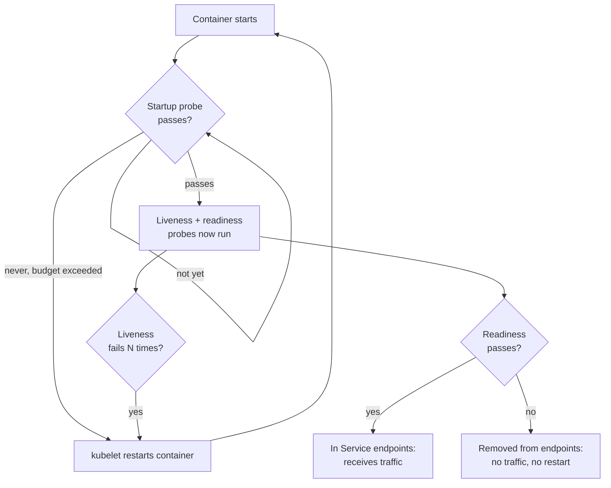

# Readiness and Liveness Probes

> [!TIP]
> **In one line:** Liveness failure makes Kubernetes restart a container, readiness failure only removes the pod from traffic, and startup probes protect slow boots; mixing them up causes real outages.
>
> **In plain English:** At a restaurant, "the chef has collapsed" means call the replacement chef. "The kitchen is not open yet" or "we're out of the main ingredient" just means seat nobody for now. Probes tell the platform which of those situations it is in, so it picks the right response.
>
> **You'll be able to:** choose what each probe type should check and what it must never check · configure probe timings that match real startup and shutdown behaviour · implement SIGTERM-safe draining so deploys drop no requests

## Why This Matters

In a container orchestrator nobody is watching your pods. Kubernetes decides, every few seconds and entirely from the answers to the probes you define, whether to send a pod traffic, leave it alone, or kill it. The decisions are automatic, and they are applied to *every* replica at once. That makes probe configuration one of the most common root causes of self-inflicted outages: a liveness probe that checks the database turns a database hiccup into a restart storm of the whole fleet; a missing startup probe lets a slow-booting service be killed in a loop before it ever starts; a shutdown that ignores SIGTERM drops in-flight requests on every deploy.

The previous chapter, [Health Checks](health-checks.md), covered what a health endpoint should examine and the hazards of dependency checks in general. This chapter is about how Kubernetes *uses* those signals, what each probe type is for, which mistakes cause incidents, and how to shut a pod down without dropping traffic. The semantics below are those of Kubernetes; other platforms (ECS, Nomad, load balancer target groups) have close analogues but different details, so check your platform's documentation.

## Core Concept

Kubernetes defines three probe types, each run by the **kubelet** on the node against a container:

- **Liveness probe: "Is this container irrecoverably stuck?"** On failure (after `failureThreshold` consecutive failures) the kubelet kills the container and restarts it according to the pod's `restartPolicy`. Repeated crashes lead to `CrashLoopBackOff`, with exponentially increasing restart delays capped at five minutes. Use it only to catch states a restart will fix: deadlock, an event loop that is blocked forever, a wedged process.
- **Readiness probe: "Can this pod serve traffic right now?"** On failure the pod's `Ready` condition becomes false and it is removed from the endpoints of any Service that selects it, so it receives no new traffic. The container is **not** restarted. When the probe passes again the pod is added back. Use it for warm-up, temporary overload, and the prerequisites this pod needs in order to answer requests.
- **Startup probe: "Has the application finished starting?"** While it has not yet succeeded, liveness and readiness probes are *disabled*. If it never succeeds within `failureThreshold × periodSeconds`, the container is killed and restarted. Once it succeeds it never runs again. Use it for slow-starting apps so that liveness can stay strict and fast without killing a process that is merely still booting.

Probes can be an `httpGet` (success means a status from 200 to 399), a `tcpSocket` connect, an `exec` command (exit code 0), or a `grpc` health check. Every probe has the same timing knobs: `initialDelaySeconds`, `periodSeconds` (default 10), `timeoutSeconds` (default 1), `successThreshold` (default 1) and `failureThreshold` (default 3). A probe that times out counts as a failure.

## Mental Model

Think of a hospital ward. **Readiness** is the "bed available" sign on the door: when staff are busy or the room is being cleaned, the sign flips and the ambulance goes elsewhere. Nobody is fired; the room just takes no new patients for a while. **Liveness** is the monitor that triggers a code-blue response when a patient's heart stops; the drastic intervention is justified only when nothing gentler will help. **Startup** is the admissions process: the monitors are not attached until the patient has actually been admitted. Using the code-blue alarm as a "ward is busy" sign would have the crash team resuscitating healthy patients all day.

## How It Works

**What liveness must check.** Only the process's own ability to make progress. The simplest good liveness endpoint does nothing but return `200`: if it answers, the event loop and server are running. If a dependency is slow, a restart will not fix that, and restarting everything at once makes it worse. Never include the database, cache or downstream services in liveness. Also keep it light enough that CPU throttling or a garbage-collection pause does not cause a false failure, which is where `timeoutSeconds` and `failureThreshold` come in: the defaults (1 second, 3 failures) are aggressive for a service that is busy at 100% of a CPU limit.

**What readiness should check.** Whether this instance can handle a request *now*: finished warm-up (config loaded, model or index in memory, connection pools established), not draining for shutdown, and optionally not overloaded. Readiness may include dependencies that are specific to this pod's ability to function, but be careful with *shared* dependencies. If the database is down and every pod reports not-ready, the Service has zero endpoints and every request, including ones that could be answered from cache or with a degraded response, fails at the proxy. For shared dependencies prefer degradation inside the app (see [Graceful Degradation](graceful-degradation.md)) and keep the pod ready. Likewise, using readiness for overload shedding can work but can also cascade: when pods drop out, the remaining ones get more load and drop out too.

**What startup should do.** Give slow starters room. If the app can take up to 90 seconds to load, configure `failureThreshold: 30` and `periodSeconds: 3` (a budget of 90 seconds), then keep the liveness probe tight. Without a startup probe you must choose between a large `initialDelaySeconds` on liveness (which delays detecting a real deadlock *after* startup) or a liveness probe that kills the slow boot.

**Probe sequence at pod start.** The container starts; the startup probe polls until it passes; then liveness and readiness begin. Readiness stays false until the application says it is ready, and only then does the pod join the Service endpoints. This is why a rolling update with a correct readiness probe keeps serving: new pods are added only when ready, and old ones are removed afterwards (subject to `maxUnavailable` and `maxSurge`).

**Graceful shutdown.** Termination is a sequence, and most dropped requests come from not understanding it:

1. The pod is marked `Terminating` and the endpoint controller begins removing it from Service endpoints. In parallel the kubelet runs the container's `preStop` hook, if any.
2. Endpoint removal must propagate to kube-proxy, ingress controllers and external load balancers. This is **asynchronous** and can take a few seconds; for a short window, new requests can still be routed to the pod.
3. After the `preStop` hook finishes, the kubelet sends `SIGTERM` to the main process.
4. The application should stop taking new work, finish in-flight requests and exit.
5. If the container is still running when `terminationGracePeriodSeconds` (default 30, counted from step 1, so including `preStop`) elapses, it is killed with `SIGKILL`.

The robust pattern is therefore: a short `preStop` sleep (for example 5 to 10 seconds) so endpoint removal propagates while the app is still happily serving; then on SIGTERM, fail readiness, finish in-flight work with a bounded drain, close pools, exit. Set `terminationGracePeriodSeconds` comfortably above `preStop sleep + drain timeout`. A common bug is the process never receiving SIGTERM because the container's PID 1 is a shell script wrapper that does not forward signals; use the exec form of the command (`exec uvicorn ...`) so the app is PID 1 or uses a proper init.

**Other consumers.** Ingress controllers and cloud load balancers often run *their own* health checks (for example target group checks), independent of Kubernetes probes. Make sure both agree about readiness, and align their intervals and thresholds with your drain timing.

## Architecture




## Request / Response Example

The kubelet's probe requests are ordinary HTTP calls. While the app is warming up in the background (the server is already listening), it answers liveness but not readiness:

```http
GET /livez HTTP/1.1
Host: 10.1.4.23:8000
User-Agent: kube-probe/1.31
```

```http
HTTP/1.1 200 OK
Content-Type: application/json

{"status": "alive"}
```

```http
GET /readyz HTTP/1.1
Host: 10.1.4.23:8000
User-Agent: kube-probe/1.31
```

```http
HTTP/1.1 503 Service Unavailable
Content-Type: application/json

{"status": "starting"}
```

Once warm-up finishes, `/readyz` returns `200 {"status": "ready"}` and the pod joins the endpoints. After SIGTERM, `/readyz` returns `503 {"status": "draining"}` while `/livez` still returns `200`, so the container is not restarted mid-drain.

## Code Example

A FastAPI app with an explicit lifecycle (`starting`, `ready`, `draining`), a dependency-free liveness endpoint, a local-state readiness endpoint, an in-flight counter and a bounded drain on shutdown. The tests check that readiness is false before warm-up, true after, false while draining, that liveness stays up throughout, and that draining waits for in-flight work but gives up at its deadline. Note that Uvicorn itself stops accepting connections on SIGTERM and waits for open connections (bounded by `--timeout-graceful-shutdown`); the explicit drain here is most useful for work you track yourself, such as background tasks, and as the readiness flip. One caveat: Uvicorn opens its listening socket only after lifespan startup completes, so with warm-up inside `lifespan` as written, probes get connection refused (a failure) until it finishes, which the startup probe tolerates. If you prefer readiness to report `starting` explicitly, start the warm-up as a background task and set the phase to `ready` when it completes. The Kubernetes manifest follows the code.

```python
import asyncio
import os
import time
from contextlib import asynccontextmanager
from enum import Enum

from fastapi import FastAPI, Request, Response
from fastapi.responses import JSONResponse

DRAIN_TIMEOUT = float(os.getenv("DRAIN_TIMEOUT", "25"))   # keep below terminationGracePeriodSeconds


class Phase(str, Enum):
    STARTING = "starting"   # booting, warming up: not ready
    READY = "ready"         # accepting traffic
    DRAINING = "draining"   # shutting down: finish in-flight work, accept no new traffic


class Lifecycle:
    def __init__(self) -> None:
        self.phase = Phase.STARTING
        self.in_flight = 0


LIFE = Lifecycle()


async def warm_up() -> None:
    # Load config, connect pools, load a model or index, run a tiny test query.
    await asyncio.sleep(0)


async def drain(timeout: float) -> bool:
    """Wait for in-flight requests to finish. True if drained before the deadline."""
    deadline = time.monotonic() + timeout
    while LIFE.in_flight > 0 and time.monotonic() < deadline:
        await asyncio.sleep(0.05)
    return LIFE.in_flight == 0


@asynccontextmanager
async def lifespan(app: FastAPI):
    await warm_up()
    LIFE.phase = Phase.READY            # readiness flips to 200 only AFTER warm-up
    yield                                # ... serving traffic ...
    LIFE.phase = Phase.DRAINING          # readiness fails from here on
    await drain(DRAIN_TIMEOUT)           # let in-flight requests finish, then exit


app = FastAPI(lifespan=lifespan)


@app.middleware("http")
async def count_in_flight(request: Request, call_next):
    LIFE.in_flight += 1
    try:
        return await call_next(request)
    finally:
        LIFE.in_flight -= 1


@app.get("/livez")
async def livez() -> dict[str, str]:
    # Liveness: NO dependencies. If the event loop can answer, the process is alive.
    # A blocked or deadlocked loop cannot answer, and that is exactly what we want to catch.
    return {"status": "alive"}


@app.get("/readyz")
async def readyz() -> Response:
    # Readiness: can THIS instance take traffic right now? Local state only, no shared deps.
    if LIFE.phase is Phase.READY:
        return JSONResponse({"status": "ready"})
    return JSONResponse({"status": LIFE.phase.value}, status_code=503)


# --- tests ---
async def test_not_ready_until_warm_then_unready_when_draining():
    import httpx
    LIFE.phase, LIFE.in_flight = Phase.STARTING, 0
    async with httpx.AsyncClient(transport=httpx.ASGITransport(app=app), base_url="http://t") as c:
        assert (await c.get("/readyz")).status_code == 503       # starting
        assert (await c.get("/livez")).status_code == 200        # alive even though not ready
        async with lifespan(app):                                 # runs warm-up, then serves
            assert (await c.get("/readyz")).status_code == 200
        assert (await c.get("/readyz")).status_code == 503       # draining after shutdown began
        assert LIFE.phase is Phase.DRAINING


async def test_drain_waits_for_in_flight_and_gives_up_at_deadline():
    LIFE.in_flight = 1
    asyncio.get_running_loop().call_later(0.1, lambda: setattr(LIFE, "in_flight", 0))
    assert await drain(1.0) is True
    LIFE.in_flight = 1
    assert await drain(0.1) is False       # stuck request: we stop waiting at the deadline
    LIFE.in_flight = 0
```

```yaml
# Deployment pod template (excerpt). Timings assume up to ~60 s boot and ~25 s drain.
spec:
  terminationGracePeriodSeconds: 45        # > preStop (10) + drain (25) + margin
  containers:
    - name: api
      image: registry.example.com/orders-api:1.8.2
      # exec form: the app is PID 1 and receives SIGTERM directly
      command: ["uvicorn", "app:app", "--host", "0.0.0.0", "--port", "8000",
                "--timeout-graceful-shutdown", "25"]
      env:
        - {name: DRAIN_TIMEOUT, value: "25"}
      ports: [{containerPort: 8000}]
      startupProbe:                        # up to 30 x 2 s = 60 s to boot
        httpGet: {path: /livez, port: 8000}
        periodSeconds: 2
        failureThreshold: 30
      livenessProbe:                       # strict, but not twitchy
        httpGet: {path: /livez, port: 8000}
        periodSeconds: 10
        timeoutSeconds: 2
        failureThreshold: 3
      readinessProbe:
        httpGet: {path: /readyz, port: 8000}
        periodSeconds: 5
        timeoutSeconds: 2
        failureThreshold: 2
      lifecycle:
        preStop:
          exec: {command: ["sleep", "10"]} # let endpoint removal propagate first
```

Why these numbers: liveness tolerates three 10-second periods (about 30 seconds) of an unresponsive process before restarting, which absorbs GC pauses and CPU throttling but still catches a deadlock. Readiness reacts faster (two 5-second periods) because removing a pod from traffic is cheap and reversible. The drain (25 s) plus `preStop` (10 s) fits inside the 45-second grace period with margin, so the kubelet should not need to `SIGKILL` a pod that is draining normally.

## Production Considerations

- **Different endpoints for different probes.** Do not point liveness and readiness at the same handler. They have different failure semantics and will diverge as the service grows.
- **Size timeouts to reality.** Measure startup time and tail latency under CPU limits, then set `failureThreshold × periodSeconds` above the 99th percentile boot time. Tune `timeoutSeconds` to cover pauses; a probe that competes for a throttled CPU can fail spuriously.
- **Watch for restarts.** Alert on rising `restartCount` and on pods flapping between ready and not ready. Both mean your probes, resource limits or app are misaligned.
- **Rolling updates depend on readiness.** `maxUnavailable`, `maxSurge`, `minReadySeconds` and PodDisruptionBudgets only protect you if readiness is truthful. A readiness probe that returns `200` too early sends traffic to a cold instance during a deploy.
- **Connection draining at the edge.** Long-lived connections (WebSockets, streaming responses, gRPC streams) will not finish within a short grace period. Decide whether to send a close message and let clients reconnect with [jittered backoff](jitter.md), and lengthen the grace period for those workloads.
- **Test shutdown.** Run a load test during a rolling restart and look for 502/503 and resets. Dropped requests during deploys are nearly always a termination-sequence problem, not an application bug.
- **Sidecars and init containers.** Probes apply per container, and a pod is ready only when all its containers are. A sidecar proxy with its own startup ordering can hold a pod unready or exit before the app finishes draining.

## Common Mistakes

- **Dependencies in liveness.** A database outage restarts every pod; they reboot, hammer the database, and prolong the incident.
- **No startup probe on a slow-booting app,** so liveness kills it again and again before it ever becomes ready (a restart loop that looks like a crash).
- **Liveness and readiness on the same endpoint with the same thresholds.** Any transient condition that should merely remove traffic instead causes a restart.
- **Shared-dependency checks in readiness,** removing every pod at once and converting a partial outage into total unavailability.
- **Default `timeoutSeconds: 1` on a CPU-throttled container,** producing restarts under load, exactly when you need the capacity.
- **Ignoring SIGTERM** (shell-wrapped PID 1, a handler that does nothing, or no drain), so deploys drop requests and in-flight work is killed at `SIGKILL`.
- **Grace period shorter than the drain,** or no `preStop` delay, so the pod exits while new requests are still being routed to it.
- **Expensive probes** that run heavy queries every few seconds across hundreds of pods.

## Best Practices

- Liveness: process-only, dependency-free, tolerant thresholds. Readiness: local warm-up and drain state. Startup: a generous budget for slow boots.
- Report not-ready until warm-up completes, and flip to not-ready first when shutdown begins.
- Use a `preStop` sleep plus a bounded in-app drain, and set `terminationGracePeriodSeconds` above both.
- Run the app so it receives SIGTERM directly (exec form), and handle it deliberately.
- Keep probe handlers cheap, cached where they touch anything, and separate from user-facing authentication and rate limits.
- Watch restart counts and readiness flaps, and rehearse rolling restarts under load.

## AI Engineering Perspective

Model-serving pods make these settings matter more. Loading multi-gigabyte weights into GPU memory can take from tens of seconds to several minutes, so a startup probe with a long budget is essential, and readiness should require a completed warm-up inference (the first request after load is often much slower, since kernels are compiled and caches are cold). Do not let liveness depend on a model call: a long-running generation can saturate the GPU and make a model-based check time out, and restarting would throw away the loaded model and slow everyone down. Check the process, not the model, for liveness. Graceful shutdown deserves extra care because LLM requests are long: a streaming completion can run for tens of seconds, so set the grace period and drain timeout to cover your longest acceptable stream, stop admitting new generations at SIGTERM, and let streams finish (see [Part 14](../14-ai-api-engineering/README.md)). Autoscaling GPU pods is slow and expensive, so being truthful about readiness avoids routing traffic to cold pods that would add latency or fail. For agent runtimes with long tasks, checkpoint progress so a restart or eviction can resume rather than start over (see [Part 17](../17-ai-agents-and-mcp/README.md)).

## Exercises

**Beginner**
1. For each situation say whether it should fail liveness, readiness or neither, and why: the app is still loading its model; the database is down for 20 seconds; the event loop is deadlocked; the pod received SIGTERM and is finishing requests.

**Intermediate**
2. An app takes up to 75 seconds to start. Write a startup probe (`periodSeconds` and `failureThreshold`) that gives it 90 seconds, and explain what Kubernetes does if the app is still not up when that 90-second budget runs out.
3. A deploy causes a burst of 502 errors for about 3 seconds on every rollout. Using the termination sequence, give two likely causes and the fix for each.

**Advanced**
4. Your liveness probe checks the database, and a 30-second database failover occurs. Walk through, with timings from the manifest above, what Kubernetes does to the fleet and what extra load the restarts put on the database. Redesign the probes so the failover causes no restarts, and say what the app should do instead.

## Key Takeaways

- Liveness restarts the container, readiness removes it from traffic without restarting, and startup disables both until boot completes. Choose the probe by the action you want.
- Keep liveness free of dependencies and tolerant; keep readiness focused on local warm-up and drain state, not shared dependencies.
- Shutdown is a sequence: endpoint removal is asynchronous, so use a `preStop` delay, fail readiness, drain in-flight work, and keep the grace period larger than both.
- Probe timings must match real boot time and pause behaviour, or the platform will restart healthy-but-slow pods.

### Check Yourself

<details markdown="1">
<summary>1. What happens when a liveness probe fails repeatedly, and what happens when a readiness probe does?</summary>

A repeated liveness failure makes the kubelet kill and restart the container. A readiness failure only marks the pod not ready, which removes it from Service endpoints so it gets no new traffic, and it is not restarted.

</details>

<details markdown="1">
<summary>2. Why is putting a database check in the liveness probe dangerous?</summary>

A database outage then fails liveness on every pod at once, so Kubernetes restarts the whole fleet even though restarting cannot fix the database. The restarts add load and delay recovery. Liveness should only detect states a restart can cure.

</details>

<details markdown="1">
<summary>3. Each deploy drops a few requests. The pod has terminationGracePeriodSeconds 30, no preStop hook, and the app exits immediately on SIGTERM. What do you change?</summary>

Add a `preStop` sleep so endpoint removal can propagate before SIGTERM, make readiness fail on shutdown, and have the app finish in-flight requests with a bounded drain on SIGTERM. Raise the grace period above the sleep plus the drain time so the pod is not killed mid-drain.

</details>

---
Back to the [Part 6 README](README.md).
