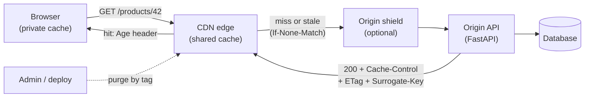
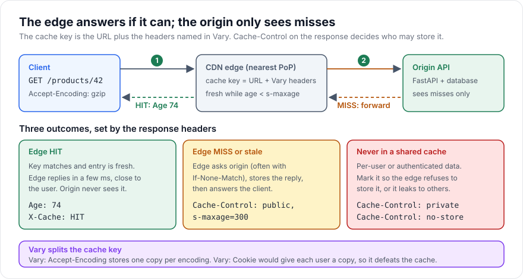

# CDN Basics

> [!TIP]
> **In one line:** A CDN caches HTTP responses at edge servers near users, controlled by Cache-Control, ETag and Vary headers, so most requests never reach your origin and per-user data is never shared.
>
> **In plain English:** Instead of every customer driving to your single warehouse, you stock small local shops in many cities with the popular items. Most customers are served from the shop around the corner; only unusual requests go to the warehouse. The label on each box (public, private, do not store) tells the shops what they may keep on their shelves.
>
> **You'll be able to:** set Cache-Control, ETag and Vary so a CDN caches the right API responses · design cache keys and purge strategies, including surrogate keys · keep authenticated and per-user responses out of shared caches

## Why This Matters

Every cache you have met so far in this part sits inside your infrastructure, between your API and your database. A CDN (content delivery network) moves caching to the edge of the internet: hundreds of points of presence (PoPs) near your users, each able to answer an HTTP request without the packet ever travelling to your region. That does two things your Redis cache cannot. It removes network distance: a user in Singapore talking to an origin in Virginia pays roughly 200 ms of round-trip time per request regardless of how fast your code is, while an edge node in Singapore answers in a few milliseconds. And it removes *load*: a request served at the edge never consumes an origin connection, a worker, a Redis call, or a database query.

CDNs are usually associated with images and JavaScript, but API responses are cacheable too: product catalogs, public configuration, search suggestions, exchange-rate tables, documentation, and any GET response that is the same for many callers. The danger is the other direction. A CDN is a *shared* cache, so a response that contains one user's data and is accidentally stored at the edge may be served to the next user. This class of incident (the wrong person seeing someone else's account page) is a famous and serious failure mode, and it comes from getting a handful of HTTP headers wrong. This chapter teaches those headers precisely. It builds directly on [Why Caching Matters](why-caching-matters.md), and the idea of invalidation from [Cache Invalidation](cache-invalidation.md) reappears here as purging.

## Core Concept

A CDN is a reverse proxy cache distributed across many locations. When a client requests a URL, DNS or anycast routing sends it to a nearby edge node. The edge computes a **cache key** for the request and looks it up. On a **hit** with a still-fresh entry, it replies immediately. On a **miss** (or a stale entry), it forwards the request to your **origin**, stores the response if the response headers allow it, and replies. Whether and how long a response may be stored is governed by standard HTTP caching headers, defined today in RFC 9111, which the CDN, browsers, and corporate proxies all honor to varying degrees.

The key distinction is between **private** caches (one user's browser) and **shared** caches (a CDN or proxy serving many users). Headers can address each separately, and that separation is what lets you say "the browser may keep this for 30 seconds, but the CDN may keep it for 5 minutes" or "only the browser may keep this at all".

## Mental Model

Treat the CDN as a franchise of vending machines in many cities. The cache key is the product code on the button: "product-42, English, gzip". The label on each product (Cache-Control) tells the franchisee whether they may stock it at all, for how long, and whether the label applies to the franchise or only to the person who bought it. If you print the same product code for two different products (two users' accounts sharing the key `/me`), customers get the wrong item. If you print a different code for every customer, the machines never have anything in stock. The craft of CDN configuration is choosing keys that are as coarse as the content allows and as fine as correctness demands.

## How It Works

**Freshness: `Cache-Control`.** The response header `Cache-Control` carries the policy. The directives you need:

- `max-age=N`: the response is fresh for N seconds, for any cache (browser and CDN).
- `s-maxage=N`: like `max-age` but for shared caches only, and it overrides `max-age` there. `Cache-Control: public, max-age=30, s-maxage=300` means browsers keep it 30 seconds, CDNs 5 minutes.
- `public`: explicitly allows shared caches to store it. It is also required in practice (along with `s-maxage` or `must-revalidate`) for a shared cache to store a response to a request that carried an `Authorization` header, which by default it must not.
- `private`: only the end user's own cache may store it; shared caches must not.
- `no-store`: no cache may store it at all. Use for sensitive responses.
- `no-cache`: despite the name, it *may* be stored, but must be revalidated with the origin before each reuse. Not the same as `no-store`.
- `stale-while-revalidate=N` and `stale-if-error=N` (RFC 5861): allow serving a stale response for N more seconds while refreshing in the background, or when the origin is erroring. This is the HTTP form of the soft/hard TTL idea from [TTL](ttl.md), and `stale-if-error` makes an origin outage far less visible.
- `immutable`: the content at this URL will never change, so do not even revalidate. Use with content-hashed URLs (`app.3fa9c1.js`).

CDNs often add their own, non-standard or newer controls. `Surrogate-Control` and the standardized `CDN-Cache-Control` (RFC 9213) let you give the CDN a different TTL than the browser without affecting `Cache-Control`; how each vendor treats them differs, so read your provider's documentation.

**Validation: `ETag` and conditional requests.** When an entry goes stale, the edge does not need to download the whole body again if nothing changed. It sends `If-None-Match: "<etag>"` to the origin; if the ETag still matches, the origin replies `304 Not Modified` with no body, and the edge refreshes the entry's lifetime and serves its stored copy. You pay one cheap round trip instead of a full response. Generating the ETag from a hash of the body, or from a version column, is straightforward. `Last-Modified` and `If-Modified-Since` do the same with timestamps.

**The cache key and `Vary`.** By default the cache key is the method, host, and full URL including the query string. That has two practical consequences. First, `?a=1&b=2` and `?b=2&a=1` are different keys unless your CDN normalizes query order, and tracking parameters such as `utm_source` fragment the cache into thousands of copies of the same page, so configure the CDN to ignore or strip parameters that do not change the response. Second, the same URL can legitimately produce different representations depending on request headers. The origin signals this with `Vary`: `Vary: Accept-Encoding` tells caches to store one copy per encoding (gzip, br), and `Vary: Accept-Language` one per language. Each header you list multiplies the number of cached variants and lowers the hit rate; `Vary: Cookie` or `Vary: Authorization` effectively gives each user a private copy, which defeats shared caching. If the response truly differs per user, it should not be cached at the edge at all. A related security risk is **cache poisoning**: if the origin builds the response from a request header that is *not* part of the cache key (such as `X-Forwarded-Host`), an attacker can cause a poisoned response to be stored and served to everyone. Either include that header in the key or make the origin ignore it.

**Purging and surrogate keys.** TTLs eventually fix staleness, but you often need it fixed now: a price correction, a retracted article. Purging removes entries before they expire. Options, from coarse to fine: purge by exact URL; purge by prefix or wildcard; and **purge by surrogate key** (called `Surrogate-Key` on Fastly and `Cache-Tag` on Cloudflare), where the origin tags each response with labels such as `product-42 category-7` and you later purge every response with that tag in one call. Tags are the CDN equivalent of the tag-based invalidation in [Cache Invalidation](cache-invalidation.md) and are what make it possible to cache a product list *and* a product page and invalidate both when the product changes. Purge APIs are typically fast (a second or two on some providers, longer on others), but not instantaneous and not transactional, so design for a short window of inconsistency and keep a sensible TTL as the safety net.

**Request collapsing and origin shield.** On a miss for a popular URL, hundreds of users at one edge node might arrive at once. Good CDNs *coalesce* them into a single origin request and hold the others until it returns, preventing the stampede discussed in [Cache-Aside](cache-aside.md). An **origin shield** adds one designated mid-tier cache between all edge nodes and the origin, so a miss in 200 PoPs becomes one request to the origin rather than 200.

**What must never be cached publicly.** Anything that varies by caller identity or contains secrets: responses to requests with `Authorization` or session cookies, `/me`, account, order, and billing endpoints, anything with `Set-Cookie`, and error responses you do not want amplified. The defense is layered: send `Cache-Control: private` or `no-store` explicitly from the origin on every authenticated route (do not rely on a default), do not use `public` on routes that read the user from a token, make sure the CDN's own configuration does not "cache everything" by overriding origin headers, and test by requesting authenticated endpoints through the CDN as two different users. Caching decisions should be allowlist-based: cache only paths you have deliberately designed to be public.

**Streaming and large media.** Video is delivered with HTTP adaptive streaming (HLS, DASH): the video is cut into small segment files with unique URLs, which are ideal CDN content (immutable, cacheable for long periods), plus a manifest that is short-lived or changing for live streams (a few seconds of TTL). Dynamic streams like Server-Sent Events or token-by-token API responses are the opposite case: they are long-lived and unique per request, so they are not cacheable, and intermediaries can break them by buffering the response. For those, send `Cache-Control: no-cache` (or `no-store`) and `X-Accel-Buffering: no` for nginx-style buffering, and verify your CDN streams responses through unbuffered.

## Architecture





## Request / Response Example

The first request misses and is forwarded; the origin sets caching headers and tags. The edge adds its own `Age`/`X-Cache` headers (names vary by provider).

```http
GET /products/42 HTTP/1.1
Host: api.example.com
Accept-Encoding: gzip
```

```http
HTTP/1.1 200 OK
Content-Type: application/json
Content-Encoding: gzip
Cache-Control: public, max-age=30, s-maxage=300, stale-while-revalidate=60, stale-if-error=600
ETag: "v6-8c1f"
Vary: Accept-Encoding
Surrogate-Key: product-42 category-7
X-Cache: MISS
```

When the entry later goes stale, the edge revalidates cheaply:

```http
GET /products/42 HTTP/1.1
Host: api.example.com
If-None-Match: "v6-8c1f"
```

```http
HTTP/1.1 304 Not Modified
ETag: "v6-8c1f"
Cache-Control: public, max-age=30, s-maxage=300, stale-while-revalidate=60, stale-if-error=600
```

A personalized endpoint must say the opposite, explicitly:

```http
HTTP/1.1 200 OK
Content-Type: application/json
Cache-Control: private, no-store
Vary: Authorization

{"id": 7, "email": "ada@example.com"}
```

## Code Example

A FastAPI origin that emits correct headers for a public catalog endpoint (ETag, 304 handling, surrogate keys) and for a private endpoint (`private, no-store`). A router-level helper keeps the policy in one place so nobody has to remember the header strings on every route.

```python
import hashlib
import json
from typing import Annotated

from fastapi import Depends, FastAPI, Header, HTTPException, Request, Response
from fastapi.security import HTTPAuthorizationCredentials, HTTPBearer

app = FastAPI()
bearer = HTTPBearer()

# In real code these come from your database; hard-coded here only to keep the example small.
PRODUCTS = {42: {"id": 42, "name": "Espresso Machine", "price_cents": 1999, "category_id": 7}}

PUBLIC_CACHE_CONTROL = (
    "public, max-age=30, s-maxage=300, stale-while-revalidate=60, stale-if-error=600"
)


def strong_etag(payload: dict) -> str:
    # A hash of the canonical body is a valid strong validator.
    body = json.dumps(payload, sort_keys=True, separators=(",", ":")).encode()
    return '"' + hashlib.sha256(body).hexdigest()[:16] + '"'


def etag_matches(if_none_match: str | None, etag: str) -> bool:
    if not if_none_match:
        return False
    # Header may hold a list of validators ("a", "b") or "*". Weak prefix W/ is ignored for GET.
    candidates = [c.strip().removeprefix("W/") for c in if_none_match.split(",")]
    return "*" in candidates or etag in candidates


@app.get("/products/{product_id}")
async def get_product(
    product_id: int,
    response: Response,
    if_none_match: Annotated[str | None, Header()] = None,
):
    product = PRODUCTS.get(product_id)
    if product is None:
        raise HTTPException(status_code=404, detail="product not found")

    etag = strong_etag(product)
    headers = {
        "Cache-Control": PUBLIC_CACHE_CONTROL,
        "ETag": etag,
        "Vary": "Accept-Encoding",
        # Tags let you purge this response by product or by category in one call.
        "Surrogate-Key": f"product-{product_id} category-{product['category_id']}",
    }
    if etag_matches(if_none_match, etag):
        return Response(status_code=304, headers=headers)  # no body, edge refreshes its copy
    for k, v in headers.items():
        response.headers[k] = v
    return product


async def current_user(
    creds: Annotated[HTTPAuthorizationCredentials, Depends(bearer)],
) -> dict:
    # Placeholder: verify the JWT or session here (see Part 5). Never trust the raw token.
    if not creds.credentials:
        raise HTTPException(status_code=401, detail="unauthorized")
    return {"id": 7, "email": "ada@example.com"}


@app.get("/me")
async def me(response: Response, user: Annotated[dict, Depends(current_user)]):
    # Explicit, not defaulted: shared caches must never store per-user data.
    response.headers["Cache-Control"] = "private, no-store"
    response.headers["Vary"] = "Authorization"
    return user


@app.middleware("http")
async def default_to_no_store(request: Request, call_next):
    # Allowlist posture: any route that did not set Cache-Control explicitly is not cacheable.
    resp = await call_next(request)
    resp.headers.setdefault("Cache-Control", "no-store")
    return resp
```

Notes and limits: the ETag here hashes only the product dict, so changes to headers or encodings do not alter it (compression middleware may need weak ETags, `W/"..."`, depending on how your stack transforms bodies). The `Authorization` handling is a placeholder and must be replaced with real verification as covered in [Part 5](../05-authentication-authorization/README.md). The middleware wraps responses for every route, so streaming routes should set their own headers explicitly.

## Production Considerations

**Hit ratio is the number to watch.** Track the CDN's cache hit ratio per path and the origin request rate. A drop usually means a new query parameter, a new `Vary` header, or a `Set-Cookie` on a previously cookie-free path (many CDNs refuse to cache responses with `Set-Cookie`). Count the *origin offload*, not just hits.

**Versioned URLs beat purging.** For static and semi-static assets, put a content hash or version in the URL (`/v3/catalog.json?rev=8c1f`) and cache for a year with `immutable`; "invalidation" becomes publishing a new URL. Reserve purges for content with stable URLs.

**Purge safely.** A "purge everything" during peak sends the full traffic to a cold origin at once. Prefer tag purges, rate-limit purge calls, and keep `stale-while-revalidate` so purged entries can still be served stale while refreshing, if your CDN supports soft purge.

**Origin protection.** Restrict origin access to the CDN (IP ranges or a shared secret header) so attackers cannot bypass the edge, and keep tokens out of query strings, since they end up in cache keys and edge logs.

## Common Mistakes

- **Caching authenticated responses publicly.** Using `public` on a route that reads the user from a token, or letting the CDN "cache everything", serves one user's data to another.
- **Forgetting `Vary`.** If gzip and uncompressed versions share a key, some clients get bodies they cannot decode.
- **`Vary: Cookie` or `Vary: User-Agent` on everything.** Each distinct value is a separate cache entry; hit rates collapse.
- **Using `no-cache` when you mean `no-store`.** `no-cache` still stores the response and revalidates; sensitive data needs `no-store`.
- **Unkeyed inputs.** Building responses from headers that are not in the cache key allows cache poisoning.
- **Relying on purge alone.** Purges can fail or lag; always have a TTL so staleness is bounded.

## Best Practices

- Decide by allowlist: only routes deliberately designed as public get `public, s-maxage=...`; everything else defaults to `private, no-store`.
- Use `s-maxage` for the CDN and a shorter `max-age` for browsers, so you can purge the edge but cannot purge a user's browser.
- Emit ETags and support conditional requests so revalidation costs a `304`, not a full body.
- Tag responses with surrogate keys and purge by tag when the underlying entity changes.
- Normalize the cache key: sort and strip irrelevant query parameters, and keep `Vary` to the minimum.
- Add `stale-while-revalidate` and `stale-if-error` to turn short outages and refreshes into non-events.

## AI Engineering Perspective

CDN caching intersects with LLM products in two opposite ways. For the *static and semi-static* parts of an AI product (model catalogs, prompt templates, public documentation, embeddings for a public knowledge base's search suggestions, rendered share-links of a conversation), the standard recipe applies and saves real money by keeping repeated traffic away from your gateway. For *generation* itself, caching is mostly wrong: responses are personalized, often streamed via Server-Sent Events, and must carry `no-store` with buffering disabled at every hop, so test that your CDN and reverse proxies pass tokens through immediately rather than batching them. See the realtime material in [Part 9](../09-realtime-and-webhooks/README.md).

Edge caching of model output is only defensible for deterministic, shared, non-personal prompts, and there it competes with the application-level response and semantic caches discussed in [Part 15](../15-production-ai-systems/README.md). Be careful with agents and tools: an [MCP or agent endpoint](../17-ai-agents-and-mcp/README.md) that carries a user's token must never be cacheable, and cache keys for anything derived from private documents must include the tenant and permission scope.

## Exercises

**Beginner**

1. Explain in one sentence each what `max-age`, `s-maxage`, `private`, `no-cache`, and `no-store` do. Which of them stop a CDN from storing a response?
2. Using `curl -I` against a public site behind a CDN, find the `Cache-Control`, `Age`, `ETag`, and any cache-status header. Request the same URL twice and describe what changed.

**Intermediate**

1. Extend the example so `/products` (a list) also carries surrogate keys for every product it includes, and write the purge call logic your service would run when product 42 is updated.
2. Write a test that requests `/me` with two different bearer tokens through a caching proxy (even a local one) and asserts that the second user never receives the first user's body.

**Advanced**

1. Your hit ratio dropped from 92 to 40 percent after a release. List five header or key-related causes you would check, in order of likelihood, and how you would confirm each from logs.
2. Design the caching headers and purge strategy for a pricing API where prices may change at any time but a stale price for more than 60 seconds is unacceptable, and a rollout of a new price must reach all users within about 10 seconds. Explain what you guarantee and what you do not.

## Key Takeaways

- A CDN is a shared, distributed HTTP cache; it removes both distance and origin load, and its behavior is controlled by `Cache-Control`, `ETag`, and `Vary`.
- Use `s-maxage` for the CDN, `max-age` for browsers, `stale-while-revalidate` and `stale-if-error` for resilience, and ETags so revalidation is a cheap `304`.
- The cache key is the URL plus the headers named in `Vary`; keep it coarse for hit rate and fine enough for correctness, and avoid unkeyed inputs.
- Purge by surrogate key when content changes, but keep TTLs as the safety net.
- Never let authenticated or per-user responses into a shared cache: default to `private, no-store` and allowlist what is public.

### Check Yourself

<details markdown="1">
<summary>1. What is the difference between `no-cache` and `no-store`?</summary>

`no-cache` allows a cache to store the response but requires it to revalidate with the origin before reusing it. `no-store` forbids any cache from storing the response at all, which is what you want for sensitive data.

</details>

<details markdown="1">
<summary>2. Why is `Vary: Cookie` on a public API endpoint a problem for a CDN?</summary>

The cache key then includes the cookie value, so every user gets a separate cached copy and the hit ratio collapses toward zero. If the response really differs per user, it should not be in the shared cache at all.

</details>

<details markdown="1">
<summary>3. After a release, users report seeing another customer's order history. The endpoint reads the user from a bearer token and returns `Cache-Control: public, s-maxage=60`. What happened and how do you fix it?</summary>

The `public, s-maxage` directive told the CDN it may store and share the response, and the key (the URL) does not include the user's identity, so later users receive the stored copy. Change the route to `private, no-store`, purge the affected paths at the CDN, and add a default-deny rule and a multi-user test so it cannot regress.

</details>

---
Back to the [Part 7 README](README.md).
