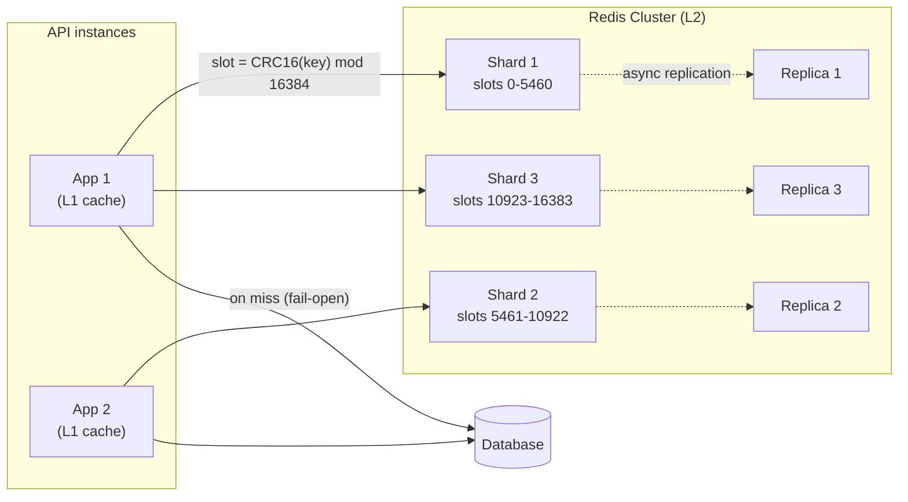

# Distributed Caching

> [!TIP]
> **In one line:** A distributed cache spreads keys across several nodes so memory and throughput scale past one machine, and it adds new problems: key placement, hot keys, big keys, and partial failure.
>
> **In plain English:** One librarian can only carry so many books and answer so many questions. Hire several and give each a section of the alphabet, and the library handles far more readers. But now you need a rule for who owns which book, a plan for when one librarian is sick, and a trick for the one book that everybody asks for at once.
>
> **You'll be able to:** explain why naive modulo sharding breaks and how consistent hashing or Redis Cluster slots fix it · spot and mitigate hot keys and big keys · layer a local L1 cache over a shared L2 cache without serving surprising staleness

## Why This Matters

A single Redis instance is fast, often well over 100,000 simple operations per second, but it has hard ceilings. Its dataset must fit in one machine's RAM. Command execution is essentially single-threaded, so one CPU core bounds throughput. And it is a single point of failure: when that node restarts, the cache is cold and every request lands on the database. The moment your API outgrows any of those limits (a dataset of 200 GB, a million reads per second at peak, an uptime target a single node cannot meet), you need a cache spread across multiple nodes.

Distribution is not free. It introduces a placement problem (which node holds this key, and how does every client agree?), skew problems (some keys are far hotter or larger than others, and one unlucky node melts), and failure modes that do not exist in a single process (one shard down while others are fine, replicas that lag, clients with different views of the cluster). Teams regularly learn these the hard way during a traffic spike. This chapter gives you the vocabulary and the mechanics so you can predict them instead.

## Core Concept

A distributed cache partitions the key space across several nodes (**sharding**, also called partitioning) and usually keeps one or more copies of each partition on other nodes (**replication**). These two ideas solve different problems and are often confused. Sharding increases *capacity and write throughput*: more nodes, more total memory and CPU, each holding a distinct slice. Replication increases *availability and read throughput*: the same data on several nodes, so one can fail and reads can be spread out. A production cache typically uses both: N shards, each with a primary and one or two replicas.

The central question is **placement**: given a key, which shard owns it? The answer must be deterministic (any client computes the same answer without asking anyone), uniform (shards get roughly equal load), and stable (adding or removing a shard should move as few keys as possible, since every moved key becomes a cache miss).

## Mental Model

Imagine a mail room with several sorting bins. The naive rule is "take the sum of the letters in the surname, divide by the number of bins, use the remainder". It works until you add a fourth bin, and then nearly every surname maps to a different bin, so every letter that was already sorted is in the wrong place. A better rule puts bins around a circular track and assigns each surname to the next bin clockwise from where the surname lands on the track. Adding a bin then only steals the surnames in the arc just before it, and the rest of the mail stays put. That circular track is consistent hashing, and Redis Cluster's 16,384 fixed "slots" are the same idea with the track pre-divided into a fixed number of numbered pieces that get handed from bin to bin.

## How It Works

**Why modulo breaks.** The simplest scheme is `shard = hash(key) % N`. It is uniform and deterministic, but changing N remaps almost everything. Going from 4 to 5 shards leaves only about 1 in 5 keys on its old node, so roughly 80 percent of the cache becomes misses at once. The database sees a surge exactly when you are changing capacity, often because load was already high. That is the reason this scheme is only acceptable for a fixed-size cluster.

**Consistent hashing.** Hash both nodes and keys onto the same ring (for example, 0 to 2^32 - 1). A key belongs to the first node clockwise from its hash. When a node is added or removed, only the keys in the arc between it and its neighbor move: on average about `1/N` of the keys instead of nearly all of them. A plain ring gives uneven arcs, so each physical node is placed at many points (**virtual nodes**, commonly 100 to 200 per node), which smooths the distribution and lets a failed node's load spread over all survivors instead of dumping on its single neighbor.

**Redis Cluster.** Redis Cluster uses a fixed hash-slot model. There are 16,384 slots; a key's slot is `CRC16(key) mod 16384`. Each primary owns a set of slot ranges, and rebalancing means moving slots (and the keys in them) between nodes, which can be done online. Clients are cluster-aware: they fetch the slot map, route each command directly to the owner, and cache the map. If the map is stale, the node replies `-MOVED slot host:port` (the slot permanently lives elsewhere, so update the map) or `-ASK` (the slot is mid-migration, retry once at the target). Operationally, important consequences are: multi-key commands (`MGET`, `SUNION`, Lua scripts touching several keys, transactions) only work when all keys hash to the same slot, which you control with **hash tags** (only the substring inside `{...}` is hashed, so `cart:{user42}:items` and `cart:{user42}:meta` share a slot); and cross-slot operations are rejected, so design key names around the unit you need to operate on atomically.

**Client-side sharding versus cluster versus proxy.** With *client-side sharding* (consistent hashing in your application library), there is no server coordination: simple, fast, and what memcached deployments typically do. But every client needs the same node list and the same algorithm, resharding is a coordinated change, and there is no built-in replication or failover. With *Redis Cluster*, the servers own the slot map, replicas and automatic failover are built in, and clients stay in sync through redirects, at the cost of cluster-aware clients and the same-slot constraint. With a *proxy layer* (Twemproxy, Envoy's Redis filter, or managed services that hide sharding), applications talk to one endpoint and the proxy shards, which simplifies clients and centralizes connection pooling at the price of an extra hop and another component to run.

**Replication.** Each primary streams its writes to replicas **asynchronously**. Reads can be served from replicas to scale read throughput, accepting that a replica may lag. On primary failure, a replica is promoted (in Redis Cluster after a failure-detection timeout, `cluster-node-timeout`, often seconds). Because replication is asynchronous, a failover can lose the last writes the old primary acknowledged. For a cache that is acceptable, since the database holds the truth; for data you cannot lose it is a warning that Redis is the wrong place to keep the only copy.

**Hot keys.** Hashing balances *keys*, not *traffic*. If one key (a viral product, a global config, a leaderboard) receives 200,000 reads per second, the shard that owns it saturates while others idle, and adding shards does not help because that single key still lives on exactly one. Mitigations, from cheapest up: cache the key in a local in-process cache (L1, below) with a short TTL so most reads never leave the app server; serve hot keys from replicas; or **split the key** into `k` copies (`hot:{key}:0` through `hot:{key}:k-1`), write all copies and read a random one, which spreads load across `k` slots at the cost of `k` writes and slight divergence between copies. Detect hot keys with per-key counters in the client or your provider's tooling (`redis-cli --hotkeys` works only with an LFU eviction policy and can be disruptive on a busy node).

**Big keys.** A single key holding 50 MB (a huge JSON blob, a list with millions of items) is a different hazard. Reading or deleting it blocks the single-threaded event loop for the duration, so every other client on that node stalls, which looks like a mysterious latency spike. It also makes the shard's memory uneven and slows replication and resharding. Keep values small (a few KB to a few hundred KB is a reasonable target), split large collections into chunks or pages, prefer hashes of bounded size, and delete large collections with `UNLINK` (asynchronous free) instead of `DEL`.

**Failure behavior.** Decide the policy before an incident. If one shard is down: with consistent hashing and a client that removes it from the ring, its keys remap to survivors, which start cold, so the database sees a surge proportional to that shard's share of traffic. With Redis Cluster, the slots of a failed primary are unavailable until its replica is promoted, and by default (`cluster-require-full-coverage yes`) the whole cluster stops serving writes if any slot is uncovered, which many operators turn off for caches. In all cases your client should have short timeouts, bounded retries with backoff and jitter, and a circuit breaker so a sick cache fails *open* (fall through to the database) rather than hanging requests. Combine this with load shedding or per-endpoint concurrency limits, because failing open sends the full load to a database that was sized assuming a high hit rate.

**L1 plus L2.** A common two-tier design keeps a small **L1** cache inside each application process (a bounded in-memory map with a short TTL) in front of the shared **L2** Redis cluster. L1 hits cost nanoseconds to microseconds, with no network hop, and they flatten hot keys. The price is consistency: each app instance has its own L1, so after a write, instances can serve old values until their L1 entry expires or is invalidated. Strategies, from simplest: a very short L1 TTL (1 to 5 seconds), accepting that much staleness; publish invalidation messages over Redis Pub/Sub or a stream so instances evict the key (note Pub/Sub is fire-and-forget, so a missed message is still bounded by the L1 TTL); or use server-assisted client-side caching (Redis 6 RESP3 tracking), where Redis tells clients which cached keys changed. Keep L1 small and bounded (LRU with a max size) so a hot-key defense does not become a memory leak across 50 pods.

## Architecture



## Request / Response Example

At the wire level, a cluster-aware client talks RESP to the node it believes owns the slot. If its slot map is stale, the node redirects it. Shown here with `redis-cli`-style output:

```text
> GET product:42
(error) MOVED 11421 10.0.3.7:6379
```

The slot for `product:42` is 11421, now owned by `10.0.3.7`. The client updates its map and retries there. Hash tags co-locate related keys, as shown by the `CLUSTER KEYSLOT` command:

```text
> CLUSTER KEYSLOT cart:{user42}:items
(integer) 5649
> CLUSTER KEYSLOT cart:{user42}:meta
(integer) 5649
> MGET cart:{user42}:items cart:{user42}:meta
1) "[...]"
2) "{...}"
```

(The slot numbers above are illustrative of the output format.) And at the API layer, a caller sees only a latency difference and a cache header you choose to expose:

```http
GET /products/42 HTTP/1.1
Host: api.example.com
```

```http
HTTP/1.1 200 OK
Content-Type: application/json
X-Cache: L1-HIT

{"id": 42, "name": "Espresso Machine", "price_cents": 1999}
```

## Code Example

Two pieces: a consistent-hash ring with virtual nodes (to see exactly how few keys move when a node is added), and a two-tier L1/L2 reader that uses a bounded, short-TTL in-process cache over Redis. Production systems should use their client's built-in cluster support rather than their own ring, but writing the ring once makes the behavior concrete.

```python
import bisect
import hashlib
import os
import time
from collections import OrderedDict
from typing import Any

import redis.asyncio as redis


class HashRing:
    """Consistent hashing with virtual nodes. Not thread-safe for concurrent mutation."""

    def __init__(self, nodes: list[str], vnodes: int = 150) -> None:
        self.vnodes = vnodes
        self._points: list[int] = []  # sorted hash positions
        self._owner: dict[int, str] = {}  # position -> node
        for n in nodes:
            self.add(n)

    @staticmethod
    def _hash(value: str) -> int:
        # md5 is used for distribution only, not security.
        return int.from_bytes(hashlib.md5(value.encode()).digest()[:8], "big")

    def add(self, node: str) -> None:
        for i in range(self.vnodes):
            h = self._hash(f"{node}#{i}")
            bisect.insort(self._points, h)
            self._owner[h] = node

    def remove(self, node: str) -> None:
        for i in range(self.vnodes):
            h = self._hash(f"{node}#{i}")
            self._points.remove(h)
            del self._owner[h]

    def node_for(self, key: str) -> str:
        h = self._hash(key)
        idx = bisect.bisect(self._points, h) % len(self._points)  # wrap around the ring
        return self._owner[self._points[idx]]


def moved_fraction() -> float:
    keys = [f"user:{i}" for i in range(20_000)]
    ring = HashRing(["cache-a", "cache-b", "cache-c", "cache-d"])
    before = {k: ring.node_for(k) for k in keys}
    ring.add("cache-e")
    moved = sum(1 for k in keys if ring.node_for(k) != before[k])
    return moved / len(keys)  # expect about 1/5 = 0.20, versus about 0.80 with modulo


class LocalCache:
    """Tiny bounded LRU with per-entry TTL: the L1 tier. Per-process, per-event-loop use."""

    def __init__(self, max_items: int = 5_000, ttl: float = 2.0) -> None:
        self.max_items, self.ttl = max_items, ttl
        self._data: OrderedDict[str, tuple[float, Any]] = OrderedDict()

    def get(self, key: str) -> Any | None:
        item = self._data.get(key)
        if item is None:
            return None
        expires, value = item
        if time.monotonic() >= expires:
            self._data.pop(key, None)
            return None
        self._data.move_to_end(key)
        return value

    def set(self, key: str, value: Any) -> None:
        self._data[key] = (time.monotonic() + self.ttl, value)
        self._data.move_to_end(key)
        while len(self._data) > self.max_items:
            self._data.popitem(last=False)  # evict least recently used


l1 = LocalCache(ttl=2.0)  # short TTL bounds cross-instance staleness
l2 = redis.from_url(
    os.environ.get("REDIS_URL", "redis://localhost:6379/0"),
    decode_responses=True,
    socket_timeout=0.05,          # a slow cache must not stall requests
    socket_connect_timeout=0.05,
)


async def get_two_tier(key: str, load_from_db) -> Any:
    value = l1.get(key)
    if value is not None:
        return value  # L1 hit: no network hop

    try:
        raw = await l2.get(key)
    except redis.RedisError:
        raw = None  # fail open: treat a broken cache as a miss, never as an error

    if raw is not None:
        l1.set(key, raw)
        return raw

    value = await load_from_db()  # the loader should return a JSON string here
    try:
        await l2.set(key, value, ex=300)
    except redis.RedisError:
        pass  # a failed cache write must not fail the request
    l1.set(key, value)
    return value
```

Limits to be aware of: this L1 is per process and has no cross-instance invalidation, so staleness is bounded only by its 2 second TTL; the loader contract (JSON string in, string out) is simplified; and failing open protects requests but not the database, so pair it with a circuit breaker and concurrency limits.

## Production Considerations

**Capacity planning.** Size for peak, with headroom for failover: if one of three primaries dies, the survivors (and the database) must absorb its share. Plan memory at roughly 60 to 70 percent utilization to leave room for replication buffers and fragmentation. Estimate hit rate from real traffic before assuming a number, using [Latency and P95/P99](latency-and-percentiles.md) style percentile measurements, not averages.

**Observability.** Track per-shard operations per second, memory, evictions, slowlog entries, connected clients, replication lag, and the hit rate for L1 and L2 separately. A single hot shard hides in cluster-wide averages, so graph the maximum across shards, not just the mean.

**Security.** Keep Redis on private networks with TLS and ACL authentication; cached values may contain personal data and need the same care as the database.

## Common Mistakes

- **Using `hash % N` for a cluster that will change size.** Adding a node invalidates most of the cache.
- **Assuming sharding fixes a hot key.** One key lives on one shard no matter how many shards you add.
- **Storing giant values or unbounded collections.** One big key can stall a whole shard.
- **Multi-key operations across slots.** They are rejected in Redis Cluster; use hash tags deliberately and sparingly (over-using one tag recreates a hot shard).
- **Failing closed.** Letting cache timeouts surface as 500s turns a cache blip into an outage, and failing open without limits turns it into a database outage instead.
- **Unbounded L1 with no invalidation story.** It either leaks memory or serves surprising stale data. Bound its size and TTL.
- **Treating replicas as strongly consistent.** Reads from a replica can lag behind the primary.

## Best Practices

- Use your platform's managed cluster mode, or Redis Cluster, instead of building your own sharding.
- Keep values small, name keys so related data shares a hash tag only when you truly need multi-key atomicity, and monitor for big and hot keys continuously.
- Defend hot keys with a short-TTL L1 cache, and key-splitting only if L1 is insufficient.
- Set aggressive client timeouts, retry with exponential backoff and jitter, and add a circuit breaker so the cache fails open safely.
- Test failure on purpose: kill a primary in staging and measure the miss surge, failover time, and the database's behavior.
- Treat the cache as disposable: everything in it must be reconstructible from the database.

## AI Engineering Perspective

Distributed caches carry an unusual load in AI systems. A semantic or exact-match response cache for an LLM gateway has very high per-entry value, since each hit saves a multi-second, paid model call, but its keys are skewed: a few popular prompts (a product FAQ, a system-prompt-prefixed query) dominate, which is a textbook hot-key pattern, and an L1 tier in front of Redis is an easy win. Cached values are also bigger than usual (long completions, embeddings of 1,536 floats are roughly 6 KB as float32), so watch value sizes and compress or store large payloads in object storage with only a pointer in Redis.

Vector search is a different workload, and it is usually served by a purpose-built vector index rather than a general key-value cache, as covered in [Part 16](../16-rag-apis/README.md). For [agents](../17-ai-agents-and-mcp/README.md), shared tool-result caches across many agent workers benefit from the same cluster design, with the same warning that tool results can contain user data, so the cache key must include the tenant and permissions scope, not only the query.

## Exercises

**Beginner**

1. With 4 shards using `hash(key) % N`, what fraction of keys keep their node when you add a fifth? What fraction with consistent hashing, roughly?
2. List three problems a single Redis node has that sharding addresses, and one that replication addresses.

**Intermediate**

1. Run `moved_fraction()` from the example. Then change `vnodes` to 1 and to 500 and compare the moved fraction and, by counting keys per node, the balance of the distribution.
2. Create a local Redis Cluster (for example with the official Docker image or `redis-cli --cluster create`). Use `CLUSTER KEYSLOT` to find which keys share a slot, and show a cross-slot `MGET` failing and a hash-tagged one succeeding.

**Advanced**

1. Implement key splitting for a hot key: write to `k` suffixed copies, read a random copy, and measure per-shard load before and after under a synthetic load. What invariants break when a write to one copy fails?
2. Design the invalidation path for the L1/L2 cache so that a product price change is visible on every API instance within one second, without Pub/Sub being a single point of failure. State exactly what bound you guarantee and what you do not.

## Key Takeaways

- Sharding scales capacity and throughput; replication scales availability and reads; production caches use both.
- Modulo sharding remaps most keys when N changes; consistent hashing (with virtual nodes) or Redis Cluster's 16,384 slots move only a small fraction.
- Hashing balances keys, not traffic: hot keys need L1 caching or key splitting, and big keys need to be split or avoided.
- Design failure behavior in advance: short timeouts, fail open with limits, and expect a miss surge when a shard dies.
- An L1 cache in front of a shared L2 trades consistency for speed, and its staleness must be bounded by TTL or invalidation.

### Check Yourself

<details markdown="1">
<summary>1. What is the difference between sharding and replication?</summary>

Sharding splits the key space so each node holds a different slice, increasing total capacity and write throughput. Replication keeps copies of the same data on more than one node, increasing availability and read capacity.

</details>

<details markdown="1">
<summary>2. Why does adding a node to a modulo-sharded cache cause a database surge, and how does consistent hashing avoid it?</summary>

Changing N changes `hash % N` for most keys, so most cached entries are now looked up on the wrong node and miss. Consistent hashing only reassigns the keys in the arc the new node takes over, roughly 1/N of them, so most entries remain valid.

</details>

<details markdown="1">
<summary>3. One product page receives 150,000 reads per second and the shard that owns it is at 100 percent CPU, while the other shards are idle. Adding two more shards does not help. What do you do?</summary>

The key lives on a single shard regardless of cluster size, so the fix is to stop sending those reads there: add a short-TTL in-process L1 cache so most reads never reach Redis, and if needed split the key into several copies spread across slots. Serving it from replicas also helps, with replica lag as the trade-off.

</details>

---
Back to the [Part 7 README](README.md).
