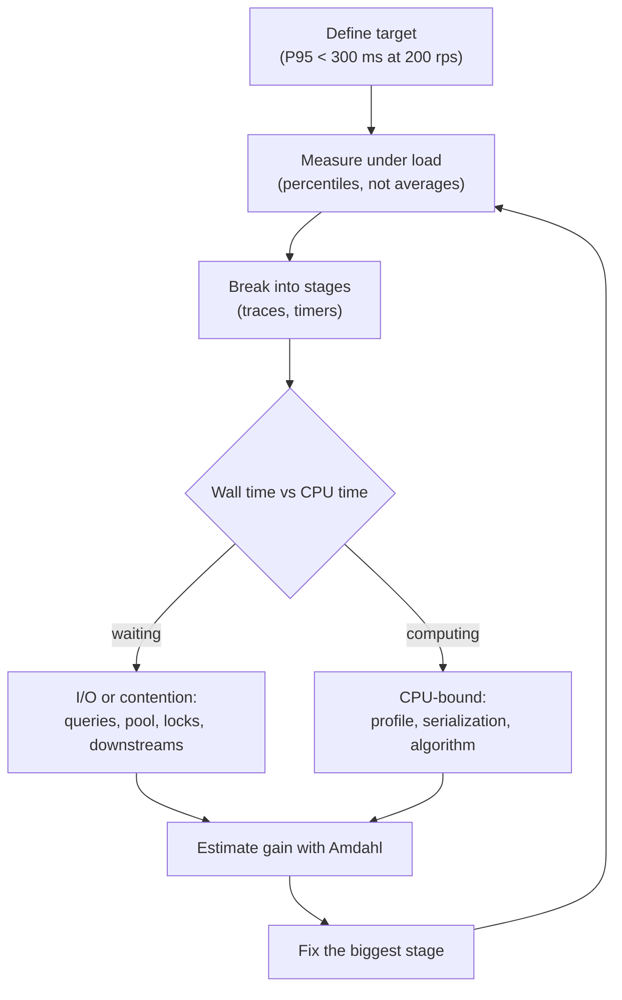

# Performance Bottlenecks

> [!TIP]
> **In one line:** Measure where time actually goes before optimizing: the slowest stage on the critical path, not the one that looks suspicious, caps how much any change can help.
>
> **In plain English:** If a motorway journey takes an hour and 50 minutes of it is queueing at one toll booth, buying a faster car barely helps. You have to time each leg of the trip first, then fix the leg that dominates. Software is the same: guessing wastes weeks, and a stopwatch around each stage shows you the toll booth.
>
> **You'll be able to:** classify a slow endpoint as CPU-bound, I/O-bound, lock-bound or database-bound with evidence · find N+1 queries, pool exhaustion and serialization costs · predict the best-case gain of a fix with Amdahl's law before building it

## Why This Matters

Caching is one answer to slow APIs, but only one, and it is the wrong answer when the slowness is not a repeated read. Teams burn weeks adding Redis to an endpoint whose time is actually spent serializing a 4 MB response, waiting for a connection from an exhausted pool, or running a loop that issues 200 queries. The cache makes no difference, or hides the problem until the first miss. The discipline that prevents this is simple to state and surprisingly rare in practice: *find the bottleneck first, with measurements, then change exactly that*.

Performance work is also an economics problem. Every optimization has a cost (code complexity, operational risk, review time), and its benefit is capped by how much of the request time it can touch. A 10x speedup on a stage that takes 5 percent of the request gives you about a 4.7 percent improvement overall. This chapter gives you a method to decide where to look, the common culprits in API backends, the tools to confirm them, and the arithmetic to predict a payoff before you spend anything. It builds on the percentile vocabulary from [Latency and P95/P99](latency-and-percentiles.md), and on the motivations in [Why Caching Matters](why-caching-matters.md).

## Core Concept

A **bottleneck** is the stage of a system whose capacity or latency limits the whole. In a single request, it is the stage that takes the largest share of the wall-clock time on the critical path. Across many requests, it is the resource that saturates first and forces others to queue. Both views matter: *latency* bottlenecks make one request slow, *throughput* bottlenecks make many requests slow together because they wait in line.

Where time goes in a typical API request falls into a few categories, and the category dictates the fix:

- **CPU-bound**: the process is computing (JSON encoding, validation, compression, regex, cryptography, template rendering). Symptom: high CPU, latency grows with payload size or compute, adding replicas helps linearly. Fix: do less work, a faster algorithm, a faster serializer, move compute off the request path, or add cores.
- **I/O-bound**: the process is mostly waiting (database, cache, other services, disk, network). Symptom: low CPU, latency dominated by downstream time. Fix: fewer or parallel calls, caching, batching, faster downstreams, and in async code, never blocking the event loop.
- **Lock- or pool-bound (contention)**: requests wait for a shared resource, such as a database row lock, a mutex, a connection pool slot, or a worker thread. Symptom: latency is fine at low load and then collapses as load rises, with low CPU and idle downstreams. Fix: shorten critical sections, size pools correctly, remove hot rows, or shard the contention.
- **Database-bound**: slow queries, missing indexes, N+1 patterns, large result sets, or lock waits. Often the largest single category in API systems.

## Mental Model

Think of a kitchen. Orders arrive, and each passes through prep, the grill, plating, and the pass. The restaurant's output is set by the slowest station. If the grill takes four minutes per dish and everything else takes one, hiring more prep cooks changes nothing, and a food critic timing one table sees "slow" without knowing why. The right move is a stopwatch at each station. Once the grill is fixed, another station becomes the slowest, so you measure again.

## How It Works

**Step 1: Define the target and measure the right thing.** "Make it faster" is not a goal. "P95 of `GET /orders` under 300 ms at 200 requests per second" is. Averages hide the tail, so measure percentiles under realistic load, as explained in [Latency and P95/P99](latency-and-percentiles.md). The tail often has a different cause than the median: the median reflects the common path, while the P99 reflects lock waits, GC pauses, cache misses, and retries.

**Step 2: Break the request into stages.** Put timers around each stage of a representative request: parsing and validation, authentication, cache lookup, each database call, calls to other services, serialization, and response writing. Distributed tracing (covered in [Part 12](../12-observability/README.md)) does this automatically across services, with each stage as a span, and the HTTP `Server-Timing` response header can expose per-stage timings to browser dev tools during development. Whichever tool you use, the output you want is a table: stage, time, share of total.

**Step 3: Classify.** Compare wall-clock time with CPU time. If a request takes 400 ms wall-clock but only 20 ms CPU, 380 ms was waiting: I/O or contention. If CPU time is close to wall time, you are compute-bound and a profiler will show where. If latency is fine at 10 requests per second and terrible at 100, with CPU idle, suspect a pool or a lock.

**Step 4: Dig into the usual suspects.**

*N+1 queries.* The classic ORM trap: one query loads 100 orders, then a loop issues one query per order for its items, totalling 101 round trips. Each is fast (a millisecond or two), so no single query looks slow in the database's slow-query log, but 101 sequential round trips cost 100+ ms of pure latency. The fix is eager loading (`selectinload`, `joinedload`) or a single query with a join or `IN` clause. Detect it by counting queries per request; a number that grows with the size of the result is the signature.

*Slow queries.* Missing indexes, `SELECT *` over wide rows, unbounded `LIMIT`-less result sets, sorting without an index, and `OFFSET` pagination over large tables. Use `EXPLAIN (ANALYZE, BUFFERS)` to see the actual plan, and compare rows scanned with rows returned; a large gap means an index could help. See [Part 4](../04-databases-and-apis/README.md) for indexing and pagination.

*Connection pools.* A pool of `N` connections can run at most `N` concurrent queries per process. By Little's law, the average number of busy connections equals throughput times the time each request holds a connection: with 200 requests per second and 50 ms of database time each, you need about `200 * 0.05 = 10` busy connections on average, and more to absorb bursts. If the pool is smaller than that, requests queue for a slot, latency grows without bound as load approaches capacity, and the database itself looks idle. Conversely, a pool far larger than the database can serve in parallel just moves the queue into the database and wastes memory. Check pool wait time as its own metric. Multiply per-process pools by the number of processes and pods to see the true connection count the database must handle.

*Serialization cost.* Turning rows into Python objects and then into JSON is real CPU. Returning 5,000 nested objects through Pydantic validation and `json.dumps` can take tens of milliseconds or more, and a huge response also costs bandwidth and client parsing time. Fix by returning fewer fields and fewer rows (pagination), selecting only needed columns, using a faster JSON encoder, skipping redundant re-validation of data you built yourself, or caching the serialized bytes rather than the objects.

*Blocking the event loop.* In an async framework, one synchronous call (a CPU-heavy function, a blocking HTTP library, a sync database driver) stalls every other request in that worker. Symptom: latency spikes across unrelated endpoints, with low overall CPU. Fix by using async drivers, moving CPU work to a process pool or background worker, and measuring event-loop lag.

*Downstream calls.* Serial calls to other services add up; independent calls can run concurrently (`asyncio.gather`) so the cost is the slowest, not the sum. Missing timeouts turn a slow dependency into a stuck request; see [Part 6](../06-production-reliability/README.md).

*Lock contention.* Many writers updating the same row (a global counter, an inventory row) serialize behind a row lock, so throughput on that row is bounded by `1 / lock_hold_time` no matter how many servers you add. Keep transactions short, never hold a transaction open across a network call, and consider sharding counters or using atomic increments.

**Step 5: Profile.** When the stage is CPU-bound or the cause is unclear, use a profiler: `cProfile` for deterministic profiling in tests, and a sampling profiler such as `py-spy` that can attach to a running process with low overhead and produce flame graphs, where the widest frames are where time goes. Profile under realistic load and data volumes, since a profile of an empty dev database misleads. For database time, use the database's own tooling (`pg_stat_statements`, slow query logs, `EXPLAIN ANALYZE`).

**Step 6: Predict the payoff with Amdahl's law.** If a fraction `p` of the request time is affected by an improvement that makes that part `s` times faster, the overall speedup is:

```text
speedup = 1 / ((1 - p) + p / s)
```

The upper bound is `1 / (1 - p)`, even if `s` is infinite. This is why measurement first matters: it tells you `p`.

**Worked example.** `GET /orders` has a P95 of 480 ms. Tracing a typical slow request gives: 300 ms in 12 database queries (an N+1 on order items), 90 ms of serialization, 40 ms of auth and validation, and 50 ms of other work. So the database fraction is `p = 300/480 = 0.625`. Option A: add a Redis cache for the order list, hoping for a 20x speedup of the database portion. Amdahl gives `1 / (0.375 + 0.625/20) = 1 / 0.406 = 2.46x`, so about 195 ms. But the cache only helps on hits, and per-user order lists change often, so the realistic hit rate is perhaps 60 percent and the real gain is smaller. Option B: fix the N+1 by eager-loading the items in one query, which cuts the database stage from 300 ms to about 30 ms (`s = 10`). Then `1 / (0.375 + 0.0625) = 2.29x`, so about 210 ms, with no new infrastructure and no staleness. The upper bound with the database stage at zero is `1/0.375 = 2.67x` (180 ms). After B, the largest remaining stage is serialization at 90 ms, which becomes the next target. That is the loop: measure, fix the worst, measure again, stop when the target is met. (Numbers are illustrative; the method is the point.)

## Architecture



## Request / Response Example

The `Server-Timing` response header exposes per-stage timings, which browser dev tools display and which make a slow request self-explanatory during development:

```http
GET /orders?limit=100 HTTP/1.1
Host: api.example.com
Authorization: Bearer <token>
```

```http
HTTP/1.1 200 OK
Content-Type: application/json
Server-Timing: auth;dur=8, db;dur=301;desc="12 queries", serialize;dur=92, total;dur=468
X-Query-Count: 12

{"items": [ ... ]}
```

Twelve queries for a page of 100 orders is not alarming by itself, but if the count rises when the page size rises, that is the N+1 signature. In production, send stage timing to tracing, not to public clients.

## Code Example

A lightweight, async-safe stage timer using `contextvars`, plus a SQLAlchemy event hook that counts queries per request. Both feed a `Server-Timing` header (disable or restrict it in production) so that "where did the time go?" is answered on every request.

```python
import time
from contextlib import contextmanager
from contextvars import ContextVar

from fastapi import FastAPI, Request
from sqlalchemy import event
from sqlalchemy.ext.asyncio import AsyncEngine

# One dict per request, isolated across concurrent tasks by contextvars.
_stages: ContextVar[dict[str, float] | None] = ContextVar("stages", default=None)
_query_count: ContextVar[list[int] | None] = ContextVar("query_count", default=None)  # mutable box


@contextmanager
def stage(name: str):
    """Time a block of work and add it to the current request's stage table."""
    start = time.perf_counter()
    try:
        yield
    finally:
        stages = _stages.get()
        if stages is not None:
            stages[name] = stages.get(name, 0.0) + (time.perf_counter() - start) * 1000


def install_query_counter(engine: AsyncEngine) -> None:
    """Count SQL statements and their time on the sync engine under the async one."""

    @event.listens_for(engine.sync_engine, "before_cursor_execute")
    def _before(conn, cursor, statement, parameters, context, executemany):
        context._t0 = time.perf_counter()

    @event.listens_for(engine.sync_engine, "after_cursor_execute")
    def _after(conn, cursor, statement, parameters, context, executemany):
        box = _query_count.get()
        if box is not None:
            box[0] += 1
        stages = _stages.get()
        if stages is not None:
            elapsed = (time.perf_counter() - context._t0) * 1000
            stages["db"] = stages.get("db", 0.0) + elapsed


app = FastAPI()


@app.middleware("http")
async def timing_middleware(request: Request, call_next):
    _stages.set({})
    _query_count.set([0])
    start = time.perf_counter()
    response = await call_next(request)
    stages = _stages.get() or {}
    total = (time.perf_counter() - start) * 1000
    parts = [f"{name};dur={dur:.0f}" for name, dur in stages.items()]
    parts.append(f"total;dur={total:.0f}")
    response.headers["Server-Timing"] = ", ".join(parts)
    response.headers["X-Query-Count"] = str(_query_count.get()[0])
    return response


# Usage inside a route:
#   with stage("serialize"):
#       body = OrderList.model_validate(rows).model_dump_json()
# and call install_query_counter(engine) once at startup.
```

Caveats: `contextvars` set inside a middleware are visible to the route handler and to tasks created from it, but a `BaseHTTPMiddleware` runs the handler in a separate task context, so mutating shared containers (the dict and the one-item list used here) is what makes the values visible; rebinding a variable inside the handler would not be. The overhead is small but nonzero. In production, prefer OpenTelemetry spans over a homegrown timer, and treat this as a teaching tool and a development aid.

## Production Considerations

**Measure in production, not just in tests.** Production has real data distributions, real cache hit rates, and real contention. Keep per-endpoint latency histograms, error rates, saturation metrics (pool wait, queue depth, event-loop lag, CPU, GC), and slow-query logs on permanently. The "USE" and "RED" method checklists in [Part 12](../12-observability/README.md) give you a starting set.

**Load test before you optimize and after.** Use a tool such as k6 or Locust with realistic data and request mixes, ramp the load, and find the knee where latency leaves the flat part of the curve. The knee tells you which resource saturates first.

**Guard against regressions.** Assert a query-count bound in tests for list endpoints and track P95 per release; N+1s reappear when someone adds a field to a response model.

## Common Mistakes

- **Optimizing without measuring.** Fixing what looks slow instead of what is slow; the guess is wrong more often than not.
- **Looking at averages.** The mean hides the tail where users feel pain and where lock waits and GC pauses live.
- **Adding a cache to every slow endpoint.** If the cost is serialization, pool waiting, or a write path, a cache does nothing for it.
- **Blocking the event loop.** One synchronous call in an async handler degrades every endpoint on that worker.
- **Ignoring Amdahl.** Spending a month for a 10x improvement of a stage that is 5 percent of the request.

## Best Practices

- State a numeric target (percentile, load) before starting, and stop when you meet it.
- Instrument stages permanently (traces, histograms, query counts) so evidence exists before the incident.
- Classify the bottleneck (CPU, I/O, contention, database) with wall time versus CPU time before choosing a fix.
- Check the database first for list endpoints: count queries per request, and read `EXPLAIN ANALYZE` for the slow ones.
- Size pools from throughput times hold time (Little's law), measure pool wait, and remember per-process multiplication.
- Estimate the payoff with Amdahl's law before building, and prefer fixes that add no new moving parts (an index, an eager load) over new infrastructure.

## AI Engineering Perspective

LLM endpoints invert the usual proportions. A typical API request is dominated by a few database calls measured in milliseconds, whereas a generation request is dominated by the model: time to first token, then tokens per second, often several seconds in total. By Amdahl's law, optimizing your own code is almost irrelevant when 95 percent of the time is the provider's inference, so the real levers are reducing tokens (shorter prompts, tighter output limits), choosing a smaller or faster model for the task, caching (see [Part 15](../15-production-ai-systems/README.md)), streaming so perceived latency is time to first token, and running independent calls such as retrieval and tool lookups concurrently.

Measure the AI-specific stages separately: embedding time, vector search, reranking, prompt assembly, model time to first token, and token throughput, all of which appear as spans in a trace through a [RAG pipeline](../16-rag-apis/README.md). Agent loops make the bottleneck structural: ten sequential tool calls multiply latency, so look for steps that can run in parallel or be dropped, as covered in [Part 17](../17-ai-agents-and-mcp/README.md).

## Exercises

**Beginner**

1. A request takes 600 ms: 450 ms in the database, 100 ms in serialization, 50 ms elsewhere. Using Amdahl's law, what is the best possible speedup from optimizing only the database, and what if you make the database stage 5x faster?
2. A request has 400 ms wall time and 30 ms CPU time. Is it more likely CPU-bound or I/O-bound? Name two things you would check next.

**Intermediate**

1. Write an endpoint that loads 50 authors and their books with an N+1, record the query count and latency, then fix it with `selectinload` and compare the numbers. Add a test asserting the query count stays constant as the number of authors grows.
2. An API handles 300 requests per second and each request holds a database connection for 40 ms on average. Estimate the average number of busy connections with Little's law, and explain what happens if the pool size is 8.

**Advanced**

1. Profile a CPU-bound endpoint (for example, one returning 5,000 Pydantic models) with `py-spy`, read the flame graph, and propose and measure three changes. Report the Amdahl-predicted versus actual speedup of each.
2. Design a load test that reveals the knee of an endpoint's latency curve, and show how you would tell whether the saturating resource is CPU, the connection pool, or a row lock. What metrics would you collect from each layer?

## Key Takeaways

- Find the bottleneck with measurements (percentiles, per-stage timing, wall versus CPU time) before changing anything.
- The category of bottleneck (CPU, I/O, contention, database) dictates the fix; a cache only helps repeated reads, and N+1 queries, pool exhaustion and serialization are common and cache-resistant.
- Amdahl's law caps the gain: improving a stage that is a fraction `p` of the time can never beat `1 / (1 - p)` overall.
- Size connection pools with Little's law and watch pool wait time, since contention looks like an idle database.
- Optimize in a loop (measure, fix the biggest stage, re-measure) and stop when you reach the target.

### Check Yourself

<details markdown="1">
<summary>1. What does Amdahl's law say about the maximum benefit of speeding up one part of a request?</summary>

If the part accounts for a fraction p of total time, the overall speedup can never exceed 1 / (1 - p), no matter how fast that part becomes. Speeding up a stage that is 5 percent of the request yields at most about a 5 percent improvement.

</details>

<details markdown="1">
<summary>2. Why is an N+1 query problem often invisible in the database's slow-query log?</summary>

Each individual query is fast, typically a millisecond or two, so none crosses the slow threshold. The cost comes from the number of sequential round trips, which is why you detect it by counting queries per request rather than looking for slow ones.

</details>

<details markdown="1">
<summary>3. An endpoint is fast at 10 requests per second but its P95 explodes at 100 requests per second, while CPU and the database both look mostly idle. What do you suspect and how do you confirm it?</summary>

Suspect contention on a shared resource, most likely an exhausted connection pool or worker pool, or a lock, since requests are waiting rather than working. Confirm by measuring pool wait time and checkout counts, comparing it with Little's law (throughput times hold time), and checking for lock waits and event-loop lag.

</details>

---
Back to the [Part 7 README](README.md).
