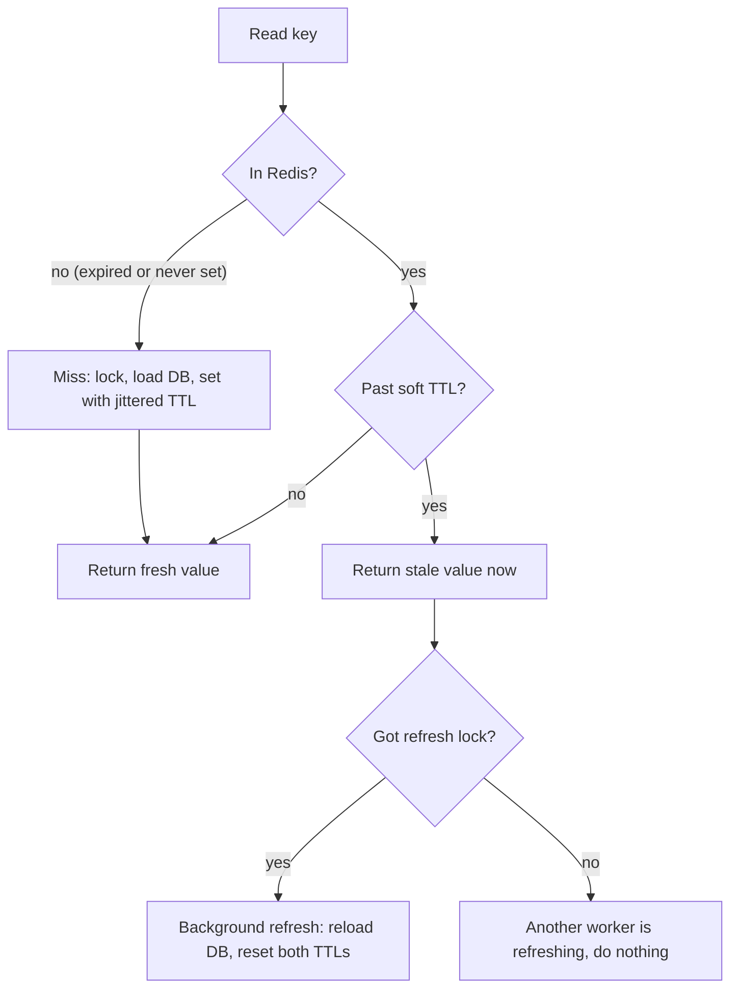

# TTL

> [!TIP]
> **In one line:** A TTL is the expiry timer on a cached entry; how you choose, randomize, and handle it decides how stale data gets and how safe your database is.
>
> **In plain English:** Every cached value is like milk in the fridge with a use-by date. Set the date too short and you keep buying fresh milk (the database does all the work). Set it too long and you pour sour milk on someone's cereal (users see stale data). And if every carton in the shop expires on the same morning, the shelf is suddenly empty.
>
> **You'll be able to:** pick a TTL from a staleness budget instead of a guess · add jitter so keys do not expire in lockstep · cache "not found" safely and serve stale data while refreshing in the background

## Why This Matters

In [cache-aside](cache-aside.md), the TTL is the setting that quietly decides almost everything. It bounds how wrong a cached answer can be (your worst-case staleness), it decides how many requests fall through to the database (your miss rate), and it is the safety net that cleans up after every bug in your invalidation logic. As [Cache Invalidation](cache-invalidation.md) explains, explicit invalidation is hard to get perfectly right, so almost every production cache relies on a TTL as the final guarantee that a wrong entry eventually goes away.

TTLs also cause outages. If a million keys are loaded at 09:00 with a one-hour TTL, they all expire at 10:00, and the database receives a wall of simultaneous misses at exactly the moment the cache stopped helping. That is a stampede caused not by a hot key but by a calendar. Understanding TTLs properly means understanding both halves: the policy question (how long should this live?) and the mechanics (how does Redis actually remove it, and what happens to traffic when it does?).

## Core Concept

A TTL attaches a lifetime to a cache entry. After that lifetime elapses, the entry is treated as absent and the next read is a miss that reloads from the source of truth. A TTL is not a freshness guarantee in the sense of "the data is at most N seconds old". It is a bound that holds only if every write path is either invalidated or tolerated: data can be stale for up to the TTL after a database change, and not longer, *provided you did nothing else to extend it*.

Three ideas organize the rest of this chapter.

**Absolute TTL versus sliding TTL.** An *absolute* TTL starts when the entry is written and is never extended: the entry dies N seconds after creation no matter how often it is read. A *sliding* (or idle) TTL resets on every access, so an entry dies N seconds after its *last read*. Absolute TTLs bound staleness, which is what you want for data cached from a database. Sliding TTLs bound memory usage and suit data whose truth does not change underneath you, such as login sessions, where "expire after 30 minutes of inactivity" is the actual business rule. Used on database-backed data, a pure sliding TTL is dangerous: a hot key is read constantly, so it never expires, and a stale value can live forever. The usual compromise is a sliding TTL with an absolute ceiling (extend on access, but never beyond N hours after creation).

**TTL as a staleness budget.** Do not pick TTLs by feel. Ask the product question first: how long can a user see an old value before it is a problem? A public product description might tolerate an hour. A stock price might tolerate two seconds. An account balance after a payment might tolerate zero, which means it should not rely on a TTL at all and should be explicitly invalidated or not cached. The TTL is the answer to that question, rounded down, not a number copied from a blog post.

**Expiry is a traffic event.** When an entry expires, one or more requests miss and hit the database. Whether that is a non-event or an incident depends on how many keys expire together, how expensive the reload is, and how many concurrent requests want that key at that moment.

## Mental Model

Think of a hotel with a lost-and-found shelf that stores each item for 30 days. If hundreds of items were all handed in on the same day, then 30 days later staff face an overflowing bin to clear in one sitting, and every owner who comes back after that day gets a blank "we threw it out". Staff who stagger things (some items kept 27 days, some 33) never face the cliff. Moreover, if a very popular item is about to be discarded, a clever clerk keeps showing the old one to visitors while a runner fetches a replacement, instead of making everyone wait at the counter. That clerk is stale-while-revalidate, and the staggering is jitter.

## How It Works

**Choosing the number.** Start from the staleness budget, then check it against the load. If the average read rate of a key is `r` requests per second and its TTL is `T` seconds, a cache-aside key causes about one database read per `T` seconds, so the database sees roughly `1/T` reads per second per key instead of `r`. The hit rate for that key is approximately `1 - 1/(r*T)`. For a key read 50 times per second with a 60 second TTL, that is `1 - 1/3000`, about 99.97 percent. Cutting the TTL to 1 second drops it to 98 percent, which is a 60-fold increase in database reads for that key. TTLs for popular keys can therefore be short without much cost, while TTLs for rarely read keys barely matter because they expire unread. This is why very short TTLs (1 to 5 seconds) are a surprisingly effective way to absorb a hot-key spike while keeping data nearly fresh.

**Jitter.** To prevent synchronized expiry, randomize the TTL when you write: `ttl = base * uniform(0.8, 1.2)` or `base + randint(0, base * 0.2)`. A bulk load of 100,000 keys with a 3,600 second base then expires smoothly across a 12-minute window rather than in one second. Jitter is nearly free and should be the default for any key written in batches (cache warmers, nightly refreshes, deploy-time warm-ups).

**Negative caching.** A "not found" is an answer worth caching. Without it, requests for IDs that do not exist (typos, scrapers, enumeration attacks) always reach the database. Cache a sentinel for missing keys with a *much shorter* TTL than positive results, perhaps 30 to 60 seconds, because the thing may be created at any moment and users who just created it should not see a 404 for an hour. When the entity is created, also delete the negative entry explicitly. Note that negative caching only helps for repeated lookups of the same missing key; an attacker iterating through random IDs defeats it, and for that you need rate limits or a Bloom filter in front.

**Stale-while-revalidate.** Instead of a single hard expiry, store two deadlines: a *soft* TTL after which the value is considered stale, and a *hard* TTL after which Redis actually removes it. For example, soft 60 seconds, hard 300 seconds. A read between soft and hard expiry returns the stale value immediately and triggers exactly one background refresh, guarded by a lock so a thousand concurrent readers do not all reload. Users see consistently low latency, and the database sees one refresh per key per soft period. The cost is that users can see data up to the hard TTL old if refreshes keep failing, which is a deliberate trade-off (and a useful resilience property: if the database is down, you keep serving the last good value). The same idea exists in HTTP as the `stale-while-revalidate` and `stale-if-error` Cache-Control extensions, discussed in [CDN Basics](cdn-basics.md).

**How Redis implements expiry.** Redis stores each expiring key's absolute expire time (a Unix timestamp in milliseconds) in a side dictionary. Two mechanisms remove expired keys. *Lazy (passive) expiry*: when a command touches a key, Redis first checks its expire time and deletes it if it has passed, so you never read an expired value. *Active expiry*: a background cycle that runs about 10 times per second, samples a batch of keys that have TTLs (20 per round), deletes the expired ones, and if more than about 25 percent of the sample was expired, repeats immediately. This keeps memory from filling with dead keys that nobody reads, but it is probabilistic: expired keys may linger briefly in memory. These are implementation details that can change between versions, but the two-layer structure is stable. Related commands: `EXPIRE key seconds` sets or replaces a TTL, `TTL`/`PTTL` read the remaining lifetime (-1 means no TTL, -2 means no such key), `PERSIST` removes it, and `SET key value EX seconds` sets value and TTL atomically. A plain `SET` on an existing key *clears* its TTL unless you pass `KEEPTTL`, a frequent source of "why is this key immortal?" bugs. `GETEX` (Redis 6.2 and later) reads a value and sets a new TTL in one atomic command, which is how you implement a sliding TTL without a second round trip. Expiry is also independent of eviction: `maxmemory-policy` decides what Redis drops when memory is full, as covered in [Redis](redis.md). In replicated setups, replicas do not expire keys on their own; they wait for the primary to send a `DEL`, with replicas hiding logically expired keys from reads.

## Architecture



Redis removes the entry only after the hard TTL, so the middle path (stale, refresh in background) serves the window between soft and hard expiry.

## Request / Response Example

A client asks for a product. The API reports cache state and age so you can see TTL behavior from outside.

```http
GET /products/42 HTTP/1.1
Host: api.example.com
Accept: application/json
```

```http
HTTP/1.1 200 OK
Content-Type: application/json
Cache-Control: private, max-age=30
X-Cache: STALE
Age: 74

{"id": 42, "name": "Espresso Machine", "price_cents": 1999}
```

Here the entry is 74 seconds old, past a 60 second soft TTL, so the API served it immediately and started a background refresh. A lookup for a missing product returns a short-lived negative answer:

```http
HTTP/1.1 404 Not Found
Content-Type: application/problem+json
X-Cache: HIT-NEGATIVE
Cache-Control: no-store

{"title": "Product not found", "status": 404}
```

`X-Cache` and `Age` here are debugging conveniences (`Age` is a real HTTP header, normally set by shared caches).

## Code Example

A small TTL toolkit on `redis.asyncio`: jittered TTLs, a negative cache sentinel, and stale-while-revalidate with a single-flight refresh lock. The value is stored with its own soft-expiry timestamp inside the JSON; Redis enforces only the hard TTL.

```python
import asyncio
import json
import os
import random
import time
from collections.abc import Awaitable, Callable
from typing import Any

import redis.asyncio as redis

r = redis.from_url(os.environ.get("REDIS_URL", "redis://localhost:6379/0"), decode_responses=True)

SOFT_TTL = 60          # after this, serve stale and refresh in the background
HARD_TTL = 300         # Redis deletes the key after this
NEGATIVE_TTL = 30      # "not found" is cached far shorter than real data
JITTER = 0.2           # +/- 20 percent spread so batches do not expire together
NOT_FOUND = "__nf__"   # sentinel for negative caching

_tasks: set[asyncio.Task] = set()  # strong refs so background tasks are not garbage-collected


def jittered(ttl: int) -> int:
    """Spread expiry across a window so bulk-loaded keys do not all die at once."""
    return max(1, int(ttl * random.uniform(1 - JITTER, 1 + JITTER)))


async def _store(key: str, value: Any) -> None:
    now = time.time()
    if value is None:
        payload = {"v": NOT_FOUND, "soft": now + jittered(NEGATIVE_TTL)}
        await r.set(key, json.dumps(payload), ex=jittered(NEGATIVE_TTL))
    else:
        payload = {"v": value, "soft": now + jittered(SOFT_TTL)}
        await r.set(key, json.dumps(payload), ex=jittered(HARD_TTL))


async def _refresh(key: str, loader: Callable[[], Awaitable[Any]]) -> None:
    lock_key = f"lock:{key}"
    # SET NX EX: only one worker wins, and the lock self-expires if that worker dies.
    if not await r.set(lock_key, "1", nx=True, ex=10):
        return
    try:
        await _store(key, await loader())
    except Exception:
        # Keep the stale value; it remains until the hard TTL. Log and meter in real code.
        pass
    finally:
        await r.delete(lock_key)


async def get_cached(key: str, loader: Callable[[], Awaitable[Any]]) -> Any:
    """Return the value for `key`, loading via `loader` (the database call) as needed.

    Returns None if the loader reports the entity does not exist.
    """
    raw = await r.get(key)
    if raw is not None:
        entry = json.loads(raw)
        if time.time() >= entry["soft"]:
            # Stale: answer now, refresh once in the background.
            task = asyncio.create_task(_refresh(key, loader))
            _tasks.add(task)
            task.add_done_callback(_tasks.discard)
        return None if entry["v"] == NOT_FOUND else entry["v"]

    # Cold miss: no stale value to serve, so load inline.
    value = await loader()
    await _store(key, value)
    return value
```

Notes on what this does and does not handle. Cold misses are not single-flight here: on a hot key's very first load, several requests can still reload concurrently (add a lock around the inline load, as in [Cache-Aside](cache-aside.md), if that matters). The values must be JSON-serializable. And the `soft` timestamp uses the application server's clock, so keep servers NTP-synchronized; a few seconds of skew only shifts the refresh point slightly.

## Production Considerations

**Choose TTLs per data class, not globally.** Keep a small table: reference data (hours), catalog data (minutes), personalized or volatile data (seconds), negative results (tens of seconds). Put them in configuration so they can be tuned without a deploy, and tune using the observed hit rate and staleness complaints.

**Watch for cliffs.** Plot database queries per second over time. A sawtooth with a period equal to your TTL means synchronized expiry. Add jitter, and for known bulk loads, stagger the load itself.

**Warm-ups need jitter too.** A deploy that flushes the cache or a cold Redis restart creates a cold-start wave regardless of TTL jitter. Pre-warm the hottest keys gradually, and be ready to shed load with rate limits and timeouts while the cache fills.

**Do not rely on TTL for correctness.** A TTL guarantees *eventual* repair, not timely repair. If a stale value would cause money or security problems (permissions, balances, feature entitlements), invalidate explicitly and keep the TTL short as a second line of defense.

**Monitor memory and expiry.** Redis exposes `expired_keys` and `evicted_keys` in `INFO stats`. Rising evictions with plenty of unexpired keys mean your TTLs are too long for your memory budget, and a missing TTL on a key family (check with `TTL` and `SCAN`) is a classic slow memory leak.

## Common Mistakes

- **No TTL at all.** The key lives until evicted, and any missed invalidation becomes permanent staleness and unbounded memory growth.
- **A single constant TTL for a bulk load.** All keys expire together and the database takes a synchronized hit. Add jitter.
- **Overwriting with plain `SET` and losing the TTL.** `SET` without `EX` or `KEEPTTL` clears the existing expiry. Always set the TTL in the same command.
- **Pure sliding TTL on database-backed data.** Hot keys never expire and serve stale data indefinitely. Add an absolute ceiling.
- **Caching "not found" for as long as real data.** A newly created record looks missing for the whole TTL. Use a short negative TTL and delete it on create.
- **Treating the TTL as the staleness guarantee after an extend.** Any code path that re-sets or extends the key resets the clock and breaks the bound.

## Best Practices

- Derive TTLs from a staleness budget agreed with the product owner, then check them against load using the `1 - 1/(r*T)` estimate.
- Always add 10 to 20 percent jitter to TTLs written in batches.
- Cache negative results with a much shorter TTL and clear them when the entity is created.
- Use soft and hard TTLs with a single-flight refresh for hot, expensive keys.
- Set value and TTL in one atomic command (`SET ... EX`, `GETEX`), and never write a cache entry without an expiry.
- Combine TTL with explicit invalidation for data where staleness matters; the TTL is the backstop, not the plan.

## AI Engineering Perspective

TTLs for LLM-related caches have different economics because a miss costs dollars and seconds, not milliseconds. A response cache keyed on a normalized prompt can use a long TTL for deterministic, factual queries (temperature 0, no per-user context) and none at all for personalized or time-sensitive prompts. Bind the cache key to the model name, prompt-template version, and any retrieved-document version, so that upgrading a model or re-indexing documents naturally misses instead of serving answers built on outdated context in your [RAG system](../16-rag-apis/README.md).

Stale-while-revalidate is particularly attractive for expensive generations: serving a slightly stale summary instantly while regenerating it once in the background beats making every reader wait several seconds for tokens. Negative caching also applies, for example remembering that a tool call or retrieval returned nothing, so an [agent](../17-ai-agents-and-mcp/README.md) does not repeat a costly failing lookup in a loop. Add jitter on top, since a batch re-embedding job otherwise creates a synchronized expiry cliff against a rate-limited model API.

## Exercises

**Beginner**

1. A key is read 20 times per second and has a 30 second TTL. Estimate the cache hit rate and the database reads per minute for that key. Then do it for a 2 second TTL.
2. In `redis-cli`, run `SET a 1 EX 100`, `TTL a`, then `SET a 2`, then `TTL a`. Explain what happened to the expiry.

**Intermediate**

1. Add a sliding TTL with an absolute ceiling using `GETEX`: each read extends the key by 10 minutes, but never beyond 2 hours after creation (store the creation time in the value).
2. Write a script that loads 10,000 keys with a fixed TTL, then again with 20 percent jitter, and plot how many keys expire per second in each case.

**Advanced**

1. Extend the example so a cold miss is single-flight too: concurrent requests for the same absent key wait briefly for the winner and then read the freshly stored value. Define what they do if the winner fails or is slow.
2. Design TTLs for an e-commerce API with product pages, inventory counts, user carts, and search suggestions. For each, state the staleness budget, the TTL, whether it needs explicit invalidation, and what happens when the database is down.

## Key Takeaways

- A TTL is both a staleness bound and a safety net for failed invalidation; derive it from a staleness budget, not from habit.
- Jitter the TTLs of keys that are written together, or they will all expire together and stampede the database.
- Cache "not found" for a much shorter time than real data, and clear it when the entity is created.
- Stale-while-revalidate with a soft and a hard TTL keeps latency flat and survives database outages for a while.
- Redis removes expired keys lazily on access and actively by sampling; a plain `SET` silently drops the TTL.

### Check Yourself

<details markdown="1">
<summary>1. What is the difference between an absolute and a sliding TTL?</summary>

An absolute TTL counts from when the entry was written and is never extended, so it bounds staleness. A sliding TTL resets on every read, so the entry expires after a period of inactivity, which bounds memory but lets hot entries live indefinitely.

</details>

<details markdown="1">
<summary>2. Why does a cache warmer that loads 100,000 keys with a fixed one-hour TTL cause a problem an hour later, and how do you fix it?</summary>

All the keys expire within the same second, so a wave of misses hits the database at once. Adding jitter (for example plus or minus 20 percent) spreads the expiries over a window and flattens the load.

</details>

<details markdown="1">
<summary>3. Users report that a newly created product shows "not found" for several minutes after creation. What is the likely cause and fix?</summary>

A negative cache entry from an earlier lookup is still alive with too long a TTL. Use a short negative TTL (tens of seconds) and delete the negative entry explicitly when the entity is created.

</details>

---
Back to the [Part 7 README](README.md).
