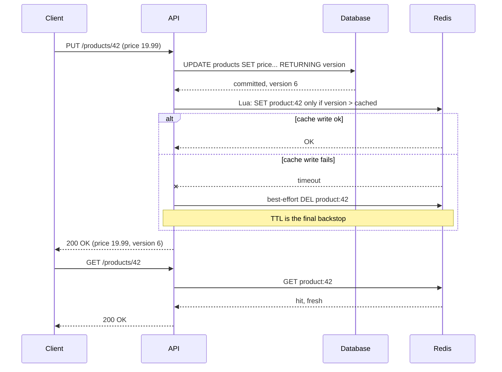
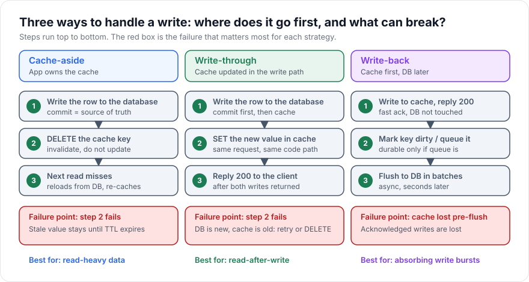

# Write-Through Caching

> [!TIP]
> **In one line:** Write-through updates the cache in the same request that updates the database, so reads right after a write see fresh data, at the cost of slower writes and a two-store consistency problem.
>
> **In plain English:** Imagine a shop that keeps a price list on the counter and a master price book in the back office. Whenever a price changes, the clerk updates both before telling the customer "done". The counter list is never out of date, but every price change takes a bit longer, and you have to decide what to do if the clerk updates one and gets interrupted before the other.
>
> **You'll be able to:** choose between cache-aside, write-through, write-around and write-back for a given workload · order the two writes so a failure leaves a recoverable state · guard a write-through cache against out-of-order writers

## Why This Matters

[Cache-aside](cache-aside.md) makes writes trivial: change the database, and let the cache catch up whenever it next misses. That is fine for most read-heavy data, but it has a visible side effect. After a write, the very next read is a miss, and in the window between the write and the cache fix-up, readers can see the old value. For a user who just changed their display name and refreshed the page, "the old name came back" looks like a bug, even though your system is working as designed.

Write-through is the answer to that specific complaint: after a successful write, the cache already holds the new value, so the next read is both fast and fresh. It is also a gateway to the harder question this chapter is really about. Any time one logical write must land in two systems (a database and a cache), you have created a mini distributed transaction without a coordinator. You need to know which store is the source of truth, which write goes first, and what state you are left in if the second write fails. Those questions recur in every part of the handbook that touches more than one datastore, and the cache is the gentlest place to learn them because a wrong cache entry is at least recoverable.

## Core Concept

A **write strategy** answers one question: when data changes, what happens to the cache? There are four classic answers.

- **Cache-aside (invalidate on write).** Write the database, then delete the cache key. The cache is repopulated lazily by the next read. Writes are cheap; the first read after a write pays a miss.
- **Write-through.** Write the database and the cache together, as part of the same request, and only acknowledge the client when both are done. Reads right after a write are hits with fresh data. Writes are slower (two round trips) and every written key occupies cache memory whether or not anyone reads it again.
- **Write-around.** Writes go straight to the database and deliberately skip the cache. Reads populate it on demand, exactly like cache-aside, but the write path never touches the cache at all (no delete either). This only makes sense for data that is written once and rarely re-read soon, such as log records, uploaded files, or audit events, where caching them would just evict hotter keys.
- **Write-back (write-behind).** Write to the cache, acknowledge the client immediately, and flush to the database later in the background, often in batches. Writes are the fastest, and repeated updates to one key can be coalesced into a single database write. The price is durability: until the flush happens, the cache holds the only copy of acknowledged data.

Notice that "write-through" in its pure textbook form means the *cache layer itself* writes to the database (the application talks only to the cache, and the cache is responsible for persistence). Managed products such as some in-memory data grids work this way. Redis does not: it has no idea your PostgreSQL exists. In an API codebase, "write-through" almost always means an *application-level* write-through: your code performs both writes. That distinction matters because it moves the consistency problem into your code, and the rest of this chapter is about handling it properly.

## Mental Model

Think of a restaurant with a whiteboard of today's specials by the door and a master menu in the kitchen. In cache-aside, when the chef changes a special, someone wipes that line off the whiteboard and waits for the next customer to ask, then writes it back. In write-through, the chef updates the kitchen menu and the whiteboard before announcing the change. In write-back, the chef scribbles the change on the whiteboard and says "I will update the master menu at the end of service", which is quick, but if the whiteboard is knocked over before then, the change is gone.

## How It Works

**The write path.** A write-through update does these steps in order:

1. Validate the request and begin a database transaction.
2. Write the new row and commit. The database is the source of truth, and the write is not real until this commit succeeds.
3. Serialize the new row and `SET` it in the cache under its key, with a TTL.
4. Return success to the client.

**Which write goes first?** Database first, cache second, is the safer default, for a simple reason: what can you recover from? If the database write fails, you abort and return an error, and the cache was never touched, so both stores still agree on the old value. If the cache write fails after the database commit succeeded, the stores disagree, but the cache holds the *older* value, and you have a durable record of the truth to repair from. Contrast that with cache first: if the cache accepts the new value and then the database write fails (a constraint violation, a deadlock, a crash), the cache now holds data that was never committed. Readers see a value that, as far as the system of record is concerned, never existed, and nothing in the database will ever correct it. Writing the cache first creates phantom data; writing the database first creates, at worst, stale data.

**When the second write fails.** After a committed database write, a failed cache `SET` leaves a stale entry. You have three options, in increasing order of effort. First, `DELETE` the key (best effort), which converts the situation into an ordinary cache-aside miss; if even the delete fails, the TTL is your backstop, which is one reason write-through entries should still carry a TTL (see [TTL](ttl.md), and [Cache Invalidation](cache-invalidation.md) for the broader picture). Second, return success anyway and log the failure, accepting staleness bounded by the TTL, which is reasonable when the cache is an optimization and not a correctness requirement. Third, enqueue the cache update in an outbox or retry queue so it is retried until it succeeds. Do not report the whole request as failed just because the cache write failed after the commit: the client would retry, the database write would run twice, and you have turned a harmless cache blip into a duplicated mutation.

**Concurrent writers.** The subtle problem in application-level write-through is ordering between two requests. Writer A commits version 5, writer B commits version 6, B writes version 6 to the cache, and then A, delayed by a garbage-collection pause or network hiccup, writes version 5 to the cache last. The cache now holds an older version than the database, and it will until the TTL expires. The database serialized the two writes correctly; the cache did not, because the two cache writes are not part of the same transaction. The standard fix is a monotonically increasing version number (or the row's `updated_at`) stored with the value, and a conditional cache write: only overwrite the cached entry if the incoming version is greater. Redis has no native compare-and-set on a field of a JSON string, so you do this atomically with a short Lua script (shown below). Without such a guard, write-through can be *less* consistent than cache-aside invalidation, which is the opposite of what people expect.

**The read path** is plain cache-aside: check the cache, on a miss read the database and populate. Write-through does not replace cache-aside reads; it only changes what happens on writes. A pure write-through cache that never falls back to the database on a miss would break the moment a key expires or is evicted.

**Write-back mechanics.** With write-back, the write path is: `SET` in the cache, append the key to a dirty set or a stream, acknowledge. A background worker drains the dirty set and writes the current values to the database, usually batched and with retry. This makes write latency equal to one cache round trip and absorbs write bursts (the database sees a smoothed, coalesced load). But it moves durability onto the cache. If the cache node crashes before the worker flushes, the acknowledged writes are gone, and the database may never have seen them. Redis persistence options (AOF with `everysec`, replication) narrow the window but do not close it: replication is asynchronous, so a failover can lose the last writes. Write-back is a legitimate choice for counters, view counts, rate-limit state, and telemetry, where losing a few seconds of data is acceptable. It is the wrong choice for orders, payments, or anything you could not reconstruct.

**Cost of write-through.** Every write now also pays a cache round trip (typically around a millisecond), and cached memory is spent on keys that may never be read again. If your workload writes many records that are rarely read (think event ingestion), write-through wastes memory and evicts hot keys; that is the case for write-around instead. Write-through shines where data is read soon after it is written and where staleness is visible: user profiles, settings, shopping carts, and "my own data" screens.

## Architecture





## Request / Response Example

A client updates a product price. The response carries the new `ETag` and version, and an immediate follow-up read is served from the cache with the fresh value.

```http
PUT /products/42 HTTP/1.1
Host: api.example.com
Authorization: Bearer <token>
Content-Type: application/json
If-Match: "5"

{"name": "Espresso Machine", "price_cents": 1999}
```

```http
HTTP/1.1 200 OK
Content-Type: application/json
ETag: "6"
X-Cache-Write: ok

{"id": 42, "name": "Espresso Machine", "price_cents": 1999, "version": 6}
```

```http
GET /products/42 HTTP/1.1
Host: api.example.com
```

```http
HTTP/1.1 200 OK
Content-Type: application/json
ETag: "6"
X-Cache: HIT
Age: 1

{"id": 42, "name": "Espresso Machine", "price_cents": 1999, "version": 6}
```

`X-Cache-Write` and `X-Cache` are illustrative debugging headers, not standards. The `If-Match` header gives you optimistic concurrency on the database side, which pairs naturally with the version guard on the cache side.

## Code Example

The example below uses SQLAlchemy 2.0 async, Pydantic v2, and `redis.asyncio`. The database `UPDATE ... RETURNING` increments a `version` column atomically, and the cache write is a Lua script that refuses to overwrite a newer version.

```python
import json
import os

import redis.asyncio as redis
from fastapi import Depends, FastAPI, HTTPException
from pydantic import BaseModel
from sqlalchemy import BigInteger, String, update
from sqlalchemy.ext.asyncio import AsyncSession, async_sessionmaker, create_async_engine
from sqlalchemy.orm import DeclarativeBase, Mapped, mapped_column

# Secrets and hosts come from the environment, never from source code.
engine = create_async_engine(os.environ["DATABASE_URL"])
SessionLocal = async_sessionmaker(engine, expire_on_commit=False)
cache = redis.from_url(os.environ.get("REDIS_URL", "redis://localhost:6379/0"))

CACHE_TTL_SECONDS = 600  # backstop: even if a cache write is lost, staleness is bounded


class Base(DeclarativeBase):
    pass


class Product(Base):
    __tablename__ = "products"
    id: Mapped[int] = mapped_column(primary_key=True)
    name: Mapped[str] = mapped_column(String(200))
    price_cents: Mapped[int] = mapped_column(BigInteger)
    version: Mapped[int] = mapped_column(default=1)  # bumped on every update


class ProductUpdate(BaseModel):
    name: str
    price_cents: int


class ProductOut(BaseModel):
    id: int
    name: str
    price_cents: int
    version: int


# Atomic "set only if newer": compares the version stored inside the cached JSON.
# KEYS[1] = cache key, ARGV[1] = new JSON, ARGV[2] = new version, ARGV[3] = TTL seconds.
SET_IF_NEWER = cache.register_script(
    """
    local current = redis.call('GET', KEYS[1])
    if current then
        local decoded = cjson.decode(current)
        if tonumber(decoded.version) >= tonumber(ARGV[2]) then
            return 0  -- cache already holds this version or a newer one
        end
    end
    redis.call('SET', KEYS[1], ARGV[1], 'EX', tonumber(ARGV[3]))
    return 1
    """
)

app = FastAPI()


async def get_session():
    async with SessionLocal() as session:
        yield session


@app.put("/products/{product_id}", response_model=ProductOut)
async def update_product(
    product_id: int, body: ProductUpdate, session: AsyncSession = Depends(get_session)
):
    # 1) Database first: it is the source of truth. If this fails, the cache is untouched.
    stmt = (
        update(Product)
        .where(Product.id == product_id)
        .values(name=body.name, price_cents=body.price_cents, version=Product.version + 1)
        .returning(Product.id, Product.name, Product.price_cents, Product.version)
    )
    row = (await session.execute(stmt)).one_or_none()
    if row is None:
        raise HTTPException(status_code=404, detail="product not found")
    await session.commit()
    out = ProductOut(id=row.id, name=row.name, price_cents=row.price_cents, version=row.version)

    # 2) Cache second. A failure here must NOT fail the request: the commit already happened.
    key = f"product:{product_id}"
    try:
        await SET_IF_NEWER(keys=[key], args=[out.model_dump_json(), out.version, CACHE_TTL_SECONDS])
    except redis.RedisError:
        # Best-effort invalidation turns a stale entry into an ordinary cache-aside miss.
        # If this also fails, the TTL bounds how long the stale value can live.
        try:
            await cache.delete(key)
        except redis.RedisError:
            pass  # log and alert in real code; do not raise
    return out


@app.get("/products/{product_id}", response_model=ProductOut)
async def get_product(product_id: int, session: AsyncSession = Depends(get_session)):
    key = f"product:{product_id}"
    cached = await cache.get(key)
    if cached is not None:
        return ProductOut.model_validate(json.loads(cached))
    # Plain cache-aside read: write-through never replaces the miss path.
    product = await session.get(Product, product_id)
    if product is None:
        raise HTTPException(status_code=404, detail="product not found")
    out = ProductOut(id=product.id, name=product.name, price_cents=product.price_cents, version=product.version)
    await SET_IF_NEWER(keys=[key], args=[out.model_dump_json(), out.version, CACHE_TTL_SECONDS])
    return out
```

Two limits are worth stating. First, `redis.RedisError` does not catch every failure mode in a production client (configure socket timeouts so a hung cache cannot hang your request). Second, the version guard stops older writes from overwriting newer ones, but a delete-on-failure followed by a stale read-repair can still briefly cache an old row; the TTL bounds it and [Cache Invalidation](cache-invalidation.md) discusses that class of race.

## Production Considerations

**Latency budget.** Write latency is now database time plus cache time. Set a short socket timeout on the cache client (tens of milliseconds) so a sick Redis degrades writes by a bounded amount rather than stalling them. Measure the added cost with the percentiles approach in [Latency and P95/P99](latency-and-percentiles.md), not just the average.

**Memory pressure.** Write-through caches every written key. For wide tables or high write volume, track cache hit rate, evictions, and memory used. If evictions climb while the hit rate on written-then-read keys is low, you are paying for data nobody reads, and write-around or cache-aside would be cheaper.

**Redis availability.** Decide up front whether the cache is required for correctness. If the cache is only an optimization, a Redis outage should degrade to database-only operation (the `try/except` above). If a feature genuinely depends on the cache (for example, session state stored only in Redis), then it is no longer a cache but a datastore, and it needs durability planning of its own.

## Common Mistakes

- **Writing the cache before the database.** If the commit then fails, the cache serves phantom data that never existed. Database first.
- **Failing the request when only the cache write failed.** The commit already happened; returning a 500 invites a client retry and a duplicate mutation. Log and degrade.
- **No TTL on write-through entries.** Without a TTL, one lost cache update leaves a stale entry forever. TTL is the safety net.
- **Ignoring concurrent writers.** Two requests can write the cache in the opposite order to their database commits. Use a version or timestamp guard.
- **Using write-back for data you cannot lose.** Acknowledged-but-unflushed writes die with the cache node.
- **Assuming write-through removes the miss path.** Keys expire, are evicted, and Redis restarts; reads must still fall back to the database.

## Best Practices

- Default to cache-aside with invalidation, and reach for write-through only where read-after-write freshness is visible to users.
- Commit to the database first, update the cache second, and treat the database as the only source of truth.
- Carry a version number with every cached value and make cache writes conditional on it.
- Keep a TTL on everything, including write-through entries, so failures are self-healing.
- Use write-around for write-once, read-rarely data, and reserve write-back for loss-tolerant counters and telemetry, ideally with a durable queue for dirty keys.
- Fail soft: a cache error on the write path should be logged and metered, not surfaced to the client.

## AI Engineering Perspective

LLM systems make the write-path choice concrete because the "database write" is often expensive in tokens, not just milliseconds. Consider a prompt-response cache or an embedding cache. When you regenerate an embedding for an edited document, a write-through update to the embedding cache means the next retrieval query sees vectors consistent with the new text, whereas lazy cache-aside could serve a similarity search against stale vectors for a full TTL and quietly degrade answer quality in your [RAG pipeline](../16-rag-apis/README.md). Versioning matters here too: store the embedding model name and a content hash alongside the vector, and treat a mismatch as a miss, so a model upgrade never mixes incompatible vectors.

Write-back is a natural fit for the *telemetry* around LLM calls, such as token counters, per-tenant usage, and latency histograms. Losing a few seconds of usage counts on a crash is tolerable, and coalescing thousands of increments per second into periodic database writes is exactly what the pattern is good at. It is a poor fit for the billing record of record, which should be committed durably first. For gateway-level caching of model responses and agent tool results, see [Part 15](../15-production-ai-systems/README.md) and [Part 17](../17-ai-agents-and-mcp/README.md).

## Exercises

**Beginner**

1. For each of these, pick cache-aside, write-through, write-around, or write-back and justify in one sentence: (a) a user profile viewed right after editing, (b) an append-only audit log, (c) a page-view counter, (d) a product catalog read thousands of times per write.
2. Draw the two-step write path for write-through and mark what state the system is in if step 2 fails. Do it once for database-first and once for cache-first.

**Intermediate**

3. Extend the example so `PUT` honors `If-Match`: reject with `412 Precondition Failed` when the supplied version does not match the row, using a `WHERE version = :expected` clause.
4. Write a test that simulates two concurrent updates committing in order 5, 6 but writing the cache in order 6, 5, and assert the cache ends at version 6.

**Advanced**

5. Design a write-back counter for API usage: increments go to a Redis hash, a worker flushes deltas to PostgreSQL every 5 seconds. Describe how you avoid double-counting if the worker crashes mid-flush, and how much data a Redis failover can lose.
6. Replace the best-effort delete with a transactional outbox: store a "refresh cache for key X" row in the same database transaction as the update, and have a worker apply it. What new failure modes does this remove, and what does it add?

## Key Takeaways

- Write-through updates the cache and the database in the same request; it buys read-after-write freshness and pays with slower writes and more cache memory.
- Write the database first: a failed second write then leaves stale data you can repair, whereas cache-first can leave phantom data that never existed.
- Application-level write-through is two uncoordinated writes, so guard against reordering with a version check and keep a TTL as the backstop.
- Write-around skips the cache for write-once data; write-back trades durability for write speed and suits only loss-tolerant data.

### Check Yourself

<details markdown="1">
<summary>1. What is the difference between write-through and write-back caching?</summary>

In write-through, the database is written in the same request and the client is acknowledged only after both stores are updated. In write-back, the cache is written and acknowledged first and the database is updated later in the background, so write latency is lower but acknowledged writes can be lost if the cache fails before the flush.

</details>

<details markdown="1">
<summary>2. Why is it safer to write the database first and the cache second?</summary>

If the database write fails, the cache was never touched and both stores agree. If the cache write fails after a successful commit, the cache is merely stale and can be repaired from the truth. With cache first, a failed database write leaves the cache holding data that was never committed, which nothing will correct.

</details>

<details markdown="1">
<summary>3. Two concurrent updates commit to the database as versions 5 then 6, but the cache ends up holding version 5. How did this happen and how do you prevent it?</summary>

The two cache writes ran in the opposite order to the commits, because the cache write is not part of the database transaction, so the slower version-5 write landed last. Prevent it by storing the version with the cached value and making the cache write conditional (for example, a Lua script that only overwrites when the new version is greater), with a TTL as a backstop.

</details>

---
Back to the [Part 7 README](README.md).
