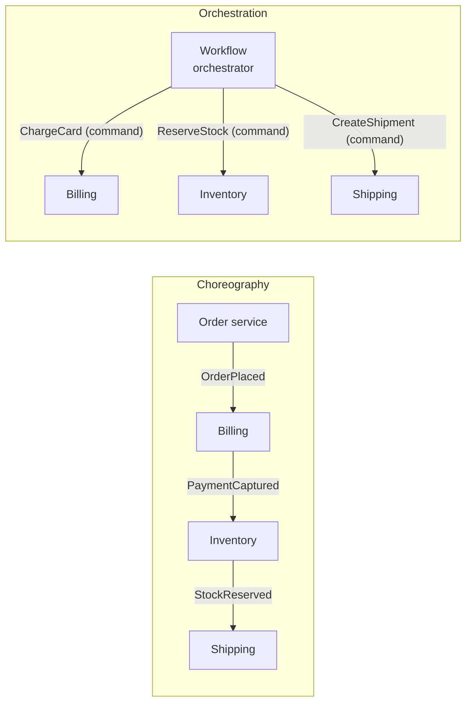
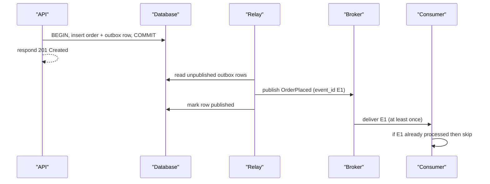

# Event-Driven Architecture

> [!TIP]
> **In one line:** In an event-driven system, services announce facts that already happened and others react independently, trading direct control for loose coupling, and the outbox pattern keeps those announcements reliable.
>
> **In plain English:** A newspaper prints what happened and anyone who cares can read it and act, without the paper knowing who its readers are. That is different from phoning each person with an instruction. It scales nicely, but nobody is in charge of the whole story unless you design for that.
>
> **You'll be able to:** distinguish events from commands and choose choreography or orchestration · publish events reliably with the transactional outbox · evolve event schemas without breaking consumers

## Why This Matters

Consider "place an order." The order service must tell billing, inventory, shipping, email, analytics and fraud detection. In a synchronous design the order endpoint calls each of them. Every new interested party means another change to the order service, the request is as slow as the slowest dependency, and one outage fails the whole checkout. This is the coupling problem the earlier chapters on [sync versus async](sync-vs-async.md) and [message queues](message-queues.md) started to address.

Event-driven architecture (EDA) reverses the dependency. The order service records that `OrderPlaced` happened and publishes it. Whoever cares subscribes. Adding a loyalty-points service means deploying a new consumer, with no change to the producer. The price is real: control flow is now implicit, behavior emerges from many reactions, failures happen in the gaps between services, and you inherit duplicated delivery, ordering and consistency problems. This chapter gives you the vocabulary and the patterns that make EDA dependable.

## Core Concept

**Events versus commands.** The most important distinction in the chapter:

- A **command** is a request to do something, addressed to a specific handler, in the imperative: `ReserveStock`, `ChargeCard`. It can be rejected. The sender expects exactly one party to act and usually cares about the result.
- An **event** is a statement that something *has happened*, in the past tense: `OrderPlaced`, `PaymentCaptured`. It cannot be rejected, because it is history. The publisher does not know or care who listens. Zero, one or fifty consumers may react.

Mixing these up is the root of many bad designs. An "event" named `SendWelcomeEmail` is a command wearing a costume; the publisher now depends on a specific consumer, and the coupling EDA was meant to remove is back.

**Event shapes.** An *event notification* carries minimal data (an ID) and consumers call back for details, which keeps events small but couples consumers to the producer's API availability. *Event-carried state transfer* includes the data consumers need, so they never call back, at the cost of larger events and a schema that is now a public contract. Most systems use the second for fields many consumers need and the first for the rest. *Event sourcing*, where events are the system of record and state is derived by replaying them, is a distinct and much heavier commitment; EDA does not require it.

**Choreography versus orchestration.** In **choreography**, each service reacts to events and emits its own: order placed, then billing charges and emits `PaymentCaptured`, then inventory reserves and emits `StockReserved`, then shipping reacts. There is no central coordinator. In **orchestration**, a coordinator (a saga orchestrator or workflow engine) sends commands, listens for outcomes and decides the next step. Choreography maximizes decoupling and suits simple, stable flows; orchestration makes multi-step flows with compensation visible and testable, and suits anything where "what is the current state of order 501's workflow?" must be answerable. Often the right answer is choreography between bounded contexts and orchestration inside a complex flow. The compensation side of this is covered in [Saga Pattern](../11-microservices-distributed-systems/saga-pattern.md).

## Mental Model

A town's notice board. Anyone can pin a dated note stating a fact ("Bakery: today's bread baked at 6:00"), and anyone can read it, copy it, and act on it when they get around to it. The baker does not know who read it. A *command* is a letter addressed to one named person, who is expected to reply. A notice board scales to a whole town but gives nobody an overview: to answer "did everything that should follow from this notice actually happen?" you must deliberately build a way to trace it.

## How It Works

**Producers and consumers.** A producer emits an event to a broker (a topic in [Kafka](kafka-concepts.md), an exchange in [RabbitMQ](rabbitmq-concepts.md), or a cloud equivalent). Consumers subscribe, each with its own independent progress, so one slow consumer does not affect others. Delivery is at-least-once, so consumers must be idempotent: dedupe on a stable `event_id`, or make the effect naturally repeatable ([Idempotency](../02-rest-api-design/idempotency.md)).

**The dual-write problem and the transactional outbox.** The classic trap: the order service saves the order to its database and then publishes `OrderPlaced` to the broker. These are two systems with no shared transaction. If the process crashes between them, you have an order with no event (downstream never learns), or, if you publish first, an event for an order that was rolled back. Retrying does not fix this, and neither does ordering the calls cleverly. The solution is the **transactional outbox**:

1. In the *same database transaction* that changes business data, insert an event row into an `outbox` table. Both commit or neither does.
2. A separate **relay** process reads unpublished outbox rows, publishes them to the broker, and marks them published (or deletes them).
3. If the relay crashes after publishing but before marking, it republishes on restart. So the outbox gives **at-least-once publication**, which is exactly what idempotent consumers expect.

The relay can be a polling loop (simple, and what the example below shows) or **change data capture**, where a tool such as Debezium tails the database's write-ahead log and publishes rows from the outbox table with lower latency and no polling. The mirror image for the consuming side is the **inbox** (deduplication) table from [Kafka Concepts](kafka-concepts.md): record the processed `event_id` in the same transaction as the effect.

**Event schema evolution.** Events are a public API with unknown consumers, and you cannot coordinate a flag day. Rules that keep you safe:

- Include `event_id`, `type`, `version`, `occurred_at` and a correlation ID (the request or workflow that caused it) in an envelope.
- **Additive changes only** within a version: new *optional* fields with defaults. Consumers must be **tolerant readers**, ignoring fields they do not know.
- Never remove, rename or change the meaning or type of a field in place. For a breaking change publish a new version (`order.placed.v2`) alongside the old one, migrate consumers, then retire the old after a deprecation period.
- Make compatibility mechanical: a schema registry with backward or forward compatibility checks in CI beats human review.
- Name events by business fact, not by database change (`OrderPlaced`, not `orders_row_updated`), or every table refactor becomes a breaking change.

**Ordering and delivery.** Brokers order within a partition or queue, not globally. Key events by the aggregate whose history must be ordered (the order ID), and design consumers that tolerate duplicates and, where cheap, late or reordered events (for example, ignore an event whose version is lower than the stored state's). Delivery claims should be stated honestly: at-least-once from the broker, effectively-once through idempotent handling.

**Failure and observability.** With no single call stack, debugging needs deliberate support: propagate a correlation ID through every event, keep a dead-letter path for events a consumer cannot process, and monitor consumer lag. A workflow that must complete (an order that must eventually ship) needs an owner: either an orchestrator or timeout-based reconciliation that detects "order placed but never paid after 30 minutes."

## Architecture





In choreography the flow lives nowhere in particular; in orchestration it lives in the orchestrator, which is easier to reason about and a single point of design attention. The sequence diagram shows why the outbox works: the only atomic step is inside one database, and everything after it is retried until it succeeds.

## Request / Response Example

The synchronous API call returns quickly. Note it reports that the order was *accepted*, not that every downstream reaction has occurred:

```http
POST /v1/orders HTTP/1.1
Host: api.example.com
Content-Type: application/json
Idempotency-Key: 5b1f2a9c-8a53-4c34-a9d0-6b2c3a6e1f10

{"customer_id": "cust-7", "items": [{"sku": "BOOK-1", "qty": 2}]}
```

```http
HTTP/1.1 201 Created
Location: /v1/orders/501
Content-Type: application/json

{"order_id": 501, "status": "placed"}
```

The event that the relay later publishes, to the `orders` topic keyed `cust-7`, in an envelope modeled on the CloudEvents attributes:

```json
{
  "event_id": "0b6f6a0e-6b0c-4f43-9d0a-3d3a2a7ad001",
  "type": "order.placed",
  "version": 1,
  "occurred_at": "2026-11-10T09:15:32Z",
  "correlation_id": "req_8f2c1d",
  "data": {"order_id": 501, "customer_id": "cust-7", "total_cents": 4200, "currency": "EUR"}
}
```

A later, backward-compatible revision may add `"coupon_code": "WELCOME10"` inside `data`. Consumers on version 1 ignore it and keep working.

## Code Example

The write side of the outbox with SQLAlchemy 2.0 async and Pydantic v2, plus a polling relay. The relay uses `FOR UPDATE SKIP LOCKED` so several relay instances never publish the same row concurrently.

```python
# outbox.py
import uuid
from datetime import datetime, timezone
from typing import Literal

from pydantic import BaseModel, Field
from sqlalchemy import DateTime, Integer, String, func, select
from sqlalchemy.dialects.postgresql import JSONB, UUID
from sqlalchemy.ext.asyncio import AsyncSession, async_sessionmaker
from sqlalchemy.orm import DeclarativeBase, Mapped, mapped_column


class Base(DeclarativeBase): ...


class Order(Base):
    __tablename__ = "orders"
    id: Mapped[int] = mapped_column(Integer, primary_key=True)
    customer_id: Mapped[str] = mapped_column(String(64))
    status: Mapped[str] = mapped_column(String(32))


class Outbox(Base):
    __tablename__ = "outbox"
    id: Mapped[int] = mapped_column(Integer, primary_key=True, autoincrement=True)
    event_id: Mapped[uuid.UUID] = mapped_column(UUID(as_uuid=True), unique=True)
    topic: Mapped[str] = mapped_column(String(100))
    key: Mapped[str] = mapped_column(String(100))
    payload: Mapped[dict] = mapped_column(JSONB)
    published_at: Mapped[datetime | None] = mapped_column(DateTime(timezone=True), nullable=True)


# The public contract. Additive changes only: new fields must be optional with defaults.
class OrderPlacedV1(BaseModel):
    event_id: uuid.UUID = Field(default_factory=uuid.uuid4)
    type: Literal["order.placed"] = "order.placed"
    version: Literal[1] = 1
    occurred_at: datetime = Field(default_factory=lambda: datetime.now(timezone.utc))
    correlation_id: str
    data: dict


async def place_order(session: AsyncSession, customer_id: str, correlation_id: str) -> int:
    # ONE transaction: the business change and the event commit together or not at all.
    async with session.begin():
        order = Order(customer_id=customer_id, status="placed")
        session.add(order)
        await session.flush()  # assigns order.id
        order_id = order.id    # read now: attributes expire after commit in async sessions
        event = OrderPlacedV1(
            correlation_id=correlation_id,
            data={"order_id": order_id, "customer_id": customer_id},
        )
        session.add(Outbox(
            event_id=event.event_id, topic="orders", key=customer_id,
            payload=event.model_dump(mode="json"),
        ))
    return order_id


async def relay_once(factory: async_sessionmaker[AsyncSession], publish, batch: int = 100) -> int:
    """Publish up to `batch` pending events. `publish(topic, key, payload)` must raise on failure."""
    async with factory() as session, session.begin():
        rows = (await session.execute(
            select(Outbox)
            .where(Outbox.published_at.is_(None))
            .order_by(Outbox.id)
            .limit(batch)
            .with_for_update(skip_locked=True)   # concurrent relays skip locked rows
        )).scalars().all()
        for row in rows:
            await publish(row.topic, row.key, row.payload)  # raises => whole batch rolls back
            row.published_at = func.now()
        return len(rows)
```

What this does and does not give you. Publishing happens before the `published_at` update commits, so a crash in between causes republication: at-least-once, which is why consumers dedupe on `event_id`. The relay holds a database transaction open while it talks to the broker, which is acceptable at small batch sizes but is a reason to prefer CDC at high volume. With `SKIP LOCKED` and several relay instances, publication order across a given key is *not* guaranteed, because a later batch can be published by another instance first; if per-key order matters, run a single relay, or shard relays by key hash. Finally, prune or archive published rows regularly so the table and its index stay small.

## Production Considerations

- **Treat events as an API product.** Own them: name an owner, document the fields, version them, announce deprecations. Consumers will depend on things you did not mean to promise.
- **Idempotent, tolerant consumers.** Dedupe on `event_id`, ignore unknown fields, and handle events arriving later than expected.
- **Dead-letter and replay.** A consumer that cannot process an event must not block the stream indefinitely. Park it with context and keep a tool to replay once fixed.
- **Trace across hops.** Propagate correlation and trace IDs in the envelope and headers so you can follow `OrderPlaced` through every reaction. Pair with the metrics and tracing in [Part 12](../12-observability/README.md).
- **Monitor the outbox.** Alert on unpublished row count and on the age of the oldest unpublished row; a growing outbox means the relay or broker is unhealthy.
- **Reconcile.** Choreographed flows need a safety net that detects stalls ("paid but never shipped") rather than relying on every hop succeeding.
- **Expect eventual consistency.** Reads on other services lag the write. See [Eventual Consistency](eventual-consistency.md) for designing around it, and where it is unacceptable.
- **Resist event overuse.** Synchronous calls remain right when the caller needs an answer now ("is this card valid?"). Event-driven is a tool for decoupled reactions, not a replacement for every request.

## Common Mistakes

- **Dual writes**: committing to the database and publishing separately, with no outbox, and losing events on crash.
- **Commands disguised as events** (`SendEmailEvent`), recreating coupling.
- **Events named after table changes** rather than business facts, leaking internal schema.
- **Breaking schemas in place**: renaming a field and silently breaking every consumer.
- **Assuming a global order** across partitions or queues.
- **Non-idempotent consumers**, which double-charge or double-email on redelivery.
- **Event chains nobody can see**: choreography grown to a dozen hops with no diagram, correlation ID or owner.
- **Fat events leaking sensitive data** to every subscriber. Think about who can read the topic.
- **Treating the broker as the source of truth** by accident, with no way to rebuild a lost consumer's state.

## Best Practices

- Name events as past-tense business facts; use imperative names only for commands.
- Use the transactional outbox (polling relay or CDC) for every event that must accompany a state change.
- Put `event_id`, `type`, `version`, `occurred_at` and `correlation_id` in every envelope.
- Evolve schemas additively, enforce compatibility in CI, version breaking changes and run old and new in parallel.
- Choose choreography for simple, stable reactions and orchestration for multi-step flows needing visibility and compensation.
- Make consumers idempotent and tolerant; give them a dead-letter path.
- Keep synchronous APIs for cases where the caller needs an immediate answer.

## AI Engineering Perspective

Events are how AI features stay decoupled from the core product. A `DocumentUploaded` event can trigger chunking, embedding, classification and PII scanning as independent consumers, each with its own rate limits and cost controls; adding a new enrichment step is a new subscriber, not a change to the upload path. Agent systems are inherently event-shaped: a tool result, a human approval or a model completion is an event that advances a workflow, and the choreography-versus-orchestration choice maps directly onto "free-form multi-agent chatter" versus "a supervised graph with explicit state." Orchestration usually wins for agents because you need an audit trail and bounded cost, themes developed in [Multi-Agent Communication](../17-ai-agents-and-mcp/multi-agent-communication.md) and [Part 15](../15-production-ai-systems/README.md). One caution specific to LLMs: model outputs are non-deterministic, so an event whose payload includes generated content must be treated as a fact recorded once, and a replay should reuse the stored output rather than re-calling the model, or downstream state will diverge.

## Exercises

**Beginner**
1. Classify each as event or command and rewrite any that are mislabeled: `CreateInvoice`, `UserRegistered`, `SendPasswordResetEmail`, `PaymentFailed`.
2. Draw the choreography for "order placed" involving billing, inventory and email. Who knows whether the whole order succeeded?

**Intermediate**
3. A producer needs to rename `total` to `total_cents` in `order.placed`. Write the rollout plan using only additive and versioned changes, and say when the old field may be removed.
4. Add an inbox table to a consumer so redelivered events are ignored, in the same transaction as the effect. What do you key the inbox on, and how do you prevent unbounded growth?

**Advanced**
5. The relay publishes an event and crashes before marking the row. Walk through exactly what each consumer sees, and describe how the system behaves with 3 relay instances and per-customer ordering requirements.
6. Convert a six-service choreographed order flow into an orchestrated saga. Which failure modes become easier to handle, and which new single points of failure appear?

## Key Takeaways

- Events are immutable past-tense facts with unknown consumers; commands are requests to a specific handler. Keep them separate.
- The transactional outbox solves the dual-write problem by making the event part of the database commit, giving at-least-once publication that idempotent consumers absorb.
- Evolve event schemas additively and version breaking changes; treat events as a public API with tolerant readers.
- Choose choreography for simple reactions and orchestration when you need visibility and compensation, and add correlation IDs and reconciliation either way.

### Check Yourself

<details markdown="1">
<summary>1. What is the difference between an event and a command?</summary>

An event states something that already happened and cannot be rejected, with any number of unknown consumers. A command asks one specific handler to do something and can be refused.

</details>

<details markdown="1">
<summary>2. Why can't you simply save to the database and then publish to the broker, retrying on failure?</summary>

They are two separate systems with no shared transaction, so a crash between the steps leaves a saved order with no event, and retry logic does not survive the process dying. The outbox writes the event in the same database transaction so it cannot be lost.

</details>

<details markdown="1">
<summary>3. Your relay publishes the same event twice after a crash and customers get two confirmation emails. Where is the bug?</summary>

The duplicate publication is expected under at-least-once delivery. The bug is that the email consumer is not idempotent; it should record the processed `event_id` (or check whether the email for that order was already sent) before sending.

</details>

---
Back to the [Part 8 README](README.md).
