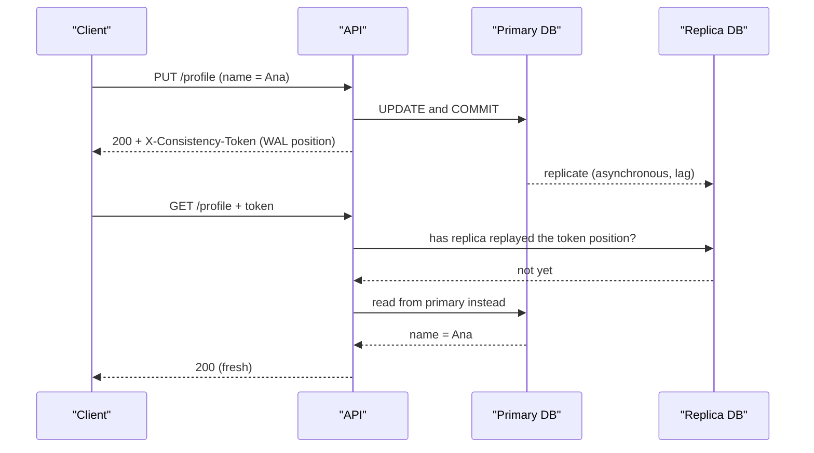
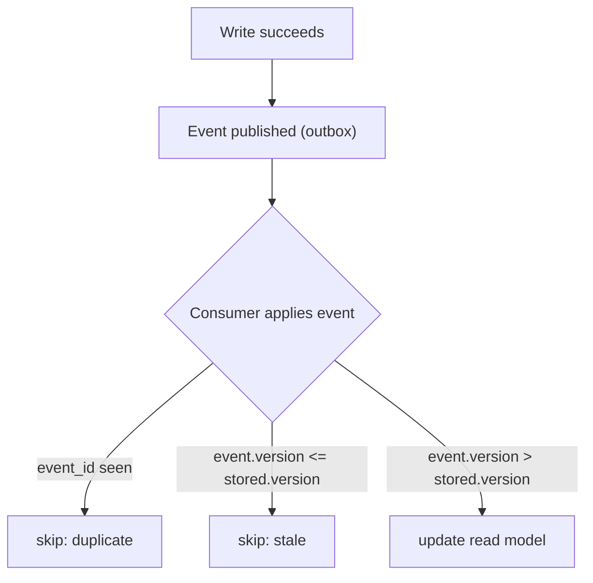

# Eventual Consistency

> [!TIP]
> **In one line:** Eventual consistency means copies may briefly disagree but converge once writes stop; design for the gap, and keep decisions that cannot tolerate staleness on authoritative data.
>
> **In plain English:** When you change your address with a company, the billing office may update tonight while the delivery depot updates tomorrow, so for a day the two disagree. It is fine as long as the lag is short, you are not misled meanwhile, and nothing important was decided using the old address.
>
> **You'll be able to:** explain what eventual consistency does and does not promise · implement read-your-writes, version-guarded updates and idempotent consumers · decide where stale data is acceptable and where it must be prevented

## Why This Matters

The moment you add a read replica, a cache, a search index, a message queue or a second service with its own database, you have more than one copy of the truth. The chapters before this one, [Message Queues](message-queues.md), [Kafka Concepts](kafka-concepts.md) and [Event-Driven Architecture](event-driven-architecture.md), all move data asynchronously, and asynchronous movement takes time. During that time, copies disagree.

The default reaction is to treat this as a bug to eliminate. Usually it is a trade-off to manage. Synchronous coordination across services or regions costs latency and availability: if every write must wait for every copy, a slow or unreachable replica stops writes entirely. Accepting a brief window of disagreement buys speed, scale and resilience. But "accept it" is not a design. Users who submit a form and then see the old data file bug reports; two services that act on conflicting copies produce double shipments; and a few kinds of data (money, stock, permissions) cannot tolerate it at all. This chapter explains what is actually promised and how to build around the gap.

## Core Concept

**Strong consistency** means that after a write completes, every subsequent read, from anywhere, sees it (the system behaves as if there were one copy). **Eventual consistency** is a much weaker statement: if no new updates are made to an item, all replicas will *eventually* return the same last value. Note what it leaves out. It gives no bound on how long "eventually" takes, no promise about what you read in the meantime (it may be old, and two reads may even go backwards in time), and no rule for which of two concurrent writes wins. Everything else in this chapter is about adding back the specific guarantees your application needs.

The useful intermediate guarantees, often called **session guarantees**, are:

- **Read-your-writes**: after *you* write, *your* subsequent reads reflect it.
- **Monotonic reads**: you never see data go backwards (newer, then older).
- **Consistent prefix**: you see updates in the order they were made, never an effect without its cause.

Most user-visible weirdness is a violation of one of these, and each can be restored cheaply for the one session that needs it, without paying for global strong consistency.

The CAP theorem frames the underlying choice: during a network partition a replicated system must choose between consistency (refuse some operations) and availability (answer, possibly stale). Even without partitions the trade-off between latency and consistency persists (the PACELC refinement), which is why single-region systems with replicas still exhibit it.

## Mental Model

A group chat with a flaky signal. Everyone's phone shows the conversation, but messages reach different phones at slightly different times, so for a moment two people have different views. If nobody sends anything new, all phones end up identical, and that is convergence. Problems arise when someone replies to a message that a friend has not yet received ("yes, do it!" with no context), when two people announce conflicting plans at the same moment, or when you act on what you saw a minute ago. Read-your-writes is making sure *your own* sent message always appears on *your* screen; conflict handling is the rule for what happens when two people edit the same plan; and "do not accept" cases are the ones where you phone instead of texting.

## How It Works

**Where the gaps come from.** Asynchronous replication to read replicas (lag typically milliseconds, but seconds or minutes under load or during a bulk write); caches with TTLs; search indexes updated from change streams; consumers processing an event queue behind the producer; multi-region active-active writes. Each is a different mechanism with the same symptom: a read can return something older than a write that has already succeeded.

**Read-your-writes.** The standard techniques, from simplest to most precise: (1) return the updated resource in the write response so the client does not need to re-read; (2) after a write, route that user's reads to the primary for a short window; (3) pass a **consistency token** (a version number or, in PostgreSQL, the write's WAL position) from the write response to later reads, and serve from a replica only if it has caught up to that token, otherwise fall back to the primary. Option 3 is exact and cheap, and the code below implements it.

**Idempotent, order-tolerant consumers.** Asynchronous consumers receive at-least-once delivery, which means duplicates, and often limited ordering. A consumer that updates a derived copy (a search document, a cached profile, a read model) should be safe under both. Two tools: an **event ID check** so a redelivered event does nothing, and a **version guard** so an older event never overwrites newer state: apply an update only if its version is greater than the stored one. This also makes consumers tolerate reordering, which is how you cope when a broker only orders within a partition.

**Conflict handling.** If two replicas accept writes to the same item concurrently (multi-region, offline-capable clients), there is a conflict and *something* must decide the outcome. Options: **last-writer-wins** by timestamp, which is simple but silently discards one write and is hostage to clock skew (it is only safe when losing a concurrent update is acceptable, such as a "last seen" field); **version vectors** that detect concurrency so the application or user can merge; **application-specific merge** (union of tags, sum of increments); and **CRDTs** (data types designed so that concurrent updates merge deterministically, such as counters and sets). For single-writer systems, **optimistic concurrency** (a version or ETag checked on write, rejecting a stale update with `412 Precondition Failed`) prevents lost updates without locks, and is the right default for most APIs.

**UX for stale data.** Consistency is partly a product decision. Show the user their own change immediately (optimistic UI) and reconcile on the response. Mark in-flight state honestly ("Processing", "Syncing"), as with the job statuses in [Job Queues](job-queues.md). Avoid showing two screens that visibly contradict each other without an explanation or a timestamp. For lists that update later (search results after an upload), tell the user ("It may take a few seconds to appear"), and let the client poll or subscribe for completion rather than asking them to refresh. See [Polling](../09-realtime-and-webhooks/polling.md) and [Server-Sent Events](../09-realtime-and-webhooks/server-sent-events.md) for delivery options.

**Where you must not accept it.** Eventual consistency is a poor fit wherever acting on stale data causes irreversible or unbounded harm, or where an invariant must hold at the moment of the write:

- **Money and balances.** Checking a balance on a stale replica and then debiting allows overdrafts. Debit and invariant check happen in one transaction on one authoritative copy ([Database Transactions](../04-databases-and-apis/database-transactions.md)).
- **Inventory and any scarce resource.** Two checkouts against stale stock oversell. Use an atomic decrement or reservation on the source of truth.
- **Uniqueness constraints.** "Username taken?" answered by a lagging copy lets two people register the same name. Enforce with a unique index on the authoritative store.
- **Authorization and revocation.** A removed user, revoked token or disabled account must stop working *now*, not after replication or cache expiry. Check the authoritative store, or keep revocation lists with very short staleness bounds (see [Part 5](../05-authentication-authorization/README.md) and [Part 10](../10-api-security/README.md)).
- **Anything with a legal or safety invariant** (consent withdrawal, medical dosing).

The rule of thumb: keep **decisions** on strongly consistent data and let **displays, search, analytics and notifications** run on eventually consistent copies. Between services, when a multi-step business transaction must stay correct without a distributed lock, use a [saga](../11-microservices-distributed-systems/saga-pattern.md) with compensating actions, which is deliberately designed for the intermediate states.

**Measure it.** "Eventual" needs a number. Track replication lag, consumer lag and the age of the newest event applied to each derived store, set an SLO (for example, 99% of search updates visible within 5 seconds), and alert on breaches.

## Architecture





## Request / Response Example

A write returns a token. A later read presents it, and the API serves from a replica only if that replica has caught up:

```http
PUT /v1/profile HTTP/1.1
Host: api.example.com
Content-Type: application/json
If-Match: "v7"

{"display_name": "Ana"}
```

```http
HTTP/1.1 200 OK
ETag: "v8"
X-Consistency-Token: 0/16B3748
Content-Type: application/json

{"user_id": 42, "display_name": "Ana", "version": 8}
```

```http
GET /v1/profile HTTP/1.1
X-Consistency-Token: 0/16B3748

HTTP/1.1 200 OK
X-Served-By: primary
Content-Type: application/json

{"user_id": 42, "display_name": "Ana", "version": 8}
```

`X-Served-By: primary` shows the replica was behind the token, so the API chose freshness over offload. Without the token the same read may return `"version": 7` from a lagging replica, which is acceptable for a casual read and unacceptable immediately after the user's own edit. A concurrent edit by someone else is rejected rather than overwritten:

```http
PUT /v1/profile HTTP/1.1
If-Match: "v7"

HTTP/1.1 412 Precondition Failed
Content-Type: application/json

{"error": "stale_version", "current_version": 8}
```

## Code Example

Three pieces: a version-guarded, idempotent consumer update; token-based read-your-writes for PostgreSQL replicas; and optimistic concurrency on the write path. This assumes PostgreSQL 10 or later with streaming replication, SQLAlchemy 2.0 async, and one async engine for the primary and one for a replica.

```python
# consistency.py
import os
import re

from fastapi import FastAPI, Header, HTTPException, Response
from sqlalchemy import BigInteger, String, text, update
from sqlalchemy.dialects.postgresql import insert
from sqlalchemy.ext.asyncio import AsyncSession, async_sessionmaker, create_async_engine
from sqlalchemy.orm import DeclarativeBase, Mapped, mapped_column

primary = create_async_engine(os.environ["PRIMARY_URL"])
replica = create_async_engine(os.environ["REPLICA_URL"])
PrimarySession = async_sessionmaker(primary, expire_on_commit=False)
ReplicaSession = async_sessionmaker(replica, expire_on_commit=False)


class Base(DeclarativeBase): ...


class Profile(Base):                      # the authoritative write model
    __tablename__ = "profiles"
    user_id: Mapped[int] = mapped_column(primary_key=True)
    display_name: Mapped[str] = mapped_column(String(100))
    version: Mapped[int] = mapped_column(BigInteger, default=1)


class ProfileView(Base):                  # a derived read model filled from events
    __tablename__ = "profile_views"
    user_id: Mapped[int] = mapped_column(primary_key=True)
    display_name: Mapped[str] = mapped_column(String(100))
    version: Mapped[int] = mapped_column(BigInteger)


# --- 1. Consumer: idempotent AND order-tolerant via a version guard --------------------
async def apply_profile_event(session: AsyncSession, ev: dict) -> None:
    stmt = insert(ProfileView).values(
        user_id=ev["user_id"], display_name=ev["display_name"], version=ev["version"]
    )
    stmt = stmt.on_conflict_do_update(
        index_elements=[ProfileView.user_id],
        set_={"display_name": stmt.excluded.display_name, "version": stmt.excluded.version},
        where=(ProfileView.version < stmt.excluded.version),  # older or equal: no-op
    )
    async with session.begin():
        await session.execute(stmt)  # redelivered or reordered events change nothing


# --- 2. Write path: optimistic concurrency + consistency token -------------------------
app = FastAPI()
LSN = re.compile(r"^[0-9A-Fa-f]+/[0-9A-Fa-f]+$")


@app.put("/v1/profile/{user_id}")
async def update_profile(user_id: int, body: dict, response: Response,
                         if_match: str = Header(...)):
    expected = int(if_match.strip('"v'))
    async with PrimarySession() as s, s.begin():
        res = await s.execute(
            update(Profile)
            .where(Profile.user_id == user_id, Profile.version == expected)
            .values(display_name=body["display_name"], version=Profile.version + 1)
            .returning(Profile.version)
        )
        row = res.first()
        if row is None:  # someone else wrote first (or the user does not exist)
            raise HTTPException(412, "stale_version")
        # (Also insert an outbox row here in the same transaction: see the EDA chapter.)
    async with PrimarySession() as s:
        # Position at or after our commit: a replica that has replayed it contains our write.
        lsn = (await s.execute(text("SELECT pg_current_wal_lsn()::text"))).scalar_one()
    response.headers["ETag"] = f'"v{row.version}"'
    response.headers["X-Consistency-Token"] = lsn
    return {"user_id": user_id, "version": row.version}


# --- 3. Read path: replica only if it has caught up to the caller's token --------------
@app.get("/v1/profile/{user_id}")
async def get_profile(user_id: int, response: Response,
                      x_consistency_token: str | None = Header(default=None)):
    if x_consistency_token and LSN.match(x_consistency_token):
        async with ReplicaSession() as s:
            caught_up = (await s.execute(
                text("SELECT pg_last_wal_replay_lsn() >= CAST(:t AS pg_lsn)"),
                {"t": x_consistency_token},
            )).scalar_one()
        factory, served = (ReplicaSession, "replica") if caught_up else (PrimarySession, "primary")
    else:
        factory, served = ReplicaSession, "replica"   # no token: staleness is acceptable
    async with factory() as s:
        p = await s.get(Profile, user_id)
    if p is None:
        raise HTTPException(404)
    response.headers["X-Served-By"] = served
    return {"user_id": p.user_id, "display_name": p.display_name, "version": p.version}
```

Be clear about the limits. The token guarantees read-your-writes only for clients that send it back, so the client or a gateway must carry it (a cookie or header). The LSN is read in a second statement after the commit, so it is at or beyond the commit position, which is conservative: it can cause an unnecessary primary read but never a stale one. The version guard makes the consumer correct only if versions come from a single authoritative writer per entity; it is not a general conflict resolver for multi-writer replication. And none of this is appropriate for balance checks or stock decrements, which belong in a single transaction on the primary.

## Production Considerations

- **Quantify and alert on lag.** Replication lag, consumer lag, and "age of newest applied event" per derived store, with SLOs.
- **Route by need.** Default reads to replicas or caches, but send correctness-sensitive reads (authorization, balance checks, anything preceding a write) to the primary.
- **Degrade gracefully.** If a replica falls far behind, fail over reads to the primary or show a "data may be delayed" indicator rather than serving silently ancient data.
- **Caches are replicas too.** TTL-based caches create staleness windows; invalidate on write for data that matters ([Part 7](../07-caching-performance/README.md)).
- **Reconcile periodically.** Event loss, bugs and manual database edits cause drift. A scheduled job comparing source and derived stores (counts, checksums, sampled rows) and repairing differences is the safety net for the whole approach.
- **Test with delay injected.** Add artificial replication and consumer delay in staging; most consistency bugs only appear when the gap is wide.
- **Document per-endpoint guarantees.** State which endpoints are read-your-writes, which may be stale and by how much, in the API docs.

## Common Mistakes

- **Reading your own write from a replica** and showing the user old data seconds after they saved.
- **Checking then acting on stale data**, such as checking stock on a replica or cache and then reserving it.
- **Last-writer-wins by wall clock** across machines, where clock skew silently discards the newer write.
- **Consumers that overwrite blindly**, so a delayed older event replaces newer state.
- **Using eventual consistency for uniqueness or permissions**, creating duplicates or leaving revoked access alive.
- **No reconciliation**, assuming the pipeline never loses or corrupts anything.
- **Promising "instant" in the UI** when the real behavior is asynchronous, so users double-submit.
- **Retry plus non-idempotent write** producing duplicates, a different failure that is often mistaken for an inconsistency.

## Best Practices

- Decide per data type: strong for decisions and invariants, eventual for displays, search and analytics.
- Restore only the session guarantee you need (usually read-your-writes) rather than forcing global strong consistency.
- Use versions or ETags for optimistic concurrency; reject stale writes with `412`.
- Make every consumer idempotent and version-guarded.
- Return the updated resource from writes and design UI states for "pending".
- Measure lag, set SLOs and reconcile on a schedule.
- Prefer sagas with compensation for multi-service business transactions over distributed locks.

## AI Engineering Perspective

AI systems are full of eventually consistent copies. A vector index lags the source documents, an embedding is computed from a document version that may already be superseded, a cached completion reflects an old prompt or knowledge snapshot, and a feature store trails the transactional database. The consequence in RAG is a user who uploads a document and immediately asks about it, then gets an answer that ignores it. Apply the same tools: return an indexing status (queued, embedded, searchable), carry the document version through the pipeline so a late embedding of version 3 cannot overwrite version 4, and gate "ask about this document" until its status is searchable or warn that indexing is in progress. See [RAG APIs](../16-rag-apis/README.md). Authorization deserves special attention: access-control filters applied to a retrieval index must not be eventually consistent in the revocation direction, or a user removed from a team keeps retrieving that team's documents. For agents that act on the world, make decisions against authoritative state and treat retrieved context as possibly stale, a theme in [Memory Systems](../17-ai-agents-and-mcp/memory-systems.md).

## Exercises

**Beginner**
1. A user changes their avatar and the profile page still shows the old one for three seconds. Name the probable cause and two ways to fix the experience without making the database strongly consistent.
2. Classify as safe or unsafe for eventual consistency and explain: a product's view count, an account balance check before a withdrawal, a search index of blog posts, a "user is banned" flag.

**Intermediate**
3. Two events for the same user arrive out of order at a consumer: version 5, then version 4. Show the table state and the SQL that ensures the final state is version 5, and show what happens on a redelivery of version 5.
4. Implement read-your-writes using a cookie that stores the last-write version rather than the WAL position. What does the read path compare, and what is the downside versus the LSN approach?

**Advanced**
5. Design conflict handling for a shopping cart editable from two devices offline. Compare last-writer-wins, an add-wins set CRDT and a user-facing merge, including what happens to a removed item that the other device re-adds.
6. Your checkout reads stock from a search index updated by events and decrements it in the order service. Describe three distinct failure scenarios (oversell, phantom out-of-stock, lost update) and redesign the flow so the decision uses authoritative data.

## Key Takeaways

- Eventual consistency promises only convergence when writes stop: no time bound, no guarantee about what you read meanwhile, and no conflict rule unless you add one.
- Restore the session guarantees you need, especially read-your-writes, with tokens, versions or primary routing, instead of paying for global strong consistency.
- Make consumers idempotent and version-guarded so duplicates and reordering are harmless; use optimistic concurrency (ETag, 412) for lost updates.
- Keep money, stock, uniqueness and authorization decisions on strongly consistent data, and measure lag with explicit SLOs.

### Check Yourself

<details markdown="1">
<summary>1. What does eventual consistency guarantee, and what does it not?</summary>

It guarantees that if updates stop, all replicas converge to the same value. It does not bound how long that takes, does not say what a read returns in the meantime, and does not decide which concurrent write wins.

</details>

<details markdown="1">
<summary>2. Why is it unsafe to check a balance on a read replica and then debit the account?</summary>

The replica may be behind, so the check can pass on a stale balance, and concurrent requests can each pass the check and overdraw. The check and the debit must happen atomically in one transaction on the authoritative copy.

</details>

<details markdown="1">
<summary>3. A consumer updates a search document from events. After a broker redelivery, an old event overwrote a newer title. How do you prevent this?</summary>

Store a version on the derived record and apply an event only when its version is greater than the stored one, ideally in a single upsert with a WHERE guard. Then redelivered or reordered events become no-ops.

</details>

---
Back to the [Part 8 README](README.md).
