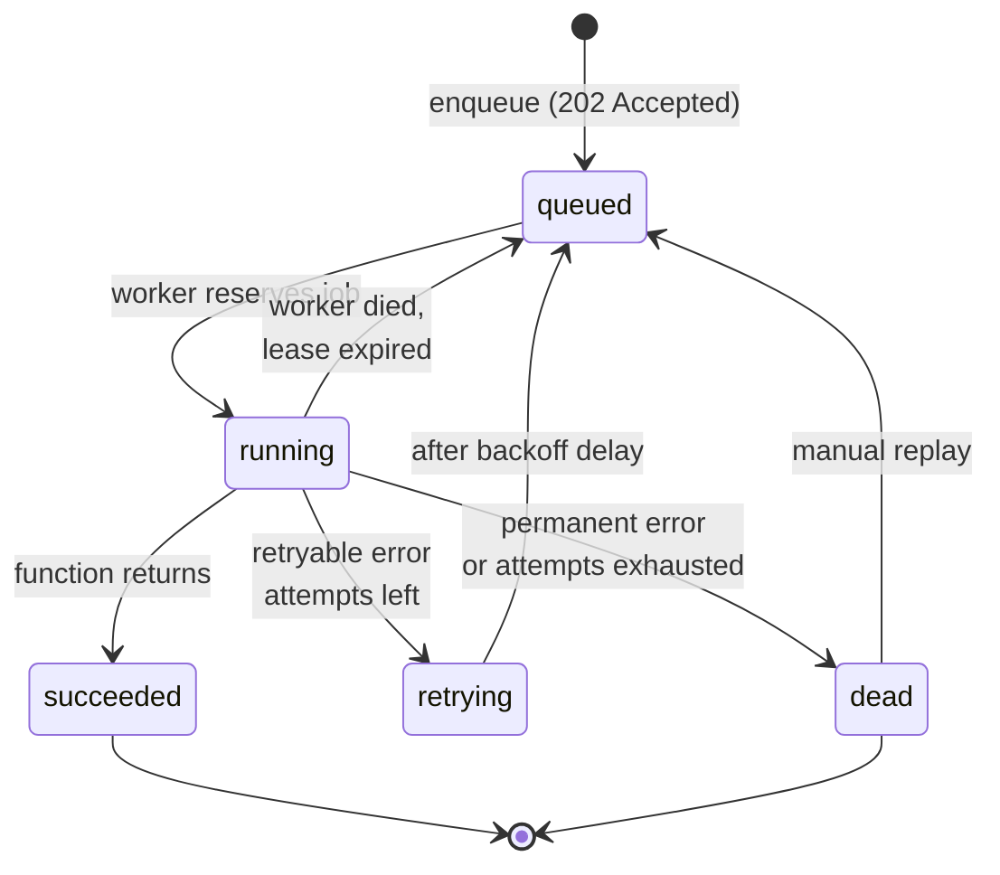
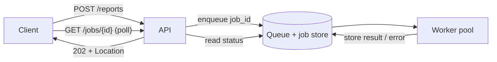

# Job Queues

> [!TIP]
> **In one line:** A job queue turns a message queue into a managed unit of work with an ID, a lifecycle, retries, a result and a status endpoint the client can poll.
>
> **In plain English:** Think of a dry-cleaning counter. You hand over a coat, get a numbered ticket straight away, and come back later to ask whether ticket 4812 is ready. The shop can retry a stain, put rush orders first, or schedule a job for Friday, and the ticket tells you where things stand at any moment.
>
> **You'll be able to:** model a job lifecycle with explicit states · expose a 202 Accepted plus polling API for long-running work · configure retries, backoff, priorities and scheduling while keeping jobs safe to run twice

## Why This Matters

[Message Queues](message-queues.md) gave you the transport: producers put messages in, consumers take them out, and a crash before an acknowledgment causes redelivery. That is necessary but not sufficient for the thing most API teams actually build, which is "do this slow thing for the user and tell them how it went." A raw queue has no notion of "the job I submitted five minutes ago." There is no ID the client can hold, no state it can query, no retry budget, no result, and no way to say "run this tomorrow at 9:00" or "this one is urgent."

A **job queue** adds exactly those things on top of a queue. Report generation, video transcoding, bulk imports, sending 50,000 emails, calling a slow third-party API, running an LLM batch: all of these exceed a sensible HTTP timeout, can fail halfway, and are things a user will ask about ("is my export done yet?"). If you only have fire-and-forget [background tasks](background-tasks.md), the work vanishes when the process restarts and the user has no way to find out what happened. A job queue is the standard answer.

## Core Concept

A **job** is a queue message with an identity and a lifecycle. It carries:

- a **job ID** (stable, unique, returned to the client),
- a **function name and arguments** (what to run),
- **state** (where it is in its lifecycle),
- **attempt count and retry policy** (how many tries remain, how long to wait between them),
- an optional **schedule** (not before time T) and **priority**,
- a **result or error** stored for a retention period so the client can read it later.

The lifecycle is a small state machine. Names differ between libraries (Celery says PENDING/STARTED/SUCCESS/FAILURE/RETRY, ARQ says deferred/queued/in_progress/complete, RQ says queued/started/finished/failed), but the shape is universal: **queued → running → succeeded**, with branches to **retrying** and, after the retry budget is spent, **dead** (or "failed permanently"). Naming the states explicitly in your own API, rather than leaking a library's internal names, keeps clients stable if you later swap the engine.

A job queue still delivers **at-least-once**. A worker can finish the work and crash before recording success, and the job will run again. Everything in this chapter that looks like a guarantee, such as "retried up to five times," is a statement about the queue's behavior, not about how many times your side effects happen. That is why idempotent jobs are a design requirement rather than a nicety.

## Mental Model

A job queue is a dry-cleaning counter with numbered tickets. Dropping off the coat is fast and returns a ticket immediately; the cleaning happens in the back room at its own pace. The ticket number is the only handle you need, and "status" is whatever the counter clerk can read off the tag: waiting, in the machine, ready, or "we could not remove this stain, please call." Rush tickets go to the front, tickets marked "pick up Friday" are not touched before Friday, and if a cleaner drops the ball, the tag goes back in the pile.

The analogy also captures a limit: if the clerk is unsure whether the cleaner finished before going home sick, they will re-clean the coat. Re-cleaning must not damage it. That is idempotency.

## How It Works

**1. Enqueue and acknowledge.** The API validates input, writes the job to the queue (and returns its ID), then replies `202 Accepted` with a `Location` header pointing to a status resource. The request does not wait for the work. Validation belongs at this step: reject bad input synchronously with a `422`, because the client cannot fix it after the fact.

**2. Run.** A [worker](workers.md) reserves the job, marks it running, executes the function and records the result. While running, the job is *leased*: if the worker vanishes, the lease expires and the job becomes visible again.

**3. Succeed or fail.** On success the result is stored with a time-to-live. On exception the engine consults the retry policy.

**4. Retry with backoff.** Immediate retries tend to hit the same overloaded dependency again. Retries should wait progressively longer with jitter, as described in [Exponential Backoff](../06-production-reliability/exponential-backoff.md). Distinguish **retryable** failures (timeouts, 503s, deadlocks) from **permanent** ones (validation errors, 404 on a resource that was deleted). Retrying a permanent failure five times only wastes capacity and delays the visible failure.

**5. Dead state.** After the retry budget is exhausted the job becomes dead: it is parked, with its error and arguments, for a human or an automated replay. Do not silently drop it, and do not retry forever. Engines vary here: RabbitMQ gets dead-letter exchanges, Celery and ARQ keep a failed result, and some teams copy dead jobs into a database table for triage.

**6. Priorities and scheduling.** Priority is usually implemented as separate queues (`critical`, `default`, `bulk`) that workers drain in preference order, because true per-message priority inside one queue is poorly supported or costly in many brokers. Delayed jobs ("send reminder in 24 hours") are stored with a not-before timestamp and become visible when it passes. Recurring schedules ("every night at 02:00") are a separate cron-like component that *enqueues* jobs; run exactly one scheduler or you will enqueue duplicates.

**7. Idempotency.** Because of at-least-once delivery, make the job's effect repeatable. Two practical tools: (a) derive writes from a natural key so a repeat overwrites rather than duplicates (`reports/{report_id}.csv`, `INSERT ... ON CONFLICT DO NOTHING`), and (b) pass an idempotency key to downstream APIs, as covered in [Idempotency](../02-rest-api-design/idempotency.md). Separately, **enqueue-side deduplication** with a deterministic job ID stops a double-clicked button from creating two jobs, though it does not protect against redelivery of a single job.

## Architecture





The second diagram shows why the job store matters: the status endpoint reads state that the worker wrote, so the API and the workers never talk to each other directly. For a broader comparison of ways to deliver the eventual result (polling, webhooks, server-sent events), see [Polling](../09-realtime-and-webhooks/polling.md) and [Webhooks](../09-realtime-and-webhooks/webhooks.md).

## Request / Response Example

Submit the job. The server answers immediately with an ID and where to look:

```http
POST /v1/reports HTTP/1.1
Host: api.example.com
Authorization: Bearer <token>
Content-Type: application/json
Idempotency-Key: 7c0f3b0e-5d1e-4a43-9f3b-1d4c6f9a21aa

{"report_type": "monthly_sales", "month": "2026-10"}
```

```http
HTTP/1.1 202 Accepted
Location: /v1/jobs/rpt_01JC8Y3K9N
Retry-After: 5
Content-Type: application/json

{"job_id": "rpt_01JC8Y3K9N", "status": "queued"}
```

Poll the status resource while the job runs:

```http
GET /v1/jobs/rpt_01JC8Y3K9N HTTP/1.1

HTTP/1.1 200 OK
Content-Type: application/json
Retry-After: 5

{"job_id": "rpt_01JC8Y3K9N", "status": "running", "attempt": 1}
```

When finished, either return the result inline or redirect to it. A common convention is `303 See Other` pointing at the finished resource:

```http
HTTP/1.1 200 OK
Content-Type: application/json

{"job_id": "rpt_01JC8Y3K9N", "status": "succeeded",
 "result_url": "/v1/reports/2026-10/download"}
```

A permanently failed job reports the failure as data (the poll itself succeeded, so the HTTP status is still `200`):

```http
HTTP/1.1 200 OK
Content-Type: application/json

{"job_id": "rpt_01JC8Y3K9N", "status": "dead", "attempt": 5,
 "error": {"code": "upstream_unavailable", "message": "Billing service timed out 5 times"}}
```

## Code Example

An ARQ-style example (ARQ is an asyncio job library on Redis; Celery and RQ follow the same shape). The API enqueues and exposes status; the worker function is idempotent and distinguishes retryable from permanent failures.

```python
# app.py: FastAPI side. Run: uvicorn app:app
import os
from contextlib import asynccontextmanager

from arq import create_pool
from arq.connections import RedisSettings
from arq.jobs import Job, JobStatus
from fastapi import FastAPI, HTTPException, Response
from pydantic import BaseModel, Field

REDIS = RedisSettings.from_dsn(os.environ["REDIS_URL"])  # never hardcode


@asynccontextmanager
async def lifespan(app: FastAPI):
    app.state.pool = await create_pool(REDIS)  # one pool per process
    yield
    await app.state.pool.aclose()


app = FastAPI(lifespan=lifespan)


class ReportIn(BaseModel):
    report_type: str = Field(pattern="^(monthly_sales|inventory)$")
    month: str = Field(pattern=r"^\d{4}-\d{2}$")


# Map the library's states onto our own stable public vocabulary.
PUBLIC = {
    JobStatus.deferred: "queued",
    JobStatus.queued: "queued",
    JobStatus.in_progress: "running",
}


@app.post("/v1/reports", status_code=202)
async def create_report(body: ReportIn, response: Response):
    # Deterministic job id => a double-click enqueues once.
    # ARQ returns None if a job with this id already exists (not yet expired).
    job_id = f"{body.report_type}:{body.month}"
    job = await app.state.pool.enqueue_job(
        "build_report", body.report_type, body.month, _job_id=job_id
    )
    response.headers["Location"] = f"/v1/jobs/{job_id}"
    response.headers["Retry-After"] = "5"
    return {"job_id": job_id, "status": "queued" if job else "already_submitted"}


@app.get("/v1/jobs/{job_id}")
async def job_status(job_id: str):
    job = Job(job_id, app.state.pool)
    status = await job.status()
    if status == JobStatus.not_found:
        raise HTTPException(404, "unknown or expired job")
    if status != JobStatus.complete:
        return {"job_id": job_id, "status": PUBLIC[status]}
    info = await job.result_info()  # None only if the result expired
    if info and info.success:
        return {"job_id": job_id, "status": "succeeded", "result": info.result}
    return {"job_id": job_id, "status": "dead", "error": str(info.result) if info else "unknown"}
```

```python
# worker.py: run with `arq worker.WorkerSettings`
import os

from arq import Retry
from arq.connections import RedisSettings


class UpstreamTimeout(Exception): ...      # retryable
class BadReportRequest(Exception): ...     # permanent


async def build_report(ctx, report_type: str, month: str) -> dict:
    attempt = ctx["job_try"]  # 1-based attempt counter maintained by ARQ
    try:
        rows = await fetch_rows(report_type, month)       # may raise UpstreamTimeout
    except UpstreamTimeout:
        # Exponential backoff: 10s, 20s, 40s, 80s (a little jitter is advisable too).
        # When attempts reach max_tries ARQ stops retrying and records the failure.
        raise Retry(defer=10 * 2 ** (attempt - 1))
    except BadReportRequest:
        raise                                             # not retryable: fail now
    # Idempotent write: deterministic key, so a repeat overwrites the same object.
    key = f"reports/{report_type}/{month}.csv"
    await put_object(key, render_csv(rows))
    return {"object_key": key, "rows": len(rows)}


class WorkerSettings:
    functions = [build_report]
    redis_settings = RedisSettings.from_dsn(os.environ["REDIS_URL"])
    max_tries = 5                 # total attempts including the first
    job_timeout = 300             # seconds before the job is cancelled
    keep_result = 3600            # how long GET /jobs/{id} can read the outcome
    max_jobs = 10                 # concurrent jobs per worker process
    allow_abort_jobs = True
```

`fetch_rows`, `put_object` and `render_csv` stand in for your own data and storage code. Note the trade-offs in this example: ARQ retries are fixed by `max_tries` and `Retry(defer=...)`, results expire after `keep_result`, and there is no built-in dead-letter store, so a production setup would also copy final failures into a database table or alert on them. Because the job ID is derived from the report, asking for the same month's report again while the first is still retained returns `already_submitted`; choose a different ID scheme if repeat submissions must create new work.

## Production Considerations

- **Observe queue depth and age.** The most useful single metric is the age of the oldest queued job, because a growing age means workers cannot keep up. Add counts by state, retry rate, and dead-job count with an alert on the last.
- **Set a timeout on every job.** A job without one can hold a worker slot forever. The timeout must be shorter than the lease or visibility window, or the job will be handed to a second worker while the first is still running.
- **Retention.** Results and dead jobs consume memory (Redis) or rows (SQL). Pick explicit TTLs and clean up.
- **Payload size.** Put IDs in the job, not documents. Large payloads slow the broker and may contain data you must not copy around; fetch from the database or object store inside the job.
- **Version your job signatures.** Jobs enqueued by version N of your code may be run by version N+1 of the worker during a deploy. Add arguments as optional with defaults, and keep old function names alive until the queue drains.
- **Authorization on the status endpoint.** `GET /jobs/{id}` must check that the caller owns the job. Predictable IDs plus no check is an ID-guessing leak (the BOLA class of bug covered in [Part 10](../10-api-security/README.md)).
- **Persist state in a database if you need a business record.** A broker's job state is operational and expires. If users must see job history for months, store a `jobs` row you control and have the worker update it.

## Common Mistakes

- **Treating the queue as exactly-once.** Retries, lease expiry and worker crashes all cause a second run. Jobs that send emails or charge cards without idempotency keys will eventually do it twice.
- **Retrying everything.** Retrying a validation error five times with backoff just delays the failure by minutes. Classify errors.
- **Retrying without backoff or a cap.** Tight retry loops amplify an outage; infinite retries hide a poison job that will never succeed.
- **No dead state.** Jobs that fail permanently disappear into logs, and nobody notices that 3% of exports never ran.
- **Blocking the event loop in an async worker.** A CPU-heavy or synchronous call inside an asyncio worker stalls every other job in that process. See [Python asyncio](python-asyncio.md).
- **Returning 200 for submission.** It signals the work is done. `202 Accepted` with a status location is the honest answer.
- **Leaking the engine's internal states** to clients, which couples your public API to a library version.

## Best Practices

- Return `202` with a `Location` header and a job ID; offer polling and, for long jobs, an optional webhook callback.
- Define your own small public state vocabulary: `queued`, `running`, `succeeded`, `failed` (or `dead`).
- Make jobs idempotent through natural keys or downstream idempotency keys, and use deterministic job IDs to deduplicate enqueue.
- Use exponential backoff with jitter, a bounded attempt count, and separate retryable from permanent errors.
- Use separate queues for priorities and give each its own worker pool so bulk work cannot starve urgent work.
- Run one scheduler for recurring jobs, and make scheduled jobs idempotent anyway.
- Enqueue after the database commit, or use the outbox pattern from [Event-Driven Architecture](event-driven-architecture.md), so a job never refers to a row that was rolled back.

## AI Engineering Perspective

LLM workloads are natural job-queue citizens: batch embedding of a document corpus, nightly evaluation runs, agent tasks that run for minutes, and fine-tuning or transcription jobs all outlast an HTTP request. They add a few twists. Provider rate limits mean your retry policy needs to honor `429` and `Retry-After` and probably a concurrency cap per provider key, not just per worker. Token spend makes naive retries expensive, so a job that already paid for a completion should store the partial result (checkpoint) and resume rather than redo the whole chain. Long agent runs benefit from the same status model, with intermediate states such as `running` carrying progress detail, as discussed in [Agent APIs](../17-ai-agents-and-mcp/agent-apis.md) and [Part 15](../15-production-ai-systems/README.md). Finally, deterministic job IDs are an easy way to cache: if the same document and model version were already embedded, return the earlier job instead of paying again.

## Exercises

**Beginner**
1. Draw the state machine for a job with a retry budget of 3. List every transition and what causes it, including the case where the worker dies mid-run.
2. Write the `POST` and `GET` HTTP exchanges for a "generate invoice PDF" job, including the status codes and headers.

**Intermediate**
3. Extend the example so that `BadReportRequest` jobs are never retried and every job that ends dead is inserted into a `dead_jobs` table with its arguments and error. Explain what happens if the insert itself fails.
4. Add two queues, `urgent` and `bulk`, with separate worker processes. Show how you would prevent a flood of bulk jobs from delaying urgent ones.

**Advanced**
5. Design a job that charges a card and then sends a receipt, so that a crash between the two steps cannot double-charge or skip the receipt. State exactly which operations need idempotency keys.
6. Your oldest-job age alert fires at 02:00 and queue depth is climbing while workers look healthy. List the metrics and log queries you would use to distinguish "downstream dependency slow," "poison job looping" and "not enough workers."

## Key Takeaways

- A job queue = a message queue plus identity, lifecycle, retries, scheduling, priority and a stored result.
- Return `202 Accepted` with a job ID and status URL; model queued, running, succeeded and dead explicitly in your own API.
- Delivery is at-least-once, so make jobs idempotent; retries need backoff, a cap and a retryable-versus-permanent distinction.
- Park exhausted jobs in a dead state that someone watches, and monitor queue depth and oldest-job age.

### Check Yourself

<details markdown="1">
<summary>1. Why does a job queue return 202 rather than 200 when a job is submitted?</summary>

Because the work has been accepted but not done. `202 Accepted` says "I will process this," and the `Location` header gives the client a status resource to check, whereas `200` would imply completion.

</details>

<details markdown="1">
<summary>2. A worker finishes sending an email and is killed before it reports success. What happens, and what protects the customer?</summary>

The lease expires and the job runs again, so the email could be sent twice. Protection comes from idempotency: an idempotency key on the email provider call, or a recorded "email sent for job X" check, so the second run becomes a no-op.

</details>

<details markdown="1">
<summary>3. A job calling a payment API fails with a 400 "invalid card number" and is retried five times with backoff. What is wrong with this design?</summary>

A 400 is a permanent failure that retrying cannot fix. The job should classify the error as non-retryable, move to the dead or failed state immediately, and report the reason so the user can correct the input.

</details>

---
Back to the [Part 8 README](README.md).
