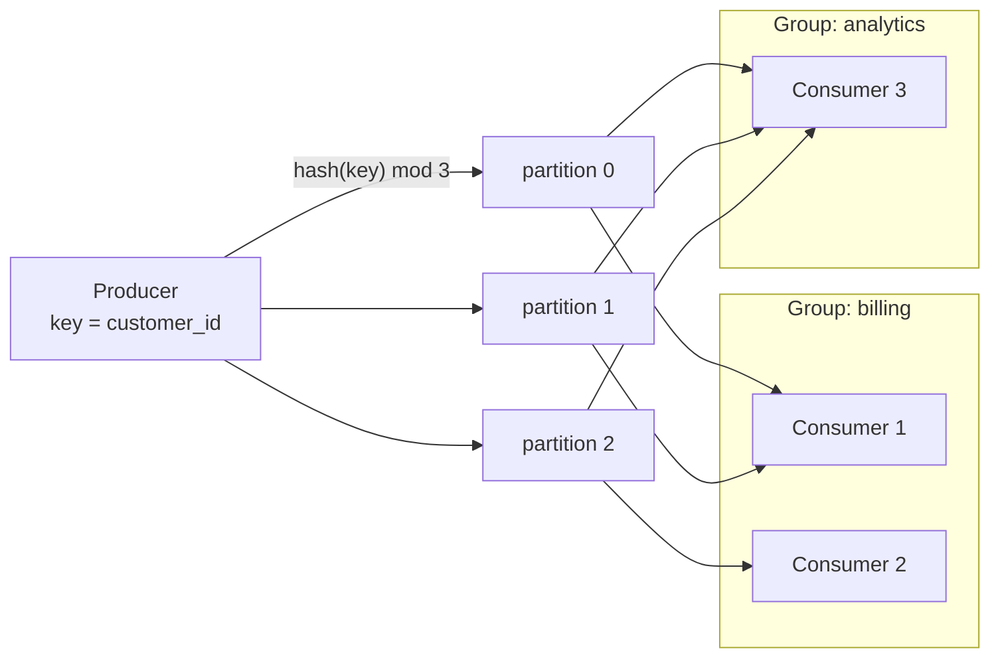
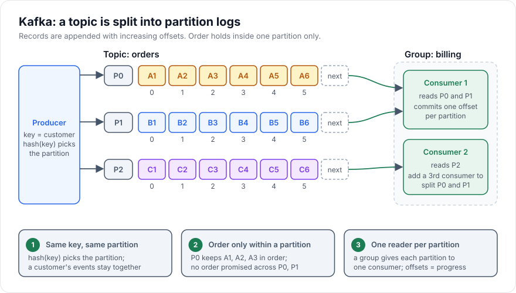

# Kafka Concepts

> [!TIP]
> **In one line:** Kafka is a replicated, partitioned, append-only log that consumers read at their own pace by tracking offsets, which gives per-key ordering, replay and many independent readers.
>
> **In plain English:** Imagine a very long ledger that is only ever added to, split into several books so many clerks can write at once. Readers keep their own bookmark and can walk back to an earlier page whenever they like. Nothing is torn out when it is read; old pages are removed only after a retention period.
>
> **You'll be able to:** explain topics, partitions, offsets and consumer groups · pick partition keys that preserve the ordering you need · state Kafka's real delivery guarantees and choose between Kafka and a queue

## Why This Matters

[Message Queues](message-queues.md) and [RabbitMQ Concepts](rabbitmq-concepts.md) describe the *consume and delete* model: a message exists to be handed to one worker and then disappears. That model fits task distribution but breaks down for several increasingly common needs: many independent systems that each need to see every event; a new service that must process a year of history; recomputing a derived view after fixing a bug; and sustained throughput in the hundreds of thousands of events per second.

Kafka answers these by changing the abstraction. Instead of a queue of pending work, it is a **durable distributed log**: events are appended and kept for a retention period regardless of whether they have been read, and each consumer simply remembers how far it has read. That makes Kafka the usual backbone for event-driven systems, change data capture, analytics pipelines and stream processing. It also has very different failure and ordering behavior from a queue, and teams that adopt it as "a faster RabbitMQ" run into trouble. This chapter builds the mental model and states the guarantees precisely.

## Core Concept

The vocabulary:

- **Topic**: a named category of records, such as `orders`. Logically one stream.
- **Partition**: a topic is split into N partitions, each an ordered, append-only sequence of records. Partitions are the unit of **parallelism, ordering and storage**. Each partition lives on one broker (the **leader**) and is replicated to others (followers).
- **Record**: a key (optional), a value, headers and a timestamp. The **offset** is the record's sequential position within its partition: 0, 1, 2, and so on. An offset is meaningful only together with its topic and partition.
- **Producer**: appends records. If the record has a key, the default partitioner hashes the key to choose the partition, so all records with the same key go to the same partition. Without a key, records are spread across partitions.
- **Consumer group**: a set of consumers that cooperate to read a topic. Kafka assigns each partition to **at most one consumer in the group** at a time. Different groups are completely independent and each receives every record.
- **Committed offset**: the group's bookmark for each partition, stored in Kafka's internal `__consumer_offsets` topic. After a restart or rebalance, consumption resumes from the last committed offset.
- **Retention**: records are deleted by age or size (the default is about seven days), or kept as the latest value per key on **compacted** topics. Reading does not delete anything.

The central consequences follow from this structure. **Ordering is guaranteed only within a partition**, never across partitions of a topic. **Parallelism is capped by partition count**: a group of 10 consumers on a 6-partition topic leaves 4 idle. And **replay is just moving the bookmark**.

## Mental Model

A topic is a set of train tracks, each a one-way line with numbered carriages. Producers couple new carriages onto the end of a line; the numbering never changes. Passengers (consumers) read at their own station and carry a ticket saying "I have read up to carriage 1,204 on line 2." A different company (another consumer group) can run its own readers over the same lines with its own tickets, and a new reader can start from carriage 0. Within one line, the carriage order is strict; between lines there is no promised order, and which line a carriage goes on is decided by a label on it (the key).

## How It Works

**Writing.** A producer batches records per partition and sends them to that partition's leader. With `acks=all` the leader waits for every **in-sync replica** to have the record before acknowledging; together with `min.insync.replicas=2` and replication factor 3, a record acknowledged to the producer survives the loss of any single broker. With `acks=1` only the leader has it, and a leader failure at the wrong moment loses acknowledged data. The **idempotent producer** (`enable.idempotence=true`, default in recent clients) attaches sequence numbers so that a producer retrying after a timeout does not create duplicates in the partition, and it preserves per-partition ordering across retries. This protects against *producer-side retry duplicates*, nothing more.

**Choosing the key.** The key decides which events are ordered relative to each other. Key by `customer_id` and all of one customer's events arrive in order at the same consumer; key by `order_id` and each order's lifecycle is ordered. Pick the entity whose events must be ordered, and check it distributes evenly: a hot key (one giant tenant) makes a **hot partition**, and that partition's single consumer becomes the bottleneck. Changing the partition count later changes the hash-to-partition mapping for the default partitioner, so keys can move partitions and per-key ordering across the change is not preserved. Partitions can be added but not removed, so plan the count for peak parallelism with headroom (commonly 2 to 3 times current need), but do not create thousands casually, since each has overhead.

**Reading.** Consumers in a group join, the group coordinator assigns partitions, and each consumer pulls records from its partitions starting at the committed offset (or `earliest`/`latest` if none exists). When consumers join, leave or crash, the group **rebalances**: partitions are reassigned, and consumption on affected partitions pauses briefly. Newer cooperative rebalancing reduces the pause, but any consumer must tolerate a partition being taken away mid-batch.

**Committing offsets and delivery semantics.** This is where precision matters.

- **At-most-once**: commit the offset, *then* process. A crash after the commit but before processing loses the record. Acceptable for lossy telemetry.
- **At-least-once**: process, *then* commit. A crash after processing but before the commit causes reprocessing on restart. This is the default correct choice, and it requires idempotent handlers.
- **Exactly-once**: Kafka's transactions let a *consume, process, produce* pipeline whose input and output are both Kafka topics commit its output records and its input offsets atomically; downstream consumers with `isolation.level=read_committed` see each result once. That guarantee covers state *inside Kafka*. The moment your handler writes to a database, calls an HTTP API or sends an email, Kafka cannot make that side effect transactional with the offset commit. For external effects the achievable property is **effectively-once**: at-least-once delivery plus an idempotent write (for example recording the event ID in the same database transaction as the effect, and skipping if it already exists).

**Head-of-line blocking.** A partition is consumed strictly in order, so a record that keeps failing blocks everything behind it in that partition. Kafka has no per-message ack, delay or dead-letter built in. The usual patterns are: after N attempts, publish the record to a **dead-letter topic** and advance the offset; or publish to a series of **retry topics** with increasing delays (consumed by dedicated consumers), accepting that this relaxes ordering for the retried records.

**Retention and replay.** To reprocess, either start a *new consumer group* with `auto.offset.reset=earliest`, or reset an existing group's offsets (with the group stopped) to a timestamp or offset. This is the superpower relative to queues, bounded by retention: records already deleted cannot be replayed. Compacted topics keep the last value per key indefinitely, which suits "current state of each entity" streams; a `null` value (tombstone) deletes a key.

**Kafka versus a queue.** Reach for Kafka when you need multiple independent consumers of the same events, replay or backfill, per-key ordering at high throughput, stream processing, or an event log as a system of record for integration. Reach for a queue such as RabbitMQ or SQS when you are distributing *tasks* to workers and need per-message acks, retry with delay, priorities, low operational weight or modest volume. Running a job queue on Kafka is possible but you must build the retry, delay and dead-letter machinery yourself; running an event backbone on a queue means losing replay. Many systems use both: Kafka for events, queues for the jobs those events trigger (see [Job Queues](job-queues.md)).

## Architecture





Both groups receive every record; within each group, a partition has exactly one reader. `billing` has two consumers sharing three partitions, `analytics` has one consumer reading all three.

## Request / Response Example

Kafka's own protocol is binary and handled by client libraries, so the useful things to look at are the operator views. Publishing keyed records with the console tool and then describing a group:

```bash
$ kafka-console-producer.sh --bootstrap-server broker:9092 --topic orders \
    --property parse.key=true --property key.separator=:
> cust-7:{"event":"order_created","order_id":501}
> cust-7:{"event":"order_paid","order_id":501}
```

```text
$ kafka-consumer-groups.sh --bootstrap-server broker:9092 --describe --group billing

GROUP    TOPIC   PARTITION  CURRENT-OFFSET  LOG-END-OFFSET  LAG   CONSUMER-ID
billing  orders  0          10441           10447           6     billing-c1-7f2
billing  orders  1          9980            9980            0     billing-c1-7f2
billing  orders  2          11203           11890           687   billing-c2-91a
```

`CURRENT-OFFSET` is the group's committed bookmark and `LOG-END-OFFSET` is the newest record. **Lag** (the difference) is the single most important consumer metric: partition 2 is 687 records behind, which suggests a slow consumer or a hot key. Both `order_created` and `order_paid` carry the key `cust-7`, so they landed in the same partition and will be seen in that order.

## Code Example

An `aiokafka` producer configured for durability and a consumer that gives effectively-once processing for a database effect: it deduplicates by event ID in the same transaction as the write, and commits offsets only after that transaction.

```python
# kafka_example.py: pip install aiokafka sqlalchemy[asyncio] asyncpg
import asyncio
import json
import os
import uuid

from aiokafka import AIOKafkaConsumer, AIOKafkaProducer, TopicPartition
from sqlalchemy import text
from sqlalchemy.ext.asyncio import async_sessionmaker, create_async_engine

BOOTSTRAP = os.environ["KAFKA_BOOTSTRAP"]
engine = create_async_engine(os.environ["DATABASE_URL"])
Session = async_sessionmaker(engine, expire_on_commit=False)


async def produce_order_event(producer: AIOKafkaProducer, customer_id: str, order_id: int):
    event = {"event_id": str(uuid.uuid4()), "type": "order_created", "order_id": order_id}
    # key => same customer always lands in the same partition => per-customer order.
    # send_and_wait returns only after the broker acknowledges (acks="all").
    await producer.send_and_wait(
        "orders", key=customer_id.encode(), value=json.dumps(event).encode()
    )


async def apply_once(event: dict) -> None:
    async with Session() as session, session.begin():
        # Deduplicate and apply in ONE database transaction.
        res = await session.execute(
            text("INSERT INTO processed_events (event_id) VALUES (:id) ON CONFLICT DO NOTHING"),
            {"id": event["event_id"]},
        )
        if res.rowcount == 0:
            return  # already applied: a redelivery after crash or rebalance
        await session.execute(
            text("UPDATE orders SET status = 'created' WHERE id = :oid"),
            {"oid": event["order_id"]},
        )


async def consume():
    consumer = AIOKafkaConsumer(
        "orders",
        bootstrap_servers=BOOTSTRAP,
        group_id="billing",
        enable_auto_commit=False,        # we decide when an offset is "done"
        auto_offset_reset="earliest",    # used only when the group has no committed offset
    )
    await consumer.start()
    try:
        async for msg in consumer:
            try:
                await apply_once(json.loads(msg.value))
            except ValueError:
                await send_to_dead_letter_topic(msg)   # poison: park it and move on
            # Commit the NEXT offset to read (offset + 1) only after success.
            await consumer.commit({TopicPartition(msg.topic, msg.partition): msg.offset + 1})
    finally:
        await consumer.stop()


async def main():
    producer = AIOKafkaProducer(
        bootstrap_servers=BOOTSTRAP,
        acks="all",                 # wait for all in-sync replicas
        enable_idempotence=True,    # no duplicates/reordering from producer retries
    )
    await producer.start()
    try:
        await produce_order_event(producer, "cust-7", 501)
    finally:
        await producer.stop()
    await consume()


async def send_to_dead_letter_topic(msg) -> None:
    ...  # produce msg.value plus error context to "orders.dlq"


if __name__ == "__main__":
    asyncio.run(main())
```

Notes on what this does and does not guarantee. The dedupe-plus-effect transaction makes the *database outcome* effectively-once even though Kafka delivers at-least-once: if the process dies between the database commit and the offset commit, the record is redelivered and the `ON CONFLICT` check turns it into a no-op. Committing after every record is simple but slow; real consumers commit in batches (every N records or T seconds) and accept more reprocessing after a crash. The `processed_events` table grows without bound, so prune it to the retention window or key it by something naturally unique to the effect. The `ValueError` branch only covers unparseable records; a handler that fails on *valid* records must not simply skip them silently.

## Production Considerations

- **Replication settings.** Use replication factor 3, `min.insync.replicas=2` and producer `acks=all` for data you cannot lose. Disable unclean leader election for the same reason.
- **Monitor lag per partition**, not just total. A single stuck partition hides inside an average.
- **Partition sizing.** Max group parallelism equals the partition count. Choose the count from target throughput divided by per-consumer throughput, with headroom, and design keys to avoid hot partitions.
- **Rebalance behavior.** Long processing time between polls causes a consumer to be considered dead and triggers a rebalance storm. Keep per-batch work shorter than `max.poll.interval.ms`, or process in a separate worker pool while polling continues.
- **Schema management.** Records are bytes. Use a schema registry with Avro, Protobuf or JSON Schema and compatibility rules so producers cannot break consumers (see [Event-Driven Architecture](event-driven-architecture.md)).
- **Retention versus replay.** Size retention to the longest outage or backfill you want to survive, and remember sensitive data (PII) stays in the log for that period; plan for deletion requirements with compaction, tombstones or encryption.
- **Operational weight.** Running Kafka yourself means brokers, controller quorum, storage, upgrades and capacity planning. Managed offerings shift that burden. Count it in the decision to adopt.
- **Security.** TLS, SASL authentication and ACLs per topic and group; credentials from the environment.

## Common Mistakes

- **Expecting global ordering.** Ordering holds per partition. Events for the same entity must share a key.
- **Poor key choice**: random keys when ordering matters, or a low-cardinality key that creates a hot partition.
- **Committing before processing**, silently turning at-least-once into at-most-once.
- **Believing "exactly-once" covers your database or API calls.** It covers Kafka-to-Kafka transactional pipelines; external effects need idempotent writes.
- **More consumers than partitions**, expecting more throughput.
- **Ignoring rebalances**: holding in-memory state or uncommitted batches that are lost or duplicated when partitions move.
- **Blocking forever on a poison record**, stalling a partition with no dead-letter path.
- **Changing partition count on a keyed topic** and breaking per-key ordering assumptions.
- **Using Kafka as a task queue** and reinventing delayed retries and priorities badly.

## Best Practices

- Key by the entity whose events must be ordered, and check key distribution.
- Process then commit; make handlers idempotent or deduplicate by event ID in the same transaction as the effect.
- Produce with `acks=all` and idempotence enabled; run replication factor 3 with `min.insync.replicas=2`.
- Provide a dead-letter topic and a clear policy for failing records.
- Alert on per-partition lag and on rebalance frequency.
- Use a schema registry and compatibility checks; evolve schemas additively.
- Pick Kafka for events and replay, queues for tasks, and be explicit about why.

## AI Engineering Perspective

Kafka fits the data plane of AI systems better than their task plane. LLM interaction logs (prompts, completions, token counts, latencies, feedback) are a high-volume event stream that several consumers want: a cost-accounting service, an evaluation pipeline sampling for quality, and a warehouse loader. Publishing once and letting separate consumer groups read independently is exactly what the log model offers, and replay lets you re-run a new evaluator over last month's traffic. For retrieval systems, change data capture from the source database into a Kafka topic, keyed by document ID, keeps embeddings and the vector index in sync, with per-document ordering so an update never overtakes the create it follows; see [RAG APIs](../16-rag-apis/README.md). Compacted topics are a natural fit for "latest version of each document" feeds. The cost lens matters too: replaying a topic through an embedding model is a recompute bill, so gate replays and track what has already been embedded using event or content hashes. For the observability side of these streams, see [Part 15](../15-production-ai-systems/README.md).

## Exercises

**Beginner**
1. A topic has 4 partitions and a consumer group has 6 consumers. How many consumers are active, and what would you do to use all six?
2. Events `A1`, `A2` (key A) and `B1`, `B2` (key B) are produced in the order `A1, B1, A2, B2`. Which orderings can a consumer observe, and which cannot be guaranteed?

**Intermediate**
1. Write the commit logic for at-least-once consumption with batch commits every 100 records. What is the maximum number of records that may be reprocessed after a crash?
2. Design a retry-topic scheme with three delay tiers and a dead-letter topic. What happens to ordering for retried records, and is that acceptable for an order lifecycle?

**Advanced**
1. Explain precisely why Kafka transactions give exactly-once for a topic-to-topic pipeline but not for a handler that updates PostgreSQL. Then design the effectively-once alternative, including how you handle dedupe-table growth.
2. A tenant generates 60% of traffic and its partition lags by hours. Evaluate three remedies (key salting, a dedicated topic, more partitions) with the ordering trade-offs of each.

## Key Takeaways

- Kafka is a partitioned, replicated, retained log: partitions give parallelism and ordering, offsets are bookmarks, and consumer groups give each partition one reader per group.
- Ordering is guaranteed only within a partition, so the key you choose defines what stays in order.
- Delivery is at-least-once when you process then commit; true exactly-once applies only inside Kafka transactions, and external side effects need idempotent, deduplicated writes for effectively-once results.
- Choose Kafka for multi-consumer events, replay and throughput; choose a queue for task distribution with per-message retry, delay and priority.

### Check Yourself

<details markdown="1">
<summary>1. What does a consumer group guarantee about how partitions are read?</summary>

Each partition is assigned to at most one consumer in the group at a time, so a partition's records are processed in order by a single reader, while different groups each read all records independently.

</details>

<details markdown="1">
<summary>2. Why does adding partitions to a keyed topic risk breaking ordering?</summary>

The default partitioner maps a key to a partition by hash modulo the partition count, so changing the count can send a key's new events to a different partition than its older ones, and ordering across the change is lost.

</details>

<details markdown="1">
<summary>3. Your consumer updates a database and then commits the offset, and the process crashes between the two steps. What happens on restart and how do you make that safe?</summary>

The last committed offset is still behind, so the record is delivered again and the update would run twice. Make the handler idempotent, for example by inserting the event ID with ON CONFLICT DO NOTHING in the same transaction as the update, so the repeat is a no-op.

</details>

---
Back to the [Part 8 README](README.md).
