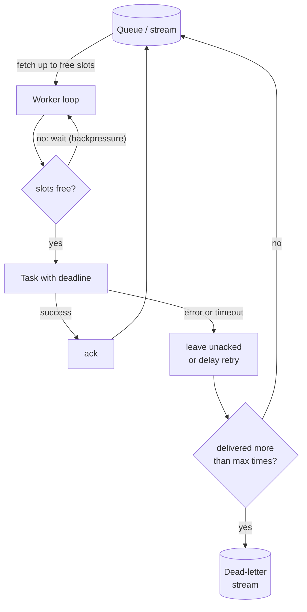
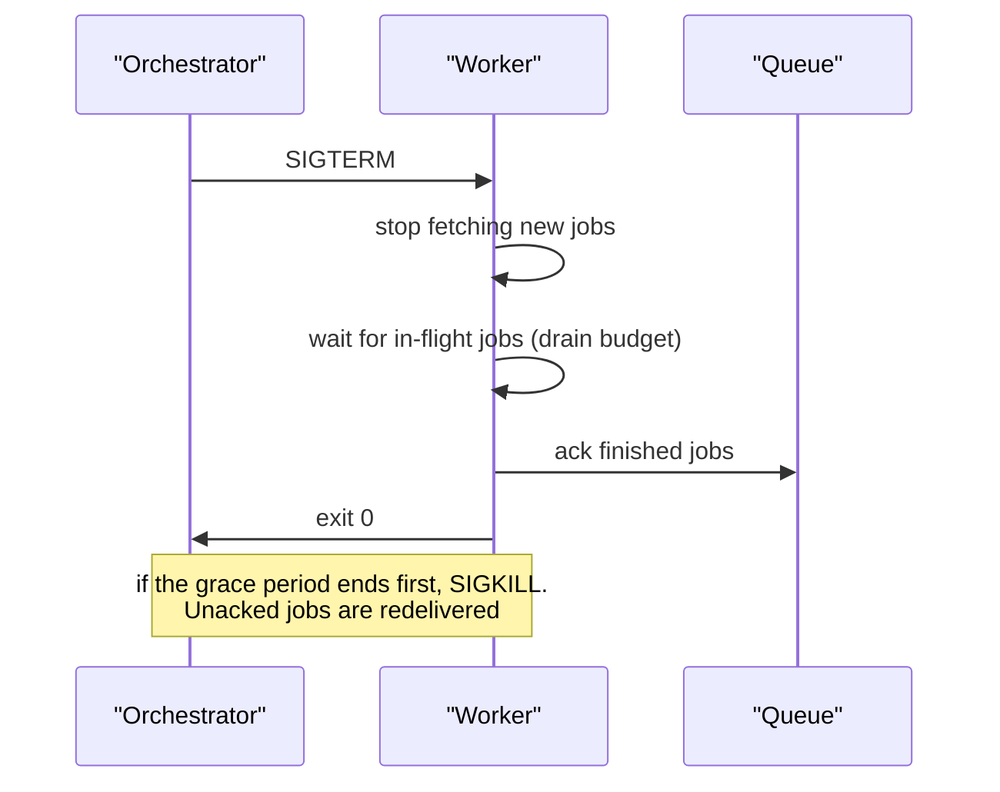

# Workers

> [!TIP]
> **In one line:** A worker is a long-running process that pulls jobs from a queue, runs them with bounded concurrency, acknowledges only on success, and shuts down without losing work.
>
> **In plain English:** Workers are the staff behind the counter. How many you hire, how many tasks each juggles, what happens at closing time, and what you do with an order nobody can ever complete are all operational decisions, and they decide whether your queue is reliable or merely present.
>
> **You'll be able to:** design a worker loop with ack, concurrency limits and backpressure · handle SIGTERM so deploys do not lose or duplicate jobs · detect and quarantine poison messages · decide how to scale a worker fleet

## Why This Matters

[Job Queues](job-queues.md) described the contract: jobs have IDs, states and retry budgets. Something has to honor that contract, and that something is the worker. Most queue incidents are worker incidents: a deploy kills in-flight jobs, a single malformed message crashes the same worker in a loop, a worker takes more jobs than it can finish and its memory balloons, or the fleet scales up and then hammers a database that cannot take the extra connections.

Workers are also where the theoretical delivery guarantee meets reality. The queue promises at-least-once delivery, but only if the worker acknowledges at the right moment and dies in a way the queue can notice. This chapter covers the worker process model and the five operational concerns that matter: concurrency, acknowledgment and visibility timeouts, graceful shutdown, poison messages, and scaling with backpressure.

## Core Concept

A **worker** is a process (or a pool of them) that runs a loop: *fetch, execute, acknowledge*. Three ideas define its behavior.

**Acknowledgment and visibility.** When a worker takes a message, the queue does not delete it; it hides it (a **visibility timeout** in SQS terms, an **unacked** state in RabbitMQ, a **pending entries list** in Redis Streams) and waits. If the worker acks, the message is deleted. If the worker crashes, hangs, or simply takes too long, the hide period or connection ends and the message becomes deliverable again. Acknowledge *after* the work is done and the result is durably recorded, never before; acking early converts at-least-once into at-most-once and silently loses jobs on a crash.

**Concurrency.** One worker process can run work three ways. *Multiple processes* give true parallelism and isolation (the usual answer for CPU-bound work, and for crash containment). *Threads* suit blocking I/O libraries. *asyncio tasks* suit I/O-bound work with async libraries and give the highest density, but one blocking call freezes every task in the process (see [Python asyncio](python-asyncio.md)). Whichever you choose, set an explicit **prefetch or concurrency limit**: the maximum number of jobs a worker holds at once.

**Backpressure.** A worker that grabs messages faster than it finishes them is just a second, less visible queue, held in memory and invisible to other workers. A concurrency limit makes the worker pull only when it has capacity, so overload shows up where it can be seen and acted on: queue depth and job age.

## Mental Model

Workers are checkout lanes at a supermarket. Each lane serves one customer at a time (concurrency), and the shop adds lanes when the line grows (scaling). A cashier does not take the next customer's basket until finished with the current one (backpressure). When a lane closes at the end of the shift, the cashier finishes the customer in front of them rather than walking away mid-scan (graceful shutdown). And if a customer's basket contains an item that jams the scanner every time, you do not let it jam lane after lane forever; the manager takes it aside (poison message quarantine).

## How It Works

**Process model.** In production a worker is a separate deployment unit from the API, started with its own command (`arq worker.WorkerSettings`, `celery -A app worker`, `python -m app.worker`) and scaled independently. A common layout is one container per worker process with modest internal concurrency, and many replicas, because orchestrators restart, scale and OOM-kill containers cleanly.

**Fetch and lease.** The worker asks for up to *N* messages, where *N* is its free capacity. The queue marks them in-flight for this consumer. The lease has a length: the visibility timeout. Set it comfortably above your worst-case job duration, or have the worker extend it (heartbeat) for long jobs. If the timeout is shorter than the job, the queue hands the message to a second worker while the first is still running it, which produces duplicate execution by design, not by accident.

**Execute with a deadline.** Every job runs under a timeout, so a hung network call cannot pin a slot forever. The job deadline should be shorter than the visibility timeout.

**Acknowledge.** On success, ack. On a failure the worker can handle, either let the job be redelivered (do not ack, or send a negative ack) or schedule a retry with delay. On a crash, nothing is sent and the lease expiry does the work.

**Graceful shutdown.** Orchestrators stop processes with `SIGTERM`, wait a grace period (30 seconds by default in Kubernetes), then send `SIGKILL`. A well-behaved worker on SIGTERM: (1) stops fetching new jobs, (2) lets in-flight jobs finish within a drain budget slightly under the grace period, (3) acks what completed, (4) exits. Anything unfinished is simply left unacked and will be redelivered, so shutdown never loses a job; it can only cause a repeat, which idempotency absorbs. Jobs longer than the grace period cannot finish during a deploy by definition. Either checkpoint them, make them resumable, or raise the grace period for that worker class.

**Poison messages.** A poison message is one that fails every time: malformed payload, a bug triggered by one record, an input that exhausts memory. Without a guard, at-least-once redelivery makes it loop forever and, if it crashes the process, takes healthy jobs down with it. The standard defense is a **delivery counter**: the queue (RabbitMQ quorum queues, SQS `ApproximateReceiveCount`, Redis Streams pending counts) tracks how many times a message was delivered; past a threshold the worker moves it to a **dead-letter** destination with context for a human to inspect, and acks the original. Treat deserialization failures as immediate poison; there is no point retrying bytes that will not parse. A message that kills the process (segfault, OOM) never reports its own failure, which is why the *delivery* count, not an in-process `try/except`, is the reliable signal.

**Scaling.** Scale on **queue depth and job age**, not CPU: an I/O-bound worker can be at 5% CPU and hopelessly behind. A rough sizing rule is Little's law: concurrent jobs needed = arrival rate × average duration. If 50 jobs arrive per second and each takes 2 seconds, you need about 100 jobs in flight; with a concurrency of 10 per worker that is roughly 10 workers, plus headroom. More workers are not free: each one holds database connections, rate-limit budget with third parties, and memory. Scaling out a queue consumer is the classic way to accidentally DDoS your own database, so cap total concurrency against downstream capacity (see [Connection Pooling](../04-databases-and-apis/connection-pooling.md)), and use a per-dependency semaphore or rate limiter when a downstream is the true bottleneck.

**Ordering and parallelism.** Competing consumers on one queue give up strict ordering: two workers can finish jobs out of order. If order matters per entity (all events for order 501), route by key to a single consumer or partition, a topic taken up in [Kafka Concepts](kafka-concepts.md).

## Architecture





## Request / Response Example

Workers do not usually speak HTTP, but their health and state do. Expose a small operational endpoint, or a metrics port, that your orchestrator and dashboards can read:

```http
GET /healthz HTTP/1.1
Host: worker-7f9c.internal:9000

HTTP/1.1 200 OK
Content-Type: application/json

{"status": "ok", "worker_id": "worker-7f9c", "in_flight": 7, "concurrency": 10,
 "draining": false, "last_fetch_age_s": 0.4}
```

During a deploy, the same endpoint tells the load balancer or operator what is happening:

```http
HTTP/1.1 503 Service Unavailable
Content-Type: application/json

{"status": "draining", "worker_id": "worker-7f9c", "in_flight": 3, "concurrency": 10,
 "draining": true}
```

Meanwhile the queue's own view, such as the Redis Streams `XPENDING` summary, shows what is leased and for how long. On the wire, a poisoned message might appear in the dead-letter stream as a record such as `{"original_id": "1730000000000-0", "deliveries": 5, "error": "ValueError: bad payload", "payload": "..."}`.

## Code Example

A complete asyncio worker on **Redis Streams** with a consumer group. Streams give the primitives we need: a pending list (leases), `XACK`, `XAUTOCLAIM` to take over stale leases (the visibility-timeout equivalent), and a per-message delivery counter. It uses bounded concurrency, per-job deadlines, SIGTERM draining and poison quarantine. It requires Python 3.11+ (`asyncio.timeout`) and `redis>=5`.

```python
# worker.py: run with `python worker.py`
import asyncio
import json
import logging
import os
import signal
import socket

import redis.asyncio as redis
from redis.exceptions import ResponseError

log = logging.getLogger("worker")

STREAM, GROUP, DEAD = "jobs", "workers", "jobs:dead"
CONSUMER = f"{socket.gethostname()}-{os.getpid()}"
CONCURRENCY = int(os.getenv("WORKER_CONCURRENCY", "10"))
JOB_TIMEOUT_S = 60            # per-job deadline
VISIBILITY_MS = 120_000       # > JOB_TIMEOUT_S, so a live job is never stolen
DRAIN_BUDGET_S = 25           # < the orchestrator's 30s SIGTERM grace period
MAX_DELIVERIES = 5            # after this many deliveries, quarantine


async def handle(fields: dict) -> None:
    """Your business logic. Must be idempotent: it can run more than once."""
    payload = json.loads(fields["payload"])  # ValueError here => poison
    ...


async def deliveries(r, msg_id: str) -> int:
    rows = await r.xpending_range(STREAM, GROUP, min=msg_id, max=msg_id, count=1)
    return rows[0]["times_delivered"] if rows else 1


async def run_one(r, msg_id: str, fields: dict) -> None:
    try:
        if await deliveries(r, msg_id) > MAX_DELIVERIES:
            # Poison: park it with context, then ack so it stops circulating.
            await r.xadd(DEAD, {"original_id": msg_id, **fields})
            await r.xack(STREAM, GROUP, msg_id)
            log.error("quarantined %s", msg_id)
            return
        async with asyncio.timeout(JOB_TIMEOUT_S):
            await handle(fields)
        await r.xack(STREAM, GROUP, msg_id)        # ack ONLY after success
    except asyncio.CancelledError:
        raise                                       # shutdown: stay unacked
    except Exception:
        # No ack: after VISIBILITY_MS another worker will reclaim and retry it.
        # (Add backoff by re-enqueueing with a delay if you need it.)
        log.exception("job %s failed, will be redelivered", msg_id)


async def main() -> None:
    r = redis.from_url(os.environ["REDIS_URL"], decode_responses=True)
    try:
        await r.xgroup_create(STREAM, GROUP, id="0", mkstream=True)
    except ResponseError as e:
        if "BUSYGROUP" not in str(e):
            raise

    stop = asyncio.Event()
    loop = asyncio.get_running_loop()
    for sig in (signal.SIGTERM, signal.SIGINT):
        loop.add_signal_handler(sig, stop.set)

    tasks: set[asyncio.Task] = set()
    while not stop.is_set():
        free = CONCURRENCY - len(tasks)
        if free <= 0:                               # backpressure: do not fetch
            await asyncio.wait(tasks, return_when=asyncio.FIRST_COMPLETED)
            continue
        # 1) take over jobs whose worker died (idle longer than visibility)
        claimed = await r.xautoclaim(STREAM, GROUP, CONSUMER,
                                     min_idle_time=VISIBILITY_MS, start_id="0-0", count=free)
        msgs = claimed[1]
        # 2) otherwise read new jobs; block briefly so we notice `stop`
        if not msgs:
            resp = await r.xreadgroup(GROUP, CONSUMER, {STREAM: ">"}, count=free, block=1000)
            msgs = resp[0][1] if resp else []
        for msg_id, fields in msgs:
            t = asyncio.create_task(run_one(r, msg_id, fields))
            tasks.add(t)
            t.add_done_callback(tasks.discard)

    log.info("draining %d in-flight jobs", len(tasks))
    if tasks:
        _, pending = await asyncio.wait(tasks, timeout=DRAIN_BUDGET_S)
        for t in pending:
            t.cancel()                              # left unacked => redelivered
        await asyncio.gather(*pending, return_exceptions=True)
    await r.aclose()


if __name__ == "__main__":
    logging.basicConfig(level=logging.INFO)
    asyncio.run(main())
```

Things to verify when you adapt this. `XAUTOCLAIM` also reclaims messages left pending by a worker that is merely slow, so `VISIBILITY_MS` must exceed `JOB_TIMEOUT_S` with margin. The delivery counter increments each time a message is claimed or read for a consumer, which is what makes the poison check work even if the process crashes. The shown loop does not add backoff between redeliveries; it relies on the visibility window as an implicit delay. CPU-heavy work should go to a `ProcessPoolExecutor` via `loop.run_in_executor`, or to separate worker processes, so it does not block the event loop. A production version would also emit metrics and a health endpoint.

## Production Considerations

- **Drain budget versus job length.** Know your p99 job duration. If it exceeds the SIGTERM grace period, deploys will interrupt jobs regularly; make them resumable or lengthen the grace period (Kubernetes `terminationGracePeriodSeconds`).
- **Autoscale on lag.** Scale on queue depth or the age of the oldest message (KEDA and cloud autoscalers support this). Add a maximum so autoscaling cannot exceed downstream limits, and a slow scale-down so bursts do not cause thrashing.
- **Memory hygiene.** Long-lived workers leak. Many libraries recycle processes after N jobs (`max_tasks_per_child` in Celery) as a pragmatic mitigation.
- **Separate pools by workload.** Put slow, CPU-heavy or risky jobs on their own queue and workers, so they cannot starve fast jobs, and so you can scale and deploy them independently.
- **Downstream protection.** Add per-dependency concurrency caps and rate limits inside workers, and a [circuit breaker](../06-production-reliability/circuit-breakers.md) so an outage turns into fast failures and backoff rather than a retry storm.
- **Observability.** Log the job ID, attempt number and worker ID on every line; emit metrics for jobs started, succeeded, failed, retried and dead-lettered, job duration, in-flight count and queue lag.
- **Dead-letter hygiene.** Alert on dead-letter growth, and keep a replay tool. A dead-letter queue nobody reads is just a slower way to lose data.

## Common Mistakes

- **Acking before the work is durable.** A crash after the early ack loses the job, with no error anywhere.
- **Unlimited prefetch.** The worker pulls thousands of messages into memory, finishes few, and, if it dies, makes all of them wait out the visibility timeout.
- **Visibility timeout shorter than the job.** Healthy long jobs are duplicated onto other workers.
- **Ignoring SIGTERM.** Python exits on SIGTERM by default, abandoning in-flight work abruptly, and `kubectl rollout` becomes a source of duplicate side effects.
- **Retrying poison forever.** Without a delivery cap, one bad message occupies a slot, floods logs and may crash the process on each attempt.
- **Blocking calls in async workers.** `requests.get` or a heavy CPU loop inside a coroutine stalls all concurrent jobs and can look like a "hung" worker.
- **Scaling workers without checking the database.** Twenty new replicas each opening ten connections is two hundred new connections.
- **Assuming ordering** with several competing consumers.

## Best Practices

- Ack after the result is durably recorded, and make handlers idempotent so redelivery is harmless.
- Set explicit concurrency, per-job timeouts and a visibility timeout that exceeds them.
- Handle SIGTERM: stop fetching, drain within a budget, exit cleanly.
- Count deliveries and quarantine poison messages to a dead-letter destination, with the error and payload attached.
- Scale on lag, with ceilings derived from downstream capacity.
- Keep workers stateless; anything they need to remember lives in the database or the job payload.
- Run API and workers as separate deployments from the same codebase and version.

## AI Engineering Perspective

LLM workers have unusual economics. A single job may call a model for 30 to 120 seconds, so visibility timeouts and drain budgets need to reflect that, and a SIGTERM mid-completion wastes real money, which argues for checkpointing intermediate results (for example, one embedding batch per checkpoint) so a redelivered job resumes instead of restarting. Provider rate limits (requests and tokens per minute) are the true scaling ceiling: a shared token-bucket limiter across the whole fleet, not just per process, prevents a scale-up from producing a wall of `429` responses. Backpressure is also the right tool against cost blowups, for example capping concurrent agent runs per tenant. For agent workloads that need tool execution in sandboxes, workers become the place where isolation and timeouts are enforced; see [Tool Execution](../17-ai-agents-and-mcp/tool-execution.md) and the reliability patterns in [Part 15](../15-production-ai-systems/README.md).

## Exercises

**Beginner**
1. List the exact sequence of events, from the orchestrator's point of view, when a worker receives SIGTERM with three jobs in flight and a 30-second grace period. What happens to a job that needs 45 seconds?
2. A worker has `CONCURRENCY = 10` and jobs average 4 seconds. Roughly how many jobs per second can one worker complete, and how many workers do you need for 25 jobs per second?

**Intermediate**
1. Modify the example so retries use exponential backoff instead of relying on the visibility window: on failure, ack the original and re-add a copy with a `not_before` field, skipping messages whose time has not arrived. Discuss the failure window between the ack and the re-add and how to close it.
2. Add a Prometheus-style gauge for in-flight jobs and a histogram for job duration. Decide which labels are safe (and which would explode cardinality).

**Advanced**
1. Design a worker for a job that takes 20 minutes and must survive deployments. Describe checkpointing, lease extension (heartbeat), and what idempotency means for each checkpoint.
2. A poison message crashes the process with an out-of-memory kill before it can log anything. Explain how the delivery counter still isolates it, and what extra signal you would add to attribute the crash to a job ID.

## Key Takeaways

- A worker is fetch, execute, ack: acknowledge only after the work is durable, so a crash leads to redelivery rather than loss.
- Bound everything: concurrency, per-job timeout, and a visibility timeout longer than the job.
- On SIGTERM stop fetching and drain; unfinished jobs are redelivered, which is safe only if handlers are idempotent.
- Use delivery counts to quarantine poison messages, and scale on queue lag with ceilings set by downstream capacity.

### Check Yourself

<details markdown="1">
<summary>1. Why should a worker acknowledge a message after processing rather than when it receives it?</summary>

Because the ack tells the queue the work is done and the message can be deleted. Acking first means a crash mid-job loses the message with no retry (at-most-once), while acking after gives at-least-once.

</details>

<details markdown="1">
<summary>2. What goes wrong if the visibility timeout is 30 seconds but some jobs take 90 seconds?</summary>

After 30 seconds the queue considers the first worker gone and redelivers the message to another worker, so the job runs twice, concurrently. The fix is a timeout above the worst-case duration, or periodic lease extension.

</details>

<details markdown="1">
<summary>3. Queue depth is rising, your workers sit at 5% CPU, and the database shows maxed connections. Should you add workers?</summary>

No. The bottleneck is the database, and more workers add more connections and make it worse. Check pool sizes and slow queries, cap worker concurrency to what the database can serve, and scale the database or batch the work instead.

</details>

---
Back to the [Part 8 README](README.md).
