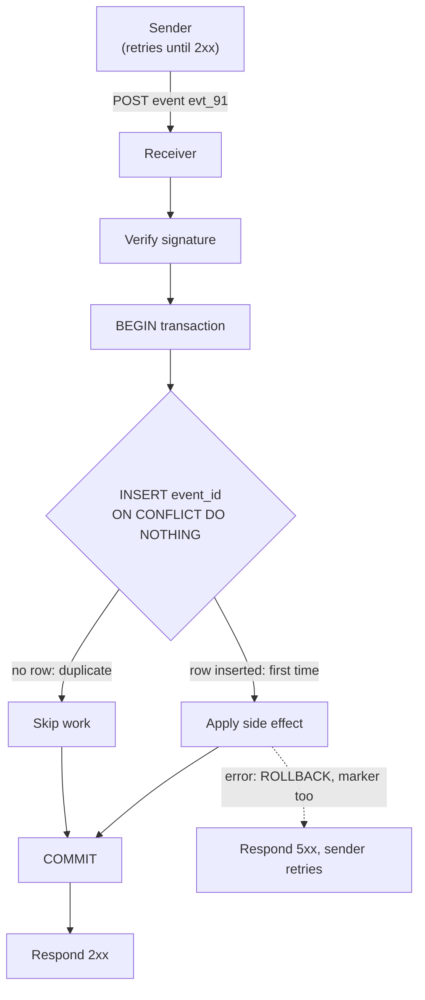

# Duplicate Events

> [!TIP]
> **In one line:** Delivery systems retry until they hear success, so every consumer will see the same event more than once; make processing idempotent and record each event ID atomically with its side effect.
>
> **In plain English:** If a courier cannot confirm you got a parcel, they bring it again, so you may end up holding two identical parcels. The fix is to keep a receipt book: before opening any parcel, check whether its number is already written down, and write the number down in the same moment you act on it, never before or after.
>
> **You'll be able to:** explain why at-least-once delivery produces duplicates · dedupe with a unique-constraint insert inside the same transaction as the side effect · size a dedupe store's retention and choose an ack point that does not lose events

## Why This Matters

Reliable delivery and duplicate delivery are two sides of the same coin. A sender cannot know whether your server received an event if the response is lost, if your server timed out after doing the work, or if a proxy cut the connection. The only safe choice for the sender is to try again. So almost every webhook provider, queue, and event stream promises **at-least-once** delivery: each event arrives one or more times, never zero (barring prolonged outage). "Exactly once" delivery is not something a network can provide; what you can build is *exactly-once processing* by making repeat deliveries harmless.

The cost of ignoring this is the kind that makes the news: a customer charged twice, two welcome emails, inventory decremented twice, a loyalty balance credited on every retry. These happen precisely when things are slow or flaky, because slowness triggers retries. The first time the sender's timeout is shorter than your processing time, every event is delivered twice.

This chapter completes a trio with [Event Ordering](event-ordering.md) (the same retries also reorder events) and [Webhooks](webhooks.md) (where receiving and acknowledging events is introduced). Authenticating each delivery before trusting it is covered in [Webhook Signature Verification](webhook-signature-verification.md).

## Core Concept

**At-least-once delivery** means the sender retries any delivery that is not positively acknowledged. A duplicate happens whenever the receiver *did* process an event but the sender *did not learn that*, and also when a sender or broker replays history on purpose (a manual replay from a dashboard, a consumer offset reset, a redelivery after a rebalance).

Two defences work together:

1. **Idempotent handlers.** Design the effect so applying it twice equals applying it once. "Set status to shipped" is idempotent; "add 50 to the balance" is not.
2. **Deduplication.** Remember which events you have already handled, keyed by a stable **event ID**, and skip repeats. This is how you make non-idempotent effects safe.

Deduplication has one hard requirement that most first attempts violate: *the record that an event was processed and the effect of processing it must succeed or fail together.* Get that wrong and you either process an event twice or never process it at all.

## Mental Model

A bouncer at a club holds a guest list. Each guest has a unique ticket number. When someone arrives, the bouncer looks the number up; if it is already crossed off, the person is turned away, and if not, the bouncer crosses it off and lets them in. Two failure modes mirror the real engineering ones. If the bouncer crosses off the number *before* the person actually gets in and then the door jams, a legitimate guest is locked out forever (lost event). If the bouncer lets them in *before* crossing off and an identical ticket arrives at the same time at the other door, both get in (duplicate). The cross-off and the entry must be one inseparable action, and that is what a database transaction with a unique constraint gives you.

## How It Works

### Step 1: find a stable event ID

You need an identifier that is the same on every redelivery of the *same logical event*. Good sources, in order of preference:

- The provider's event ID (`evt_...`), present in the payload or a header, stable across retries.
- A producer-generated UUID attached when the event is created (not when it is sent).
- A deterministic business key if nothing else exists, such as `(order_id, status_transition)` or `(payment_id, "succeeded")`.

Beware of **delivery IDs** that change on every attempt, and of hashing the whole payload when fields like `sent_at` change between retries. Both make every retry look new. Also ensure IDs are unique within the *namespace* you key on (for example per provider), by prefixing or using a composite key `(source, event_id)`.

### Step 2: record the ID atomically with the effect

The core move is an **insert with a unique constraint**, in the **same database transaction** as the work:

```text
BEGIN
  INSERT INTO processed_events (event_id) VALUES (:id)   -- unique / primary key
      ON CONFLICT DO NOTHING                              -- did a row get inserted?
  if no row was inserted: this is a duplicate -> COMMIT and return success
  else: perform the side effect (UPDATE balances ...)     -- same transaction
COMMIT                                                    -- both or neither
```

Why the unique constraint rather than "SELECT, then INSERT if missing"? Because two deliveries of the same event can arrive concurrently (a sender retrying while the first attempt is still running). Both SELECTs see nothing, both proceed, and both apply the effect. The unique index makes the database arbitrate: in PostgreSQL the second inserter *waits* for the first transaction to commit or roll back; if the first commits it gets a conflict and skips, if the first rolls back it proceeds. Exactly one transaction wins.

Because the marker and the effect share a transaction, a crash between them cannot leave you with "marked but not applied" (the event would be lost forever) or "applied but not marked" (it would be applied again). If the work fails and the transaction rolls back, the marker rolls back with it, so the sender's retry is processed normally.

### Step 3: acknowledge only after the durable save

A webhook sender treats a 2xx response as "got it, stop retrying." Return 2xx only after the event is **durably stored** (committed). If you reply 200 first and then crash while processing in memory, the sender will never retry and the event is gone. Two valid shapes:

- **Process inline.** Dedupe, apply, commit, then 2xx. Simple, but the sender waits for your work, so your processing time must fit its timeout (often 5 to 30 seconds).
- **Inbox pattern.** In one transaction, insert the raw event into an `inbox` table with the event ID as a unique key, then return 2xx immediately. A background worker processes inbox rows, marking each done. Duplicate deliveries hit the unique key and are acknowledged without creating a second row. This decouples acknowledgement latency from processing time, and the inbox is also your audit log and replay source.

### Step 4: make side effects outside the database safe

A database transaction cannot cover a call to an email service or a payment provider. For those, either pass the event ID (or a derived key) as the *downstream* idempotency key so the third party deduplicates, or write an **outbox** row in the same transaction and let a separate publisher send it, accepting that the publisher itself is at-least-once and so the receiver must dedupe again. Idempotency keys for outbound calls are covered with reliability patterns in [Part 6](../06-production-reliability/README.md).

### Step 5: decide how long to remember

You cannot store every ID forever, and you do not need to. A dedupe record only has to outlive the **longest window in which a duplicate can still arrive**: the sender's maximum retry horizon (providers often retry for hours to days), plus time allowed for manual replays, plus a safety margin. A common choice is a retention several times the retry horizon, for example 7 to 30 days, then purge. Decisions this implies:

- Too short a TTL means a late retry or replay looks new and is processed again.
- Idempotent effects (set-to-value, upserts) are not exposed to this risk; the dedupe table is a second layer for the non-idempotent ones.
- Partition or index the table by time so purging is a cheap range delete, and make sure the unique index exists for the retention period.

### Idempotent handlers: the stronger defence

Prefer designs that do not *need* the dedupe table to be correct:

- **Set, don't increment:** `status = 'shipped'` rather than "advance the status."
- **Upsert by natural key:** `INSERT ... ON CONFLICT (order_id, line_no) DO UPDATE`.
- **Conditional state transitions:** `UPDATE orders SET status='paid' WHERE id=:id AND status='pending'` affects zero rows on a repeat.
- **Unique business constraints:** one invoice per `(order_id)`, one welcome email per `(user_id, template)`; a second insert fails harmlessly.

Dedupe by event ID plus idempotent effects together is the robust combination, because each covers the other's blind spots (a TTL expiry, or a producer that issues two different event IDs for one real-world change).

## Architecture



## Request / Response Example

The provider delivers `evt_91` and the first attempt times out on the sender's side after the receiver already committed. The sender retries with the same event ID:

```http
POST /webhooks/payments HTTP/1.1
Host: shop.example.com
Content-Type: application/json
X-Signature: 5b0c1e...  (HMAC of the raw body)

{"id":"evt_91","type":"payment.succeeded","account_id":"acct_1","amount_cents":5000}
```

First delivery (processed):

```http
HTTP/1.1 200 OK
Content-Type: application/json

{"status":"processed"}
```

The retry of the same event is acknowledged without being applied again:

```http
HTTP/1.1 200 OK
Content-Type: application/json

{"status":"duplicate_ignored"}
```

The duplicate gets a **2xx**, not an error. From the sender's view the goal "make sure the receiver has this event" is already met; an error response would just trigger more retries.

## Code Example

A FastAPI receiver with SQLAlchemy 2.0 async and PostgreSQL. The dedupe marker and the balance update share one transaction.

```python
# receiver.py  -  requires: fastapi, sqlalchemy[asyncio], asyncpg, pydantic
import hashlib
import hmac
import os
from datetime import datetime, timedelta, timezone

from fastapi import FastAPI, HTTPException, Request
from pydantic import BaseModel
from sqlalchemy import BigInteger, DateTime, String, delete, func, update
from sqlalchemy.dialects.postgresql import insert as pg_insert
from sqlalchemy.ext.asyncio import AsyncSession, async_sessionmaker, create_async_engine
from sqlalchemy.orm import DeclarativeBase, Mapped, mapped_column

engine = create_async_engine(os.environ["DATABASE_URL"])  # postgresql+asyncpg://...
SessionFactory = async_sessionmaker(engine, expire_on_commit=False)
app = FastAPI()


class Base(DeclarativeBase):
    pass


class ProcessedEvent(Base):
    __tablename__ = "processed_events"
    # Composite key: namespaces the ID by source so two providers cannot collide.
    source: Mapped[str] = mapped_column(String, primary_key=True)
    event_id: Mapped[str] = mapped_column(String, primary_key=True)
    processed_at: Mapped[datetime] = mapped_column(
        DateTime(timezone=True), server_default=func.now(), index=True
    )


class Account(Base):
    __tablename__ = "accounts"
    id: Mapped[str] = mapped_column(String, primary_key=True)
    balance_cents: Mapped[int] = mapped_column(BigInteger, default=0)


class PaymentEvent(BaseModel):
    id: str
    type: str
    account_id: str
    amount_cents: int


def verify_signature(raw_body: bytes, header: str | None) -> None:
    """Illustrative HMAC check; use your provider's documented scheme and
    timestamp tolerance (see webhook-signature-verification.md)."""
    secret = os.environ["WEBHOOK_SECRET"].encode()
    expected = hmac.new(secret, raw_body, hashlib.sha256).hexdigest()
    if not header or not hmac.compare_digest(expected, header):
        raise HTTPException(status_code=401, detail="bad signature")


async def first_time(session: AsyncSession, source: str, event_id: str) -> bool:
    """True if this call recorded the event, False if it was already recorded.
    The unique key makes concurrent duplicates race safely: the loser blocks
    until the winner commits, then sees a conflict."""
    result = await session.execute(
        pg_insert(ProcessedEvent)
        .values(source=source, event_id=event_id)
        .on_conflict_do_nothing(index_elements=["source", "event_id"])
        .returning(ProcessedEvent.event_id)
    )
    return result.scalar_one_or_none() is not None


@app.post("/webhooks/payments")
async def receive(request: Request) -> dict:
    raw = await request.body()  # verify against the exact bytes received
    verify_signature(raw, request.headers.get("X-Signature"))
    event = PaymentEvent.model_validate_json(raw)

    # One transaction: marker + effect commit together or roll back together.
    async with SessionFactory() as session, session.begin():
        if not await first_time(session, "payments-provider", event.id):
            return {"status": "duplicate_ignored"}  # commit is a no-op; still 2xx

        if event.type == "payment.succeeded":
            # Not idempotent by itself (an increment) -- safe only because the
            # marker above guarantees this runs once per event ID.
            await session.execute(
                update(Account)
                .where(Account.id == event.account_id)
                .values(balance_cents=Account.balance_cents + event.amount_cents)
            )
    # Any exception above rolls back the marker too, the framework returns 500,
    # and the sender's retry is processed from scratch.
    return {"status": "processed"}


async def purge_old_markers(retention_days: int = 14) -> int:
    """Run on a schedule. Retention must exceed the sender's longest retry
    window plus any replay window you allow; otherwise a late duplicate is
    processed again."""
    cutoff = datetime.now(timezone.utc) - timedelta(days=retention_days)
    async with SessionFactory() as session, session.begin():
        result = await session.execute(
            delete(ProcessedEvent).where(ProcessedEvent.processed_at < cutoff)
        )
        return result.rowcount or 0
```

Assumptions and limits: the effect is a database write in the same PostgreSQL database as the marker table, which is what makes the transaction cover both. If the effect is an external call (sending an email, charging a card), a transaction does not include it: pass the event ID downstream as an idempotency key or write an outbox row in this transaction instead. An in-memory set or a Redis `SET NX` alone is not enough for database effects because the marker and the effect can then fail independently. Processing inline means the sender waits for your work; use the inbox pattern if that exceeds its timeout.

## Production Considerations

- **Concurrency.** Test parallel delivery of the same event ID (for example 20 simultaneous requests) and assert exactly one effect. This is the test that exposes the SELECT-then-INSERT race.
- **Sender timeouts.** If processing is slower than the sender's timeout, you will see duplicates constantly. Respond quickly using the inbox pattern, or speed up the work.
- **Table growth.** Plan purging from day one: an index on `processed_at`, scheduled deletes in batches, or time-partitioned tables dropped wholesale.
- **Status codes.** 2xx for a duplicate; 4xx only for events that will never succeed (bad signature, malformed payload) so senders do not retry forever; 5xx for transient failures that should be retried.
- **Poison events.** An event that always fails will be retried until the sender gives up. Alert on repeated failures and route to a dead-letter store for manual replay.
- **Replays.** Support intentional replays: a flag to bypass dedupe, or deleting a marker, with the idempotency of the effect as the backstop.
- **Multi-consumer fan-out.** If several independent consumers handle the same event, each needs its own dedupe key space (`(consumer, event_id)`), not one shared marker.
- **Observability.** Count processed versus duplicate-ignored versus failed; a spike in duplicates signals timeouts or an upstream incident.

## Common Mistakes

- **Check-then-act without a unique constraint.** SELECT then INSERT is a race; concurrent duplicates both pass.
- **Recording the ID in a different transaction than the effect.** Mark first and crash, and the event is lost; apply first and crash, and it repeats.
- **Acknowledging before saving.** A 200 followed by a crash drops the event with no retry.
- **Returning an error for a duplicate.** It triggers more retries; return success.
- **Deduping on delivery ID or full-payload hash** that changes between attempts.
- **Keeping dedupe records forever, or for too short a time.** Unbounded growth on one side, reprocessed late retries on the other.
- **Assuming the broker gives exactly-once.** Even systems with "exactly-once" features give it only within their own boundary; effects in your database or in third-party APIs still need idempotency.
- **Redis `SET NX` as the only guard for a database write.** The marker and the write can fail independently, so you can mark and not apply, or apply and not mark.

## Best Practices

- Treat every event as possibly delivered multiple times, always.
- Prefer naturally idempotent effects (set, upsert, conditional transition) and add event-ID dedupe for the rest.
- Insert the event ID with a unique constraint in the same transaction as the side effect.
- Respond 2xx only after the durable commit, and respond 2xx to duplicates.
- Use stable, namespaced event IDs; avoid per-attempt delivery IDs.
- Size the TTL to the sender's retry horizon plus replay window, with margin, and purge on a schedule.
- Forward the event ID as an idempotency key to downstream services, and use an outbox for effects that cannot share your transaction.
- Verify the signature before dedupe so forged events never consume IDs; see [Webhook Signature Verification](webhook-signature-verification.md).

## AI Engineering Perspective

Duplicate handling matters more once models and tools are in the loop because the duplicated action is often expensive or irreversible. A retried "run this agent" webhook can launch a second multi-minute run that bills tokens twice; a redelivered tool-call result can make an agent act on the same observation twice; a replayed "document updated" event can re-embed and re-index the same content, burning embedding costs and creating duplicate chunks that distort retrieval ranking. Dedupe by event ID *before* the costly call, and key side effects such as a "send email" tool by a deterministic idempotency key derived from the run ID and step number, so a retried step is recognised rather than repeated.

LLM calls themselves are not idempotent: calling a model twice with the same prompt can return different text, so "retry and hope it matches" is not dedupe. Store the first completed result under the idempotency key and return it on repeats. Agent frameworks and workflow engines ([Part 17](../17-ai-agents-and-mcp/README.md)) typically checkpoint each step with a unique ID for exactly this reason, and ingestion pipelines for retrieval ([Part 16](../16-rag-apis/README.md)) should upsert chunks by a content or document-version key so reprocessing is harmless.

## Exercises

**Beginner**
1. List three realistic situations in which a webhook receiver gets the same event twice even though both sender and receiver are working correctly.

**Intermediate**
2. Run the receiver against a local PostgreSQL. Send the same event 20 times concurrently with `asyncio.gather` and assert the account balance changed exactly once. Then change `first_time` to SELECT-then-INSERT and show the race produces a wrong balance.
3. Convert the handler to the inbox pattern: insert the raw body with a unique `(source, event_id)`, return 200, and process rows in a worker using `SELECT ... FOR UPDATE SKIP LOCKED`. What happens if the worker crashes mid-row?

**Advanced**
4. The effect is calling an external payment API that supports idempotency keys. Design the flow so that a crash after the API call but before your commit cannot cause a second charge, and say what you store and when. What if the API has no idempotency key support?

## Key Takeaways

- At-least-once delivery means duplicates are normal, so consumers must be safe to run twice.
- Dedupe by a stable event ID using an insert with a unique constraint, in the same transaction as the side effect.
- Acknowledge only after the durable commit, and respond with success to duplicates.
- Dedupe records need a TTL longer than the sender's retry and replay window; prefer idempotent effects so correctness does not depend on the TTL.
- External side effects need their own idempotency key or an outbox; a database transaction cannot cover them.

### Check Yourself
<details markdown="1">
<summary>1. Why does at-least-once delivery produce duplicates?</summary>

The sender cannot tell whether a failed or timed-out delivery was processed, so to avoid losing the event it retries until it gets a success response. If the receiver had in fact processed the first attempt, the retry is a duplicate.

</details>

<details markdown="1">
<summary>2. Why must the event-ID insert and the side effect be in the same transaction?</summary>

If they are separate, a crash between them leaves the event marked but not applied (lost) or applied but not marked (applied again on retry). A single transaction makes the marker and the effect commit or roll back together.

</details>

<details markdown="1">
<summary>3. Your receiver returns 200 immediately and then processes the event in a background task held in memory. The process is restarted mid-task. What goes wrong and how do you fix it?</summary>

The sender already got a 2xx so it will not retry, and the in-memory task is gone, so the event is lost. Save the event durably first, for example in an inbox table with a unique event ID in a transaction, then acknowledge, and let a worker process stored rows so unfinished work survives restarts.

</details>

---
Back to the [Part 9 README](README.md).
