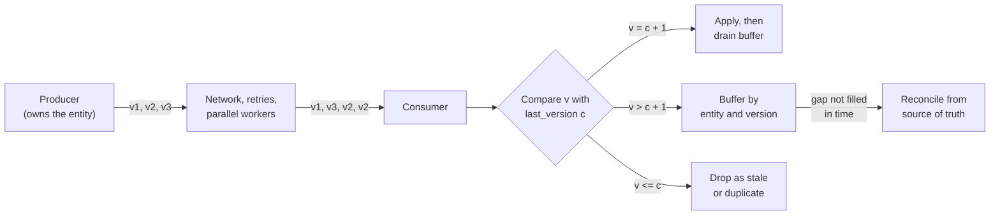
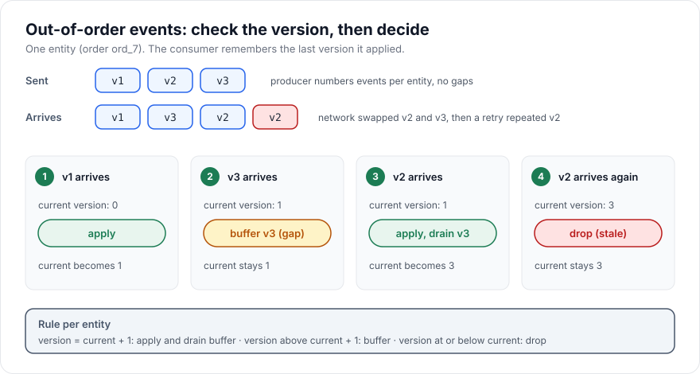

# Event Ordering

> [!TIP]
> **In one line:** Events can arrive in a different order than they happened, so consumers must use per-entity version numbers, not arrival time or timestamps, to decide what to apply, buffer, or ignore.
>
> **In plain English:** Think of a stack of numbered page-turn instructions that gets shuffled in the mail. If you obey them in the order they arrive, you end up on the wrong page. The fix is to read the number on each instruction, hold back any that jump ahead, and throw away any you have already done.
>
> **You'll be able to:** explain why delivery order is not event order · design version numbers and apply, buffer or drop rules per entity · know when you need ordering at all and when a cheaper rule is enough

## Why This Matters

Distributed systems deliver messages over multiple paths, with retries, in parallel, and through queues. The network does not promise that two messages sent in order arrive in order. A webhook sender that retries a failed `order.paid` while `order.shipped` goes through first, a consumer group with several workers reading one queue, a mobile client that sends two quick edits over different connections: all of these deliver events out of order in ordinary operation, not just during outages.

Consequences are concrete. An `order.cancelled` processed *before* the `order.created` it refers to either errors out or, worse, is ignored and then the stale `created` revives a cancelled order. A user sets their display name twice and the *older* value wins. A balance computed from `deposit` and `withdraw` events is right only if you handle them consistently. These bugs are intermittent, appear only under load, and are hard to reproduce, which is exactly why you need a deliberate design instead of hoping arrival order is event order.

This chapter pairs with [Duplicate Events](duplicate-events.md) because the two problems share a cause (at-least-once delivery with retries) and share machinery (a per-entity record of what you have already processed). It also builds on the cursor idea from [Long Polling](long-polling.md) and the resumable streams of [Streaming APIs](streaming-apis.md).

## Core Concept

**Event ordering** is the problem of ensuring that a consumer's resulting state reflects events in the order they *happened to the entity they describe*, even though they may *arrive* in a different order.

Two distinctions drive every design decision:

**Per-entity order versus global order.** A *global* order means every event in the whole system has one position in a single line. It is expensive: it requires a single sequencer, which is a throughput bottleneck and a single point of coordination. A *per-entity* order only says that events about the *same* thing (one order, one user, one document) are ordered relative to each other, while events about different things are independent. Almost every real requirement is per-entity: the payment for order A must not be applied before order A exists, but it does not matter whether order B's events come before or after A's. Per-entity ordering is cheap and scales, because different entities can be processed in parallel.

**Sequence numbers versus timestamps.** A *version* or *sequence number* assigned by the entity's single owner (the producer that serialises writes to that entity) is a trustworthy order. A *timestamp* is not. Clocks on different machines drift by milliseconds to seconds, two events can share a timestamp, time can jump after clock adjustments, and a timestamp records when something was *observed*, not what causally preceded it. Timestamps are useful for humans, retention, and rough windows, never for deciding which of two updates wins.

## Mental Model

A library keeps one index card per book. Every time the book's status changes, the librarian stamps a revision number on a slip: "book 91, revision 7: checked out." Slips reach the cataloguer by different carts, so revision 8 can arrive before revision 7. The cataloguer's rule is mechanical and needs no clock: if the slip is exactly one more than the card, apply it. If it is more than one ahead, set it aside until the missing slip arrives. If it is the same or lower, it is a repeat or an old slip and goes in the bin. The card's revision number *is* the memory that makes the rule work.

## How It Works

### Step 1: the producer assigns the order

Ordering is established at the source, by whoever owns the entity, at the moment the change is committed. Put a `version` (a per-entity integer that increases by exactly one per change) or a monotonically increasing `sequence` in every event, along with the `entity_id`. If the version comes from the entity's own database row (`UPDATE ... SET version = version + 1`), then the event is numbered inside the same transaction as the change it describes, and there are no gaps unless a transaction rolled back before publishing.

A per-stream sequence (as in a log) gives order within that stream; a per-entity version gives order for one object even if several streams carry it. Choose one scope and say so in the contract.

### Step 2: the consumer keeps the last-applied version

For each entity the consumer stores the highest version it has applied (`last_version`). That state must be updated *atomically* with the effect of the event, in the same transaction, or the check and the work can disagree after a crash.

### Step 3: apply, buffer, or drop

For an event with version `v` and stored `last_version = c`:

- `v == c + 1`: it is the next expected event. Apply it, set `last_version = v`, then check the buffer for `v + 1`, `v + 2` and so on, and apply those in turn.
- `v > c + 1`: there is a gap. Either **buffer** the event until the missing ones arrive, or ignore the ordering problem if events are full snapshots (see below).
- `v <= c`: already applied or older. **Drop** it (it is a duplicate or stale). This is also your first line of defence against duplicates.

### Two families of events

The right strategy depends on what the event contains.

**State snapshots** carry the entire new state of the entity ("order ord_7 is now `shipped` with these fields"). Here the latest version is all that matters. Rule: apply if `v > c`, else drop. This is *last-writer-wins by version*, and it needs no buffering because a newer snapshot supersedes everything before it. Missing a middle snapshot loses nothing the final state needs. This is the simplest and most robust pattern, and many APIs (including most webhook payloads that embed the whole object) can use it.

**Deltas / transitions** carry a change ("add 50 to balance", "status moved from paid to shipped"). Every one matters, so you cannot skip a gap. You must buffer out-of-order events and apply them in sequence, or, when a gap does not close within a time limit, **reconcile**: fetch the current authoritative state from the source's API and overwrite local state with it, then resume from that version.

### Gaps that never close

A buffered event waits for a missing predecessor that might never arrive: the producer rolled back, the message expired, or a poison message was dead-lettered. Buffers need a time limit and an escape route. After N seconds, trigger reconciliation (re-fetch the entity), or alert. Never let a buffer grow without bound.

### Partitioning as a cheap ordering tool

Log-based brokers get per-entity order a different way: they route all events with the same *key* (the entity id) to the same *partition*, and a partition is read in order by exactly one consumer in a group. That gives per-entity ordering at scale, with parallelism across keys. The price is that ordering is only guaranteed within a partition; there is no ordering across partitions, and a rebalance or a retry topic can reintroduce reordering. See [Part 8 — Async Systems](../08-async-systems/README.md) for brokers and consumers. Note that this gives order *to the consumer*, but a producer that publishes the same entity's events from two processes without a coordinated order can still publish them in the wrong order in the first place; ordering must be assigned at the entity owner.

### What not to rely on

- **Arrival order.** Retries, parallel workers and multi-path delivery all break it.
- **Timestamps.** They detect *staleness* only roughly. If you must use time (for example, no version exists), pair it with a tie-breaker and accept that near-simultaneous writes can pick the wrong winner.
- **"It was fine in testing."** Reordering needs concurrency and retries to appear; low-volume tests hide it.

## Architecture





## Request / Response Example

Webhook deliveries for one order reach the consumer in this order. Each body carries the entity id, a per-entity `version`, and a timestamp that is *not* used for ordering:

```http
POST /webhooks/orders HTTP/1.1
Host: shop.example.com
Content-Type: application/json
X-Event-Id: evt_0042

{"entity_id":"ord_7Hq2","version":1,"status":"paid","occurred_at":"2025-03-04T10:00:00.120Z"}
```

```http
POST /webhooks/orders HTTP/1.1
Host: shop.example.com
Content-Type: application/json
X-Event-Id: evt_0044

{"entity_id":"ord_7Hq2","version":3,"status":"delivered","occurred_at":"2025-03-04T10:00:02.480Z"}
```

Version 3 arrived while the stored version is 1, so the consumer buffers it and acknowledges receipt (so the sender stops retrying) with a 2xx. It must have *durably saved* the event before acknowledging; see [Webhooks](webhooks.md). Then version 2 arrives:

```http
POST /webhooks/orders HTTP/1.1
Host: shop.example.com
Content-Type: application/json
X-Event-Id: evt_0043

{"entity_id":"ord_7Hq2","version":2,"status":"shipped","occurred_at":"2025-03-04T10:00:01.300Z"}
```

The consumer applies version 2, drains buffered version 3, and ends at version 3, `delivered`. Note that `occurred_at` happens to agree with version order here, but if the producer's two servers had clocks 2 seconds apart it would not, which is why the version, not the timestamp, decides.

## Code Example

A consumer for transition-style events using SQLAlchemy 2.0 async with PostgreSQL. A row lock per entity (`SELECT ... FOR UPDATE`) serialises concurrent deliveries for the same order, so the version check, the apply, and the buffer drain happen as one atomic unit. If your events are full snapshots, replace the whole function body with a single conditional `UPDATE ... WHERE version < :v`.

```python
# ordering.py  -  requires: sqlalchemy[asyncio], asyncpg, pydantic
import os
from datetime import datetime, timedelta, timezone

from pydantic import BaseModel, Field
from sqlalchemy import BigInteger, DateTime, String, func, select
from sqlalchemy.dialects.postgresql import insert as pg_insert
from sqlalchemy.ext.asyncio import async_sessionmaker, create_async_engine
from sqlalchemy.orm import DeclarativeBase, Mapped, mapped_column

engine = create_async_engine(os.environ["DATABASE_URL"])  # postgresql+asyncpg://...
SessionFactory = async_sessionmaker(engine, expire_on_commit=False)


class Base(DeclarativeBase):
    pass


class Order(Base):
    __tablename__ = "orders"
    id: Mapped[str] = mapped_column(String, primary_key=True)
    status: Mapped[str] = mapped_column(String, default="new")
    version: Mapped[int] = mapped_column(BigInteger, default=0)  # last applied version


class PendingEvent(Base):
    """Out-of-order events waiting for their predecessors."""

    __tablename__ = "pending_events"
    entity_id: Mapped[str] = mapped_column(String, primary_key=True)
    version: Mapped[int] = mapped_column(BigInteger, primary_key=True)
    status: Mapped[str] = mapped_column(String)
    received_at: Mapped[datetime] = mapped_column(
        DateTime(timezone=True), server_default=func.now()
    )


class OrderEvent(BaseModel):
    entity_id: str
    version: int = Field(ge=1)  # assigned by the producer, +1 per change
    status: str


async def handle_event(ev: OrderEvent) -> str:
    """Apply, buffer or drop. Returns which one happened."""
    async with SessionFactory() as session, session.begin():
        # Make sure a row exists, then lock it. Concurrent deliveries for the
        # same entity queue up here; other entities proceed in parallel.
        await session.execute(
            pg_insert(Order)
            .values(id=ev.entity_id, status="new", version=0)
            .on_conflict_do_nothing(index_elements=["id"])
        )
        order = (
            await session.execute(
                select(Order).where(Order.id == ev.entity_id).with_for_update()
            )
        ).scalar_one()

        if ev.version <= order.version:
            return "dropped_stale"  # duplicate or older than what we have

        if ev.version > order.version + 1:
            # Gap: park it. ON CONFLICT makes a repeated buffering a no-op.
            await session.execute(
                pg_insert(PendingEvent)
                .values(entity_id=ev.entity_id, version=ev.version, status=ev.status)
                .on_conflict_do_nothing()
            )
            return "buffered"

        # Exactly the next version: apply it...
        order.status, order.version = ev.status, ev.version
        # ...then drain any buffered successors, in order.
        while True:
            nxt = (
                await session.execute(
                    select(PendingEvent).where(
                        PendingEvent.entity_id == ev.entity_id,
                        PendingEvent.version == order.version + 1,
                    )
                )
            ).scalar_one_or_none()
            if nxt is None:
                break
            order.status, order.version = nxt.status, nxt.version
            await session.delete(nxt)
        return "applied"  # the transaction commits when the block exits


async def entities_with_stuck_gaps(older_than: timedelta) -> list[str]:
    """Run periodically. Entities returned here should be reconciled by
    fetching their current state from the source of truth and resetting
    `version`, or alerted on if reconciliation is not possible."""
    cutoff = datetime.now(timezone.utc) - older_than
    async with SessionFactory() as session:
        rows = await session.execute(
            select(PendingEvent.entity_id).where(PendingEvent.received_at < cutoff).distinct()
        )
        return list(rows.scalars())
```

Assumptions and limits: versions are per entity and gapless; events are delivered at least once (a replay of an applied version is dropped by the stale rule); and the database is the single source of the consumer's state. The reconciliation step is deliberately left to the caller because it depends on the source system's API. If the producer can legitimately skip versions (for example, version bumps from changes that emit no event), a gap rule based on `+1` would buffer forever; in that case use snapshot semantics or a sequence that counts only emitted events.

## Production Considerations

- **Where does the version come from?** If it is not assigned by the entity's owner at commit time, you do not have ordering, you have a guess. Retrofitting a version onto an existing system is often the hardest part of this work.
- **Throughput versus ordering.** The row lock serialises per entity only. Do not widen the lock scope (a global lock or a single consumer) to "fix" ordering; shard by entity id instead.
- **Retention and buffer size.** Cap the number of buffered events per entity and their age. A hostile or buggy sender can fill the buffer with far-future versions. Reject versions implausibly far above `last_version`.
- **Reconciliation cost.** Fetching authoritative state is the safety net, but it can stampede the source API after an outage. Rate-limit and batch it.
- **Observability.** Track counts of applied, buffered, dropped-stale, and reconciled events, buffer age, and gap duration. A rising buffered ratio means upstream reordering got worse; stale drops are expected when senders retry.
- **Multi-entity invariants.** Per-entity order does not order events *across* entities (a payment and its order). If a consumer needs cross-entity consistency, model the dependency explicitly (buffer the payment until the order exists) or use a single entity that owns both.
- **Replays and backfills.** Replaying history through the same handler is safe only because old versions drop as stale; verify that before relying on it.

## Common Mistakes

- **Ordering by timestamp.** Clock skew and ties produce the wrong winner, silently.
- **Assuming the queue preserves order.** Most queues order per partition at best, and retries, dead-letter queues, and multiple workers break even that.
- **Using one global consumer to get ordering.** It works until it becomes the throughput bottleneck and a single point of failure.
- **Checking the version and applying in separate transactions.** Two workers both pass the check and both apply. Lock the entity or use a conditional update.
- **Buffering forever.** A missing event stalls an entity permanently with no alert.
- **Ignoring duplicates in the ordering logic.** A version `<= last_version` is both stale and duplicate; handle it explicitly rather than reprocessing.
- **Wanting global ordering when per-entity suffices.** It buys you a bottleneck you did not need.

## Best Practices

- Define the ordering scope (per entity, per stream) in the event contract and put `entity_id` and `version` in every event.
- Prefer full-state snapshot events with last-writer-wins by version when the domain allows; it removes the buffering problem.
- Assign versions at the entity owner inside the same transaction as the change.
- Update `last_version` atomically with the side effect, using a row lock or a conditional update.
- Give every buffer a size cap and a time limit, with a reconciliation path.
- Use timestamps for display and retention only; never for conflict resolution unless nothing better exists.
- Test with deliberately shuffled, duplicated, and delayed events, not just ordered ones.

## AI Engineering Perspective

Ordering shows up wherever model output is assembled from pieces. Token streams carry a sequence index so a UI can render deltas in order, and tool-call argument fragments must be concatenated in index order before parsing the JSON. If your gateway fans one request out to parallel tool calls or several model calls, their results return in completion order, not request order, so you key results by call id and reassemble deterministically; otherwise a transcript can list a tool result before the tool call that caused it.

In multi-agent and agent-memory systems, the version-per-entity rule is how you avoid stale writes: two agents updating the same task or memory record should compare versions (optimistic concurrency) so the slower, staler one does not overwrite a newer decision. Event-sourced agent runs ([Part 17](../17-ai-agents-and-mcp/README.md)) rely on a strict per-run sequence to replay a run, resume it after a crash, and audit what happened in what order. For retrieval pipelines ([Part 16](../16-rag-apis/README.md)), index updates are the same problem: if a document is updated twice and the updates reach the indexer out of order, the older content can overwrite the newer, so index writes should carry the document version and be dropped if stale.

## Exercises

**Beginner**
1. Given a stored version of 4, classify these arrivals as apply, buffer, or drop: v5, v7, v3, v4. Then trace what happens to the buffered event when the missing version arrives.

**Intermediate**
2. Rewrite `handle_event` for snapshot events with a single `UPDATE orders SET status = :s, version = :v WHERE id = :id AND version < :v`. How do you know from the result whether it applied or was stale? What did you lose compared with the transition version, and what did you gain?
3. Write a test that delivers versions 1 to 6 in random order, including duplicates, and asserts the final state is version 6 regardless of order.

**Advanced**
4. A producer runs on two nodes, each stamping `occurred_at` from its own clock, and has no per-entity version. Design a way to introduce one (for example a database sequence or an optimistic `version` column) without downtime for existing consumers, and describe what the consumer does with events that lack a version during the transition.

## Key Takeaways

- Delivery order is not event order; retries, parallelism and multiple paths reorder messages even when nothing is failing.
- You almost always need only per-entity ordering, enforced with a per-entity version assigned by the owner of that entity.
- The consumer rule is mechanical: next version, apply and drain; future version, buffer; same or older, drop.
- Snapshot events with last-writer-wins by version are simpler and more robust than deltas, which need buffering and reconciliation.
- Timestamps are not order; buffers need limits and a reconciliation path.

### Check Yourself
<details markdown="1">
<summary>1. What is the difference between per-entity ordering and global ordering, and which do most systems need?</summary>

Per-entity ordering orders events about the same object relative to each other; global ordering puts every event in the system on one line. Most systems need only per-entity ordering, which scales because different entities can be processed in parallel, while global ordering needs a single sequencer.

</details>

<details markdown="1">
<summary>2. Why is last-writer-wins by timestamp unsafe, and what should decide the winner instead?</summary>

Clocks drift and can tie, and a timestamp says when something was observed, not what came first in the entity's history, so a stale update can carry the later time. A per-entity version assigned by the entity's owner at commit time gives a trustworthy order.

</details>

<details markdown="1">
<summary>3. Your consumer stored version 2 for an order and receives v5. What do you do, and what could go wrong if you wait for v3 and v4?</summary>

If events are deltas, buffer v5 and wait for v3 and v4, then apply them in order. The risk is that v3 or v4 never arrive, so the order is stuck behind the gap forever; put a time limit on the buffer and reconcile by fetching the current state from the source. If events are full snapshots, simply apply v5 because it supersedes v3 and v4.

</details>

---
Back to the [Part 9 README](README.md).
