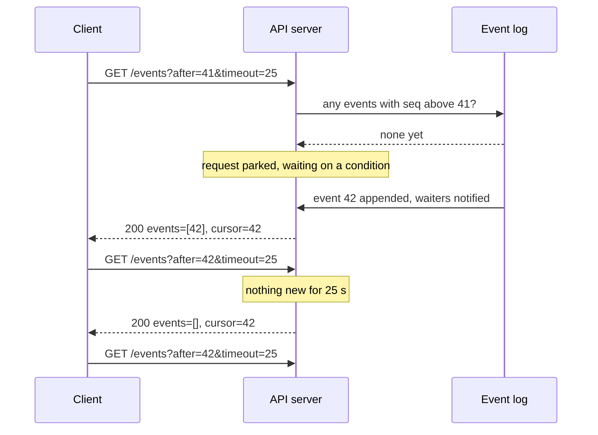
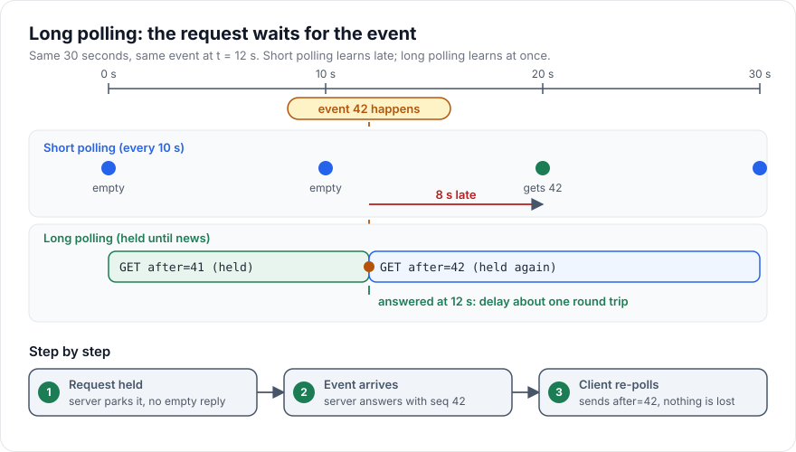

# Long Polling

> [!TIP]
> **In one line:** Long polling holds a request open until the server has something new or a timeout expires, so the client hears about events almost immediately without a special protocol.
>
> **In plain English:** Instead of knocking on a door every few seconds to ask "anything for me?", you knock once and the person inside says "wait here, I'll open the door the moment a parcel arrives." If nothing arrives after a while they tell you "nothing yet," and you simply knock again, this time saying which parcel you last received so none are skipped.
>
> **You'll be able to:** build a cursor-based long-poll endpoint in FastAPI that never loses an event between polls · choose timeouts that survive proxies and load balancers · decide when long polling beats polling, SSE, or WebSocket

## Why This Matters

[Short polling](polling.md) is the easiest way to get "fresh" data: ask on a timer. Its weakness is the trade-off baked into the timer. Poll every 30 seconds and users wait up to 30 seconds to see an update. Poll every second and you generate 3,600 requests per client per hour, almost all of them answering "nothing new." Latency and load pull in opposite directions, and you can only pick a point on that line.

Long polling breaks the trade-off using only ordinary HTTP. The request is deliberately *slow*: the server parks it until there is something to say. Latency drops to roughly one network round trip after the event happens, and an idle client costs one open request per timeout window instead of dozens. It was the workhorse of early "comet" web apps and chat widgets, and it is still the fallback inside many real-time libraries when a WebSocket or [SSE](server-sent-events.md) connection is blocked by a corporate proxy.

It also matters because it is the simplest place to learn the hard problem that every real-time system shares: **how do you guarantee a client does not miss an event while it is between connections?** The answer, a cursor, reappears in [Streaming APIs](streaming-apis.md), in SSE's `Last-Event-ID`, and in [Event Ordering](event-ordering.md).

## Core Concept

**Long polling** is a request/response pattern in which the server does not answer immediately when there is no new data. It holds the request open, then responds when either (a) new data becomes available or (b) a maximum wait time elapses. After receiving *any* response, the client immediately sends the next request. Mechanically it is still one request, one response, repeated; only the server's willingness to delay the response is new.

Three ideas make it work:

1. **Hold, then respond.** The handler waits on an in-process signal (an `asyncio.Condition` or queue, or a pub/sub subscription across processes) rather than checking the database in a tight loop.
2. **A bounded wait.** The server always answers before any intermediary gives up, typically after 20 to 30 seconds, with an empty result if nothing happened. This is a normal, successful outcome, not an error.
3. **A cursor.** Every event has a monotonically increasing position (a sequence number or ID). The client sends "give me everything after position N." Because the server remembers events and the client remembers N, the gap between one response and the next request cannot lose anything.

The third point is what separates a toy from a correct implementation. Without a cursor, an event that fires while the client is processing the previous response and preparing its next request has nowhere to go and is silently lost.

## Mental Model

Think of a restaurant pass where a waiter is waiting for the kitchen. In short polling the waiter walks to the pass every 10 seconds and asks "is table 4 ready?" In long polling the waiter stands at the pass and refuses to leave until a plate appears, or until a manager says "go back to your section after 25 seconds regardless." The ticket number on each plate is the cursor: when the waiter returns they say "I already took tickets up to 41," so even plates finished while they were walking away are handed over in order.

## How It Works

1. **Client first request.** `GET /events?after=0&timeout=25`. A cursor of `0` means "from the beginning" (or the client first fetches a snapshot and starts from its cursor).
2. **Server checks for existing events.** If events with `seq > after` already exist, respond right away with them. This is the *catch-up* case and is what closes the gap between polls.
3. **Otherwise the server waits.** The handler suspends on a condition. A suspended coroutine costs a small amount of memory, not a thread, so thousands can wait on one async worker.
4. **Something happens.** A producer appends an event to the log and notifies waiters. Every waiter wakes, re-checks "are there events after my cursor?", and responds.
5. **Or the timer fires.** If the deadline passes first, the server responds with an empty list and the unchanged cursor.
6. **Client processes, updates its cursor, re-polls immediately.** The new cursor is the last `seq` it *fully processed*.
7. **Errors.** On a network error or 5xx, the client waits with exponential backoff and jitter, then retries with the same cursor. Retrying is safe because the request only reads.
8. **Cursor expired.** If the server has discarded events older than the cursor (retention), it answers `410 Gone`. The client must re-sync from a snapshot, then resume from the snapshot's cursor.

### Timeouts and intermediaries

The server's hold time is only one of several clocks. A request crosses a client library, possibly a CDN, a load balancer, a reverse proxy, and your app server, each with an idle or total timeout. Common defaults are 60 seconds for several cloud load balancers and nginx's `proxy_read_timeout`, but they vary and are configurable, so check your own stack. A safe rule:

```text
server hold time  <  smallest proxy/LB timeout in the path      (25 s < 60 s)
server hold time  <  client read timeout                        (25 s < 35 s)
```

The server's hold time must be *shorter* than every proxy in the path, otherwise a proxy cuts the connection and the client sees spurious 504s or resets. The client's read timeout must be *longer* than the server's hold time, otherwise the client aborts a perfectly healthy poll. Pick the server value with a margin, and let the client request a smaller value if it wishes but clamp it server-side.

### Comparison with the neighbours

| | Short polling | Long polling | SSE | WebSocket |
|---|---|---|---|---|
| Latency to see an event | up to the interval | about one round trip | about one round trip | about one round trip |
| Idle cost | many empty requests | one parked request per window | one open stream | one open socket |
| Direction | client pulls | client pulls | server pushes | both |
| Resume after drop | not needed | cursor, built by you | `Last-Event-ID` built in, server must replay | built by you |
| Works through hostile proxies | yes | yes, mostly | usually | sometimes blocked |

Long polling's weaknesses are real: every event costs a full HTTP request/response with headers, and the gap between a response and the next request is a window where a slow client is "offline." Under heavy event rates it degenerates into short polling with extra steps, which is when [SSE](server-sent-events.md) or [WebSocket](websocket.md) is the better fit.

## Architecture





## Request / Response Example

Client asks for anything after sequence 41, waiting up to 25 seconds:

```http
GET /v1/orders/events?after=41&timeout=25 HTTP/1.1
Host: api.example.com
Authorization: Bearer <token>
Accept: application/json
```

Eleven seconds later an order is shipped and the server answers:

```http
HTTP/1.1 200 OK
Content-Type: application/json
Cache-Control: no-store

{
  "events": [
    {"seq": 42, "type": "order.shipped", "data": {"order_id": "ord_7Hq2", "carrier": "UPS"}}
  ],
  "cursor": 42
}
```

If nothing happens for the full window, the answer is still a success and the cursor does not move:

```http
HTTP/1.1 200 OK
Content-Type: application/json
Cache-Control: no-store

{"events": [], "cursor": 42}
```

If the client has been offline so long that event 42 was already trimmed from retention:

```http
HTTP/1.1 410 Gone
Content-Type: application/json

{"error": "cursor_expired", "detail": "Re-fetch GET /v1/orders and resume from its cursor."}
```

## Code Example

A single-process FastAPI server with a bounded in-memory event log, plus a client loop. In production the log lives in a database, Redis Stream, or broker so that every API replica sees the same events (see the notes below).

```python
# server.py  -  run: uvicorn server:app
import asyncio
from collections import deque

from fastapi import FastAPI, HTTPException, Query
from pydantic import BaseModel

MAX_HOLD_SECONDS = 25  # keep below the smallest proxy/LB idle timeout


class Event(BaseModel):
    seq: int
    type: str
    data: dict


class PollResponse(BaseModel):
    events: list[Event]
    cursor: int


class CursorGone(Exception):
    """Cursor points at events we no longer have, or at the future."""


class EventLog:
    """Append-only, bounded log with a monotonically increasing seq."""

    def __init__(self, max_events: int = 1000) -> None:
        self._events: deque[Event] = deque(maxlen=max_events)
        self._last_seq = 0
        self._cond = asyncio.Condition()

    async def publish(self, type_: str, data: dict) -> Event:
        async with self._cond:
            self._last_seq += 1
            event = Event(seq=self._last_seq, type=type_, data=data)
            self._events.append(event)
            self._cond.notify_all()  # wake every parked poller
            return event

    def _validate(self, cursor: int) -> None:
        first_retained = self._events[0].seq if self._events else self._last_seq + 1
        # cursor + 1 is the next seq the client needs; if it is older than
        # what we kept, there is a hole we cannot fill.
        if cursor + 1 < first_retained or cursor > self._last_seq:
            raise CursorGone

    async def wait_after(self, cursor: int, timeout: float, limit: int) -> list[Event]:
        async with self._cond:
            self._validate(cursor)
            try:
                # wait_for re-checks the predicate after every notify, so a
                # wake-up for an unrelated event cannot return early.
                await asyncio.wait_for(
                    self._cond.wait_for(lambda: self._last_seq > cursor),
                    timeout=timeout,
                )
            except asyncio.TimeoutError:
                pass  # empty result is a normal outcome
            self._validate(cursor)  # eviction may have happened while parked
            return [e for e in self._events if e.seq > cursor][:limit]


log = EventLog()
app = FastAPI()


@app.get("/events", response_model=PollResponse)
async def poll(
    after: int = Query(0, ge=0),
    timeout: float = Query(MAX_HOLD_SECONDS, ge=0, le=MAX_HOLD_SECONDS),
    limit: int = Query(100, ge=1, le=500),
) -> PollResponse:
    try:
        events = await log.wait_after(after, timeout, limit)
    except CursorGone:
        raise HTTPException(status_code=410, detail="cursor_expired")
    # Cursor advances only to the last event we are actually returning.
    return PollResponse(events=events, cursor=events[-1].seq if events else after)


@app.post("/events", status_code=201)
async def publish(type: str, payload: dict) -> Event:
    return await log.publish(type, payload)
```

```python
# client.py  -  a polite long-poll loop
import asyncio
import os
import random

import httpx

BASE = os.environ["EVENTS_BASE_URL"]  # e.g. https://api.example.com
HOLD = 25.0


async def handle(event: dict) -> None:
    print("processing", event["seq"], event["type"])  # must be idempotent


async def follow(cursor: int = 0) -> None:
    backoff = 1.0
    # read timeout comfortably above the server's hold time
    timeout = httpx.Timeout(connect=5.0, read=HOLD + 10.0, write=5.0, pool=5.0)
    async with httpx.AsyncClient(base_url=BASE, timeout=timeout) as http:
        while True:
            try:
                r = await http.get("/events", params={"after": cursor, "timeout": HOLD})
                if r.status_code == 410:
                    cursor = await resync(http)  # snapshot, then resume
                    continue
                r.raise_for_status()
            except (httpx.TransportError, httpx.HTTPStatusError):
                # jittered exponential backoff; retrying a GET with the same cursor is safe
                await asyncio.sleep(backoff * random.uniform(0.5, 1.5))
                backoff = min(backoff * 2, 30.0)
                continue
            backoff = 1.0
            for event in r.json()["events"]:
                await handle(event)
                cursor = event["seq"]  # advance only after handling


async def resync(http: httpx.AsyncClient) -> int:
    # Application-specific: load a fresh snapshot and return its cursor.
    return 0


if __name__ == "__main__":
    asyncio.run(follow())
```

Notes on the limits of this sketch: the log is in one process's memory, so it works with a single worker only. With several workers or hosts, back the log with something shared (a database table with an auto-increment ID, a Redis Stream, a broker) and use Redis pub/sub or `LISTEN/NOTIFY` as the wake-up signal, with the stored log as the source of truth. A wake-up can be lost; the stored log plus the cursor is what makes that harmless.

## Production Considerations

- **Worker capacity.** Each parked request holds a connection. An async server handles many thousands of them cheaply; a synchronous server with a thread per request does not. Check connection and file-descriptor limits on the server, proxy, and load balancer, and size them for the number of *clients*, not requests per second.
- **Thundering herd on reconnect.** After a deploy or outage, every client re-polls at once. Use jittered backoff on the client, and consider randomising the hold time slightly (for example 20 to 25 seconds) so timeouts do not synchronise.
- **Graceful shutdown.** Parked requests block a rolling deploy until they time out. Either drain with a shutdown signal that answers all waiters with an empty response, or accept the deploy delay of up to the hold time.
- **Retention and 410.** Decide how long events are kept. The retention window is also the longest outage a client can survive without a full re-sync.
- **Authorization at the cursor.** Re-check permissions on each poll, and scope the log per user or tenant. A shared log with a single global cursor can leak other tenants' events if you filter after the fact carelessly.
- **No caching.** Send `Cache-Control: no-store`; a cache that replays an old "empty" answer defeats the whole pattern.
- **Observability.** Track parked-request count, the share of polls that return empty versus with events, and 410 rate. A rising empty-return share is normal off-peak; a rising 410 rate means retention is too short.

## Common Mistakes

- **No cursor.** Returning "whatever is new right now" and re-polling loses every event that fires between the response and the next request.
- **Advancing the cursor before processing.** If the client crashes after saving cursor 42 but before handling event 42, that event is gone. Advance after the work is done, and make handlers idempotent, since a crash can also cause a replay.
- **Server hold time longer than a proxy timeout.** Everything works in development, then fails in production with 504s every 60 seconds.
- **Client read timeout shorter than the hold.** The client cancels healthy polls and, worse, hammers the server with retries.
- **Treating the empty response as an error.** It is a success; do not back off on it, just re-poll.
- **Polling in a tight loop on error.** A 500 plus an immediate retry creates a self-inflicted outage. Back off with jitter.
- **Waking on every change and re-querying everything.** Wake the waiter, but query only `seq > cursor` with a limit.

## Best Practices

- Give every event a monotonic, gap-free-per-stream sequence number and use it as the cursor.
- Always include a catch-up path: check for existing events *before* waiting.
- Clamp the server hold time, keep it comfortably below intermediary timeouts, and make client read timeouts longer.
- Return `410 Gone` for expired cursors and document the re-sync procedure.
- Make consumers idempotent; at-least-once is the realistic guarantee (see [Duplicate Events](duplicate-events.md)).
- Fall back gracefully: use [SSE](server-sent-events.md) or [WebSocket](websocket.md) when available and long polling when they are not, sharing the same event log and cursor semantics.
- Cap `limit` per response so a client far behind catches up in batches instead of one giant payload.

## AI Engineering Perspective

Long polling is the natural shape for asynchronous AI jobs. A long-running agent run, an evaluation batch, or a media generation request takes seconds to minutes, which is too long to hold a single response and too slow to justify a one-second polling loop. A `GET /runs/{id}/events?after=N` endpoint lets a UI show tool calls, intermediate steps, and the final answer as they land, using a cursor the client can persist across page reloads. Because each step is a stored event, a user who closes the tab and returns still sees the full run history instead of a half-finished stream.

It is also a pragmatic fallback for token streaming. Where a corporate proxy buffers or blocks `text/event-stream`, a client can fall back to long polling at a coarser granularity (a batch of tokens per response). That costs smoothness but keeps the product working. For the primary path, prefer the streaming approaches in [Streaming APIs](streaming-apis.md) and plan the full architecture with [Part 15](../15-production-ai-systems/README.md) in mind.

## Exercises

**Beginner**
1. Run the server above, open two terminals, and `curl "localhost:8000/events?after=0&timeout=10"` in one. In the other, `curl -X POST "localhost:8000/events?type=ping" -H 'content-type: application/json' -d '{}'`. How quickly does the first return? What does it return if you wait the full 10 seconds?

**Intermediate**
2. Add a `tenant_id` dimension so each tenant has its own `EventLog`. Make sure one tenant cannot poll another's events even by guessing a cursor.
3. Write a test using `httpx.ASGITransport` that publishes an event *between* two polls and asserts it is returned by the second poll thanks to the cursor.

**Advanced**
4. Replace the in-memory log with a Postgres table (`BIGSERIAL seq`) and use `LISTEN/NOTIFY` for wake-ups. What happens if two transactions commit out of order, so a lower `seq` becomes visible after a higher one? How would you avoid skipping it?

## Key Takeaways

- Long polling is polling where the server delays its answer until there is news or a timeout, giving near-instant delivery over ordinary HTTP.
- The cursor is what makes it correct: the client asks for "everything after N," so events that fire between polls are never lost.
- Server hold time must be shorter than every proxy timeout, and the client read timeout longer than the hold.
- Treat the empty-on-timeout response as success, back off with jitter on real errors, and return `410` when a cursor has expired.
- It trades efficiency for compatibility; at high event rates prefer SSE or WebSocket.

### Check Yourself
<details markdown="1">
<summary>1. What are the two conditions that cause a long-poll request to return?</summary>

New data becomes available after the client's cursor, or the maximum hold time elapses. In the second case the server returns an empty successful response and the client re-polls.

</details>

<details markdown="1">
<summary>2. Why does a long-poll client send a cursor instead of just asking for "new events"?</summary>

Between receiving one response and sending the next request, the client is not connected, and events can fire in that gap. A cursor tells the server exactly where the client stopped, so the server can return everything after that point instead of only what happens while a request is parked.

</details>

<details markdown="1">
<summary>3. Your long-poll works locally but production clients get a 504 about every 60 seconds. What is the likely cause and fix?</summary>

A load balancer or proxy has a 60-second idle or read timeout that is shorter than your hold time. Lower the server hold time well below that limit (for example 25 seconds), and keep the client's read timeout above the hold time.

</details>

---
Back to the [Part 9 README](README.md).
