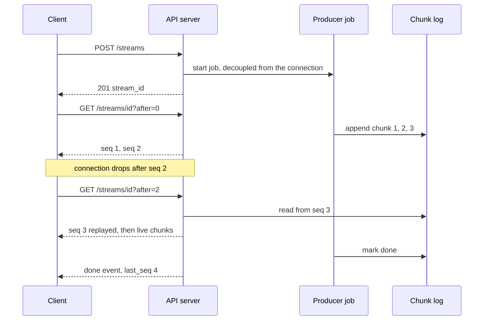

# Streaming APIs

> [!TIP]
> **In one line:** A streaming API sends a response in pieces as they are ready, so clients see the first result immediately, but you must design for slow clients, mid-stream failure, and resumption.
>
> **In plain English:** A normal API call is like waiting for a whole book to be printed before you can read page one. Streaming is like a serialised story: you get each chapter as it is written. The catch is that the story can be cut off halfway, so you need a way to say "I got up to chapter 7, continue from there" and the publisher has to actually keep chapters 8 onward on hand.
>
> **You'll be able to:** pick between NDJSON, SSE, and WebSocket for a streaming endpoint · handle backpressure, mid-stream errors, and proxy buffering · build a resumable stream where the server replays missed chunks

## Why This Matters

Many responses are slow to finish but useful long before they are complete: a large export, a search that returns hits as shards answer, a build log, and above all an LLM completion that takes 20 seconds to produce 500 tokens. If the server buffers everything and replies once, the user stares at a spinner for the entire duration and your server holds the whole result in memory. Streaming cuts *time to first byte* from "the whole job" to "the first piece" and keeps memory flat, because each piece is sent and forgotten.

Streaming also changes the failure model, and this is where teams get hurt. A normal response is atomic from the client's view: it arrives or the request fails. A stream can succeed for 400 tokens and then die. The HTTP status line (`200 OK`) was already sent, so you cannot change it to a 500. The client has partial data, no obvious way to tell "finished" from "cut off," and often no way to continue. A streaming API is therefore as much about its *framing, termination, and recovery protocol* as about the data.

[Server-Sent Events](server-sent-events.md) and [WebSocket](websocket.md) are two specific streaming mechanisms. This chapter steps back to the general problem they solve and the choices around them, and builds on [Long Polling](long-polling.md)'s cursor idea.

## Core Concept

A **streaming API** returns data incrementally over one connection rather than as a single complete payload. In HTTP this works because a response body does not need a known length: with HTTP/1.1 chunked transfer encoding (or HTTP/2 data frames) the server writes pieces, flushes them, and ends the body when done. The client reads the body incrementally instead of waiting for it to complete.

There are three common ways to frame the pieces:

| Format | What it is | Strengths | Limits |
|---|---|---|---|
| **NDJSON** (newline-delimited JSON, `application/x-ndjson`) | One JSON object per line | Trivial to produce and parse, works with plain `fetch`/`httpx`, easy to `curl` | No built-in event ids, retry, or auto-reconnect; you define the protocol |
| **SSE** (`text/event-stream`) | `data:` lines with optional `id:` and `event:` | Browser `EventSource` reconnects and sends `Last-Event-ID`; standard for LLM tokens | One-way, text only, `GET` in the native browser API |
| **WebSocket** | Framed messages on an upgraded connection | Two-way, binary, low overhead per message | Not plain HTTP; auth, proxies, reconnection and resumption are all yours |

Which to pick follows from the data flow. One-way, server to client, over HTTP: SSE or NDJSON. Streaming *and* the client sends a continuous stream back (voice, collaborative editing, interactive control): WebSocket. A rule of thumb is to start with the simplest one that fits and upgrade only when you hit a concrete limit.

Underneath all three sit the same four problems: **backpressure**, **termination**, **partial failure**, and **resumption**.

## Mental Model

Picture a water pipe from a tank to a tap. The tank (your producer) can pour faster than the tap (a slow client on mobile data) can drain. If the pipe has no limit, the water piles up somewhere: in your server's memory, or in a proxy's buffer. That pile-up is the real cost of streaming. Pipes also burst: halfway through, the flow stops, and the person at the tap has a half-full glass and no idea if the tank ran dry or the pipe broke, unless the tank always sends a distinct "last drop" marker. And if they want to resume after a burst, someone upstream must have kept a record of what was already poured. A good streaming API gives you a valve (backpressure), a last-drop marker (explicit termination), and a ledger (replayable history).

## How It Works

### Framing and flushing

The server produces items and writes each one to the response as soon as it is ready. In ASGI frameworks this is an async generator passed to a streaming response. Two details bite people: the framework or a middleware (notably gzip) may buffer small writes until a threshold, and every intermediary may buffer too (see proxies, below).

### Backpressure

If the client reads slowly, TCP's flow control eventually fills the kernel send buffer, and a well-behaved async server stops pulling from your generator until the socket drains. So **a generator that produces data on demand gets backpressure for free**: a slow client slows the generator, memory stays flat. The trap is a design where production is *decoupled* from the connection (a background task pushing into a list or unbounded queue). Then a slow client causes unbounded buffering. Decide explicitly: either bound the buffer and drop or disconnect slow consumers, or accept the memory cost for a bounded, known-size result. For fan-out streams (one producer, many subscribers), give each subscriber its own bounded queue and define the overflow policy: drop oldest, coalesce, or close the connection and let the client resume.

### Termination: how does the client know it is done?

A closed connection is ambiguous. A clean end of body and a dropped connection can look alike to application code, especially behind proxies that close upstream on error. Always send an explicit **terminal event** (`{"type":"done"}`, SSE `event: done`, WebSocket close frame with a code). Then the client rule is simple: *no terminal event means the stream was cut, so recover.* This single convention removes most "my export is silently truncated" bugs.

### Partial failure mid-stream

Once the first byte is sent, the status code is fixed at 200. If the producer fails later (a database error, an upstream LLM timeout), you cannot send a 500. Instead:

- Send an **in-band error event** (`{"type":"error","code":"upstream_timeout","retryable":true}`), then end the stream. This is the clean path.
- If the process dies, the client sees an abrupt close with no terminal event, handled by the rule above.
- Validate everything you can *before* the first byte (auth, input, quota, the existence of the resource) so those failures still get proper 4xx/5xx statuses.

### Resumption: the server must replay

Reconnecting only works if the server can send the missed items again. A client saying "continue after item 87" (a custom `?after=87`, or SSE's `Last-Event-ID: 87`) is a *request*; the server can honour it only if it **stored** items 88 onward. Browsers' `EventSource` resends `Last-Event-ID` automatically, but nothing in the protocol makes the server remember anything. If your stream is generated live and not persisted, resume is impossible, and the honest options are to restart from the beginning, or to make the work itself resumable (an LLM generation continued from a stored prefix is *not* guaranteed to produce the same tokens).

This means resumable streaming needs three things: a durable or at least short-lived **log** keyed by stream id with per-stream sequence numbers, a **retention window** (how long you keep chunks after the stream ends), and a policy for expired cursors (`410 Gone` and start over). It also means the producing job should usually be **decoupled from the connection**: if the client disconnects, the work continues and fills the log, so the reconnect finds it. (Decoupling is exactly where the backpressure trade-off above reappears.) Sequence numbers must be stable and per stream, not global timestamps; see [Event Ordering](event-ordering.md).

### Proxies, CDNs and buffering

Reverse proxies often buffer upstream responses to free the app server quickly, which destroys streaming: the client receives nothing until the buffer fills or the response ends. Nginx honours `X-Accel-Buffering: no` per response or `proxy_buffering off;` per location. Many CDNs and gateways have their own switches or only stream certain content types. Send `Cache-Control: no-cache` (or `no-store`), disable response compression for event streams unless the server flushes after each write, and test through the *real* production path, not just `localhost`. Idle timeouts also apply: a stream that is quiet for longer than a proxy's idle limit gets cut, so send a periodic heartbeat (an SSE comment line `: ping`, or an NDJSON `{"type":"ping"}`) every 15 to 30 seconds.

### Disconnect detection and cancellation

When the client goes away, stop doing work on its behalf. In ASGI servers the generator is cancelled or closed on disconnect; use `try/finally` to release resources, and cancel upstream calls (for example the LLM request) when the *consumer* of a non-resumable stream leaves, or you pay for tokens nobody reads.

## Architecture



## Request / Response Example

Start a generation, then read it as NDJSON. The producer runs in the background:

```http
POST /v1/streams HTTP/1.1
Host: api.example.com
Content-Type: application/json

{"prompt": "Explain backpressure in one paragraph."}
```

```http
HTTP/1.1 201 Created
Content-Type: application/json
Location: /v1/streams/st_91kd

{"id": "st_91kd"}
```

```http
GET /v1/streams/st_91kd?after=0 HTTP/1.1
Host: api.example.com
Accept: application/x-ndjson
```

```http
HTTP/1.1 200 OK
Content-Type: application/x-ndjson
Cache-Control: no-cache
X-Accel-Buffering: no

{"seq":1,"token":"Backpressure"}
{"seq":2,"token":" is"}
{"seq":3,"token":" the"}
```

The connection drops here. The client reconnects, saying it has seen up to `seq` 3:

```http
GET /v1/streams/st_91kd?after=3 HTTP/1.1
Host: api.example.com
Accept: application/x-ndjson
```

```http
HTTP/1.1 200 OK
Content-Type: application/x-ndjson

{"seq":4,"token":" ability"}
{"seq":5,"token":" to"}
{"type":"done","last_seq":5}
```

If the upstream fails after the headers are out, the error travels in-band:

```text
{"type":"error","code":"upstream_timeout","retryable":true,"last_seq":4}
```

## Code Example

A resumable NDJSON stream. The producer is a background task that writes into a per-stream log; the endpoint reads from the log starting at a cursor. The log here is in process memory; use Redis Streams or a database in production so any replica can serve a reconnect.

```python
# stream_server.py  -  run: uvicorn stream_server:app
import asyncio
import json
import uuid

from fastapi import FastAPI, HTTPException, Query
from fastapi.responses import StreamingResponse
from pydantic import BaseModel

app = FastAPI()


class StartRequest(BaseModel):
    prompt: str


class StreamState:
    """Append-only chunk log for one stream, plus a wake-up signal."""

    def __init__(self) -> None:
        self.chunks: list[str] = []
        self.done = False
        self.error: str | None = None
        self.cond = asyncio.Condition()


STREAMS: dict[str, StreamState] = {}  # demo only: unbounded, single process
TASKS: set[asyncio.Task] = set()      # keep references so tasks are not GC'd


async def produce(state: StreamState, prompt: str) -> None:
    """Stand-in for an LLM call or long job. Runs even if no client is connected."""
    try:
        for word in f"Echoing: {prompt}".split():
            await asyncio.sleep(0.2)  # simulated work
            async with state.cond:
                state.chunks.append(word + " ")
                state.cond.notify_all()
    except Exception as exc:  # record the failure for readers
        state.error = type(exc).__name__
    finally:
        async with state.cond:
            state.done = True
            state.cond.notify_all()


@app.post("/streams", status_code=201)
async def start(req: StartRequest) -> dict:
    stream_id = f"st_{uuid.uuid4().hex[:8]}"
    state = StreamState()
    STREAMS[stream_id] = state
    task = asyncio.create_task(produce(state, req.prompt))
    TASKS.add(task)
    task.add_done_callback(TASKS.discard)
    return {"id": stream_id}


async def ndjson_lines(state: StreamState, cursor: int):
    """Yield chunks after `cursor`. Pulled on demand, so a slow client slows us."""
    sent = cursor
    try:
        while True:
            async with state.cond:
                await state.cond.wait_for(lambda: len(state.chunks) > sent or state.done)
                batch = state.chunks[sent:]
                finished = state.done  # read under the same lock as the batch
                error = state.error
            for token in batch:
                sent += 1
                yield json.dumps({"seq": sent, "token": token}) + "\n"
            if finished:
                if error:
                    yield json.dumps({"type": "error", "code": error, "last_seq": sent}) + "\n"
                else:
                    yield json.dumps({"type": "done", "last_seq": sent}) + "\n"
                return
    finally:
        # Client disconnected or stream finished: release per-reader resources here.
        # Note we do NOT cancel the producer; the job keeps filling the log for reconnects.
        pass


@app.get("/streams/{stream_id}")
async def read(stream_id: str, after: int = Query(0, ge=0)) -> StreamingResponse:
    state = STREAMS.get(stream_id)
    if state is None:
        raise HTTPException(404, "unknown stream")  # still a proper status: nothing sent yet
    if after > len(state.chunks):
        raise HTTPException(410, "cursor is ahead of the stream; restart")
    return StreamingResponse(
        ndjson_lines(state, after),
        media_type="application/x-ndjson",
        headers={"Cache-Control": "no-cache", "X-Accel-Buffering": "no"},
    )
```

```python
# stream_client.py  -  keeps the last seq and resumes after any cut
import asyncio
import json
import os

import httpx

BASE = os.environ["STREAM_BASE_URL"]  # e.g. http://localhost:8000


async def consume(stream_id: str) -> str:
    text, last_seq, attempts = [], 0, 0
    # Read timeout applies per chunk, not to the whole stream; add server heartbeats for quiet streams.
    timeout = httpx.Timeout(connect=5.0, read=60.0, write=5.0, pool=5.0)
    async with httpx.AsyncClient(base_url=BASE, timeout=timeout) as http:
        while attempts < 5:
            try:
                async with http.stream("GET", f"/streams/{stream_id}", params={"after": last_seq}) as r:
                    r.raise_for_status()
                    async for line in r.aiter_lines():
                        if not line:
                            continue
                        msg = json.loads(line)
                        if msg.get("type") == "done":
                            return "".join(text)  # the ONLY success signal
                        if msg.get("type") == "error":
                            raise RuntimeError(msg["code"])
                        text.append(msg["token"])
                        last_seq = msg["seq"]
            except (httpx.TransportError, httpx.RemoteProtocolError):
                pass  # cut mid-stream: fall through and resume
            attempts += 1  # also reached if the body ended without a terminal event
            await asyncio.sleep(min(2 ** attempts, 10))
    raise RuntimeError("stream did not complete")
```

Limits of this sketch: chunks accumulate in memory forever, the log lives in one process, tokens are appended with no authentication or per-user scoping, and `error` is a class name. Production needs a shared log with retention, per-user authorization on the `stream_id`, and a heartbeat for long quiet stretches.

## Production Considerations

- **Authentication and authorization.** `EventSource` cannot set an `Authorization` header, so SSE often uses cookies or short-lived signed URLs; NDJSON via `fetch` can use normal headers. Authorize the `stream_id` against the user on *every* connect, including resumes.
- **Connection budget.** Each open stream occupies a connection through the proxy, the load balancer, and the app. Size limits and set per-user caps so one client cannot open thousands.
- **Load balancer behaviour.** Resumption must work on any replica, which is why the log is shared. Sticky sessions are a crutch, not a design.
- **Compression.** Gzip can delay small writes. Either disable it for streams or flush after each message.
- **HTTP/2 and HTTP/1.1 limits.** Browsers cap parallel HTTP/1.1 connections per origin (commonly six), and each stream uses one; HTTP/2 multiplexing largely removes that cap.
- **Retention and cost.** Decide how long chunks live after completion. Longer retention means easier recovery and more storage; short retention means more `410` re-starts.
- **Observability.** Record time to first byte, stream duration, chunks per stream, completion versus error versus cut rate, and resume count. A rising cut rate usually points at a proxy timeout.
- **Graceful deploys.** Closing live streams during a rollout looks like a mass disconnect. Send a final in-band `{"type":"reconnect"}`, or rely on cursor-based resume and let clients reconnect with jitter.

## Common Mistakes

- **Treating a closed connection as success.** Without a terminal event, a truncated response is indistinguishable from a finished one.
- **Promising resume without storing anything.** `Last-Event-ID` and `?after=` only carry a position; the server must have kept the chunks.
- **Testing only on localhost.** The proxy, CDN, or antivirus in the real path buffers the stream and everything arrives at the end.
- **Raising an HTTP error mid-stream.** After headers are sent you cannot change the status; send an error event instead.
- **Unbounded queues between producer and connection.** A slow client turns into an out-of-memory crash.
- **Not cancelling upstream work on disconnect** for non-resumable streams, which burns compute or LLM tokens for no reader.
- **No heartbeat.** An idle stream is cut by a 60-second proxy timeout and the client retry loop hides the cause.
- **Resuming by timestamp.** Clocks tie and skew; use a per-stream sequence number.

## Best Practices

- Choose the simplest framing that fits: NDJSON or SSE for one-way, WebSocket when you truly need two-way.
- Give every item a per-stream sequence number and always send an explicit terminal event.
- Do all validation and authorization before sending the first byte so failures keep their real status codes.
- Make the producer independent of the connection when the work is expensive, and persist chunks long enough to replay.
- Bound every buffer and define what happens to slow consumers.
- Send heartbeats, set `Cache-Control: no-cache`, disable proxy buffering, and test through the production path.
- Make client handlers idempotent by `seq`, since a resume can overlap with what was already processed (see [Duplicate Events](duplicate-events.md)).

## AI Engineering Perspective

LLM token streaming is the canonical streaming API, and it exposes every issue above. Providers typically deliver tokens as SSE (or an SSE-like framed stream), and your gateway re-streams them to browsers. Time to first token, not total latency, drives perceived quality, so streaming is a product requirement rather than an optimisation.

The sharp edges are the ones in this chapter. A model call that fails after 300 tokens needs an in-band error and a policy (retry the whole call, or show the partial answer with a warning). Resumption is subtle: you can replay *stored* tokens exactly, but you cannot ask a model to regenerate the same suffix deterministically, so store tokens as they arrive if you want to offer reconnect, as the example does. Tool-calling streams add structure: partial JSON arguments arrive in fragments and must be accumulated until the tool call is complete before being parsed or executed. Cancellation matters financially: when a user closes the tab, cancel the upstream request so you stop paying for tokens. Safety filters and moderation that run on the final text must either run on partial windows or hold back the stream, which trades latency for control. Agent runs ([Part 17](../17-ai-agents-and-mcp/README.md)) stream steps, tool calls and observations the same way, and gateways in [Part 15](../15-production-ai-systems/README.md) must pass streams through without buffering.

## Exercises

**Beginner**
1. Run the server and `curl -N localhost:8000/streams/<id>` (after `POST /streams`). What happens without `-N`? Why?

**Intermediate**
2. Kill the client mid-stream, then re-run with `?after=<last seq>`. Verify no tokens are lost or duplicated, and that the producer finished while no client was connected.
3. Add a heartbeat line every 15 seconds when no chunk is available, using `asyncio.wait_for` on the condition wait. Make sure the client ignores it.

**Advanced**
4. Replace the in-memory list with a Redis Stream (`XADD`, `XREAD BLOCK`) so any replica can serve any reader, and add a retention policy that returns `410` for expired cursors. What changes about backpressure when the log is external?

## Key Takeaways

- Streaming cuts time to first byte and memory use, but moves complexity into framing, termination, failure handling, and resumption.
- Always send an explicit terminal event; a closed connection alone cannot distinguish success from truncation.
- After the first byte the status is fixed, so report later failures as in-band error events.
- Resumption works only if the server stored the chunks and the client sends a per-stream cursor; headers like `Last-Event-ID` carry a position, not data.
- Proxies that buffer, idle timeouts, and unbounded queues are the usual production killers.

### Check Yourself
<details markdown="1">
<summary>1. Why can't you return a 500 status if a streaming job fails halfway?</summary>

The status line and headers were already sent with the first byte, so the 200 is fixed. The server has to signal failure inside the stream (an error event) or by cutting the connection, and the client must be built to recognise both.

</details>

<details markdown="1">
<summary>2. A client reconnects with `Last-Event-ID: 87` but the server only generates tokens live and stores nothing. What happens, and why?</summary>

The server cannot resend items 88 onward because it never kept them; the header only tells it where the client stopped. It can only restart the stream or fail. Real resumption needs a stored log keyed by stream and sequence number.

</details>

<details markdown="1">
<summary>3. Your NDJSON endpoint works locally, but in production the client receives nothing until the very end of a 30-second response. What do you check?</summary>

Something in the path is buffering: a reverse proxy (for example nginx buffering, fixed with `X-Accel-Buffering: no` or `proxy_buffering off`), a CDN or gateway, or gzip middleware holding small writes. Test through the real production route and confirm each hop streams.

</details>

---
Back to the [Part 9 README](README.md).
