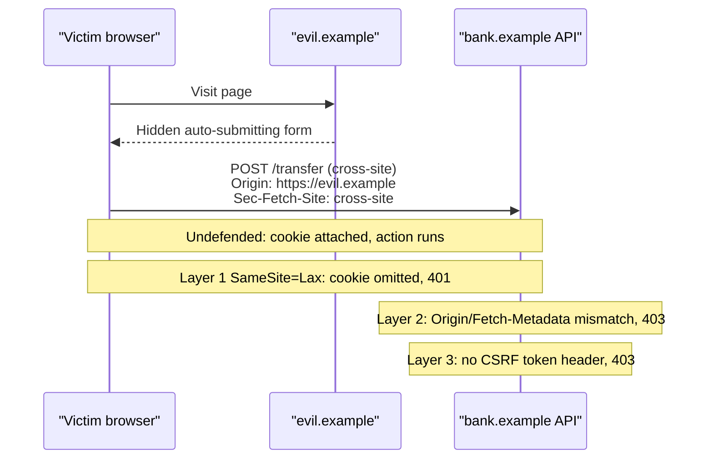

# CSRF

> [!TIP]
> **In one line:** CSRF abuses the fact that browsers attach your cookies automatically, so a hostile site can make your browser send a real, authenticated request you never intended.
>
> **In plain English:** Imagine a bank that honours any envelope carrying your signature stamp, and your browser stamps every envelope bound for that bank, even ones a stranger wrote. The defence is to make the envelope carry something the stranger cannot know or cannot forge, and to check where it came from.
>
> **You'll be able to:** explain why cookie-authenticated APIs are exposed and Bearer-header APIs mostly are not · layer SameSite, Origin/Fetch-Metadata checks and CSRF tokens · say precisely why CORS is not a CSRF defence

## Why This Matters

Cross-Site Request Forgery (CSRF) is the attack that makes "the user is logged in" an insufficient reason to trust a request. If your API authenticates browsers with a session cookie and performs actions such as changing an email address, transferring money, or deleting a project, then any web page the user visits might be able to cause their browser to send those requests. The attacker never sees the response and never steals the cookie. They only need the browser to *send* the request, and browsers have always been happy to do that.

CSRF is easy to under-estimate because modern defaults (SameSite cookies) have made it much less common than a decade ago. But the defaults have gaps (cross-subdomain setups, older browsers, `SameSite=None` for embedded or cross-site apps, state-changing GET endpoints), and the moment a team moves from Bearer tokens to cookies, for instance to keep tokens away from JavaScript (see [XSS and APIs](xss-and-apis.md)), CSRF comes back on the menu. It appears in the [OWASP API Security Top 10](owasp-api-security.md) discussion of broken authentication and security misconfiguration, and it is a classic interview question precisely because it exposes whether you understand how browsers, cookies, and origins actually interact.

## Core Concept

The root cause is **ambient authority**: a credential that the browser attaches to requests automatically, without the calling code having to supply it. Cookies are the prime example (HTTP Basic auth credentials and client TLS certificates behave similarly). When the browser sends a request to `bank.example`, it attaches the cookies for `bank.example` no matter which page triggered the request: the bank's own page, or `evil.example` containing a hidden form that posts to the bank.

From the server's side, the forged request is indistinguishable from a legitimate one at the credential level: valid session cookie, well-formed body. What differs is the *intent* and the *origin* of the request. A CSRF defence therefore has to add something the attacker cannot supply, or verify something the attacker cannot fake:

- A **secret the page must know** (a CSRF token): the attacker's page cannot read it because of the same-origin policy.
- A **browser-set signal about the request's origin** (`Origin`, `Sec-Fetch-Site` headers): page script cannot forge these, because the browser, not JavaScript, sets them.
- A **restriction on when the cookie is sent at all** (`SameSite`): the browser simply withholds the cookie on cross-site requests.

Three terms are easy to confuse. An **origin** is scheme + host + port. A **site** is the registrable domain (scheme plus eTLD+1), so `app.example.com` and `api.example.com` are the same *site* but different *origins*. **SameSite** cookies compare sites, not origins, which is why they do not protect against a hostile sibling subdomain.

## Mental Model

Think of a **hotel key card that opens your room whenever it touches the door sensor, even if somebody else holds your hand against it**. The card (cookie) is real, and the door cannot tell who is pushing. CSRF is a stranger steering your hand. The defences are the equivalents of: a door that only reads the card if you walked up from the hallway rather than from the window (SameSite), a door that asks "which corridor did you come from?" (Origin / Fetch Metadata), and a door that also requires a one-time code that was only ever shown on the room's own screen (CSRF token).

Contrast that with a **Bearer token in a header**: that is a key you must consciously take out of your pocket and hand over. Cross-site pages cannot make your browser do that, because they cannot read your pocket (storage) and cannot attach arbitrary `Authorization` headers without a CORS preflight that your server would refuse.

## How It Works

**The attack.** The victim is logged in to `bank.example`, and the browser holds `session=abc123`. The victim opens `evil.example`, which contains a form that auto-submits:

1. The page's markup contains a hidden `<form method="POST" action="https://bank.example/transfer">` with fields pre-filled, and a one-line script submits it on load.
2. The browser navigates (or submits in a hidden frame) to the bank, sending `Cookie: session=abc123` because the destination is the bank.
3. The bank validates the cookie, sees an authenticated user, and executes the transfer.
4. The attacker never sees the response. Often they do not need to.

This works for any request a page can trigger without a CORS preflight: form posts (`application/x-www-form-urlencoded`, `multipart/form-data`, `text/plain`), image/script tags for GETs, and navigations. A common false belief is "my API only accepts JSON, so I'm safe." That is *mostly* true for a different reason: setting `Content-Type: application/json` from cross-site JavaScript triggers a preflight, which your CORS policy refuses. But it fails if your server ignores the `Content-Type` and parses the body as JSON anyway (a form can send a `text/plain` body that happens to contain JSON), so the guarantee depends on a *strict content-type check*, not on the format alone.

**Why Bearer-header APIs mostly escape.** An API that reads `Authorization: Bearer <token>` from a header, with the token held in JavaScript memory, is not ambient: a forged cross-site request simply arrives with no credential. That is why a pure SPA-plus-Bearer-token API does not need CSRF tokens. The caveats: if the token is *also* accepted from a cookie, the cookie path is exposed; and XSS defeats everything, because injected script can read the token and call the API as the user from the legitimate origin.

**Defence 1: SameSite cookies.** `SameSite=Lax` tells the browser to omit the cookie on cross-site subrequests (form POSTs, fetch, images, iframes) but to include it on top-level GET navigations (clicking a link). `SameSite=Strict` omits it even for those. `SameSite=None; Secure` sends it everywhere (needed for genuinely cross-site embedding). Consequences: Lax kills the classic POST attack, but any state-changing `GET` is still reachable via a link, and "same-site" includes sibling subdomains, so an XSS or subdomain takeover on `blog.example.com` can attack `api.example.com`. Treat SameSite as a strong first layer, not the only one.

**Defence 2: Origin and Fetch Metadata checks.** Browsers attach an `Origin` header to cross-origin requests and to all non-GET/HEAD requests. Modern browsers also send `Sec-Fetch-Site` (`same-origin`, `same-site`, `cross-site`, `none`). On unsafe methods, the server can reject anything whose `Sec-Fetch-Site` is `cross-site`, or whose `Origin` is not on the allowlist. Script on a web page cannot forge these headers (they are "forbidden" header names for `fetch`). Gaps: very old clients may send neither, and a non-browser client can send anything, which is fine because non-browser clients are not subject to ambient-cookie attacks.

**Defence 3: CSRF tokens.** The server issues a per-session (or per-request) unpredictable value, and requires it back in a custom header or hidden form field on every unsafe request. Two common shapes:

- **Synchronizer token:** the server stores the token in the session and compares. Stateful, robust.
- **Double-submit cookie:** the token is set in a cookie *and* sent in a header; the server checks they match. Stateless, but naive versions are weak if an attacker can plant a cookie (subdomain cookie tossing). The hardened variant **signs** the token with an HMAC over the session identifier using a server secret, so an attacker cannot mint a valid pair.

**CORS is not a CSRF defence.** CORS controls whether a page may *read* a cross-origin response. It does not stop the request being sent, and the simple cross-site requests used in CSRF skip preflight entirely. A strict CORS policy complements CSRF defences (it blocks the cross-site JSON-with-custom-headers path), but it never replaces them. The distinction is spelled out in [CORS](cors.md); the short version is that CORS protects *reads*, CSRF is about *writes*.

## Architecture




## Request / Response Example

A forged request as the API sees it, **without** defences, and with the browser-set signals that give it away:

```http
POST /v1/transfers HTTP/1.1
Host: api.bank.example
Cookie: session=s_8f2a91c3d0
Origin: https://evil.example
Sec-Fetch-Site: cross-site
Sec-Fetch-Mode: navigate
Content-Type: application/x-www-form-urlencoded

to=acct_9912&amount=5000
```

The defended API rejects it before touching business logic:

```http
HTTP/1.1 403 Forbidden
Content-Type: application/problem+json

{"type":"about:blank","title":"Forbidden","status":403,"detail":"Cross-site request rejected"}
```

A legitimate request from the real frontend carries the same-origin signals plus the token:

```http
POST /v1/transfers HTTP/1.1
Host: api.bank.example
Cookie: session=s_8f2a91c3d0
Origin: https://app.bank.example
Sec-Fetch-Site: same-site
X-CSRF-Token: 5mQe1xk3yA.9f1c0b...e7
Content-Type: application/json

{"to":"acct_9912","amount":5000}
```

Note `Sec-Fetch-Site: same-site` here, because `app.` and `api.` share a registrable domain. That is why the code below checks the exact `Origin` allowlist rather than accepting every `same-site` request.

## Code Example

A FastAPI dependency that layers an Origin allowlist, a Fetch-Metadata check, and an HMAC-signed CSRF token bound to the session. The secret comes from the environment.

```python
import hmac
import hashlib
import os
import secrets

from fastapi import Depends, FastAPI, HTTPException, Request, Response
from fastapi.middleware.cors import CORSMiddleware

app = FastAPI()

# Secrets and allowlists come from the environment, never source code.
CSRF_SECRET = os.environ["CSRF_SECRET"].encode()
ALLOWED_ORIGINS = set(
    os.environ.get("ALLOWED_ORIGINS", "https://app.bank.example").split(",")
)
SAFE_METHODS = {"GET", "HEAD", "OPTIONS"}

# The frontend (app.bank.example) calls this API (api.bank.example) cross-origin, so the
# browser needs CORS to send the cookie, read the token response and pass the preflight.
# CORS is what lets the legitimate page in; it is NOT the CSRF defence (the layers below are).
app.add_middleware(
    CORSMiddleware,
    allow_origins=sorted(ALLOWED_ORIGINS),     # exact origins; never "*" with credentials
    allow_credentials=True,
    allow_methods=["GET", "POST"],
    allow_headers=["Content-Type", "X-CSRF-Token"],
)


def _mac(session_id: str, nonce: str) -> str:
    # Binding the MAC to the session id means a token minted for one session
    # is useless in another, and an attacker who can plant cookies cannot
    # forge a valid pair without CSRF_SECRET.
    msg = f"{session_id}!{nonce}".encode()
    return hmac.new(CSRF_SECRET, msg, hashlib.sha256).hexdigest()


def issue_token(session_id: str) -> str:
    nonce = secrets.token_urlsafe(16)
    return f"{nonce}.{_mac(session_id, nonce)}"


def token_is_valid(session_id: str, token: str) -> bool:
    nonce, _, mac = token.partition(".")
    if not nonce or not mac:
        return False
    # compare_digest avoids leaking match length through timing.
    return hmac.compare_digest(mac, _mac(session_id, nonce))


async def csrf_protect(request: Request) -> None:
    """Apply to every route that changes state and accepts cookie auth."""
    if request.method in SAFE_METHODS:
        return

    session_id = request.cookies.get("session")
    if session_id is None:
        return  # no ambient credential, nothing to forge (Bearer routes land here)

    # Layer 1: browser-set Fetch Metadata. Present in all current browsers.
    site = request.headers.get("sec-fetch-site")
    if site == "cross-site":
        raise HTTPException(403, "Cross-site request rejected")

    # Layer 2: exact Origin match. 'same-site' alone would also admit sibling
    # subdomains, so we compare the whole origin against our allowlist.
    origin = request.headers.get("origin")
    if origin is not None and origin not in ALLOWED_ORIGINS:
        raise HTTPException(403, "Origin not allowed")

    # Layer 3: token proves the caller could read a same-origin response.
    token = request.headers.get("x-csrf-token", "")
    if not token_is_valid(session_id, token):
        raise HTTPException(403, "Missing or invalid CSRF token")


@app.get("/v1/csrf-token")
async def get_csrf_token(request: Request, response: Response) -> dict:
    session_id = request.cookies.get("session")
    if session_id is None:
        raise HTTPException(401, "Not authenticated")
    response.headers["Cache-Control"] = "no-store"
    return {"csrf_token": issue_token(session_id)}


@app.post("/v1/transfers", dependencies=[Depends(csrf_protect)])
async def create_transfer(payload: dict) -> dict:
    # ... real handler: validate with a Pydantic model, authorize, then act
    return {"status": "accepted"}


def set_session_cookie(response: Response, session_id: str) -> None:
    response.set_cookie(
        "session",
        session_id,
        httponly=True,      # JavaScript cannot read it (limits XSS theft)
        secure=True,        # HTTPS only
        samesite="lax",     # withheld on cross-site subrequests
        max_age=3600,
        path="/",
    )
```

Limits worth stating: the checks assume the request is from a browser; a request with no `Origin` and no `Sec-Fetch-Site` falls through to the token check, which is why the token layer exists. The token endpoint must itself be safe (a `GET` readable only same-origin, which the same-origin policy and a tight CORS policy ensure). And none of this helps if the page has an XSS bug, because injected script legitimately fetches the token.

## Production Considerations

- **Decide per route group, not per app.** Cookie-authenticated routes need the dependency; pure Bearer routes do not. Mixing both on the same route (accepting a token *or* a cookie) means the cookie path needs protection.
- **Never change state on GET.** `SameSite=Lax` sends cookies on top-level GET navigations, and caches, prefetchers, and link scanners will happily fetch your "logout" or "delete" links.
- **Login CSRF.** An attacker can forge a *login* request, logging the victim into the attacker's account so later actions (saved cards, uploaded files) land there. Protect the login endpoint as well, and use a pre-session token for it.
- **Rotate tokens on privilege change** (login, logout, role elevation) and bind them to the session so they cannot be replayed across users.
- **Subdomain risk.** If any sibling subdomain hosts user content or can be taken over, cookies scoped to the parent domain can be overwritten or abused. Prefer host-only cookies (`__Host-` prefix: `Secure`, `Path=/`, no `Domain`) for sessions.
- **Third-party embedding.** `SameSite=None` cookies reopen the exposure fully; in that case Origin checks plus tokens are mandatory, not optional.
- **Observability.** Log CSRF rejections with origin and fetch-site. A burst of rejections from one origin is a signal; a spike after a frontend deploy is usually a missing header, not an attack.
- **Frameworks help.** Mature web frameworks ship CSRF middleware. Use theirs where it exists and understand what it checks, rather than hand-rolling it everywhere.

## Common Mistakes

- **"CORS blocks CSRF."** It blocks cross-origin *reads* and non-simple requests; simple form posts are sent regardless.
- **"We use JSON, so we're immune."** Only if the server rejects non-JSON content types. A lax parser re-opens the hole.
- **Relying on `Referer` or `Origin` alone** and treating a *missing* header as acceptable on cookie-authenticated unsafe requests without a token fallback.
- **Plain double-submit with an unsigned cookie**, vulnerable to a cookie planted from a sibling subdomain.
- **Putting the CSRF token in a cookie the server trusts as the *only* check**, with no comparison to a header, so it provides nothing.
- **Exempting "internal" or "admin" endpoints** from checks, which are exactly the high-value targets.
- **Using `SameSite=None` "to make it work"** without adding any other layer.
- **Leaking the token in URLs**, where it ends up in logs and `Referer` headers.

## Best Practices

- Use `HttpOnly; Secure; SameSite=Lax` (or `Strict`) host-only session cookies by default.
- Layer defences: SameSite, then Fetch-Metadata/Origin validation, then a signed or synchronizer token on every unsafe cookie-authenticated request.
- Keep state changes on POST/PUT/PATCH/DELETE and enforce a strict `Content-Type` on JSON endpoints.
- Keep the CORS allowlist explicit (see [CORS](cors.md)) and never combine reflected origins with credentials.
- Fix XSS first and treat it as the prerequisite: see [XSS and APIs](xss-and-apis.md). Validate inputs as described in [Input Validation](input-validation.md).
- Test it: add automated tests that a cross-site Origin, a missing token, and a token from another session are all rejected.

## AI Engineering Perspective

LLM-backed web apps create new *confused deputy* variants of the same idea. A chat UI that authenticates with a cookie and exposes an endpoint like `POST /v1/chat/tools/run` is a CSRF target: a forged request can make the user's session run a tool, spend their quota, or trigger an agent action. Agents that browse or render untrusted content add a related risk: a page the agent reads can contain instructions or auto-loading resources that cause the agent's browser tool to send authenticated requests on the user's behalf. Treat agent tool endpoints as state-changing: require tokens and Origin checks, prefer short-lived scoped Bearer credentials for agent-to-API calls (no ambient cookies), and require human confirmation for high-impact actions. The deeper agent-security discussion is in [Part 17 — AI Agents & MCP](../17-ai-agents-and-mcp/README.md).

## Exercises

**Beginner**
1. In your own words, explain why the bank cannot tell a forged transfer apart from a real one using only the cookie. Name the three kinds of signal a defence can add.
2. List which of these are same-origin, same-site, or cross-site relative to `https://app.example.com`: `https://api.example.com`, `http://app.example.com`, `https://example.org`.

**Intermediate**
3. Extend the code example so that `csrf_protect` also rejects unsafe requests whose `Content-Type` is not `application/json`, and write three pytest cases (cross-site Origin, missing token, token from a different session).
4. Explain why a naive double-submit cookie fails against an attacker who controls a sibling subdomain, and how HMAC-binding to the session fixes it.

**Advanced**
5. Design the CSRF strategy for an app that serves a first-party SPA (cookie session) and a public Bearer-token API from the same routes. What happens to the routes accepting both, and how would you separate them?
6. Your product must embed a widget cross-site, requiring `SameSite=None`. Write the layered defence you would deploy, and list what residual risk remains.

## Key Takeaways

- CSRF exists because cookies are ambient authority: the browser attaches them to any request bound for their site, whoever triggered it.
- Bearer-header APIs are mostly immune because the credential is not attached automatically; cookie-authenticated APIs are not.
- Layer SameSite cookies, Origin/Fetch-Metadata validation, and signed or synchronizer CSRF tokens; none alone covers every browser and deployment shape.
- CORS governs who may read responses; it is not a CSRF defence, and XSS defeats all CSRF protections.

### Check Yourself

<details markdown="1">
<summary>1. What property of cookies makes CSRF possible?</summary>

Cookies are ambient authority: the browser attaches them automatically to every request for their site, regardless of which page initiated the request. The server sees a valid credential but cannot tell who really intended the action.

</details>

<details markdown="1">
<summary>2. Why does a strict CORS policy not stop a classic CSRF attack?</summary>

CORS only decides whether a page may read a cross-origin response. A form post is a simple request that skips preflight, so it is sent with cookies and executed by the server even if the response is unreadable. The attacker usually does not need the response.

</details>

<details markdown="1">
<summary>3. Your SPA moves from Bearer tokens in memory to an HttpOnly session cookie to reduce XSS token theft. What must you add, and why?</summary>

You must add CSRF protection (SameSite, Origin/Fetch-Metadata checks, and a token on unsafe requests), because the credential is now attached automatically. The cookie move trades token-theft risk for CSRF exposure, which the layered checks close.

</details>

---
Back to the [Part 10 README](README.md).
