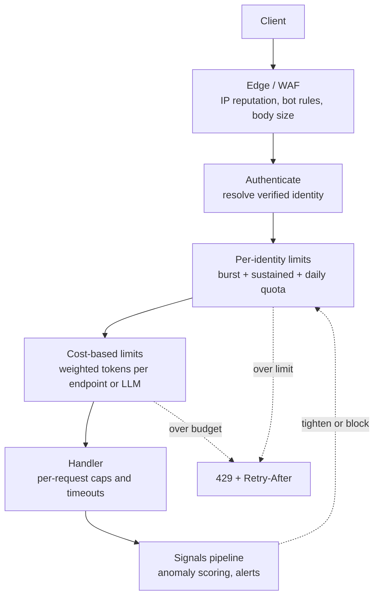
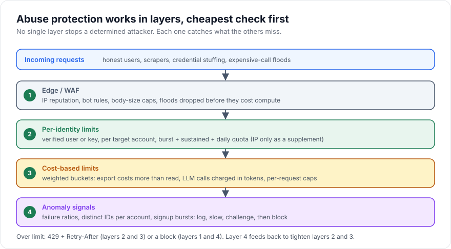

# Rate-Limit Abuse Protection

> [!TIP]
> **In one line:** A basic per-IP rate limit stops accidents, not attackers; real abuse protection layers per-identity limits, cost-based budgets, and behavioural signals, and expects evasion.
>
> **In plain English:** A turnstile that counts people at the gate is fine for a crowd, but a determined pickpocket uses many gates, many coats, and many days. You also need to notice who is carrying away the expensive items, not just how often someone walks in.
>
> **You'll be able to:** choose the right key (identity, IP, account, route) for each limit · charge expensive endpoints and LLM calls by cost instead of by request · design 429 responses and Redis counters that hold up under rotating IPs and credential stuffing

## Why This Matters

The chapter on [Rate Limiting](../06-production-reliability/rate-limiting.md) covers the mechanics (token bucket, windows, 429, `Retry-After`) in the context of protecting capacity. This chapter is about the adversarial case: someone who is *trying* to get around your limits. The goals of abusers vary, and each one defeats a naive limiter differently:

- **Credential stuffing:** testing millions of leaked username/password pairs, each from a different IP, one or two attempts per account. Per-IP limits barely notice it.
- **Account and resource enumeration:** walking sequential IDs, emails, or phone numbers to learn what exists (the "unrestricted resource consumption" and enumeration themes in the [OWASP API Security Top 10](owasp-api-security.md)).
- **Scraping:** pulling your whole catalogue slowly enough to look normal.
- **Cost attacks:** a few legitimate-looking requests that are enormously expensive: a huge export, a deeply nested GraphQL query, an LLM call with a giant context.
- **Denial of wallet:** the attacker's goal is not downtime but your cloud or model bill.
- **Abuse of free tiers:** mass-creating accounts to multiply free quotas.

A flat "100 requests per minute per IP" is simultaneously too strict (a university network or corporate NAT shares one IP among thousands of legitimate users) and too lax (a botnet has thousands of IPs). Effective protection is layered, keyed on the right thing, and priced by cost.

## Core Concept

Abuse protection answers three questions for every request, in this order:

1. **Who is this?** The strength of the answer determines the key. An authenticated, verified identity (API key id, user id, tenant id) is a strong key that the caller cannot cheaply rotate. An IP address is a weak key: shared by many users, cheap to rotate for attackers. An anonymous fingerprint (User-Agent, TLS fingerprint) is weaker still and spoofable.
2. **How much does this request cost?** Not every request is equal. A cached `GET /status` and a `POST /reports/export` should not consume the same budget. Cost can be CPU time, rows scanned, downstream calls, or LLM tokens.
3. **Does the pattern look abusive?** Even within limits, some behaviour is suspicious: one IP failing logins across 5,000 usernames, one account touching 10,000 distinct object IDs in an hour, signups from one subnet.

The practical design is a stack of cheap checks first and expensive judgement last: edge filtering for obvious junk, per-identity limits for fairness and quotas, cost-based limits for expensive operations, then anomaly signals that tighten or block.

A key honesty point: **there is no perfect bot detection.** Challenges (CAPTCHAs), device fingerprints, and IP reputation raise the cost of abuse but are bypassed by determined, funded attackers (residential proxy networks, CAPTCHA-solving services, real browsers). The goal is to make abuse uneconomical, not impossible, and to bound the damage when it happens.

## Mental Model

Think of a **theme park**. The front gate has a turnstile (edge limits) so the queue outside doesn't block the street. Each visitor has a wristband (identity), and wristbands are limited to a number of rides (per-identity quota). The roller coaster costs three ride tickets and the carousel one (cost-based limits). Staff in the park watch for patterns (anomaly signals): someone riding the coaster nonstop, a group handing wristbands to each other, or a hundred "new visitors" arriving together wearing identical hats. And when someone is cut off, a polite sign says when they can come back (429 with `Retry-After`) rather than just locking the gate.

## How It Works

**Choosing the key.** Use the strongest identity available at each endpoint:

- *Authenticated endpoints:* key on the verified principal (user id, API key id, tenant id). Never key on an unverified header such as a raw `X-API-Key` value, otherwise an attacker rotates random values to dodge the limit and fills your Redis with junk keys; verify first, then limit.
- *Pre-authentication endpoints* (login, signup, password reset, OTP): no identity yet, so combine several keys: per-IP, per-target-account (the username or email being attacked, hashed), and a global rate for the endpoint. Per-account limits are what defeat distributed credential stuffing from many IPs against one victim; per-IP limits defeat one machine trying many accounts; the global limit is the backstop.
- *Behind proxies:* the client IP is only trustworthy if taken from a forwarding header set by *your* trusted proxy. Configure how many hops to trust; a client-supplied `X-Forwarded-For` is attacker input.

**Tiers and scopes.** Apply limits at several scopes simultaneously: per-second burst (protects against spikes), per-minute or per-hour (sustained rate), and per-day quotas (business limits and cost caps). A request must pass all of them.

**Cost-based and token-based limits.** Instead of counting requests, deduct a *cost* from a bucket. For the token bucket in the existing chapter, a cost of 1 per request becomes a cost of N for heavy operations: 1 for a cached read, 10 for a search, 50 for an export. For LLM-backed endpoints, the natural unit is **tokens**: estimate input tokens plus the maximum output tokens requested, deduct up front, and reconcile after the call completes (refund the unused part). Limits are then expressed as "tokens per minute," which maps directly to what the model provider charges and throttles. Always cap the *request parameters themselves* too: maximum prompt size, `max_tokens`, page size, query depth, upload size. A limiter cannot save you from a single request that is legitimately within budget but costs a fortune; per-request caps and timeouts handle that.

**Account-level defences for login.** Beyond limits: progressive delays or temporary lockouts per account (bear in mind that hard lockouts become a denial-of-service tool against victims; prefer throttling plus a step-up challenge), generic error messages so responses do not reveal whether an account exists, uniform response timing, detection of known-breached passwords at signup and login, multi-factor authentication, and notifications to account owners on suspicious attempts.

**Abuse signals.** Cheap, high-value signals to collect and alert on: failure ratio per IP and per ASN, distinct usernames tried per IP, distinct object IDs fetched per identity, signup rate per IP range or email domain, reuse of one payment fingerprint across accounts, sudden jumps in cost per identity, requests lacking headers real clients send. Signals feed *graduated responses*: log, then slow (add delay), then challenge, then block temporarily. Graduated responses limit the harm of false positives.

**Distributed counters with Redis.** With multiple API instances, counters must be shared. Redis is the common store. The rule that matters is **atomicity**: reading a counter in one command and writing in another lets concurrent requests both pass (a race). Use a single Lua script (executed atomically by Redis) or atomic commands (`INCR` with `EXPIRE` set only when the key is created). Use Redis's own clock (`TIME`) inside the script so instance clock skew does not corrupt refill math, and give keys a TTL so idle identities do not leak memory. Decide the failure mode explicitly: when Redis is unreachable, **fail open** (accept traffic, risking abuse) for general limits to protect availability, and **fail closed** (or use a conservative local in-process limit) for security-critical endpoints like login or OTP.

**Evasion, and what it teaches.** Attackers rotate IPs (residential proxy pools, cloud functions), spread across many accounts, stay just below thresholds ("low and slow"), and mimic browsers. Consequences for design: do not rely on IP alone; make accounts costly to create (verification, deposits, phone checks) since free account creation multiplies quotas; use per-resource limits (per target account, per object) which the attacker cannot spread around; and combine layers so bypassing one still leaves others. A WAF or bot-management service at the edge adds reputation and fingerprint intelligence that you cannot easily build yourself, but treat it as another probabilistic layer, not a guarantee.

**Responding correctly.** Return `429 Too Many Requests` with a `Retry-After` header (seconds, an integer, or an HTTP date) and a JSON body explaining the limit. Informational headers such as `RateLimit-Limit`, `RateLimit-Remaining`, and `RateLimit-Reset` are in an IETF draft and widely used; format varies, so document yours. Be careful with *too much* information on security endpoints: for login, a precise remaining-attempts counter helps an attacker tune their pace. Use `503` for load shedding of the whole service, and `403` for outright blocks.

## Architecture





## Request / Response Example

A heavy LLM call that exceeds the caller's per-minute token budget:

```http
POST /v1/summaries HTTP/1.1
Host: api.example.com
Authorization: Bearer sk_live_...redacted
Content-Type: application/json

{"prompt": "...(about 30,000 characters)...", "max_tokens": 2000}
```

```http
HTTP/1.1 429 Too Many Requests
Content-Type: application/problem+json
Retry-After: 25
RateLimit-Limit: 20000
RateLimit-Remaining: 1200
RateLimit-Reset: 25

{"type":"https://api.example.com/problems/rate-limited","title":"Token budget exceeded","status":429,"detail":"This request needs about 9500 tokens; 1200 remain. Retry in 25 seconds or send a shorter prompt.","retry_after_seconds":25}
```

A failed login keeps the response generic and does not disclose whether the account exists:

```http
HTTP/1.1 401 Unauthorized
Content-Type: application/problem+json

{"type":"about:blank","title":"Unauthorized","status":401,"detail":"Invalid credentials"}
```

After repeated failures for that account, the next attempt gets `429` with `Retry-After`, and the account owner is notified out of band.

## Code Example

A Redis-backed, atomic, cost-aware token bucket used for (a) per-identity limits and (b) an LLM token budget. The bucket is evaluated in one Lua script so concurrent requests cannot both pass on a stale read.

```python
import math
import os

import redis.asyncio as redis
from fastapi import FastAPI, HTTPException, Request
from pydantic import BaseModel, Field

app = FastAPI()
r = redis.from_url(os.environ.get("REDIS_URL", "redis://localhost:6379/0"))

# Atomic token bucket with a variable cost. Time comes from Redis (TIME),
# so API instances with skewed clocks cannot corrupt the refill math.
# Returns {allowed (0/1), tokens_left, seconds_until_enough_tokens}.
BUCKET_LUA = """
local capacity = tonumber(ARGV[1])
local rate     = tonumber(ARGV[2])   -- tokens per second
local cost     = tonumber(ARGV[3])
local t   = redis.call('TIME')
local now = tonumber(t[1]) + tonumber(t[2]) / 1000000
local d      = redis.call('HMGET', KEYS[1], 'tokens', 'ts')
local tokens = tonumber(d[1])
local ts     = tonumber(d[2])
if tokens == nil then tokens = capacity; ts = now end
tokens = math.min(capacity, tokens + math.max(0, now - ts) * rate)
local allowed = 0
local retry   = 0
if tokens >= cost then
  tokens = tokens - cost
  allowed = 1
else
  retry = (cost - tokens) / rate
end
redis.call('HSET', KEYS[1], 'tokens', tostring(tokens), 'ts', tostring(now))
-- Idle buckets are refilled anyway, so expire after ~2x the refill time.
redis.call('EXPIRE', KEYS[1], math.ceil(capacity / rate) * 2)
return {allowed, tostring(tokens), tostring(retry)}
"""
bucket = r.register_script(BUCKET_LUA)


async def take(key: str, capacity: float, rate: float, cost: float,
               fail_open: bool = True) -> tuple[bool, float, float]:
    if cost > capacity:
        # Can never succeed: a per-request cap problem, not a rate problem.
        raise HTTPException(413, "Request exceeds the maximum allowed size")
    try:
        allowed, left, retry = await bucket(keys=[key], args=[capacity, rate, cost])
    except redis.RedisError:
        # Explicit failure mode. Use fail_open=False on login/OTP endpoints.
        if fail_open:
            return True, 0.0, 0.0
        raise HTTPException(503, "Temporarily unavailable")
    return bool(int(allowed)), float(left), float(retry)


def identity(request: Request) -> str:
    # Auth middleware sets request.state.principal_id only AFTER verifying the
    # credential. Never key on a raw, unverified header value.
    principal = getattr(request.state, "principal_id", None)
    if principal:
        return f"id:{principal}"
    # Fallback: client IP. Only trustworthy if the server/proxy layer is
    # configured to take it from YOUR trusted proxy, not a client header.
    return f"ip:{request.client.host if request.client else 'unknown'}"


def too_many(retry: float, detail: str) -> HTTPException:
    seconds = max(1, math.ceil(retry))
    return HTTPException(429, detail, headers={"Retry-After": str(seconds)})


class SummaryIn(BaseModel):
    prompt: str = Field(max_length=60_000)          # per-request cap
    max_tokens: int = Field(default=500, ge=1, le=2_000)  # per-request cap


def estimate_tokens(prompt: str, max_tokens: int) -> int:
    # Rough heuristic (about 4 chars per token) plus the maximum output the
    # caller asked for. Real systems use the provider's tokenizer.
    return math.ceil(len(prompt) / 4) + max_tokens


@app.post("/v1/summaries")
async def summarize(body: SummaryIn, request: Request) -> dict:
    who = identity(request)

    # Layer A: request-count burst limit per identity (cost 1).
    ok, _, retry = await take(f"rl:req:{who}", capacity=20, rate=5, cost=1)
    if not ok:
        raise too_many(retry, "Too many requests")

    # Layer B: LLM token budget per identity: 20k tokens per minute.
    cost = estimate_tokens(body.prompt, body.max_tokens)
    ok, left, retry = await take(f"rl:tok:{who}", capacity=20_000, rate=20_000 / 60, cost=cost)
    if not ok:
        raise too_many(retry, f"Token budget exceeded: need ~{cost}, {int(left)} left")

    # ... call the model here (pseudo-SDK), with a timeout. Reconcile by
    # refunding (estimated - actual) tokens afterwards if you track usage.
    return {"summary": "...", "estimated_tokens": cost}
```

Limits of this sketch: the two buckets are checked in sequence, so a request that passes A but fails B has already spent a request token (acceptable here; combine into one script if that matters). The IP fallback shares one bucket among everyone behind a NAT. Per-account login protection would add a bucket keyed on a *hash of the target username*, and a global bucket for the endpoint. And the model call itself needs a timeout and `max_tokens` enforced server-side, which this sketch only gestures at.

## Production Considerations

- **Key hygiene and memory.** Use bounded, namespaced keys with TTLs. Hash usernames and emails used in keys so Redis does not hold raw PII, and cap key cardinality for unauthenticated traffic so an attacker cannot exhaust memory with random keys.
- **Redis as a dependency.** Decide fail-open versus fail-closed per endpoint class, monitor Redis latency (every request now pays a round trip), and consider an in-process local limiter as a first, cheap line. Redis Cluster needs keys for one bucket in a single slot, which a single-key script satisfies.
- **Observability.** Emit metrics for allowed, limited, and failed-open decisions, by route and tier; alert on limited-rate spikes and on fail-open events. Log identity, key, cost, and decision, never secrets.
- **Quota versus rate.** Per-second limits protect the system; per-day quotas protect the budget. Surface remaining quota to legitimate customers so they can self-regulate.
- **Fair treatment of shared IPs.** Offer a way for known enterprise ranges to get higher IP limits, and prefer identity-based keys wherever possible.
- **Gradual enforcement.** Ship new limits in *log-only* mode first, compare against real traffic, then enforce. Provide an allowlist and an emergency override.
- **Don't punish honest retries.** Clients that obey `Retry-After` with exponential backoff and jitter (see [Retries](../06-production-reliability/retries.md)) should recover cleanly; clients that ignore it can be escalated to longer penalties.
- **Gateway layering.** A gateway or CDN can drop obvious floods before they cost you compute; application limits know about identities and costs. You need both. See [Part 18 — Production Architecture](../18-production-architecture/README.md).

## Common Mistakes

- **Per-IP limits only.** They punish NATs and are trivially bypassed by IP rotation.
- **Keying on unverified input** (raw API key header, `X-Forwarded-For` from the client).
- **Counting requests when cost varies wildly**, so one expensive call equals one trivial call.
- **Check-then-set races** with separate `GET` and `SET` instead of an atomic script.
- **Hard account lockouts** that let an attacker lock out victims on demand.
- **Revealing too much:** distinct errors for "no such user" versus "wrong password," or exact remaining-attempt counts on security endpoints.
- **No per-request caps**, so a single in-budget request is still enormous.
- **Treating bot detection as a solved problem** and removing other controls once a CAPTCHA is in place.
- **Silently failing open** with no metric or alert when Redis is down.

## Best Practices

- Key limits on verified identity first, then target resource or account, then IP as a supplement.
- Combine burst, sustained, and daily scopes; price endpoints by cost, and LLM calls by tokens.
- Cap request parameters (size, depth, page size, `max_tokens`) and set timeouts independent of rate limits.
- Make atomicity, TTLs, and failure mode explicit in the limiter; test them under concurrency.
- Use graduated responses (log, delay, challenge, block) driven by abuse signals, and notify account owners.
- Return `429` with `Retry-After` and documented headers; keep security-endpoint responses generic.
- Pair limits with strong authentication ([Part 5](../05-authentication-authorization/README.md)), input validation ([Input Validation](input-validation.md)), and secret hygiene so leaked keys have a short life ([Secrets Management](secrets-management.md)).

## AI Engineering Perspective

LLM endpoints change the economics of abuse. The cost of a request is dominated by tokens, varies by orders of magnitude between callers, and is billed to *you*, so requests-per-minute is the wrong unit: budget in tokens per minute and per day, estimate before the call, reconcile after, and cap both prompt size and `max_tokens`. Streaming complicates enforcement: a connection may run for a long time, so enforce maximum duration and stop generation when the budget is spent. Agents and tool-calling loops can self-amplify, issuing many model and tool calls per user request, so add per-task budgets (maximum steps, tokens, and spend) in addition to per-user limits. Prompt-injected content can also drive an agent to hammer an internal API on an attacker's behalf, which is another reason for identity-scoped limits on internal calls. A gateway that centralises model access can apply org, team, user, and model-level budgets uniformly; see [Part 15 — Production AI Systems](../15-production-ai-systems/README.md) for cost control and gateways, and [Part 17 — AI Agents & MCP](../17-ai-agents-and-mcp/README.md) for agent loop budgets.

## Exercises

**Beginner**
1. A login endpoint allows 5 attempts per IP per minute. Describe two realistic attacks that this still permits, and one extra limit that closes each.
2. What should a `429` response contain so that a well-behaved client can recover without guessing?

**Intermediate**
3. Extend the code example so that a login route enforces three buckets (per-IP, per-hashed-username, global) and fails closed when Redis is unavailable. Explain why per-username limits matter against distributed attacks.
4. Explain the race in a `GET counter` / `SET counter+1` limiter and demonstrate with two concurrent requests how both can pass. Then show how the Lua script prevents it.

**Advanced**
5. Design cost weights for an API with `GET /items/{id}`, `GET /search`, `POST /exports`, and an LLM `POST /summaries`. Justify weights from measurements you would collect, and describe how you would reconcile estimated and actual LLM tokens.
6. An attacker uses 50,000 residential IPs, one request each per hour, against `/signup`. Which signals would you collect, which graduated responses would you apply, and what residual risk remains?

## Key Takeaways

- Basic per-IP limits stop accidents; abuse needs layers: edge filtering, per-identity limits, cost-based budgets, and behavioural signals.
- Key on the strongest verified identity available, and add per-target limits (per account, per object) that distributed attackers cannot spread around.
- Price requests by cost, in tokens for LLM calls, and still cap per-request size and duration.
- Redis limiters must be atomic, TTL'd, clock-safe, and have an explicit fail-open or fail-closed decision; no bot detection is perfect, so aim to make abuse uneconomical and bounded.

### Check Yourself

<details markdown="1">
<summary>1. Why is a per-IP rate limit alone weak against credential stuffing?</summary>

Attackers spread attempts across many IPs, sending only one or two per IP against each account, so no IP crosses the threshold. A per-target-account limit (keyed on the hashed username) catches the pattern from the victim's side.

</details>

<details markdown="1">
<summary>2. Why do LLM endpoints call for token-based limits instead of request counts?</summary>

Cost and load scale with tokens, not requests: one request with a huge prompt and large `max_tokens` can cost far more than hundreds of small ones. Budgeting in tokens ties the limit to what the provider bills and throttles, and per-request caps bound any single call.

</details>

<details markdown="1">
<summary>3. Your Redis limiter instance goes down. What should happen on the public catalogue endpoint versus the login endpoint?</summary>

The catalogue can fail open (with a metric and alert) so an outage of the limiter does not take the API down. Login should fail closed or use a conservative local limit, because without limits it is exposed to guessing and stuffing attacks.

</details>

---
Back to the [Part 10 README](README.md).
