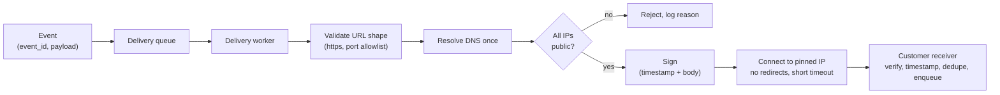

# Webhook Security

> [!TIP]
> **In one line:** Webhooks are security-sensitive in both directions: receivers must authenticate, time-bound, and deduplicate events, and senders must stop customer-supplied URLs from turning their servers into SSRF proxies.
>
> **In plain English:** A webhook is a phone call placed to a number someone gave you. If you pick up, you should check the caller really is who they say and hasn't played you an old recording. If you are the one dialling, you should never dial a number that rings inside your own private office just because a customer wrote it down.
>
> **You'll be able to:** harden a webhook receiver with signature, timestamp window, dedupe and least privilege · block SSRF when delivering to customer URLs, including DNS rebinding and redirects · rotate webhook secrets without dropping events

## Why This Matters

[Webhooks](../09-realtime-and-webhooks/webhooks.md) invert the usual security picture. A normal API call is a client you may authenticate calling a server you control. A webhook receiver is a public URL that *anyone* can POST to, and it has to decide whether the request really came from the provider. A webhook sender is a server that makes outbound requests to URLs chosen by its *customers*, and it has to ensure those URLs cannot point somewhere dangerous.

Both sides have a history of serious incidents. Receivers that skip verification let anyone forge "payment succeeded" events. Senders that fetch arbitrary customer URLs have been used to reach cloud metadata services and internal admin panels, a class of bug called **Server-Side Request Forgery (SSRF)**, which features prominently in the [OWASP API Security Top 10](owasp-api-security.md). The signature algorithm itself is covered in [Webhook Signature Verification](../09-realtime-and-webhooks/webhook-signature-verification.md); this chapter does not repeat it. It covers everything around it: the other receiver controls, the sender-side SSRF defences, secret rotation, and the limits of replay protection.

## Core Concept

Think in terms of two separate trust problems.

**Receiver: "is this really from the provider, and is it fresh and new?"** Three independent properties are needed:

1. **Authenticity and integrity:** a signature (HMAC with a shared secret, or an asymmetric signature) over the raw body proves the sender knows the secret and the body was not altered.
2. **Freshness:** the signed material includes a timestamp, and the receiver rejects events whose timestamp is outside a small tolerance window (commonly a few minutes). This limits how long a captured request stays usable.
3. **Uniqueness:** the receiver records event IDs it has processed and ignores repeats.

A critical precision: **a timestamp narrows the replay window but does not remove replay.** Within the tolerance window (say five minutes), a captured valid request can be re-sent and will still pass signature and timestamp checks. Only deduplication by event ID closes that gap, and the dedupe record must live at least as long as the tolerance window (plus clock-skew margin); after that, the timestamp check rejects the old request on its own. Providers also redeliver the *same* event legitimately on retries, so receivers need idempotency regardless of attackers.

**Sender: "where am I willing to send requests?"** The sender takes a URL from a customer's configuration and connects to it from inside your network. That is SSRF waiting to happen. The attacker does not need to compromise anything: they register `https://something/` as their webhook endpoint and observe what your delivery worker does. If the destination resolves to your cloud metadata address, an internal service, or `localhost`, your worker may reach it, and any response data you expose (an error message, a "delivery log" with the response body) can leak it.

Defences are layered the same way as everywhere in security: validate the destination, resolve and check the *actual IP addresses*, connect to exactly the IP you checked, refuse redirects, limit what the worker can reach at the network layer, and avoid returning response contents to the customer.

## Mental Model

A webhook is a **registered mailbox with a locked slot**. For the receiver: the postal worker must prove who they are (signature), show that the letter was posted today (timestamp), and the mailbox keeps a ledger of letter numbers so the same letter is not processed twice (dedupe). For the sender, you are the postal service that accepts *delivery addresses from customers*. A sensible postal service refuses to deliver to "the inside of the sorting office" (private addresses), checks the address when it is registered *and again* when the van leaves (DNS can change), never lets the recipient redirect the van elsewhere (redirects), and does not read the recipient's reply aloud to the sender (response bodies).

## How It Works

### Receiver hardening

On every request to the webhook endpoint, in this order:

1. **Cap the body size and require TLS.** Read the *raw bytes* once. Parsing JSON before verifying means an attacker can already make you do work.
2. **Verify the signature on the raw body** with the per-endpoint secret using a constant-time comparison (see the signature chapter). Reject with `401`/`400` and no explanatory detail.
3. **Check the timestamp** is within the tolerance window.
4. **Deduplicate on the event ID** with an atomic operation (a unique constraint insert, or Redis `SET NX` with a TTL), so two concurrent deliveries of the same event cannot both pass a check-then-set race.
5. **Acknowledge fast** with a `2xx` and process asynchronously, which also keeps the sender's retries from piling up. Only return a `5xx` when you want a retry.

Beyond these, apply **least privilege**. The webhook endpoint should be a thin ingress: verify, record, enqueue, return. Give it a dedicated route, credentials, and service identity with no broader powers than writing to a queue. Do not let the handler perform privileged actions directly based on payload contents. A robust pattern is the **thin event**: treat the webhook as a notification ("invoice `inv_123` changed") and fetch the authoritative state from the provider's API using your own credentials, rather than trusting values in the payload. This also contains the damage if a secret leaks. IP allowlists published by the provider are a useful supplement, but they are not a substitute for signatures (IPs can change and shared infrastructure widens the set).

Use a **separate secret per endpoint** (and ideally per integration), store it with the practices in [Secrets Management](secrets-management.md), and never log it or the signature header.

### Secret rotation

Secrets leak, staff leave, and policies require rotation. Rotation must not drop events. The standard approach is **overlap**: the sender can hold two active secrets for an endpoint and includes a signature for each (for example, `v1=<sig_new>,v1=<sig_old>`); the receiver accepts the request if *any* signature verifies with a secret it currently holds. The procedure: (1) generate the new secret and show it to the customer once; (2) the sender begins signing with both; (3) the customer deploys the new secret to the receiver, which now accepts either; (4) after a grace period the sender retires the old secret. For receivers that rotate their own copy, keep the previous secret valid for a bounded time, then remove it. Provide an emergency "revoke now" path for a suspected leak that skips the grace period.

### Sender-side SSRF defences

**Validate at registration, enforce at delivery.** Checking the URL when the customer saves it is necessary (to give a helpful error) but never sufficient, because DNS answers change. The enforcement point is the moment of connection.

1. **Restrict the shape of the URL.** Require `https`, reject embedded credentials (`user:pass@`), restrict ports to a short allowlist, and reject IP literals if your product does not need them.
2. **Resolve and inspect every address.** Resolve the hostname yourself and reject if *any* resolved address is non-public: loopback (`127.0.0.0/8`, `::1`), private (`10/8`, `172.16/12`, `192.168/16`, `fc00::/7`), link-local (`169.254/16`, which contains the cloud metadata address, and `fe80::/10`), shared/CGNAT (`100.64/10`), unspecified, multicast, and reserved ranges. Normalise IPv4-mapped IPv6 addresses (`::ffff:10.0.0.1`) before checking. Do not hand-roll string checks on hostnames: decimal, hex, octal, and short forms of IPs, and DNS names that simply resolve to private IPs, all bypass them.
3. **Defeat DNS rebinding by pinning.** If you check the name and then let the HTTP client resolve it *again*, an attacker's DNS server can return a public IP for the check and a private IP for the connection (time-of-check to time-of-use). Resolve once, validate, then connect to *that IP* while keeping the original hostname for the `Host` header and TLS server name (SNI and certificate verification).
4. **Do not follow redirects** (or re-validate every hop with the same pipeline). A public URL that answers `302` to an internal address defeats up-front validation.
5. **Bound the work:** short connect and total timeouts, a maximum response size, and do not read response bodies you do not need. A slow or huge response is a resource attack on your workers.
6. **Do not reflect responses.** Showing the customer the response body or detailed connection errors turns blind SSRF into a data-exfiltration channel. Show the status code and a generic category ("connection refused", "timed out", "destination not allowed").
7. **Add a network-layer backstop.** Run delivery workers in a network segment whose egress is restricted (deny rules to private ranges and the metadata endpoint, or force traffic through an egress proxy that enforces the policy). Also require session-token-protected metadata services (for example IMDSv2-style hop limits) on cloud hosts. Application-level checks have bugs; network controls are independent evidence.

## Architecture



Receiver-side processing is a separate pipeline: raw body, signature, timestamp, event-ID dedupe, `2xx`, async work. The sender pipeline above is where SSRF defences live.

## Request / Response Example

A delivery as the customer's receiver sees it. The scheme here is illustrative (the exact header format varies by provider):

```http
POST /hooks/billing HTTP/1.1
Host: hooks.customer.example
Content-Type: application/json
User-Agent: ExampleWebhooks/1.0
X-Webhook-Id: evt_01HV8Q3K9ZP4
X-Webhook-Signature: t=1731240000,v1=5f1c0e...a91b,v1=c2d7b8...04ee

{"id":"evt_01HV8Q3K9ZP4","type":"invoice.paid","created":1731240000,"data":{"invoice_id":"inv_5521"}}
```

The receiver acknowledges quickly after verify, dedupe, and enqueue:

```http
HTTP/1.1 200 OK
Content-Length: 0
```

A replay of the same request within the window is recognised by event ID and acknowledged without reprocessing (so a legitimate sender retry stops retrying). When a customer tries to register a hostile destination, the sender's API refuses with a generic reason:

```http
HTTP/1.1 422 Unprocessable Content
Content-Type: application/problem+json

{"type":"about:blank","title":"Invalid webhook destination","status":422,"detail":"Destination is not allowed: it does not resolve to a public address."}
```

## Code Example

First, a **sender** that delivers with SSRF controls: URL shape checks, one DNS resolution, all-addresses-public validation, connection pinned to the validated IP with the original hostname for TLS and `Host`, no redirects, short timeouts, no body read. It signs with every active secret to support rotation.

```python
import asyncio
import hashlib
import hmac
import ipaddress
import json
import socket
import time
from urllib.parse import urlsplit

import httpx

ALLOWED_PORTS = {443, 8443}


class UnsafeDestination(Exception):
    """The destination is not permitted. Message is safe to show to customers."""


async def resolve_public_ips(host: str, port: int) -> list[str]:
    loop = asyncio.get_running_loop()
    try:
        infos = await loop.getaddrinfo(host, port, type=socket.SOCK_STREAM)
    except socket.gaierror:
        raise UnsafeDestination("Hostname does not resolve")
    ips: list[str] = []
    for _family, _type, _proto, _canon, sockaddr in infos:
        ip = ipaddress.ip_address(sockaddr[0].split("%")[0])
        if isinstance(ip, ipaddress.IPv6Address) and ip.ipv4_mapped:
            ip = ip.ipv4_mapped  # ::ffff:10.0.0.1 must be judged as 10.0.0.1
        # is_global is False for loopback, private, link-local (incl. the
        # 169.254.169.254 metadata address), CGNAT and other reserved ranges.
        if not ip.is_global or ip.is_multicast:
            raise UnsafeDestination("Destination does not resolve to a public address")
        ips.append(str(ip))
    if not ips:
        raise UnsafeDestination("Hostname does not resolve")
    return ips


def sign(secret: bytes, timestamp: str, body: bytes) -> str:
    # Signed material = timestamp + "." + raw body (see the signature chapter).
    return hmac.new(secret, timestamp.encode() + b"." + body, hashlib.sha256).hexdigest()


async def deliver(url: str, event_id: str, payload: dict, active_secrets: list[bytes]) -> int:
    parts = urlsplit(url)
    if parts.scheme != "https" or not parts.hostname or parts.username or parts.password:
        raise UnsafeDestination("URL must be https without credentials")
    port = parts.port or 443
    if port not in ALLOWED_PORTS:
        raise UnsafeDestination("Port not allowed")

    # Resolve ONCE, validate every address, then connect to that exact IP.
    # Letting the HTTP client resolve again would reopen DNS rebinding.
    ip = (await resolve_public_ips(parts.hostname, port))[0]
    ip_host = f"[{ip}]" if ":" in ip else ip

    body = json.dumps({"id": event_id, **payload}, separators=(",", ":")).encode()
    ts = str(int(time.time()))
    # One signature per active secret allows overlap during rotation.
    signature = f"t={ts}," + ",".join(f"v1={sign(s, ts, body)}" for s in active_secrets)

    path = parts.path or "/"
    target = f"https://{ip_host}:{port}{path}" + (f"?{parts.query}" if parts.query else "")
    headers = {
        "Host": parts.netloc,  # original name, not the IP
        "Content-Type": "application/json",
        "X-Webhook-Id": event_id,
        "X-Webhook-Signature": signature,
    }

    async with httpx.AsyncClient(
        follow_redirects=False,          # a 3xx must not lead us elsewhere
        trust_env=False,                 # ignore proxy env vars unless intended
        timeout=httpx.Timeout(5.0, connect=3.0),
    ) as client:
        # sni_hostname makes TLS verify the certificate against the real
        # hostname even though we are connecting to the pinned IP.
        async with client.stream(
            "POST", target, content=body, headers=headers,
            extensions={"sni_hostname": parts.hostname},
        ) as resp:
            return resp.status_code  # body is never read or shown to customers
```

Limits: this pins only the first validated address (add fallback across the others if you want it); it assumes a trusted DNS resolver; and it is one layer, so pair it with network egress rules. Never log the secrets or signature header.

Second, the receiver's **dedupe** step, atomic via Redis `SET NX`. The TTL covers the timestamp tolerance window with margin:

```python
import os
import redis.asyncio as redis

r = redis.from_url(os.environ.get("REDIS_URL", "redis://localhost:6379/0"))
TOLERANCE_SECONDS = 300
DEDUPE_TTL = TOLERANCE_SECONDS * 2 + 60  # must be >= tolerance + clock skew


async def first_time_seeing(endpoint_id: str, event_id: str) -> bool:
    # SET NX is atomic: exactly one of two concurrent deliveries wins.
    # In production, process the event and mark completion transactionally
    # (or use a DB unique constraint) so a crash between steps cannot lose it.
    return bool(await r.set(f"wh:seen:{endpoint_id}:{event_id}", "1", nx=True, ex=DEDUPE_TTL))
```

## Production Considerations

- **Delivery logs without leaks.** Store status code, latency, and a coarse failure category. Never store or display response bodies from customer endpoints, and redact signature headers.
- **Retries and backoff.** Retry with exponential backoff and jitter on `5xx` and timeouts, and give up after a bounded schedule; mark endpoints unhealthy and notify the owner rather than hammering them forever. Re-run the full destination validation on *every* attempt, since DNS can change between retries.
- **Egress controls.** Treat the delivery worker like a semi-hostile component: minimal IAM role, no access to internal networks, and an egress proxy or firewall that blocks private and metadata ranges independent of your code.
- **Rate-limit per customer.** A customer who registers many endpoints, or a compromised account, can use your sender as a request amplifier. Apply per-tenant quotas ([Rate-Limit Abuse Protection](rate-limit-abuse-protection.md)).
- **Receiver clocks.** Keep servers on NTP; a skewed clock rejects valid events or widens the replay window.
- **Verify ownership of endpoints** where you can (a challenge the receiver must echo), so customers cannot point your sender at third-party victims for harassment or amplification.
- **Monitor.** Alert on spikes of rejected signatures, destination rejections, and unusual response times; they are early signs of probing.

## Common Mistakes

- **Checking the hostname string** ("doesn't contain `localhost`") instead of the resolved IPs.
- **Validate-then-fetch with a second DNS lookup**, enabling rebinding.
- **Following redirects** by default in the HTTP client.
- **Verifying a re-serialised JSON body** instead of the raw bytes, or comparing signatures with `==`.
- **Treating the timestamp as full replay protection**, and skipping event-ID dedupe.
- **Dedupe TTL shorter than the tolerance window**, which re-opens replay.
- **Doing privileged work in the HTTP handler**, so slow processing causes retries and a bug becomes a privilege issue.
- **One shared secret** across all customers or endpoints.
- **Echoing response bodies** from customer URLs in your dashboard.

## Best Practices

- Receivers: verify signature on raw body, enforce a timestamp window, dedupe by event ID atomically, acknowledge fast, and keep the endpoint least-privileged (see [Webhook Signature Verification](../09-realtime-and-webhooks/webhook-signature-verification.md)).
- Prefer thin events and fetch authoritative state with your own credentials.
- Senders: https only, port allowlist, resolve once, validate all IPs, pin the connection, no redirects, short timeouts, no body reflection.
- Back application checks with network-level egress restrictions.
- Support multi-secret overlap for rotation and an emergency revoke path.
- Per-endpoint secrets, stored and handled per [Secrets Management](secrets-management.md); validate payloads like any other input ([Input Validation](input-validation.md)).

## AI Engineering Perspective

The sender-side SSRF problem appears wherever an LLM-powered system fetches a URL it did not choose: agent "browse" and "fetch" tools, RAG ingestion from user-supplied links, link-preview and image-fetching in chat products, and MCP servers that call arbitrary endpoints. A prompt-injected document can say "fetch this internal URL," and the model will happily call a tool that does so. The same pinned, public-IP-only, no-redirect fetcher belongs behind those tools, with egress restrictions at the network layer and no raw response bodies returned to the model from unvetted destinations. On the receiving side, webhooks are how model providers, batch inference jobs, and fine-tuning pipelines tell you something finished; the same signature, timestamp, dedupe, and idempotency rules apply, with an extra reason for idempotency, since duplicated "job complete" events can trigger duplicate expensive downstream steps. See [Part 16 — RAG APIs](../16-rag-apis/README.md) for ingestion pipelines and [Part 17 — AI Agents & MCP](../17-ai-agents-and-mcp/README.md) for tool-safety boundaries.

## Exercises

**Beginner**
1. List the three properties a webhook receiver must establish about an incoming request, and the control that provides each.
2. Why is `https://127.0.0.1/hook` obviously a bad destination, and why is `https://innocent.example/hook` possibly also bad?

**Intermediate**
3. Write unit tests for `resolve_public_ips` using a monkeypatched `getaddrinfo` covering: a public address, a private address, an IPv4-mapped IPv6 private address, and a hostname returning one public and one private address.
4. Explain DNS rebinding as a time-of-check/time-of-use bug and show where in the code example the pinning removes the second lookup.

**Advanced**
5. Design the secret-rotation flow for 5,000 customers, including overlap period, signing with two secrets, the customer-facing UI, and an emergency revoke. What breaks if the grace period is too short?
6. Your product must allow customers to deliver to servers inside *their own* private network. How could you support that safely without opening your own internal network (consider agents or tunnels, per-tenant egress paths, and explicit allowlisting)?

## Key Takeaways

- Receivers need signature, timestamp, and event-ID dedupe together: a timestamp narrows replay but does not remove it, and the dedupe TTL must cover the tolerance window.
- Senders delivering to customer URLs have an SSRF problem: validate resolved IPs, pin the connection to the validated IP, refuse redirects, and do not reflect responses.
- Application checks need a network-layer backstop (restricted egress), because both can have bugs.
- Rotate secrets with overlap by signing with two secrets, and keep webhook endpoints thin and least-privileged.

### Check Yourself

<details markdown="1">
<summary>1. Why does a valid timestamp not fully prevent replay of a captured webhook?</summary>

Within the tolerance window (for example five minutes) a captured request still has a valid signature and a fresh-enough timestamp, so it passes both checks. Only recording processed event IDs and ignoring repeats stops the replay inside that window.

</details>

<details markdown="1">
<summary>2. Why must the sender connect to the IP it validated instead of passing the hostname to the HTTP client?</summary>

The client would resolve the name again, and an attacker-controlled DNS server can answer with a public IP for your check and a private IP for the connection (DNS rebinding). Pinning to the validated IP removes the second lookup.

</details>

<details markdown="1">
<summary>3. A customer reports they rotated their webhook secret and now miss events. What went wrong and how should rotation work?</summary>

Likely the sender switched to the new secret before the receiver deployed it, or the receiver dropped the old one too early. Use overlap: the sender signs with both secrets, the receiver accepts either, and the old secret is retired only after the customer confirms the new one works.

</details>

---
Back to the [Part 10 README](README.md).
