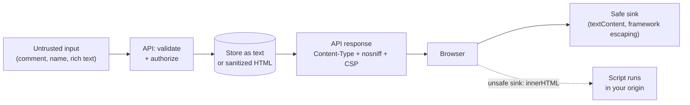

# XSS and APIs

> [!TIP]
> **In one line:** An API becomes an XSS vector when data it returns is rendered as HTML or script somewhere; fix it with correct Content-Type, output encoding, sanitizing, CSP, and careful token storage.
>
> **In plain English:** If a restaurant lets customers write their own menu cards and then prints them without checking, one customer can make every other diner's menu say something harmful. XSS is that, but in web pages: someone's text gets treated as instructions by other people's browsers. The API is the printing press, so it must label what it prints and clean what it accepts.
>
> **You'll be able to:** explain how a JSON API response can end up executing as script · apply Content-Type, nosniff, output encoding, CSP and HTML sanitizing in the right places · weigh localStorage against HttpOnly cookies for token storage

## Why This Matters

Cross-Site Scripting (XSS) is when an attacker gets their text executed as code in another user's browser, in the context of *your* origin. Once that happens, the browser's security model is on the attacker's side: the injected script runs with the user's session, can call your API as them, can read anything the page can read (including tokens in `localStorage`), and can rewrite the page to phish credentials. XSS also defeats the defences in [CSRF](csrf.md), because the forged request now comes from your own origin, with a valid token fetched by the attacker's script.

It is tempting to treat XSS as "a frontend problem," and a pure JSON API seems far from HTML. But APIs are where untrusted data *enters* the system and where it is *labelled* on the way out. Most real-world XSS involving APIs falls into a few patterns: user-generated content (comments, names, bios, rich-text fields) that the API stores and later serves to other users' browsers; error messages that echo input; endpoints that return user content with a misleading `Content-Type`; and file download or preview endpoints. The API team owns each of those decisions. XSS is also a standing item in the [OWASP API Security Top 10](owasp-api-security.md) discussion of injection and security misconfiguration, and shares its root cause with [SQL injection](sql-injection.md): data crossing a boundary and being interpreted as code.

## Core Concept

XSS is an **injection into a rendering context**. The same string means different things depending on where it lands:

- In HTML body text, `<` and `&` are special.
- In an HTML attribute, quotes are special.
- In a JavaScript string, backslash and quotes are special.
- In a URL, schemes such as `javascript:` are special.

There is therefore no single "escape for XSS" function. Correct defence is **context-aware output encoding**: encode for the place where the data will be *used*. Input validation helps (see [Input Validation](input-validation.md)), but validation at the API boundary cannot know every future rendering context; encoding at output can.

XSS comes in three broad kinds:

- **Stored:** the payload is saved (comment, profile field) and served to later visitors. Typically the most damaging, since no victim interaction beyond viewing is needed.
- **Reflected:** the payload is part of the request and the response echoes it back (an error message, a search page).
- **DOM-based:** client-side JavaScript takes data (from the API, the URL, `postMessage`) and writes it into the page with an unsafe sink such as `innerHTML`. The server may never see anything wrong.

For API authors, one more concept matters: **Content-Type and sniffing**. Browsers decide how to treat a response from its `Content-Type`. Historically, browsers also "sniffed" content, guessing HTML from the bytes when the header was missing or wrong. Response headers `Content-Type: application/json` plus `X-Content-Type-Options: nosniff` tell the browser to trust the declared type and not guess.

## Mental Model

Think of your API as a **mailroom that stamps every parcel**. The stamp (`Content-Type`) tells the recipient whether to open it as a document to read or as a machine to run. Parcels from outside (user content) arrive in unknown shape. A careful mailroom (1) puts them in sealed, correctly labelled envelopes (encoding, correct type, `nosniff`), (2) removes anything dangerous from the few parcels that must be opened flat, like rich text (sanitizing against an allowlist), and (3) provides the building with a rule that even if something slips through, the doors it could open are locked (CSP). A mislabelled envelope, say a hand-written note stamped "program," is how harm slips in.

## How It Works

**1. JSON served as HTML.** `Content-Type: application/json` is not rendered as a page by browsers. Problems arise when an endpoint returns JSON with `text/html` (a framework default that was overridden, or a proxy rewriting types), or no type at all in a browser that sniffs. If a user-controlled string inside that body contains markup, the browser may render it. The fix is boring and effective: always send an accurate `Content-Type`, and add `X-Content-Type-Options: nosniff` globally.

**2. Reflected errors.** A handler that returns `<p>No user named {name}</p>` with `text/html` reflects input into HTML. The rule: error bodies from an API should be JSON (e.g. `application/problem+json`) with the input either omitted or treated as data, never concatenated into markup. If you must produce HTML, use a template engine with auto-escaping on (Jinja2 autoescape for HTML templates), never string formatting.

**3. User-generated content (stored XSS).** The API stores what users send and serves it back to others. Two sound approaches:

- **Store plain text, encode at output.** Treat a display name or comment as text. The client renders it with a text sink (`textContent`, or a framework's default text binding, which escapes). Do not store pre-escaped values, because escaping for HTML at write time corrupts the data for non-HTML consumers (mobile apps, CSV exports, LLM prompts) and gives a false sense of safety in other contexts.
- **Rich text: sanitize with an allowlist.** If users legitimately submit HTML (a rich-text editor), parse it with a real HTML sanitizer library (not regexes) and keep only an allowlist of tags, attributes, and URL schemes. Sanitizing on write *and* on read is defensible: write-time keeps the database clean, read-time protects against sanitizer updates and legacy rows. Pin and update the library; sanitizer bypasses are found periodically.

**4. DOM sinks in the client.** Even with a perfectly safe API, `element.innerHTML = apiValue` re-introduces XSS. Frameworks such as React escape by default and make the unsafe path explicit (`dangerouslySetInnerHTML`, `v-html`); search for those. The API team can help by documenting which fields are text and which are sanitized HTML.

**5. Content Security Policy (CSP).** CSP is a response header that restricts what the page may load and execute. For an API that serves no HTML, a strict policy such as `default-src 'none'; frame-ancestors 'none'` ensures that if a response is ever rendered, no script runs. For the web app itself, a policy that forbids inline scripts and restricts script sources to your own origin (with nonces or hashes where needed) turns many XSS bugs into non-events. CSP is **defence in depth**, not a substitute for encoding: policies are hard to get right, and a permissive one (`'unsafe-inline'`, wildcard hosts) gives little protection.

**6. File and preview endpoints.** Serving user-uploaded files from your main origin is a classic path to XSS. Safer: serve downloads with `Content-Disposition: attachment`, a correct non-HTML `Content-Type` (or `application/octet-stream`), `nosniff`, and ideally from a **separate registrable domain** so any script that does run has no access to your cookies or storage. SVG and HTML uploads need special care because both can carry script.

**7. Token storage trade-offs.** Where does the browser app keep its credential?

| Storage | XSS impact | CSRF impact | Notes |
|---|---|---|---|
| `localStorage` / `sessionStorage` | Script can read and exfiltrate the token; it stays valid after the attacker leaves | None (not ambient) | Simple; whole token is stolen on XSS |
| In-memory JS variable (Bearer) | Script can still *use* the session while the page is open, harder to steal durably | None | Lost on refresh; pair with short-lived tokens and a refresh mechanism |
| `HttpOnly; Secure; SameSite` cookie | Script cannot *read* it, but can still make requests as the user from the page | Yes, needs [CSRF](csrf.md) defences | Prevents token exfiltration, not on-page abuse |

The honest summary: `HttpOnly` cookies stop *theft* of the credential, not *abuse* during the XSS session. There is no storage choice that makes an XSS bug harmless; the choice only changes what the attacker can do and for how long. Prevent the XSS first, then limit the blast radius with short token lifetimes, scoped tokens, and re-authentication for sensitive actions.

## Architecture



The diagram shows where each control lives: validation at entry, text-or-sanitized storage, honest headers at the response, and a safe sink in the client. The dashed edge is the bug class that remains even with a perfect API.

## Request / Response Example

A user profile endpoint where one user's display name contains markup-like text. The API treats it as data:

```http
GET /v1/users/u_204 HTTP/1.1
Host: api.example.com
Accept: application/json
```

```http
HTTP/1.1 200 OK
Content-Type: application/json; charset=utf-8
X-Content-Type-Options: nosniff
Content-Security-Policy: default-src 'none'; frame-ancestors 'none'
Cache-Control: private, no-store

{"id":"u_204","display_name":"<i>Sam</i> & co","bio_html":"<p>Hello <strong>world</strong></p>"}
```

`display_name` is plain text: the client must render it with a text sink so the angle brackets appear literally. `bio_html` is sanitized HTML that passed the allowlist, which the client may insert as HTML. A reflected-error contrast:

```http
HTTP/1.1 404 Not Found
Content-Type: application/problem+json
X-Content-Type-Options: nosniff

{"type":"about:blank","title":"Not Found","status":404,"detail":"User not found"}
```

The error does not echo the requested identifier into markup and is not served as HTML.

## Code Example

Security headers for every response, a sanitizer for rich-text fields, a safe error handler, and a download endpoint for user content. The sanitizer is the third-party `nh3` library (a Rust-backed HTML sanitizer); configuration values are illustrative.

```python
import os
from typing import Annotated

import nh3  # pip install nh3 -- allowlist-based HTML sanitizer
from fastapi import FastAPI, HTTPException, Request
from fastapi.responses import JSONResponse, Response
from pydantic import BaseModel, Field, StringConstraints

app = FastAPI()

# --- 1. Global headers: honest types, no sniffing, restrictive CSP ----------
@app.middleware("http")
async def security_headers(request: Request, call_next):
    response = await call_next(request)
    response.headers.setdefault("X-Content-Type-Options", "nosniff")
    # This service serves JSON, not pages: if a browser ever renders a
    # response, run nothing and allow no framing.
    response.headers.setdefault(
        "Content-Security-Policy", "default-src 'none'; frame-ancestors 'none'"
    )
    return response


# --- 2. Rich text: sanitize with an allowlist, never with regexes ----------
ALLOWED_TAGS = {"p", "br", "strong", "em", "ul", "ol", "li", "a", "code", "pre"}
ALLOWED_ATTRS = {"a": {"href"}}
ALLOWED_SCHEMES = {"http", "https", "mailto"}  # drops javascript: and similar


def sanitize_rich_text(html: str) -> str:
    return nh3.clean(
        html,
        tags=ALLOWED_TAGS,
        attributes=ALLOWED_ATTRS,
        url_schemes=ALLOWED_SCHEMES,
        link_rel="noopener noreferrer",
    )


class ProfileIn(BaseModel):
    # Plain text: stored as given, rendered by the client with a text sink.
    display_name: Annotated[str, StringConstraints(strip_whitespace=True, min_length=1, max_length=60)]
    # Rich text: bounded size, sanitized before it is stored.
    bio_html: str = Field(default="", max_length=5_000)


PROFILES: dict[str, dict] = {}  # stand-in for a real database table


@app.put("/v1/profiles/{user_id}")
async def put_profile(user_id: str, body: ProfileIn) -> dict:
    record = {
        "id": user_id,
        "display_name": body.display_name,
        "bio_html": sanitize_rich_text(body.bio_html),
    }
    PROFILES[user_id] = record
    return record


@app.get("/v1/profiles/{user_id}")
async def get_profile(user_id: str) -> dict:
    record = PROFILES.get(user_id)
    if record is None:
        # Do not interpolate user_id into markup; this is JSON, data only.
        raise HTTPException(status_code=404, detail="Profile not found")
    # Defence in depth: sanitize again on read so rows written before a
    # sanitizer upgrade (or by another code path) are still cleaned.
    return {**record, "bio_html": sanitize_rich_text(record["bio_html"])}


# --- 3. User-uploaded content: never let it render as a page ---------------
UPLOAD_DIR = os.environ.get("UPLOAD_DIR", "/var/data/uploads")


@app.get("/v1/files/{file_id}")
async def download(file_id: str) -> Response:
    if not file_id.isalnum():  # ids are server-generated; reject anything else
        raise HTTPException(status_code=404, detail="File not found")
    path = os.path.join(UPLOAD_DIR, file_id)
    if not os.path.isfile(path):
        raise HTTPException(status_code=404, detail="File not found")
    with open(path, "rb") as fh:
        data = fh.read()
    return Response(
        content=data,
        media_type="application/octet-stream",  # not html, not svg
        headers={
            "Content-Disposition": f'attachment; filename="{file_id}"',
            "X-Content-Type-Options": "nosniff",
        },
    )
```

What this does *not* do: it does not make unsafe client code safe (an `innerHTML` assignment elsewhere still bites), it does not cover every sanitizer edge case, and the whole-file read is only suitable for small files (stream large ones). Test the sanitizer against your own allowlist with unit tests, and keep the dependency updated.

## Production Considerations

- **Set headers once, centrally.** A middleware or gateway rule is more reliable than per-endpoint code. Verify with an automated test that every route returns `nosniff` and an accurate `Content-Type`.
- **Roll out CSP in report-only mode first** (`Content-Security-Policy-Report-Only` plus a report endpoint), review violations, then enforce. A strict policy on the web app is more valuable than on the API.
- **Short-lived access tokens** and refresh rotation reduce what stolen tokens are worth; scope tokens narrowly.
- **Separate origins for user content** (uploads, rendered previews, user-hosted sites) so scripts there cannot touch your session.
- **Sanitizer lifecycle.** Treat it like any security dependency: pin, monitor advisories, upgrade, and keep a re-sanitize-on-read path so a library fix reaches old data.
- **Logging and exports.** CSV/Excel exports can interpret leading `=`/`+` as formulas; prefix such cells in exports of user-supplied text. Logs viewed in web consoles are also a rendering context, so encode there too.
- **Cookie flags:** `HttpOnly`, `Secure`, `SameSite`, and the `__Host-` prefix for session cookies.

## Common Mistakes

- **Escaping at write time** and storing HTML-escaped text; this corrupts data, double-encodes, and doesn't cover other contexts.
- **Building HTML with f-strings** in error pages or emails.
- **Sanitizing with regular expressions** or blocklists ("strip `<script>`"); HTML parsing has too many edge cases. Use an allowlist sanitizer.
- **Allowing arbitrary URL schemes** in links, images, or redirects supplied by users.
- **Trusting `Content-Type` from the uploader** and serving files back with it.
- **Wildcard or `'unsafe-inline'` CSP** that gives a false sense of security.
- **Assuming HttpOnly means XSS-safe.** It prevents reading the cookie, not using the session.
- **Forgetting the client:** `innerHTML`, `v-html`, `dangerouslySetInnerHTML`, and template-string DOM building on API data.

## Best Practices

- Return accurate `Content-Type` everywhere and send `X-Content-Type-Options: nosniff` globally.
- Store user text as text; encode for the context at output. Sanitize rich text with an allowlist library, on write and on read.
- Return errors as JSON; never reflect raw input into HTML.
- Serve user uploads as attachments from a separate origin where possible.
- Apply CSP (strict on the web app, `default-src 'none'` on the API) as defence in depth, rolled out via report-only.
- Combine with validated inputs ([Input Validation](input-validation.md)), restrictive CORS ([CORS](cors.md)), and protected secrets ([Secrets Management](secrets-management.md)).
- Choose token storage knowingly: prefer HttpOnly cookies plus CSRF defences, or short-lived in-memory tokens; avoid long-lived tokens in `localStorage`.

## AI Engineering Perspective

LLM output is untrusted input to a rendering context. A model can be induced (by a prompt-injected document, a hostile user, or just an unlucky generation) to emit HTML, Markdown with embedded HTML, or links with dangerous schemes; a chat UI that renders that output with `innerHTML` or a lax Markdown renderer has an XSS hole created by the *model*, not the user. Treat model responses exactly like user-generated content: render as text or as Markdown through a sanitizing renderer with a URL-scheme allowlist, and be wary of auto-loading remote images in rendered output, which can leak conversation data through the image URL. The same applies to streamed tokens and to tool results shown in the UI. In RAG systems, retrieved documents are another stored-XSS channel into the prompt and the page; see [Part 16 — RAG APIs](../16-rag-apis/README.md) for ingestion hygiene and [Part 17 — AI Agents & MCP](../17-ai-agents-and-mcp/README.md) for the confused-deputy risks when agents act on rendered or fetched content.

## Exercises

**Beginner**
1. Explain the difference between stored, reflected, and DOM-based XSS using a comment feature as the example for each.
2. Why does `X-Content-Type-Options: nosniff` matter for a JSON API even though browsers do not normally render JSON as a page?

**Intermediate**
3. Add a test to the code example proving that a bio containing a `javascript:` link and an `onclick` attribute is stripped, while `<strong>` and `https://` links survive.
4. Compare `localStorage`, in-memory tokens, and `HttpOnly` cookies for a SPA on three axes: token theft by XSS, abuse during an XSS session, and CSRF exposure.

**Advanced**
5. Design a CSP for a SPA that uses a CDN for fonts and an analytics script. Describe your report-only rollout, and what you would refuse to allow and why.
6. Your product lets users upload SVG avatars. Describe how you would serve, sanitize or convert, and isolate them so a malicious SVG cannot run script in your main origin.

## Key Takeaways

- XSS is injection into a rendering context; defend with context-appropriate output encoding, not one universal escape.
- APIs contribute through user content, reflected errors, wrong Content-Type, and file endpoints: label responses accurately, add `nosniff`, and return errors as JSON.
- Store text as text; sanitize rich HTML with an allowlist library and keep it updated. CSP is a valuable second layer, not the first.
- No token storage choice survives XSS intact: HttpOnly cookies prevent theft but not abuse, localStorage allows theft.

### Check Yourself

<details markdown="1">
<summary>1. Name three ways an API can contribute to an XSS vulnerability.</summary>

Serving user-generated content that clients render unsafely, reflecting input into HTML error bodies, and serving data or uploads with a wrong or missing Content-Type so a browser renders or sniffs it as HTML. Rich-text fields that are not sanitized are another.

</details>

<details markdown="1">
<summary>2. Why is HTML-escaping user input before storing it a poor strategy?</summary>

Encoding must match the context where data is used, and a stored value is later used in many contexts (HTML, JSON for mobile apps, CSV, LLM prompts). Escaping at write time corrupts the data for non-HTML uses and does not protect other contexts such as attributes or JavaScript strings.

</details>

<details markdown="1">
<summary>3. An XSS bug is found. Your session is an HttpOnly cookie. What can and can't the attacker do?</summary>

They cannot read the cookie value, so they cannot take the session away to use elsewhere. They can still run script in your origin, which sends requests with the cookie attached, so they can act as the user while the page is open and can fetch CSRF tokens. Fix the XSS; HttpOnly only limits the damage.

</details>

---
Back to the [Part 10 README](README.md).
