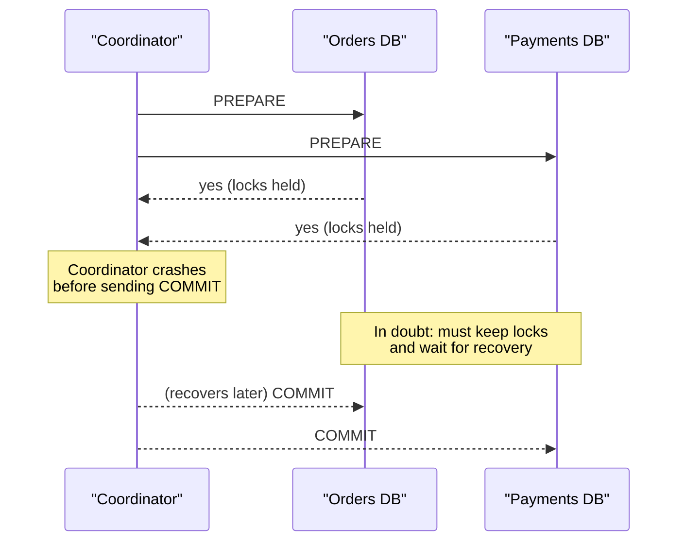
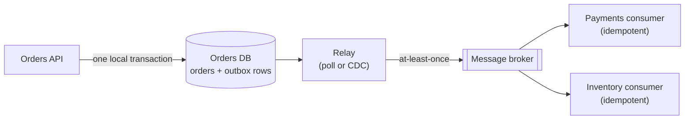

# Distributed Transactions

> [!TIP]
> **In one line:** A database transaction cannot span independently owned services, so you either coordinate with two-phase commit and accept blocking, or use local transactions plus an outbox, idempotent steps and compensation.
>
> **In plain English:** Two people in different cities cannot press "confirm" on the same button at the exact same instant, and if one phones to say "ready" and then the line goes dead, the other must wait. Distributed transactions are about handling that waiting and those dead lines safely.
>
> **You'll be able to:** explain why ACID stops at a service's database boundary and what 2PC costs · fix the dual-write bug with the transactional outbox and idempotent consumers · decide when to redraw service boundaries instead of building cross-service consistency

## Why This Matters

Inside one database, a transaction is a promise: either all of these changes happen or none do, and no one sees a half-finished state (see `../04-databases-and-apis/database-transactions.md`). It is so convenient that people stop noticing it is there. A monolith transfers money, creates an order, decrements stock and records an audit row in one `BEGIN ... COMMIT`.

Split these across services that own separate databases (see `monolith-vs-microservices.md`) and the promise is gone. Each service can commit its own change atomically, but nothing makes the *set* of commits atomic. Concretely, the three failures that appear in real systems are:

- The order row is saved, then the service crashes before telling payments, so the order sits forever "pending".
- The message announcing the order is published, but the database write behind it rolled back, so other services act on an order that does not exist.
- A request times out and is retried, and the retry charges the customer twice, because the first attempt actually succeeded.

These are not exotic. They happen at modest scale, at low frequency, which makes them the most expensive kind of bug: rare enough to escape testing, frequent enough to generate support tickets and reconciliation work. This chapter explains why the problem is fundamentally hard, what the classical solution (two-phase commit) costs, and the practical toolkit most systems use instead.

## Core Concept

A **distributed transaction** is a unit of work whose effects must be applied consistently across more than one independent resource (databases, queues, services). The underlying difficulty is that components fail independently and the network can lose, delay or duplicate messages, and no protocol can make two parties agree, with certainty, over an unreliable channel in bounded time (the "two generals" problem). Every approach is therefore a trade between **atomicity, availability, latency and complexity**.

The options form a spectrum:

1. **Don't distribute.** Keep data that must change together inside one service and one database. This is the best answer more often than architects admit.
2. **Two-phase commit (2PC).** A coordinator makes all participants durably promise they *can* commit, then tells them all to commit. True atomicity, at the cost of blocking and availability.
3. **Eventual consistency with local transactions.** Each service commits locally, announces the fact reliably (outbox), and others react idempotently. Failures are repaired by retries and **compensation**, which is the Saga pattern (see `saga-pattern.md`, which covers orchestration and choreography in depth and is not repeated here).

A useful framing: you almost never need *atomicity across services*. You need that **every business-significant change is eventually reflected everywhere it matters, exactly once in effect, with no lost or phantom updates**. That weaker requirement is achievable with ordinary tools.

## Mental Model

Imagine buying a house. The buyer's bank, the seller's bank and the land registry are three independent organisations. A 2PC-style approach is the closing meeting: everyone sits in one room, each confirms "my part is ready", a notary asks "everyone still ready?", and only then does everyone sign. It is clean, but if the notary collapses after everyone said "ready" and before anyone signed, all parties are stuck: they cannot leave (they promised), and cannot sign (no go-ahead). The saga approach is the alternative: the buyer pays a deposit (reversible, with a defined refund process), the registry records a conditional transfer, and only at the end is the irreversible step done. If something fails midway, each party runs its refund or undo procedure. It tolerates absences, but you must define the undo for every step and live with the fact that, for a while, the world is in-between.

## How It Works

### Why a local transaction cannot reach across

A database transaction is enforced by one engine that owns the locks and the write-ahead log for its data. A second service's database is a different engine with its own log, so "roll back both" has no owner. Calling both in sequence leaves a gap between the two commits. This is the **dual-write problem**: any time a request must update two systems (a database and a message broker, or two services), a crash, timeout or partition between the writes leaves them disagreeing, and no ordering of the two writes avoids it. Write the database first and crash before publishing: the event is lost. Publish first and crash before committing: the event describes something that never happened.

### Two-phase commit

2PC (the basis of the XA standard) uses a **coordinator** and several **participants**.

1. **Prepare.** The coordinator asks each participant "can you commit?". Each does the work, writes everything needed to commit to its own durable log, **holds its locks**, and replies yes or no. A "yes" is a binding promise: the participant may no longer unilaterally abort.
2. **Commit.** If every participant said yes, the coordinator durably logs "commit" and tells all participants to commit; otherwise it tells them to abort.

PostgreSQL exposes the participant side directly (`PREPARE TRANSACTION 'gid'`, then `COMMIT PREPARED 'gid'` or `ROLLBACK PREPARED 'gid'`, disabled by default via `max_prepared_transactions = 0`).

The problems are structural:

- **Blocking.** If the coordinator fails after participants voted yes and before they learn the decision, those participants are *in doubt*: they must keep holding locks and wait for the coordinator to recover, because committing or aborting on their own could violate atomicity. Other transactions touching those rows queue behind them, and the blockage spreads.
- **Availability is multiplied.** The transaction needs every participant and the coordinator to be up. With five components at 99.9% each, availability is roughly 99.5%, about 3.6 hours of unavailability a month.
- **Latency and lock duration.** At least two network round trips, plus durable log writes at each step, with locks held throughout. Throughput on contended rows collapses.
- **Coupling.** All participants must support the protocol, which many message brokers, SaaS APIs and NoSQL stores do not. A payment provider's HTTP API will never join your 2PC.

2PC is not useless. It is used *inside* databases that replicate across nodes, and some distributed SQL systems run 2PC across shards, where the coordinator itself is made highly available through consensus and the participants are all under one operator's control. The problem is using it *between independently deployed services*, where those mitigations are absent.

### The transactional outbox

The practical fix for the dual-write problem is to turn two writes into **one local transaction plus asynchronous delivery**. In the same database transaction that changes the business data, insert a row describing the event into an `outbox` table. A separate **relay** process reads unpublished outbox rows and publishes them to the broker, marking them published afterwards. Because the business change and the event row commit atomically, either both exist or neither does. The relay may crash after publishing but before marking the row, in which case it republishes, so delivery is **at-least-once**. (This is the guarantee message brokers can actually provide; "exactly-once delivery" claims always hide an idempotent consumer or a transaction scope that is narrower than it sounds.)

Variants: a polling relay (simple; adds latency of one poll interval), or **change data capture** reading the database's write-ahead log (lower latency, no polling load, more infrastructure).

### Idempotent steps

At-least-once delivery plus retries means every step can run more than once, so every step must be **idempotent**: applying it twice has the same effect as applying it once. Techniques:

- **Idempotency keys.** The caller sends a stable key (`order-8821:charge`); the callee records the key together with the result, in the same transaction as the effect, and replays the stored result on a repeat (see [Part 2](../02-rest-api-design/README.md)).
- **Processed-message table.** A consumer records each handled event id with a unique constraint in the same transaction as its effect. A duplicate hits the constraint and is skipped.
- **Naturally idempotent operations.** "Set status to shipped" is safe to repeat; "increment counter" is not, so express it as "set balance to X for ledger entry Y".
- **Conditional updates.** `UPDATE ... WHERE version = N` or state-machine guards (`WHERE status = 'pending'`) make stale or duplicate messages harmless.

### Compensation and reservations

When a later step fails, earlier steps must be undone with *new business actions*, not rollbacks: release the reservation, refund the payment. Steps that are hard to compensate should come last, and many systems use **reservations** (a "try, then confirm or cancel" shape, sometimes called TCC): reserve stock with an expiry, then confirm on success or let the reservation lapse. The expiry matters: it turns "we forgot to cancel" from a permanent leak into a bounded one. See `saga-pattern.md` for how to sequence and coordinate this.

### Redraw the boundary

Before building any of this, ask whether the boundary is right. If two pieces of data must always change together with strong consistency (an order and its line items, an account and its balance), that is strong evidence they belong to the **same aggregate and the same service**, as discussed in `monolith-vs-microservices.md`. A needed distributed transaction is often a signal of a bad split. Merging two services, or moving a table, can delete a whole class of failure modes. Distributed machinery is the right answer only when the boundary is genuinely right and the cross-service process is genuinely a business workflow that can tolerate in-between states, such as order fulfilment.

## Architecture

Why 2PC blocks when the coordinator fails after the prepare phase:



The outbox alternative, with atomicity kept local:



## Request / Response Example

A client creates an order, using an idempotency key so retries are safe. The response confirms the order is accepted and still in progress, which is honest: the cross-service work completes later.

```http
POST /orders HTTP/1.1
Host: orders.internal
Content-Type: application/json
Idempotency-Key: 5d0c7f2e-3b69-4f43-9a3b-7e1d8c5a9b10

{"customer_id": "cust-42", "items": [{"sku": "sku-9", "qty": 2}]}
```

```http
HTTP/1.1 202 Accepted
Location: /orders/ord-8821
Content-Type: application/json

{"id": "ord-8821", "status": "pending", "idempotency_key": "5d0c7f2e-3b69-4f43-9a3b-7e1d8c5a9b10"}
```

Repeating the identical request returns the same `202` and the same order, without creating a second one. The event that the relay publishes after the commit:

```json
{
  "event_id": "0b6d3c1e-52a8-4c0e-8c4a-3f9a2d7e61aa",
  "type": "order.created.v1",
  "aggregate_id": "ord-8821",
  "occurred_at": "2026-11-10T09:15:02Z",
  "data": {"customer_id": "cust-42", "total_minor": 4998, "currency": "EUR"}
}
```

And the raw SQL view of a prepared transaction in PostgreSQL, if you do use 2PC against a database that supports it:

```sql
BEGIN;
UPDATE accounts SET balance = balance - 4998 WHERE id = 'cust-42';
PREPARE TRANSACTION 'xfer-8821';       -- durable promise; locks stay held
-- later, by the coordinator, possibly after recovery:
COMMIT PREPARED 'xfer-8821';           -- or: ROLLBACK PREPARED 'xfer-8821';
```

## Code Example

An outbox with SQLAlchemy 2.0 async and PostgreSQL. The order and its event commit atomically; the relay publishes with `FOR UPDATE SKIP LOCKED`; the consumer deduplicates with a unique constraint in the same transaction as its effect. `publish` stands in for your broker client.

```python
"""Transactional outbox: atomic write, at-least-once relay, idempotent consumer."""
import uuid
from datetime import datetime, timezone
from typing import Awaitable, Callable

from sqlalchemy import BigInteger, DateTime, JSON, String, select
from sqlalchemy.dialects.postgresql import insert as pg_insert
from sqlalchemy.ext.asyncio import AsyncSession, async_sessionmaker
from sqlalchemy.orm import DeclarativeBase, Mapped, mapped_column


class Base(DeclarativeBase):
    pass


class Order(Base):
    __tablename__ = "orders"
    id: Mapped[str] = mapped_column(String, primary_key=True)
    customer_id: Mapped[str] = mapped_column(String)
    total_minor: Mapped[int] = mapped_column(BigInteger)
    status: Mapped[str] = mapped_column(String, default="pending")


class OutboxEvent(Base):
    __tablename__ = "outbox"
    seq: Mapped[int] = mapped_column(BigInteger, primary_key=True, autoincrement=True)  # relay order
    event_id: Mapped[str] = mapped_column(String, unique=True)
    aggregate_id: Mapped[str] = mapped_column(String, index=True)
    type: Mapped[str] = mapped_column(String)
    payload: Mapped[dict] = mapped_column(JSON)
    published_at: Mapped[datetime | None] = mapped_column(DateTime(timezone=True), nullable=True)


class ProcessedEvent(Base):            # lives in the CONSUMER's database
    __tablename__ = "processed_events"
    event_id: Mapped[str] = mapped_column(String, primary_key=True)


async def create_order(sf: async_sessionmaker[AsyncSession], customer_id: str, total: int) -> str:
    order_id = f"ord-{uuid.uuid4().hex[:8]}"
    # One local transaction: the order and its event commit together or not at all.
    async with sf.begin() as session:
        session.add(Order(id=order_id, customer_id=customer_id, total_minor=total))
        session.add(OutboxEvent(
            event_id=str(uuid.uuid4()),
            aggregate_id=order_id,
            type="order.created.v1",
            payload={"customer_id": customer_id, "total_minor": total},
        ))
    return order_id


Publish = Callable[[str, str, dict], Awaitable[None]]   # (event_id, key, body)


async def relay_once(sf: async_sessionmaker[AsyncSession], publish: Publish, batch: int = 100) -> int:
    """Publish one batch. Run from one relay loop per outbox, or shard by aggregate id.

    SKIP LOCKED lets several relays run without double-claiming rows, but ordering
    across relays is then not guaranteed. If publish() raises, the transaction rolls
    back and the whole batch is retried, so some events may be published twice.
    """
    async with sf.begin() as session:
        rows = (await session.execute(
            select(OutboxEvent)
            .where(OutboxEvent.published_at.is_(None))
            .order_by(OutboxEvent.seq)
            .limit(batch)
            .with_for_update(skip_locked=True)
        )).scalars().all()
        for row in rows:
            await publish(row.event_id, row.aggregate_id, {"type": row.type, **row.payload})
            row.published_at = datetime.now(timezone.utc)
        return len(rows)


async def handle_order_created(sf: async_sessionmaker[AsyncSession], event_id: str, apply_effect) -> bool:
    """Consumer side. Returns False if this event was already handled."""
    async with sf.begin() as session:
        result = await session.execute(
            pg_insert(ProcessedEvent).values(event_id=event_id).on_conflict_do_nothing()
        )
        if result.rowcount == 0:        # unique constraint hit: duplicate delivery
            return False
        await apply_effect(session)     # the effect commits atomically with the dedupe row
        return True
```

Two honest limits. If `apply_effect` has a side effect outside the database (calling a payment provider, sending an email), the dedupe row cannot make that atomic, so pass the provider an idempotency key too. And the relay holds row locks while it publishes, which is fine for small batches but means a slow broker slows the relay, not the API.

## Production Considerations

- **Monitor outbox lag.** Alert on the age of the oldest unpublished row and on its backlog size; a stuck relay silently turns into stale downstream systems.
- **Prune the outbox.** Delete or archive published rows on a schedule, or the table and its index grow without bound.
- **Order and partitioning.** Use the aggregate id as the broker partition key so events for one entity stay in order, and design consumers to tolerate reordering across entities.
- **Timeouts everywhere.** A step without a timeout cannot fail, only hang. Combine with retries, backoff and circuit breakers (see [Part 6](../06-production-reliability/README.md)).
- **Reconciliation.** Even good designs drift. Run periodic jobs that compare systems (orders paid versus payments captured) and repair or alert; treat this as part of the design, not an admission of failure.
- **Make state visible.** Model intermediate states explicitly (`pending`, `reserved`, `paid`) so users and operators can see in-between states instead of inferring them.
- **Prepared transactions are dangerous if abandoned.** If you do use PostgreSQL's `PREPARE TRANSACTION`, an orphaned prepared transaction holds locks and blocks vacuum until someone resolves it, so monitor `pg_prepared_xacts`.
- **Trace across the flow.** Carry a correlation id through every message so a stuck workflow can be followed (see [Part 12](../12-observability/README.md)).

## Common Mistakes

- **Dual writes in a request handler** ("save, then publish") with no outbox.
- **Assuming the broker gives exactly-once** and skipping idempotent consumers.
- **Treating compensation as rollback.** It is a new action, can fail and may be visible to customers (a charge followed by a refund).
- **Using 2PC across services you do not control**, or across HTTP APIs that cannot participate.
- **Splitting a strongly consistent aggregate across services**, then spending years rebuilding atomicity.
- **Idempotency key stored outside the transaction** of the effect, leaving a window where the effect happens twice or never.
- **No expiry on reservations**, so abandoned workflows hold stock forever.

## Best Practices

- First try to keep data that must change together inside one service; merge or re-slice before building cross-service machinery.
- Use the outbox (or CDC) for every "update my data and tell others" action.
- Make every handler idempotent by key, constraint or conditional update, and design for duplicates and reordering.
- Prefer sagas with explicit compensation and reservations to 2PC between services; reserve 2PC for homogeneous infrastructure under one operator.
- Put irreversible steps last and model states explicitly.
- Build reconciliation and observability in from day one.

## AI Engineering Perspective

AI workflows are naturally long-running, multi-step and failure-prone, which is exactly the shape distributed transactions address. An agent that creates a ticket, charges a card and sends an email is performing a saga whose steps are chosen by a model: the cost of a duplicate step is real, retries by the agent loop are routine, and the model itself may re-issue a tool call after a timeout. Tool endpoints that change state should therefore accept idempotency keys, and the agent runtime should persist its step state (see [Part 17](../17-ai-agents-and-mcp/README.md)) so a resumed run continues rather than repeats.

Pipelines that index documents for retrieval (see [Part 16](../16-rag-apis/README.md)) have the dual-write problem in a pure form: the source database and the vector index are two stores, and a crash between updating them leaves stale or phantom embeddings. The outbox pattern, with an idempotent indexer that upserts by document id and version, is the standard cure; periodic reconciliation between source and index catches what slips through.

## Exercises

**Beginner**
1. Name the failure that can occur in this handler and explain why changing the order of the two lines does not fix it: `await db.commit(); await broker.publish(event)`.

**Intermediate**
2. Using the code example, describe exactly what happens if the relay crashes after `publish` succeeds for event 17 but before the transaction commits. What does a consumer see, and which mechanism keeps the system correct?

**Advanced**
3. Two services, Accounts and Ledger, currently need a distributed transaction for every transfer. Argue for and against merging them, and design the saga alternative (steps, compensations, states, reconciliation). State which of your invariants are guaranteed and which are only eventually true.

## Key Takeaways

- ACID ends at a single database. Across services, every write sequence has a failure window, the dual-write problem.
- 2PC gives atomicity but blocks when the coordinator fails, multiplies unavailability and needs every participant to support it, so it rarely suits independent services.
- The transactional outbox makes "change data and publish an event" atomic locally; delivery is at-least-once, so consumers and steps must be idempotent.
- The cheapest distributed transaction is the one you avoid by drawing service boundaries around data that must change together.

### Check Yourself
<details markdown="1">
<summary>1. What is the dual-write problem?</summary>

It is the inconsistency that arises when one request must update two independent systems (such as a database and a broker) without a shared transaction. A crash or failure between the two writes leaves one updated and the other not, whichever you write first.

</details>

<details markdown="1">
<summary>2. Why does two-phase commit block when the coordinator crashes after the prepare phase?</summary>

Participants that voted yes have promised not to abort on their own and do not know the decision, so they must hold their locks until the coordinator recovers. Deciding unilaterally could break atomicity.

</details>

<details markdown="1">
<summary>3. Your outbox relay occasionally publishes the same event twice and a customer was emailed twice. Where do you fix it?</summary>

In the consumer: the email handler must be idempotent, for example by recording the event id in a unique table in the same transaction as the decision to send, and passing an idempotency key to the email provider. Duplicates are expected with at-least-once delivery and cannot be removed from the relay alone.

</details>

---
Back to the [Part 11 README](README.md).
