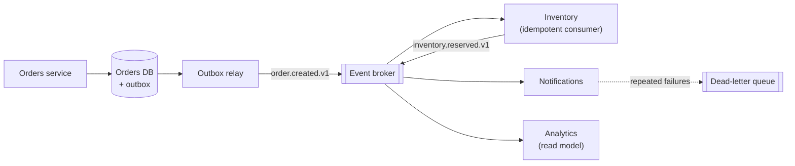

# Event-Driven Microservices

> [!TIP]
> **In one line:** Services publish facts about what happened and others react on their own schedule, which loosens coupling but demands reliable publishing, idempotent consumers, versioned schemas and strong tracing.
>
> **In plain English:** Instead of phoning every department when an order arrives, you pin a note to a noticeboard and each department reads it when ready. Nobody waits on anyone, but you need a way to know who read what, and what to do when a note gets read twice.
>
> **You'll be able to:** choose between event notification and event-carried state transfer · publish events reliably with an outbox and consume them idempotently · version event schemas and debug a flow across services with trace and causation ids

## Why This Matters

The simplest way for services to cooperate is synchronous: the orders service calls inventory, which calls pricing, which calls tax. It is easy to reason about and easy to debug, but it chains availability together (if tax is down, orders fail), stacks latency (each hop adds its time), and couples the caller to knowing every downstream party. Adding a new reaction to "an order was placed" (say, a fraud check or a loyalty-points service) means editing the orders service to call it.

Event-driven design inverts this. The orders service records that `order.created` happened and publishes that fact. Inventory, notifications, analytics and any future service subscribe independently. The publisher does not know or care who listens, so new consumers are added without touching it, and a slow or failed consumer does not block the publisher, because the broker buffers.

That freedom is not free. You gain loose coupling and resilience, and you pay in **eventual consistency, duplicate delivery, ordering puzzles, schema evolution across teams, and flows that no single place describes**. This chapter covers how to get the benefits without being surprised by the costs. It builds on the general architecture style in [Part 8](../08-async-systems/README.md) (see `../08-async-systems/event-driven-architecture.md` and `../08-async-systems/message-queues.md`), on reliable publishing from `distributed-transactions.md`, and on the sagas in `saga-pattern.md`.

## Core Concept

An **event** is an immutable record of something that *has happened*, named in the past tense (`order.created`, `payment.captured`). It differs from a **command**, which asks someone to do something (`ChargeCard`) and has one intended recipient who may refuse. Events have zero-to-many consumers and cannot be refused, only ignored.

Two designs for what an event carries:

**Event notification.** The event is a thin signal: "order 8821 changed". Consumers that care call back to the owning service's API for details. It keeps events small and the source of truth single and fresh, but it reintroduces runtime coupling (the consumer calls the publisher, so if the publisher is down the consumer is stuck) and can create a thundering herd of callbacks after a popular event.

**Event-carried state transfer (ECST).** The event includes the data consumers need (customer id, items, totals). Consumers keep their own local copy or read model and never call back. This removes runtime dependency and lets consumers work when the publisher is down, at the cost of larger events, **stale** local copies (the consumer is only as fresh as the last event it processed), duplicated data, and a schema that is now a public contract that every consumer depends on. It also spreads personal data into more stores, which has privacy and deletion implications.

A pragmatic middle is common: carry the data most consumers need plus stable identifiers, and let rare consumers fetch the rest.

Two designs for how a multi-step flow is coordinated, covered in depth in `saga-pattern.md`:

- **Choreography.** Each service reacts to events and emits its own. No central owner: easy to add participants, hard to see the whole flow.
- **Orchestration.** A coordinator holds the flow's state and tells each service what to do. The flow is explicit and observable, at the cost of a central component.

Rule of thumb: choreography for simple, few-step reactions and fan-out ("tell everyone an order was created"); orchestration once a flow has branching, compensation and an owner who needs to answer "where is order 8821 right now?".

## Mental Model

Picture a town noticeboard in a village square. Anyone can pin a dated note ("Bakery: sold out of bread at 10:00"), and notes are never altered, only added. Residents check the board when they pass by. A resident who was away for a week reads the notes in order and catches up. Two things can go wrong: someone reads the same note twice and acts twice (they order two loaves), and someone misreads an old-format note after the town changes how it writes them.

The notes are events, the board is the broker's log, reading at your own pace is consumer lag, and the two failure modes are duplicates (hence idempotent consumers) and schema changes (hence versioning). A town clerk who stamps each note with "in response to note #42, part of errand #7" gives you what you need to reconstruct a story afterwards: the causation and trace ids.

## How It Works

### Publishing reliably

An event must be published if and only if the change that caused it was committed. Publishing from the request handler after `commit()` can lose events; publishing before can emit phantoms. Use the **transactional outbox**: write the event to an outbox table in the same local transaction as the business change, and let a **relay** (polling, or change data capture from the database log) publish it to the broker. Delivery is at-least-once. Details and code are in `distributed-transactions.md`; the rest of this chapter assumes that mechanism.

### Consuming safely

Brokers (Kafka, RabbitMQ, SQS and others, see `../08-async-systems/kafka-concepts.md` and `../08-async-systems/rabbitmq-concepts.md`) deliver at-least-once: if a consumer processes a message but crashes before acknowledging, the message comes again. Consumers therefore must be **idempotent**:

- Record `event_id` in a table with a unique constraint **in the same transaction** as the side effect; a duplicate violates the constraint and is skipped.
- Or make the effect naturally idempotent (upsert by key, "set status to X" guarded by the current state).
- For external side effects (emails, payment calls), pass an idempotency key derived from the event id.

Acknowledge a message only after the work is durably done. Retry transient failures with backoff, and send messages that keep failing (**poison messages**) to a **dead-letter queue** with the error attached, so one bad message cannot block a partition forever, and alert on its depth.

### Ordering

Brokers typically guarantee order only within a partition or queue, not globally. Use the aggregate id (the order id) as the partition key so all events for one entity stay in order, and make consumers tolerant: carry a version or sequence number in the event and ignore or park events older than what you have applied (see `../09-realtime-and-webhooks/event-ordering.md` and `../09-realtime-and-webhooks/duplicate-events.md` for the same problems at the webhook level).

### Schema versioning

Events are stored and replayed, and consumers are deployed independently, so an event schema is a long-lived public API. Practices:

- **Additive changes only** within a version: new optional fields are safe; renaming, removing or changing the meaning of a field is not.
- **Tolerant readers:** consumers ignore unknown fields and supply defaults for missing optional ones.
- **Version in the event** (`order.created.v1` or a `version` field). When a breaking change is unavoidable, publish the new version, either alongside the old for a migration period or with consumers upgrading old events on read (**upcasting**).
- **A schema registry** and a compatibility check in CI enforce this mechanically. Protobuf or Avro help because the format itself defines compatibility rules (see `protocol-buffers.md`); with JSON, use JSON Schema and the same discipline.
- **Never change what an existing field means.** A field that keeps its name but changes units from dollars to cents is the most damaging kind of change, because nothing fails; the numbers are just wrong.

### Debugging distributed flows

When "the confirmation email never arrived", the cause may be five services and three queues away. Make flows reconstructable:

- **Event envelope with ids.** Every event carries a unique `event_id`, a `trace_id` shared by everything caused by one original request, and a `causation_id` pointing to the event or request that directly triggered it. With those, a log search for one `trace_id` gives the whole causal tree.
- **Propagate trace context** (the W3C `traceparent` header) through message headers, so distributed tracing tools can link the producer span to the consumer span (see [Part 12](../12-observability/README.md)). Messaging uses *links* or parent-child spans across the async gap.
- **Observe consumers:** lag (how far behind the log head), processing time, failure and retry counts, and DLQ depth, per consumer group.
- **Keep an audit trail** or event store you can query by aggregate, so you can answer what happened to order 8821, and replay safely into a fixed consumer.

## Architecture



Every service writes its own events through its own outbox, so the diagram has no cross-service transaction: coordination happens only through the log, and each consumer keeps its own pace and its own state.

## Request / Response Example

Event notification versus event-carried state transfer, for the same occurrence:

```json
{"event_id": "0b6d3c1e", "type": "order.created", "order_id": "ord-8821"}
```

```json
{
  "event_id": "0b6d3c1e-52a8-4c0e-8c4a-3f9a2d7e61aa",
  "type": "order.created",
  "version": 2,
  "occurred_at": "2026-11-10T09:15:02Z",
  "aggregate_id": "ord-8821",
  "trace_id": "4bf92f3577b34da6a3ce929d0e0e4736",
  "causation_id": "req-7c1e0d",
  "data": {
    "customer_id": "cust-42",
    "lines": [{"sku": "sku-9", "qty": 2, "unit_price_minor": 2499}],
    "total": {"amount_minor": 4998, "currency": "EUR"}
  }
}
```

With the thin form, each consumer then has to call `GET /orders/ord-8821`. With the second, it has everything it needs. A message on the wire usually also carries transport headers, for example with Kafka:

```text
topic:      orders.events
partition:  key = "ord-8821"          (same key, same partition, ordered)
headers:    traceparent = 00-4bf92f3577b34da6a3ce929d0e0e4736-00f067aa0ba902b7-01
            content-type = application/json
            schema = order.created/2
```

A message that fails repeatedly lands in the DLQ with context attached:

```json
{
  "original": {"event_id": "0b6d3c1e-52a8-4c0e-8c4a-3f9a2d7e61aa", "type": "order.created", "version": 2},
  "error": "KeyError: 'customer_id'",
  "consumer": "notifications",
  "attempts": 5,
  "failed_at": "2026-11-10T09:15:41Z"
}
```

## Code Example

A consumer-side building block using Pydantic v2: a versioned envelope, a tolerant reader, upcasting of an old version, idempotent handling and propagation of trace and causation ids to any event it emits. The `DedupeStore` is an abstraction: in production it is a unique-constrained table written in the same transaction as the effect (see `distributed-transactions.md`), not process memory.

```python
"""Idempotent, version-tolerant event consumer with trace propagation."""
import json
import uuid
from datetime import datetime, timezone
from typing import Any, Awaitable, Callable, Protocol

from pydantic import BaseModel, ConfigDict


class Envelope(BaseModel):
    model_config = ConfigDict(extra="ignore")          # tolerant reader: unknown fields are fine
    event_id: uuid.UUID
    type: str
    version: int = 1
    occurred_at: datetime
    aggregate_id: str
    trace_id: str
    causation_id: str | None = None
    data: dict[str, Any]


class OrderCreated(BaseModel):                         # the shape handlers work with (v2)
    model_config = ConfigDict(extra="ignore")
    customer_id: str
    total_minor: int
    currency: str = "EUR"


def upcast_order_created(version: int, data: dict[str, Any]) -> OrderCreated:
    """Translate older versions to the current shape, so handlers see one schema."""
    if version == 1:                                   # v1 had a flat 'total_minor', no currency
        return OrderCreated(customer_id=data["customer_id"], total_minor=data["total_minor"])
    if version == 2:                                   # v2 nested the amount under 'total'
        return OrderCreated(
            customer_id=data["customer_id"],
            total_minor=data["total"]["amount_minor"],
            currency=data["total"]["currency"],
        )
    raise ValueError(f"unsupported order.created version {version}")   # -> retry/DLQ, never guess


class DedupeStore(Protocol):
    async def claim(self, event_id: uuid.UUID) -> bool:
        """Atomically record event_id; False if it was already recorded."""


Emit = Callable[[dict[str, Any]], Awaitable[None]]


async def handle_message(raw: bytes, dedupe: DedupeStore, emit: Emit) -> None:
    env = Envelope.model_validate_json(raw)            # invalid message -> exception -> DLQ path
    if env.type != "order.created":
        return                                         # not ours: ignore, do not fail
    if not await dedupe.claim(env.event_id):
        return                                         # duplicate delivery: already handled

    order = upcast_order_created(env.version, env.data)

    # ...apply the local effect here, e.g. reserve stock for env.aggregate_id...
    # NOTE: claim() and the effect must commit together; a claim followed by a crash
    # before the effect would otherwise lose this event.

    # Emit a follow-up event that keeps the same trace and points back at its cause.
    await emit({
        "event_id": str(uuid.uuid4()),
        "type": "inventory.reserved",
        "version": 1,
        "occurred_at": datetime.now(timezone.utc).isoformat(),
        "aggregate_id": env.aggregate_id,
        "trace_id": env.trace_id,                      # same flow, same trace
        "causation_id": str(env.event_id),             # direct parent of this event
        "data": {"customer_id": order.customer_id},
    })


if __name__ == "__main__":
    import asyncio

    class MemoryDedupe:                                # demo only: not durable, not shared
        def __init__(self) -> None:
            self.seen: set[uuid.UUID] = set()

        async def claim(self, event_id: uuid.UUID) -> bool:
            if event_id in self.seen:
                return False
            self.seen.add(event_id)
            return True

    async def demo() -> None:
        out: list[dict] = []

        async def emit(e: dict) -> None:
            out.append(e)

        msg = json.dumps({
            "event_id": str(uuid.uuid4()), "type": "order.created", "version": 1,
            "occurred_at": "2026-11-10T09:15:02Z", "aggregate_id": "ord-1",
            "trace_id": "abc123", "data": {"customer_id": "c1", "total_minor": 4998},
        }).encode()
        store = MemoryDedupe()
        await handle_message(msg, store, emit)
        await handle_message(msg, store, emit)          # same message delivered twice
        print(len(out), "event emitted")                # 1

    asyncio.run(demo())
```

The demo delivers the same message twice and produces one follow-up event, which is the behaviour at-least-once delivery requires. Note the deliberate decisions: an unknown *type* is ignored (other consumers' business), but an unsupported *version* or an invalid body raises, so the message is retried and eventually dead-lettered where a human can see it, rather than being silently dropped or guessed at.

## Production Considerations

- **Delivery semantics.** Design for at-least-once everywhere. If you need an effect to happen once, build it from idempotence, not from trusting the broker.
- **Back-pressure and lag.** A slow consumer builds a backlog. Alert on lag and age of the oldest unprocessed message, scale consumers up to the partition count, and have a plan for catching up (for instance, a replay rate limit so recovery does not overload downstream services).
- **Replays.** One of the biggest benefits of a log is replaying history into a new or fixed consumer. That only works if handlers are idempotent, events are retained long enough, and handlers do not trigger real-world side effects (emails) on replay without a guard.
- **Retention and compaction.** Decide how long events live and whether compacted topics (latest value per key) fit state-transfer topics.
- **Privacy.** ECST copies personal data into every subscriber. Minimise fields, use identifiers rather than raw data where possible, and plan for deletion requests (encryption with per-subject keys, or tombstone events).
- **Contracts and ownership.** Each event type has an owning team, documentation, a schema in the registry, and a deprecation policy. Treat consumers you cannot see as real.
- **Testing.** Add consumer-driven contract tests for event schemas, and test duplicates, reordering and poison messages explicitly, not just the happy path (see [Part 13](../13-api-testing/README.md)).
- **Avoid hidden synchronous coupling.** A flow where service A publishes and then blocks waiting for a reply event is synchronous with extra steps. If you need a response, use a request/response call or design the UI for asynchronous completion.

## Common Mistakes

- **Publishing from the handler after commit** and losing events on a crash.
- **Non-idempotent consumers**, producing double emails, double charges or double counts.
- **Breaking event schemas** by renaming or reinterpreting fields, then discovering a consumer parked in a dead-letter queue.
- **Fat events nobody owns**, containing everything "just in case", which freezes the schema because every field has an unknown consumer.
- **Command disguised as event** (`SendEmailRequested` published to a topic only one service reads), which is really a point-to-point command with extra indirection.
- **Assuming global ordering** across partitions or topics.
- **No correlation ids**, so a failed flow cannot be reconstructed.
- **Unbounded choreography**, where the flow is spread across many handlers and no one can describe it. Move to orchestration when the flow needs an owner.
- **Ignoring the DLQ** until it holds a hundred thousand messages.

## Best Practices

- Name events in the past tense, as business facts, and keep them small and meaningful.
- Publish through an outbox; consume idempotently; ack after the effect is durable.
- Use the aggregate id as partition key for per-entity ordering, and carry version or sequence numbers.
- Version every event, evolve additively, read tolerantly, and enforce compatibility in CI.
- Put `event_id`, `trace_id`, `causation_id` and a timestamp on every event, and propagate trace headers.
- Choose choreography for fan-out and simple reactions, orchestration for complex, compensating flows.
- Monitor lag, retries and DLQ depth per consumer, and rehearse a replay.

## AI Engineering Perspective

Events are a natural backbone for AI features because model calls are slow, variable and expensive. Instead of making a user's request wait on summarisation or embedding, the service records a fact (`document.uploaded`) and downstream workers (chunking, embedding, indexing; see [Part 16](../16-rag-apis/README.md)) react asynchronously, each retryable and independently scalable, with a status the UI can poll or stream. The idempotency discipline matters twice: duplicate embedding calls waste money, and a re-delivered "generate invoice summary" event must not produce two different model outputs saved against one record.

Agents add a different angle. An agent platform is itself an event stream: each tool call, model response and state transition is an event with a trace id, which is exactly the data needed to debug a run, audit what an agent did and replay it (see [Part 17](../17-ai-agents-and-mcp/README.md)). Treat agent steps like saga steps: durable, idempotent, resumable. Also be careful with ECST: putting prompts or user content into broadly consumed events spreads sensitive data and potentially injected text to every subscriber, so carry references and fetch under access control where you can.

## Exercises

**Beginner**
1. Rewrite "The orders service calls the notification service when an order is created" as an event-driven interaction. Name the event, say who publishes and who subscribes, and list one thing that gets easier and one that gets harder.

**Intermediate**
2. A consumer processes `payment.captured`, sends a receipt email, then crashes before acknowledging. Describe what happens on redelivery in a naive consumer and design the fix, including what you pass to the email provider.

**Advanced**
3. You must change `total_minor` (EUR cents) to `total` as `{amount_minor, currency}` across 12 consumers owned by 6 teams, with 30 days of retained events. Produce a migration plan: schema versions, publisher behaviour, consumer upgrade order, how you detect stragglers, and when the old version can be dropped.

## Key Takeaways

- Events are immutable facts; publishing them decouples services in time and knowledge, but trades synchronous clarity for eventual consistency.
- Event notification keeps events small but needs callbacks; event-carried state transfer removes runtime dependencies at the cost of staleness, size and a heavier schema contract.
- Reliability needs an outbox on the producer and idempotent consumers, because delivery is at-least-once and ordering is only per key.
- Version events additively, read tolerantly, and carry trace and causation ids so flows can be debugged.

### Check Yourself
<details markdown="1">
<summary>1. What is the difference between event notification and event-carried state transfer?</summary>

Notification sends a minimal signal and consumers call back for details. State transfer puts the needed data in the event so consumers need no callback, at the cost of larger events, stale local copies and a tighter schema contract.

</details>

<details markdown="1">
<summary>2. Why must event consumers be idempotent even when you use a reliable broker?</summary>

Reliable brokers guarantee delivery at least once, not exactly once: a consumer that crashes after doing the work but before acknowledging will receive the message again. Idempotence makes the repeat harmless.

</details>

<details markdown="1">
<summary>3. Customers report a missing confirmation email, and the flow crosses four services. What do you need in place to find out what happened?</summary>

A shared trace id on every event and log line, a causation id linking each event to its parent, propagated trace headers, and per-consumer visibility into lag, retries and the dead-letter queue. With them you can follow one trace id through the whole flow and see where it stopped.

</details>

---
Back to the [Part 11 README](README.md).
