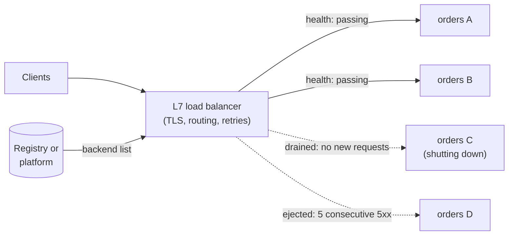
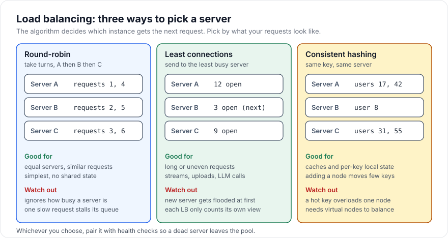

# Load Balancing

> [!TIP]
> **In one line:** A load balancer spreads requests across healthy instances, and the algorithm you pick, plus health checks, draining and retry limits, decides whether it improves reliability or amplifies failures.
>
> **In plain English:** Think of a supermarket where a greeter points each arriving shopper to a checkout lane. A greeter who just says "lane 1, lane 2, lane 3" fails when one cashier is slow, and one who looks at the queues does better. The same choice, plus knowing when a lane is closed, matters for servers.
>
> **You'll be able to:** distinguish L4 from L7 balancing and choose round-robin, least-connections, EWMA or consistent hashing for a workload · configure health checks, connection draining and sticky sessions with their trade-offs · keep retries at the balancer from causing a retry storm

## Why This Matters

A single instance of a service has a ceiling on throughput and is a single point of failure. Running several instances solves both problems only if something sends each request to one of them, avoids the ones that are broken, and does so without becoming the new bottleneck. That component is the load balancer.

The details matter more than they first appear. Send traffic naively and one slow instance accumulates a queue while others sit idle, so your tail latency (the p99 you promised in your SLO) is set by your worst instance rather than your average. Forget to remove a failed instance and a fixed fraction of requests fail until someone notices. Deploy without draining connections and every release drops in-flight requests. And retry carelessly at the balancer and a small slowdown multiplies into a full outage, because every client request becomes two or three backend requests exactly when the backends are least able to cope.

This chapter builds on service discovery (see `service-discovery.md`), which supplies the list of backends, and on the timeouts, retries and circuit breakers of [Part 6](../06-production-reliability/README.md), which the balancer must cooperate with rather than undermine.

## Core Concept

A **load balancer** accepts traffic at one logical address and forwards each unit of work to one backend chosen from a pool. Four decisions define its behaviour.

**Layer.** At **L4** (transport), the balancer sees TCP or UDP connections: source and destination addresses and ports, nothing about HTTP. It picks a backend per *connection* and relays bytes. It is very fast and protocol-agnostic, but it cannot route by path or header, cannot retry a request on another backend, and, importantly, balances connections rather than requests. At **L7** (application), the balancer terminates the connection, parses HTTP, and picks a backend per *request*. It can route by host or path, add headers, enforce timeouts, retry, and balance HTTP/2 or gRPC streams that share one connection, at the cost of more CPU and a more complex failure surface. The API gateway (see `api-gateway.md`) is an L7 balancer plus policy.

**Algorithm.** How to choose among healthy backends (next section).

**Health.** Which backends are eligible, using active probes and passive observation of real traffic.

**Lifecycle.** How backends join and leave without hurting requests: slow start for new ones, connection draining for departing ones.

## Mental Model

Imagine an airport check-in hall with a floor manager directing passengers to desks. The manager can be simple (rotate through desks in order) or observant (send the next passenger to the desk with the shortest line, adjusted for how fast that agent has actually been working). If a desk's agent goes on break, the manager stops sending people there, but lets the passengers already at the desk finish rather than throwing them out. If every passenger needs their own agent's saved notes (a returning customer), the manager must send the same person to the same desk, which works until that desk gets all the VIPs.

Each of those behaviours has a counterpart: round-robin, least-connections and latency-aware choice, health checks, connection draining, and sticky sessions or consistent hashing with their hot-spot risk.

## How It Works

### Choosing a backend

**Round-robin** cycles through backends in order (or by weight). It needs no state about backend load, is trivially fair for *request counts*, and is perfect when backends are identical and requests are similar and short. It is blind to cost: if one request in a hundred takes a hundred times longer, round-robin keeps feeding the busy instance on schedule.

**Least connections** sends each request to the backend with the fewest in-flight requests. Because the in-flight count rises while a backend is slow, it naturally steers away from slow or busy instances and is a much better default for variable-cost work such as uploads, report generation, streaming responses, or calls to LLMs whose duration varies from 200 ms to a minute. Its weaknesses: a brand-new backend has zero connections and is instantly flooded (so use *slow start*, ramping its weight up over, say, 30 seconds), and with several balancers each sees only its own connections, so the "least loaded" view is partial.

**Power of two choices** is a cheap, robust refinement: pick two backends at random and send the request to the less loaded of the two. It avoids the herd effect where every balancer picks the single globally least-loaded backend simultaneously, and with large pools it performs nearly as well as scanning everything.

**EWMA (latency-aware)** keeps an exponentially weighted moving average of each backend's recent response time, and scores backends by `ewma_latency x (in_flight + 1)`. A backend that has become slow loses traffic even if it has few connections, because its estimated cost per request is high. This is what "peak EWMA" balancers in service meshes do. It reacts to degradation that connection counts miss, but it needs careful tuning of the decay so it neither flaps nor reacts too slowly, and a backend that fails *fast* can look attractive (low latency), so failures must count heavily in the score.

**Consistent hashing** maps a key (user id, tenant id, cache key) onto a ring of backends so the same key goes to the same backend, and adding or removing a backend remaps only roughly `1/N` of keys instead of nearly all of them, as `hash(key) % N` would. Each backend is placed at many pseudo-random points on the ring ("virtual nodes") to smooth the distribution. It is right when backends hold per-key state worth keeping local: in-memory caches, sharded session or conversation state, per-tenant connection pools. Its weaknesses: hot keys overload one backend, and load is only statistically balanced.

### Health checks

**Active** checks have the balancer probe an endpoint (`GET /healthz`) on an interval; mark a backend down after N consecutive failures and up after M successes. **Passive** (outlier detection) checks watch real traffic: eject a backend after, say, 5 consecutive 5xx responses or connection failures, for an escalating period. Passive detection reacts in the time of one request; active probing can find a backend that is broken before it takes traffic and notice recovery. Use both. Probe a lightweight, meaningful endpoint, and do not let it depend on every downstream, or one flaky dependency will eject the whole fleet.

### Draining and slow start

When a backend is being removed (deploy, scale-in), the balancer should stop sending *new* requests but let in-flight requests finish, up to a timeout. That is **connection draining** (a "deregistration delay"). Pair it with the application's graceful shutdown: on SIGTERM, fail the health check, keep serving for a few seconds, finish in-flight work, then exit. The reverse, **slow start**, ramps a new backend's share up gradually so a cold instance (empty caches, un-JITed code, unwarmed connection pools) is not hit with full load immediately.

### Sticky sessions

Sticky sessions (session affinity) pin a client to the backend it first used, via a cookie or by hashing the client IP. They are a workaround for backends that keep per-user state in memory. The costs are real: load becomes uneven (a few heavy users pin one instance), scale-in and crashes lose the state anyway, and the pinned instance's failure logs users out. Prefer stateless services with state in a shared store (see [Part 7](../07-caching-performance/README.md) for caching), and reserve stickiness for cases where locality is a genuine performance win, such as a cache keyed by user, where losing the cache costs speed but not correctness.

### Retries at the balancer

An L7 balancer can retry a failed request on another backend, which hides single-instance failures from clients. But retries multiply load. If a service is at 90% capacity and starts failing 20% of requests, retrying each failure once adds 18% more load, which pushes it further over the edge: a **retry storm**. Three defences:

- **Retry budget.** Allow retries only while they are a small fraction of recent traffic (for example 10% of requests). When the budget is spent, fail fast.
- **Retry only what is safe.** Connection failures before any bytes were sent are safe to retry. Retrying a non-idempotent `POST` after a timeout may duplicate the action, so require idempotency keys (see `retries.md`).
- **Retry on a different backend**, with a per-try timeout shorter than the overall deadline, and do not stack retries at every tier (client, gateway, service); multiplying 3 retries across 3 layers gives 27 attempts.

## Architecture





## Request / Response Example

What the backend sees through an L7 balancer, and what the balancer does during a drain.

```http
GET /orders/8821 HTTP/1.1
Host: api.example.com
X-Forwarded-For: 203.0.113.50
X-Forwarded-Proto: https
X-Request-Id: 9b1f2c7e-31aa-4a55-9d7a-0c6f5a1d2e44
Forwarded: for=203.0.113.50;proto=https
```

The backend must read the client address from `X-Forwarded-For` (and only trust it when it comes from your own balancer), because the TCP peer is the balancer. While a backend is draining, it still answers in-flight requests but tells keep-alive clients to reconnect elsewhere:

```http
HTTP/1.1 200 OK
Content-Type: application/json
Connection: close

{"id": "8821", "status": "shipped"}
```

If the whole pool is unhealthy or the retry budget is exhausted, a good balancer fails fast rather than queueing:

```http
HTTP/1.1 503 Service Unavailable
Retry-After: 2
Content-Type: application/json

{"error": "no_healthy_upstream"}
```

## Code Example

The selection logic is small enough to implement directly. This sketch (single event loop, no locking, so it is for illustration and tests rather than a production data path) shows power-of-two-choices with EWMA scoring, a consistent-hash ring with virtual nodes, and a ratio-based retry budget.

```python
"""Backend selection primitives: P2C+EWMA, consistent hashing, retry budget."""
import bisect
import hashlib
import random
from dataclasses import dataclass, field


@dataclass
class Backend:
    addr: str
    inflight: int = 0
    ewma_ms: float = 50.0          # optimistic prior so new backends get tried
    healthy: bool = True


def score(b: Backend) -> float:
    # Expected cost of the next request: typical latency x queue it joins.
    return b.ewma_ms * (b.inflight + 1)


def pick_p2c(backends: list[Backend]) -> Backend:
    pool = [b for b in backends if b.healthy]
    if not pool:
        raise RuntimeError("no healthy upstream")
    if len(pool) == 1:
        return pool[0]
    a, b = random.sample(pool, 2)               # two distinct random candidates
    return a if score(a) <= score(b) else b


def record(b: Backend, latency_ms: float, ok: bool, alpha: float = 0.3) -> None:
    # Failures count as a large latency so a fast-failing backend does not look good.
    sample = latency_ms if ok else max(latency_ms, 1000.0)
    b.ewma_ms = alpha * sample + (1 - alpha) * b.ewma_ms


class HashRing:
    """Consistent hashing with virtual nodes."""

    def __init__(self, nodes: list[str], vnodes: int = 100) -> None:
        self._vnodes = vnodes
        self._ring: list[tuple[int, str]] = []
        for n in nodes:
            self.add(n)

    @staticmethod
    def _h(value: str) -> int:
        return int.from_bytes(hashlib.md5(value.encode()).digest()[:8], "big")

    def add(self, node: str) -> None:
        for i in range(self._vnodes):
            bisect.insort(self._ring, (self._h(f"{node}#{i}"), node))

    def remove(self, node: str) -> None:
        self._ring = [(h, n) for h, n in self._ring if n != node]

    def get(self, key: str) -> str:
        if not self._ring:
            raise RuntimeError("empty ring")
        # First virtual node clockwise from the key's position, wrapping around.
        idx = bisect.bisect(self._ring, (self._h(key), "")) % len(self._ring)
        return self._ring[idx][1]


@dataclass
class RetryBudget:
    """Allow retries as at most `ratio` of recent requests (token style)."""
    ratio: float = 0.1
    max_tokens: float = 20.0
    tokens: float = field(default=20.0)

    def on_request(self) -> None:
        self.tokens = min(self.max_tokens, self.tokens + self.ratio)

    def try_retry(self) -> bool:
        if self.tokens >= 1.0:
            self.tokens -= 1.0
            return True
        return False                            # budget spent: fail fast


if __name__ == "__main__":
    ring = HashRing(["a", "b", "c"])
    before = {f"user-{i}": ring.get(f"user-{i}") for i in range(10_000)}
    ring.add("d")
    moved = sum(1 for k, v in before.items() if ring.get(k) != v)
    print(f"keys moved after adding a node: {moved / 10_000:.0%}")   # roughly 25%, not ~75%
```

Run as a script, the final lines print roughly a quarter of keys moving when a fourth node joins, versus about three quarters for `hash(key) % N`. In real systems you rarely write this yourself: Envoy, NGINX, HAProxy, cloud balancers and Kubernetes ingress controllers provide these algorithms, so the value of knowing the internals is choosing and tuning them correctly.

## Production Considerations

- **Match the algorithm to the workload.** Uniform short requests: round-robin or P2C. Variable duration (uploads, LLM calls): least-connections, P2C or EWMA. Stateful or cache-affine: consistent hashing with a fallback if the target is down.
- **Keep the balancer redundant.** A single balancer is a single point of failure. Use multiple instances behind DNS, anycast or a cloud-managed front end, and make them stateless apart from configuration.
- **Terminate TLS deliberately.** Terminating at the L7 balancer enables routing and observability but means traffic inside is plaintext unless you re-encrypt (see `service-to-service-authentication.md`).
- **Set timeouts at the balancer.** Idle timeout, per-request timeout and per-try timeout should be shorter than the client's deadline and longer than your p99 (see `timeouts.md`).
- **Mind connection reuse.** HTTP/2 and gRPC pin many requests to one connection; L4 balancing then sends all of one client's traffic to one backend. Use an L7 balancer or per-request client-side balancing.
- **Limit concurrency per backend.** Cap in-flight requests (a "max connections" or bulkhead setting) so an overloaded backend sheds load instead of collapsing, and combine with circuit breakers (see `circuit-breakers.md`).
- **Observe per-backend metrics.** Request rate, error rate, latency and in-flight count per backend reveal the one bad instance that aggregate dashboards hide (see [Part 12](../12-observability/README.md)).

## Common Mistakes

- **Round-robin for variable-cost work.** One slow request type piles up queues behind itself.
- **Health checks that are too strict or too shallow.** A check that always returns 200 never removes anything; one that checks every dependency ejects the fleet during a shared dependency blip.
- **No draining.** Every deploy drops some in-flight requests and the error graph shows a sawtooth.
- **Unbudgeted retries at several layers.** Client, gateway and service each retry three times and a brownout becomes a blackout.
- **Sticky sessions as the default.** They hide stateful design problems and create uneven load.
- **Trusting `X-Forwarded-For` blindly.** Clients can send their own value, so accept it only from your known proxies.
- **Ignoring cold starts.** New instances at full weight fail their first requests and get ejected, then flap.

## Best Practices

- Default to least-connections or P2C (optionally latency-weighted) for APIs; use consistent hashing only where locality pays for itself.
- Use both active and passive health checks, with hysteresis (different thresholds for down and up).
- Implement graceful shutdown in the app and draining in the balancer together, and test it during a load test.
- Enforce a retry budget and retry only idempotent or keyed requests on a different backend.
- Prefer stateless services; use sticky sessions only as a measured optimisation.
- Load test failure scenarios (kill an instance, slow one down) and confirm tail latency and error rate stay within the SLO.

## AI Engineering Perspective

LLM workloads break several of the assumptions behind classic algorithms. Requests are extremely uneven (a 10-token completion versus a 4,000-token generation), responses are streamed for many seconds, and each GPU worker has a hard concurrency limit tied to memory. Round-robin does badly here; balancers for model servers use in-flight request counts, queue depth or reported KV-cache utilisation as the signal. Some systems route with **prefix affinity**: hashing on the conversation id or the shared system-prompt prefix so repeated requests land on a worker that already has that prefix cached, which is consistent hashing with a clear performance reason.

At the LLM gateway level (see [Part 14](../14-ai-api-engineering/README.md)), "load balancing" also spans providers: spreading across API keys, regions and vendors to respect rate limits, with fallback when one returns 429 or 5xx. The retry-budget discipline matters even more, because a retry of a long generation costs real money and can double a bill during a provider incident. Retry budgets and circuit breakers belong at the gateway, and streaming responses should not be retried once tokens have been sent to the client.

## Exercises

**Beginner**
1. Your API has three identical instances and requests all take about 20 ms. Which algorithm would you choose and why? Would your answer change if 5% of requests took 5 seconds?

**Intermediate**
2. A service at 80% of capacity starts returning errors for 25% of requests. Calculate the extra load if the balancer retries each failed request once, then with a 10% retry budget. What happens to the failure rate in each case?

**Advanced**
3. Design a rolling deploy for a service with 8 instances behind an L7 balancer: describe health check settings, the drain timeout, slow start, and the application's SIGTERM behaviour. How would you verify, using metrics, that no request was dropped?

## Key Takeaways

- L4 balances connections cheaply; L7 balances requests and enables routing, retries and per-request policy.
- Round-robin suits uniform work; least-connections, P2C and EWMA suit variable work; consistent hashing suits per-key locality.
- Health checks, draining and slow start decide whether deploys and failures are invisible to users.
- Retries at the balancer need a budget and a different-backend rule, or they turn slowdowns into outages.

### Check Yourself
<details markdown="1">
<summary>1. When would you choose least-connections over round-robin?</summary>

When request costs vary, because in-flight counts rise on slow or busy backends and steer new requests away from them, while round-robin keeps sending work on a fixed schedule regardless of load.

</details>

<details markdown="1">
<summary>2. Why does consistent hashing move far fewer keys than `hash(key) % N` when a node is added?</summary>

With modulo, changing N changes the result for most keys. With a ring, a new node only takes over the ranges immediately before its points, so roughly 1/N of keys move and the rest keep their backend.

</details>

<details markdown="1">
<summary>3. Every deploy shows a short spike of 502s from your balancer. What do you check first?</summary>

Whether backends are drained properly: the app should fail its health check and keep serving in-flight requests on SIGTERM, and the balancer's deregistration delay should exceed the longest normal request. Without it, requests are cut off or sent to a process that is already stopping.

</details>

---
Back to the [Part 11 README](README.md).
