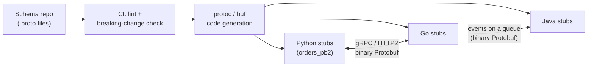

# Protocol Buffers

> [!TIP]
> **In one line:** Protocol Buffers define a typed schema and a compact binary encoding keyed by field numbers, so services can evolve their messages without breaking each other, if you follow the compatibility rules.
>
> **In plain English:** A form where every box has a permanent number printed on it, and the form only ever sends "box 3: Alice" rather than the whole question. Old and new versions of the form can still be read as long as nobody renumbers or reuses a box.
>
> **You'll be able to:** write a .proto schema with sensible field numbers, enums and reserved fields · explain the wire format well enough to read a hex dump · tell safe schema changes from breaking ones

## Why This Matters

Two services that exchange messages need a shared understanding of the data's shape. With JSON over REST that understanding is informal: a documentation page, perhaps an OpenAPI file, and a lot of trust. Field names travel with every message, types are loose (is `"quantity": "3"` a string or a number?), and nothing stops a producer from renaming `customer_id` to `customerId` on a Friday afternoon.

In a microservice system (see `monolith-vs-microservices.md`), the hard part is rarely sending the first message; it is **evolving** the contract while dozens of producers and consumers deploy independently, with old and new versions running side by side for hours or weeks during rolling deploys, and old messages sitting in queues or logs for months. Protocol Buffers (Protobuf) address both problems: a machine-readable schema that generates typed code for every language, and an encoding designed so that schemas can change in defined, safe ways.

It is also the foundation of gRPC (see `rest-vs-grpc.md`, which compares the two styles at the protocol level). This chapter goes beneath that comparison: what a `.proto` file is, how bytes are laid out, and which changes are safe.

## Core Concept

**Protocol Buffers** is Google's language-neutral, platform-neutral mechanism for serialising structured data. You define messages in a `.proto` file; a compiler (`protoc`, or tooling such as `buf`) generates classes for your language; the generated code converts between in-memory objects and a compact binary form.

Three ideas carry most of the weight:

1. **The schema is the contract.** Types, field names and numbers are declared once, in one place, and everyone generates code from it. A typo in a field name becomes a compile or import error rather than a runtime surprise.
2. **Fields are identified by number, not name, on the wire.** The binary message contains `(field number, value)` pairs. Names exist only in the schema and generated code. This makes messages small and makes renaming a field safe at the binary level.
3. **Unknown and missing fields are tolerated.** A reader ignores (and, in modern implementations, preserves) fields it does not know, and treats absent fields as defaults. That is what makes *forward* and *backward* compatibility possible.

Terminology worth fixing: **backward compatible** means new code can read data written by old code. **Forward compatible** means old code can read data written by new code. Safe evolution in a rolling deploy needs both, because during the rollout both directions happen.

## Mental Model

Think of a library card catalogue where every field has a fixed drawer number: drawer 1 is the title, drawer 2 is the author, drawer 3 is the year. A card says only "1: Dune, 2: Herbert, 3: 1965". A newer librarian adds drawer 4 for the ISBN; an older librarian who has never heard of drawer 4 simply leaves those cards in place and moves on. If someone decides drawer 3 should now hold "publisher", every old card that says "3: 1965" is silently reinterpreted as a publisher called "1965". That is why reusing a number is the unforgivable sin: the data is still valid, it just means something different.

The numbers, not the labels on the drawers, are the real contract.

## How It Works

### Schema

```proto
syntax = "proto3";

package shop.orders.v1;

import "google/protobuf/timestamp.proto";

enum OrderStatus {
  ORDER_STATUS_UNSPECIFIED = 0;   // proto3 enums must start at zero: make it "unknown"
  ORDER_STATUS_PENDING = 1;
  ORDER_STATUS_PAID = 2;
  ORDER_STATUS_SHIPPED = 3;
}

message Money {
  string currency_code = 1;       // ISO 4217, e.g. "EUR"
  int64 amount_minor = 2;         // cents, never floats for money
}

message OrderLine {
  string sku = 1;
  int32 quantity = 2;
  Money unit_price = 3;
}

message Order {
  reserved 4, 9 to 11;            // numbers retired earlier: never reuse them
  reserved "coupon_code";         // and the old name, to stop it coming back

  string id = 1;
  string customer_id = 2;
  OrderStatus status = 3;
  repeated OrderLine lines = 5;
  google.protobuf.Timestamp created_at = 6;
  optional string note = 7;       // explicit presence: can tell "unset" from ""
  map<string, string> labels = 8;
}

service OrderService {
  rpc GetOrder(GetOrderRequest) returns (Order);
}

message GetOrderRequest { string id = 1; }
```

Notes on the choices: put the most frequently set fields at numbers 1 to 15, because the tag for those fits in one byte; use a package with a version (`v1`) so a breaking redesign can be a new package rather than a mutation; use `int64` minor units or a decimal-string for money; and give enums an explicit `UNSPECIFIED = 0` so that a missing value is never mistaken for a real one.

### Wire format basics

Each field on the wire is a **tag** followed by a payload. The tag is a varint equal to `(field_number << 3) | wire_type`. The common wire types are `0` (varint: integers, bools, enums), `2` (length-delimited: strings, bytes, nested messages, packed repeated fields), plus `1` and `5` for fixed 64- and 32-bit values.

A **varint** stores an integer in 7-bit groups, least significant first, with the high bit of each byte set when more bytes follow. So 1 is `01`, and 150 is `96 01`: 150 in binary is `1 0010110`; the low seven bits `0010110` get the continuation bit, giving `0x96`, then the remaining `1` gives `0x01`. Small numbers use one byte, which is why Protobuf is compact for typical IDs and counts.

Take `message Reservation { int32 sku_id = 1; string note = 2; }` with `sku_id = 150` and `note = "hi"`:

```text
08 96 01 12 02 68 69
|  |____| |  |  |____|
|    |    |  |    "hi" (0x68 0x69)
|    |    |  length 2
|    |    tag: field 2, wire type 2  = (2<<3)|2 = 0x12
|    value 150 as a varint
tag: field 1, wire type 0 = (1<<3)|0 = 0x08
```

Seven bytes. The JSON equivalent, `{"sku_id":150,"note":"hi"}`, is 25. The saving grows or shrinks with the data (long strings compress no better than in JSON, while many small numbers shrink dramatically), and JSON can be gzipped, so the real-world difference is typically a factor of two or three in payload size, plus faster parsing since no key strings need to be matched. It is a performance advantage, but the schema and evolution discipline are the more durable benefits.

Two consequences follow. A reader that meets an unknown tag can skip it correctly because the wire type tells it how many bytes to skip. And encoding is not self-describing: without the schema you can see "field 2 is a length-delimited blob" but not that it is a string called `note`.

### Defaults and presence (proto3)

In proto3, a scalar field set to its default (0, `""`, false) is *not written*, and a reader cannot distinguish "set to 0" from "never set". That is a problem for patch semantics ("did the caller mean `quantity = 0` or omit it?"). The `optional` keyword restores explicit presence, so `has_note` can be tested. Message-typed fields always have presence. Enums are *open* in proto3: an unrecognised value from a newer writer is preserved as its integer rather than rejected, so code must handle "a value I do not know" gracefully, which is the second reason for `UNSPECIFIED = 0`.

### Compatibility rules

Safe changes (for both directions of compatibility):

- **Add a field with a new, never-used number.** Old readers skip it; new readers see the default when reading old data.
- **Remove a field, and `reserve` its number and name** so nobody reuses them.
- **Rename a field**: the wire format uses numbers. (But if you also use the JSON mapping of Protobuf, which uses names, a rename breaks JSON consumers, and generated code in each language changes.)
- **Add enum values** (readers must tolerate unknown values).

Breaking changes:

- **Reusing or changing a field number**: silently corrupts meaning.
- **Changing a field's type** incompatibly: `int32`/`int64`/`bool` are wire-compatible with each other (values may truncate), while `int32` to `sint32` or `string` to `bytes` with non-UTF-8 content is not safe. When in doubt, add a new field and migrate.
- **Changing singular to `repeated` or the reverse**, moving a field into or out of a `oneof` in ways that change semantics.
- **Making semantics stricter** ("this field is now required to be non-empty") without coordinating, which is a behavioural break the compiler cannot see.

Proto3 deliberately dropped `required`: a required field can never safely be removed, because old readers would reject messages without it. Validate in application code (or with a validation library) instead.

Automate the rules: tools such as `buf breaking` compare the new schema with the previous version in CI and fail the build on a wire-incompatible change.

## Architecture



A single versioned schema repository (or a package published from one) becomes the source of truth, so a producer and all consumers generate from the same definition, and CI rejects incompatible edits before they ship.

## Request / Response Example

On the wire, a gRPC call is an HTTP/2 request whose body is a Protobuf message with a five-byte prefix: one byte for the compression flag and four bytes for the message length.

```text
:method: POST
:path: /shop.orders.v1.OrderService/GetOrder
:scheme: https
content-type: application/grpc
te: trailers
grpc-timeout: 800m

[00] [00 00 00 07]  0a 05 6f 72 64 2d 31      <- GetOrderRequest{id: "ord-1"} (7 bytes)
```

The request body `0a 05 6f 72 64 2d 31` is tag `0x0a` (field 1, length-delimited), length 5, then the ASCII bytes of `ord-1`. The server answers with headers, the framed `Order` message, then **trailers** carrying the outcome:

```text
:status: 200
content-type: application/grpc

[00] [00 00 00 2a]  0a 05 6f 72 64 2d 31 12 07 63 75 73 74 2d 34 32 18 02 ...

grpc-status: 0
grpc-message:
```

The status lives in trailers (`grpc-status: 0` means OK), not in the HTTP status code, which is one reason plain HTTP tooling such as `curl` and browser dev tools handle gRPC awkwardly. Protobuf also defines a canonical JSON mapping, so gateways can expose the same schema as `application/json`:

```json
{"id": "ord-1", "customerId": "cust-42", "status": "ORDER_STATUS_PAID"}
```

## Code Example

First the generation step and Python usage, then a hand-rolled encoder that makes the wire format concrete. The generated module is produced by `protoc`; its exact import path depends on your `-I` and output layout.

```bash
pip install protobuf grpcio-tools
mkdir -p gen
python -m grpc_tools.protoc -I proto --python_out=gen --pyi_out=gen \
    proto/shop/orders/v1/orders.proto
# Result: gen/shop/orders/v1/orders_pb2.py (add gen/ to PYTHONPATH)
```

```python
"""Using generated Protobuf code, plus the wire format by hand."""
# --- Part 1: generated code (requires the protoc step above) -----------------
# from google.protobuf.json_format import MessageToJson
# from shop.orders.v1 import orders_pb2
#
# order = orders_pb2.Order(
#     id="ord-1",
#     customer_id="cust-42",
#     status=orders_pb2.ORDER_STATUS_PAID,
#     lines=[orders_pb2.OrderLine(sku="sku-9", quantity=2)],
# )
# order.note = "leave at door"            # `optional` field: presence is tracked
# data: bytes = order.SerializeToString()  # compact binary, ready for gRPC or a queue
#
# decoded = orders_pb2.Order.FromString(data)
# assert decoded.HasField("note")          # explicit presence works for `optional`
# print(MessageToJson(decoded))            # canonical JSON mapping (camelCase names)
#
# Unknown fields written by a newer schema are preserved on re-serialisation by
# the Python implementation, so a pass-through service does not drop them.


# --- Part 2: the wire format, standard library only (runnable) ---------------
def encode_varint(n: int) -> bytes:
    """Encode a non-negative integer as a base-128 varint."""
    out = bytearray()
    while True:
        byte = n & 0x7F
        n >>= 7
        if n:
            out.append(byte | 0x80)       # more bytes follow
        else:
            out.append(byte)
            return bytes(out)


def field_varint(number: int, value: int) -> bytes:
    return encode_varint((number << 3) | 0) + encode_varint(value)       # wire type 0


def field_bytes(number: int, payload: bytes) -> bytes:
    return encode_varint((number << 3) | 2) + encode_varint(len(payload)) + payload


def decode_fields(buf: bytes):
    """Yield (field_number, wire_type, value); unknown fields are skipped, not errors."""
    i = 0
    while i < len(buf):
        tag, i = _read_varint(buf, i)
        number, wire = tag >> 3, tag & 7
        if wire == 0:
            value, i = _read_varint(buf, i)
        elif wire == 2:
            length, i = _read_varint(buf, i)
            value, i = buf[i:i + length], i + length
        else:
            raise ValueError(f"wire type {wire} not handled in this sketch")
        yield number, wire, value


def _read_varint(buf: bytes, i: int) -> tuple[int, int]:
    shift = result = 0
    while True:
        b = buf[i]
        i += 1
        result |= (b & 0x7F) << shift
        if not b & 0x80:
            return result, i
        shift += 7


if __name__ == "__main__":
    # message Reservation { int32 sku_id = 1; string note = 2; }
    msg = field_varint(1, 150) + field_bytes(2, b"hi")
    print(msg.hex(" "))                    # 08 96 01 12 02 68 69

    # A "new" writer adds field 3 (which an "old" reader does not know about):
    newer = msg + field_varint(3, 7)
    # The old reader only cares about fields 1 and 2 and simply ignores the rest.
    known = {n: v for n, _, v in decode_fields(newer) if n in (1, 2)}
    print(known)                           # {1: 150, 2: b'hi'}
```

The second half is not something you would ship, but running it shows that an old reader copes with a newer message, which is the entire basis of forward compatibility. Real implementations also handle signed integers (zig-zag for `sint32`/`sint64`), fixed-width types, packed repeated fields and nested messages.

## Production Considerations

- **Treat `.proto` files as public APIs.** Review them like code, version the package (`v1`, `v2`), and publish generated packages from CI rather than copying files by hand.
- **Run breaking-change detection in CI.** Compare against the main branch (`buf breaking` or equivalent) so a reuse of a field number never reaches a deploy.
- **Plan for mixed versions.** During a rolling deploy and for any data at rest (queues, logs, stored blobs), both old and new schemas coexist; design changes to be safe in both directions, and deploy readers before writers when adding a field consumers depend on.
- **Do not use serialised bytes as a canonical form.** Protobuf serialisation is not guaranteed to be byte-identical across languages, versions or map orderings, so avoid hashing or signing raw serialised messages (or use deterministic serialisation options and document their limits) and compare messages by value.
- **Set size limits.** gRPC servers default to modest maximum message sizes (4 MB is common); large payloads should be streamed or chunked, and untrusted input should be bounded.
- **Keep debuggability.** Binary is opaque in logs. Log the JSON mapping of selected fields (excluding sensitive ones), use tools such as `grpcurl` and server reflection in non-production environments, and keep schemas discoverable.
- **Don't expose it blindly at the edge.** Browsers and third-party integrators generally want REST/JSON; offer a gateway with the JSON mapping or a separate public API (see `api-gateway.md`).
- **Mind sensitive fields.** Mark PII in the schema (options or comments) so logging and storage layers can redact it.

## Common Mistakes

- **Reusing a field number** after deleting a field. Old data is reinterpreted silently.
- **Renumbering "to tidy up".** Same effect, and often shipped as a refactor.
- **Using floats for money** or timestamps as free-form strings instead of `int64` minor units and `google.protobuf.Timestamp`.
- **No `UNSPECIFIED = 0` enum value**, so a missing value looks like a legitimate first state.
- **Relying on default values to mean "not set"** without `optional`, then being unable to tell `0` from absent in updates.
- **Treating the schema as private** and changing it without checking who consumes it, including offline consumers like analytics jobs reading old events.
- **Assuming "binary means fast enough"**; measure, because for small payloads on a fast network the difference may be invisible and tooling costs may dominate.

## Best Practices

- Assign numbers 1 to 15 to common fields, never reuse a number, and `reserve` every retired number and name.
- Add fields rather than changing them; migrate by writing both old and new fields, moving readers, then retiring the old one.
- Use `optional` where "unset" matters, and avoid `required`-style assumptions in consumers; validate explicitly.
- Prefer well-known types (`Timestamp`, `Duration`, `FieldMask`) over ad hoc ones.
- Lint and breaking-check schemas in CI, and generate code in the build rather than committing it where practical.
- Version packages and keep one canonical schema source.

## AI Engineering Perspective

Protobuf shows up in AI systems mainly on the serving side: model servers and inference platforms commonly expose gRPC with Protobuf messages for tensors and batched predictions, where large numeric payloads make compact binary encoding genuinely valuable, and streaming RPCs fit token-by-token generation. The compatibility discipline matters because feature schemas for models evolve constantly: a new feature added to a feature vector must not break the model version still serving in production.

A second connection runs the other way. LLM tool calling (see [Part 14](../14-ai-api-engineering/README.md) and [Part 17](../17-ai-agents-and-mcp/README.md)) uses JSON Schema to describe tool arguments, and teams with existing gRPC services often *derive* those JSON schemas from their `.proto` definitions, so one schema drives both the typed internal API and the model-facing tool description. The lesson from this chapter applies: because model-generated arguments are untrusted, validate them against the schema before passing them on, and remember that Protobuf's lenient parsing (unknown fields ignored, defaults filled in) is a compatibility feature, not a validation feature.

## Exercises

**Beginner**
1. Encode `message M { int32 a = 1; }` with `a = 300` by hand and give the bytes. (Hint: 300 is `1 0010 1100` in binary.) Then decode `08 05` back.

**Intermediate**
2. You have `message User { string id = 1; string name = 2; string legacy_nick = 3; }` and want to remove `legacy_nick` and later add `email`. Write the new schema using `reserved`, and explain exactly what goes wrong if `email` is given number 3.

**Advanced**
3. A producer will change `int32 quantity = 2` to a `Quantity` message with a unit (for example `{value, unit}`). Design a migration that never breaks a running consumer during a rolling deploy: list the schema versions, the order in which producers and consumers deploy, and how you would detect that no old reader remains before retiring the old field.

## Key Takeaways

- Protobuf is a schema plus a compact encoding where fields are identified by number, which is what makes evolution possible.
- Adding fields with new numbers is safe; reusing numbers, changing types incompatibly or renumbering is not. Reserve what you retire.
- The wire format is `(tag, value)` pairs with varints and length-delimited payloads, and unknown tags can be skipped, which gives forward compatibility.
- Automate compatibility checks in CI and treat schemas as public APIs, especially where old data (queues, logs) outlives code.

### Check Yourself
<details markdown="1">
<summary>1. Why must a deleted field's number never be reused?</summary>

Binary messages identify fields only by number. Old data, queued messages and old readers still use the original meaning, so a new field with the same number would be decoded as the wrong thing without any error.

</details>

<details markdown="1">
<summary>2. Why can an old reader still process a message written by a newer schema?</summary>

Each field's tag includes its wire type, so the reader can skip over fields whose numbers it does not recognise and use only those it knows, treating anything missing as a default.

</details>

<details markdown="1">
<summary>3. A teammate wants to rename `customer_id` to `buyer_id` in a schema used over gRPC and by a JSON gateway. Is it safe?</summary>

Over binary gRPC it is wire-safe because only the number matters, but the generated code changes in every language and the JSON mapping (which uses names) will break existing JSON clients. Keep the name, or add a new field and migrate deliberately.

</details>

---
Back to the [Part 11 README](README.md).
