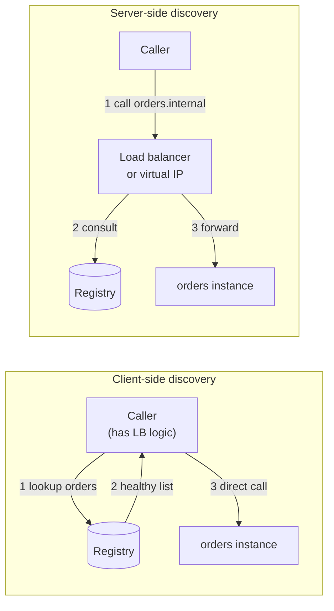
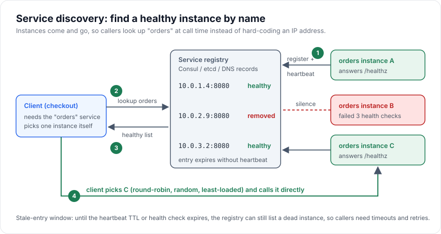

# Service Discovery

> [!TIP]
> **In one line:** Service discovery lets callers find a currently healthy instance of a service by name, because in a dynamic fleet instance addresses change constantly.
>
> **In plain English:** Think of calling a company's switchboard instead of memorising each employee's mobile number. People change desks and phones all the time, but the switchboard always knows who is in today. Service discovery is that switchboard for your servers.
>
> **You'll be able to:** compare client-side and server-side discovery and say when each fits · explain how DNS, registries like Consul or etcd, and Kubernetes Services find instances · reason about stale endpoints and health-based removal

## Why This Matters

In the monolith world (see `monolith-vs-microservices.md`), "where is the code I need to call?" has a trivial answer: it is in the same process. Once you split into services, every call becomes a network call to an address, and that address is not stable. Containers are rescheduled to different nodes, autoscalers add and remove instances every few minutes, deployments replace every instance with a new one, and spot or preemptible machines disappear without warning. An IP address you wrote into a config file this morning may belong to a different service by lunchtime.

Hard-coding addresses fails in two ways. First, it is operationally brittle: each scale event or deploy means editing configuration somewhere. Second, and worse, it fails silently under partial failure: if the caller keeps sending traffic to an address whose process has crashed, every such request pays a connection timeout before failing. Discovery is the machinery that keeps the caller's idea of "who is out there and alive" close enough to reality that most requests go to something that can answer.

It also underpins other parts of this handbook. Load balancing (see `load-balancing.md`) needs a list of backends to choose among, the API gateway (see `api-gateway.md`) needs to know where to route, and resilience patterns such as retries and circuit breakers (see [Part 6](../06-production-reliability/README.md)) assume the caller can try a different instance rather than the same dead one.

## Core Concept

**Service discovery** is the mechanism by which a client turns a logical service name (`orders`) into one or more concrete network endpoints (`10.0.1.4:8080`, `10.0.3.2:8080`) at call time, and keeps that mapping current as instances come and go.

Every discovery system has the same three parts:

1. **Registration.** Instances become known, either by announcing themselves (self-registration) or by being observed by a platform (third-party registration, as when an orchestrator watches containers start).
2. **A source of truth.** Something stores the name-to-endpoints mapping: a DNS zone, a registry such as Consul or etcd, or the control plane of an orchestrator such as Kubernetes.
3. **Health-based membership.** Entries that stop being healthy leave the mapping, via heartbeats with a time-to-live, active health checks, or readiness signals from the platform.

The main design choice is *who does the lookup and the selection*:

- **Client-side discovery.** The calling service queries the registry itself, gets the list of healthy endpoints, and picks one (round-robin, random, least-loaded). The client is smart and talks directly to the chosen instance, saving a hop. The cost: every client language needs discovery and balancing logic, and every client holds its own cached view.
- **Server-side discovery.** The caller sends the request to a stable address, such as a virtual IP or a load balancer, and that component consults the registry and forwards. Clients stay simple and language-agnostic. The cost: an extra hop and an extra component that must itself be highly available.

Neither is "more modern". Kubernetes Services are essentially server-side discovery built into the platform. Service meshes bring smart client-side behaviour back without putting it in application code, by running a sidecar proxy next to each service.

## Mental Model

Picture a large hospital where doctors are on rotation. A nurse needing "the on-call cardiologist" does not memorise a pager number. There is a duty board in the corridor, updated at each shift change. Doctors sign in when they start a shift, and the board has a rule: if you have not tapped your badge within the last few minutes, your name comes off. A nurse reads the board, picks a name, and calls.

The board is the registry. Signing in is registration, tapping the badge is the heartbeat, and the removal rule is health-based eviction. The important subtlety is the delay: if a doctor collapses, their name stays on the board until the tap timeout expires. During that window, a nurse reading the board will call someone who cannot answer. That gap is the **stale-endpoint window**, and every discovery system has one. Your job is not to eliminate it but to make it short and to make callers tolerant of it.

## How It Works

**DNS-based discovery.** The oldest and simplest approach: publish `orders.internal` as DNS records pointing at the instances. Every language and tool already speaks DNS, so adoption is nearly free. The weaknesses are all about caching. Resolvers, operating systems and libraries cache answers for the record's TTL, and some runtimes cache longer than the TTL or resolve once at startup and never again (a classic source of "we deployed but traffic still goes to the old IPs"). A plain A-record lookup also returns no ports, so you either standardise ports or use SRV records, which many HTTP clients do not support. DNS works best for coarse-grained, slowly changing targets, with short TTLs where it must be dynamic.

**Registry-based discovery (Consul, etcd, ZooKeeper, Eureka).** A dedicated, strongly consistent or highly available store holds registrations. Instances register on startup with name, address, port and metadata (version, zone), and keep the registration alive either by sending heartbeats (a TTL check that must be refreshed) or by letting the registry actively probe a health endpoint. Clients query it, often via a long-poll or watch so that changes are pushed rather than polled. Registries give you rich metadata, per-instance health, and fast convergence, but they are another stateful system to run. If the registry is down, newly started instances cannot register and clients cannot refresh, so robust clients keep their last known good list and keep using it ("stale if error") rather than failing every call.

**Platform discovery (Kubernetes).** A Kubernetes `Service` gives a set of pods a stable name (`orders.shop.svc.cluster.local`) and a virtual IP. The control plane tracks which pods match the Service's selector and are *ready* (the readiness probe passes, see [Part 6](../06-production-reliability/README.md)), publishes them as EndpointSlices, and each node's proxy layer forwards traffic sent to the virtual IP to one of the ready pods. A pod that fails its readiness probe is removed from the endpoints without being killed, which is exactly the health-based removal you want for a temporarily overloaded instance. A "headless" Service (no virtual IP) returns the pod IPs directly in DNS, which enables client-side selection when you need it, such as for gRPC with its long-lived connections.

**Health and removal.** There are three common signals. A *heartbeat TTL*: the instance must check in every few seconds or be dropped. An *active check*: the registry or platform probes `/healthz` and removes the instance after N consecutive failures. A *graceful deregistration*: on shutdown, the instance removes itself first, then drains in-flight requests, then exits. Use all of them: graceful deregistration handles planned shutdowns with no stale window at all, and the other two handle crashes.

**Stale endpoints are normal.** A crash is only noticed after the TTL or after N failed probes, so for a period (seconds to tens of seconds) the list includes a dead instance. Callers should therefore use short connect timeouts, retry idempotent requests on a *different* instance (see `retries.md` and `timeouts.md`), and temporarily eject an endpoint locally after a connection failure rather than waiting for the registry to catch up.

## Architecture





The diagram above shows the client-side flow end to end: registration with heartbeats, health-based removal of instance B, and the client choosing among the healthy endpoints itself.

## Request / Response Example

Querying Consul's health API for only the instances currently passing their checks:

```http
GET /v1/health/service/orders?passing=true HTTP/1.1
Host: consul.internal:8500
Accept: application/json
```

```http
HTTP/1.1 200 OK
Content-Type: application/json
X-Consul-Index: 48213

[
  {
    "Node":    {"Node": "node-a", "Address": "10.0.1.4"},
    "Service": {"ID": "orders-7f3c", "Service": "orders",
                "Address": "10.0.1.4", "Port": 8080,
                "Tags": ["v2"], "Meta": {"zone": "eu-1a"}},
    "Checks":  [{"CheckID": "service:orders-7f3c", "Status": "passing"}]
  },
  {
    "Node":    {"Node": "node-c", "Address": "10.0.3.2"},
    "Service": {"ID": "orders-91ab", "Service": "orders",
                "Address": "", "Port": 8080, "Tags": ["v2"], "Meta": {"zone": "eu-1c"}},
    "Checks":  [{"CheckID": "service:orders-91ab", "Status": "passing"}]
  }
]
```

Notice that the second entry has an empty service `Address`; Consul's convention is to fall back to the node's address. The `X-Consul-Index` header is what a blocking query passes back as `?index=48213&wait=30s` so the call returns only when the list changes, which is how clients get near-instant updates without hammering the registry.

In Kubernetes, the equivalent is simply `curl http://orders.shop.svc.cluster.local/orders/42`: the platform hides the lookup.

## Code Example

A small client-side resolver for Consul, with a TTL cache, round-robin selection, local ejection of endpoints that just failed, and "stale if error" behaviour when the registry itself is unreachable.

```python
"""Client-side service discovery against Consul's HTTP API (illustrative)."""
import asyncio
import itertools
import os
import time

import httpx

CONSUL_URL = os.environ.get("CONSUL_URL", "http://127.0.0.1:8500")


class ServiceResolver:
    def __init__(self, ttl: float = 5.0, eject_for: float = 10.0) -> None:
        self._ttl = ttl                    # how long a registry answer is reused
        self._eject_for = eject_for        # how long a failed endpoint is skipped locally
        self._cache: dict[str, tuple[float, list[str]]] = {}
        self._ejected: dict[str, float] = {}     # endpoint -> time until which we skip it
        self._counters: dict[str, itertools.count] = {}
        self._lock = asyncio.Lock()
        self._http = httpx.AsyncClient(base_url=CONSUL_URL, timeout=2.0)

    async def _refresh(self, service: str) -> list[str]:
        resp = await self._http.get(
            f"/v1/health/service/{service}", params={"passing": "true"}
        )
        resp.raise_for_status()
        endpoints = []
        for entry in resp.json():
            host = entry["Service"]["Address"] or entry["Node"]["Address"]
            endpoints.append(f"http://{host}:{entry['Service']['Port']}")
        self._cache[service] = (time.monotonic(), endpoints)
        return endpoints

    async def endpoints(self, service: str) -> list[str]:
        cached = self._cache.get(service)
        if cached and time.monotonic() - cached[0] < self._ttl:
            return cached[1]
        # One refresh at a time: avoids a thundering herd on the registry.
        async with self._lock:
            cached = self._cache.get(service)
            if cached and time.monotonic() - cached[0] < self._ttl:
                return cached[1]
            try:
                return await self._refresh(service)
            except httpx.HTTPError:
                if cached:                 # registry down: serve the last known list
                    return cached[1]
                raise

    async def pick(self, service: str, exclude: set[str] | None = None) -> str:
        now = time.monotonic()
        skip = (exclude or set()) | {e for e, t in self._ejected.items() if t > now}
        candidates = [e for e in await self.endpoints(service) if e not in skip]
        if not candidates:
            # Everything looks bad: fall back to the full list rather than fail outright.
            candidates = await self.endpoints(service)
        if not candidates:
            raise RuntimeError(f"no healthy endpoints for {service}")
        counter = self._counters.setdefault(service, itertools.count())
        return candidates[next(counter) % len(candidates)]

    def eject(self, endpoint: str) -> None:
        self._ejected[endpoint] = time.monotonic() + self._eject_for


resolver = ServiceResolver()


async def get_order(order_id: str) -> dict:
    """GET is idempotent, so retrying on a different instance is safe."""
    tried: set[str] = set()
    last_exc: Exception | None = None
    for _ in range(2):                                    # at most one retry
        base = await resolver.pick("orders", exclude=tried)
        tried.add(base)
        try:
            async with httpx.AsyncClient(timeout=httpx.Timeout(2.0, connect=0.3)) as client:
                resp = await client.get(f"{base}/orders/{order_id}")
            resp.raise_for_status()
            return resp.json()
        except (httpx.ConnectError, httpx.ConnectTimeout) as exc:
            resolver.eject(base)                          # skip it locally, don't wait for the registry
            last_exc = exc
    raise RuntimeError("orders unavailable") from last_exc
```

Points worth noticing: the connect timeout is deliberately tiny (300 ms) so a dead instance costs little; only connection-level failures are retried here because a timeout after the request was sent may mean the server already acted (retry non-idempotent calls only with idempotency keys, see [Part 2](../02-rest-api-design/README.md)); and in production you would reuse a single `AsyncClient` for connection pooling and close the resolver's client on shutdown.

## Production Considerations

- **Tune the stale window.** Total time to stop routing to a crashed instance is roughly `check interval x failure threshold`, plus cache TTLs on the client. Faster is not free: aggressive checks cause flapping and load. Typical values are checks every 2 to 10 seconds with 2 to 3 failures.
- **Readiness is not liveness.** An instance that is alive but overloaded or still warming caches should leave the load-balancing pool without being restarted. Use separate signals, and make the readiness check reflect real ability to serve (database reachable, caches warm), but not so strict that a shared dependency's blip removes every instance at once and turns a partial outage into a full one.
- **Deregister gracefully.** On SIGTERM: fail readiness or deregister, wait a few seconds for caches and load balancers to notice, finish in-flight requests, then exit. Without this, every deploy briefly sends traffic to a process that is shutting down.
- **Protect the registry.** It is on the critical path of startup and of cache refreshes. Run it as a multi-node cluster, cache aggressively on clients, and decide what happens when it is unreachable (usually: keep going with the last list).
- **Long-lived connections defeat naive discovery.** HTTP/2 and gRPC multiplex many requests on one connection, so a client that resolves once and connects once will pin all its traffic to a single instance. Use headless Services with client-side balancing, or an L7 proxy or mesh that balances per request (see `load-balancing.md`).
- **Zone awareness.** Prefer instances in the caller's availability zone to cut latency and cross-zone cost, with fallback to others.
- **Security.** Registration is a powerful operation: an attacker who can register a fake `payments` instance can capture traffic. Restrict who can register, and authenticate the callee (see `service-to-service-authentication.md`).

## Common Mistakes

- **Hard-coding IPs or resolving once at startup.** The first deploy breaks it, and nobody remembers why traffic goes to a dead address.
- **Trusting DNS TTLs blindly.** Some runtimes and connection pools cache DNS far longer than the TTL, so verify actual behaviour in your stack.
- **No timeout on connect.** A stale endpoint then costs the full default TCP timeout (often tens of seconds) per request.
- **Retrying on the same dead instance.** Exclude the endpoint that just failed.
- **Failing hard when the registry is down.** The registry being unavailable should degrade discovery freshness, not take down every caller.
- **One health check for everything.** A single `/health` that checks all downstreams can remove the whole fleet when one dependency blips.

## Best Practices

- Prefer the platform's built-in discovery (Kubernetes Services, cloud service-connect features) before running your own registry; add a registry or mesh only when you have needs it does not cover, such as multi-cluster or metadata-based routing.
- Combine passive signals (errors seen by callers) with active signals (health checks) so a bad instance is ejected quickly.
- Keep client caches short but bounded, and serve stale data on registry errors.
- Deregister before shutdown and drain connections.
- Expose version and zone metadata so you can do canary releases and zone-aware routing.
- Treat discovery as part of the security boundary: authenticate both sides.

## AI Engineering Perspective

LLM-backed systems add discovery problems that look slightly different. A fleet of model-serving workers (GPU hosts running an inference server) is expensive, slow to start (loading weights can take minutes), and heterogeneous: different instances host different models or quantisations. Discovery metadata therefore carries more than an address: model name, version, max context length and current queue depth, so an LLM gateway (see [Part 14](../14-ai-api-engineering/README.md)) can route "give me a 70B-class model with a 32k context" to a suitable worker. The slow start makes *readiness* critical: a worker that has registered but not finished loading weights must not receive traffic.

Agents and tool servers (see [Part 17](../17-ai-agents-and-mcp/README.md)) have a similar need: an agent runtime may discover MCP servers or tool endpoints dynamically, and a stale or spoofed entry is a security risk, not just a latency one, because the agent will send model-generated arguments to whatever it finds. Authenticate the endpoint and restrict who can register.

## Exercises

**Beginner**
1. Explain, in your own words, why a client that resolves `orders.internal` once at startup breaks during a rolling deploy, and name two ways to fix it.

**Intermediate**
2. In the code example, the connect timeout is 300 ms and a failed endpoint is ejected for 10 seconds. If the registry TTL is 5 seconds and checks run every 5 seconds with 3 failures needed, estimate the worst-case time during which a crashed instance can still be chosen, and describe what each safeguard saves.

**Advanced**
3. Extend `ServiceResolver` to use a Consul blocking query (`index` and `wait` parameters) in a background task, so the cache updates within moments of a change. Describe how you would handle the registry being unreachable and the index going backwards.

## Key Takeaways

- Discovery turns a service name into healthy endpoints at call time, because instance addresses are not stable.
- Client-side discovery saves a hop but puts logic in every client; server-side discovery keeps clients simple at the cost of an extra component.
- DNS is simple but cache-sensitive; registries give metadata and fast updates; Kubernetes Services bundle discovery with readiness.
- Stale endpoints are unavoidable, so combine short connect timeouts, retries on a different instance, and local ejection.

### Check Yourself
<details markdown="1">
<summary>1. What is the difference between client-side and server-side service discovery?</summary>

In client-side discovery the caller queries the registry and picks an instance itself, then calls it directly. In server-side discovery the caller sends to a stable address (a load balancer or virtual IP) that does the lookup and forwarding, so clients stay simple but there is an extra hop.

</details>

<details markdown="1">
<summary>2. Why does a crashed instance still receive traffic for a short time, and what can the caller do about it?</summary>

The registry only learns of the crash after a heartbeat TTL or several failed health checks, and clients cache the list on top of that. Callers should use short connect timeouts, retry idempotent requests on a different instance, and eject the failed endpoint locally.

</details>

<details markdown="1">
<summary>3. After a deploy, your gRPC client sends all traffic to one pod even though the Service has five ready pods. What is likely happening and how would you fix it?</summary>

gRPC multiplexes requests over one long-lived HTTP/2 connection, and a ClusterIP Service balances only when connections are made, so the single connection pins to one pod. Use a headless Service with client-side balancing across resolved pod IPs, or an L7 proxy or mesh that balances per request.

</details>

---
Back to the [Part 11 README](README.md).
