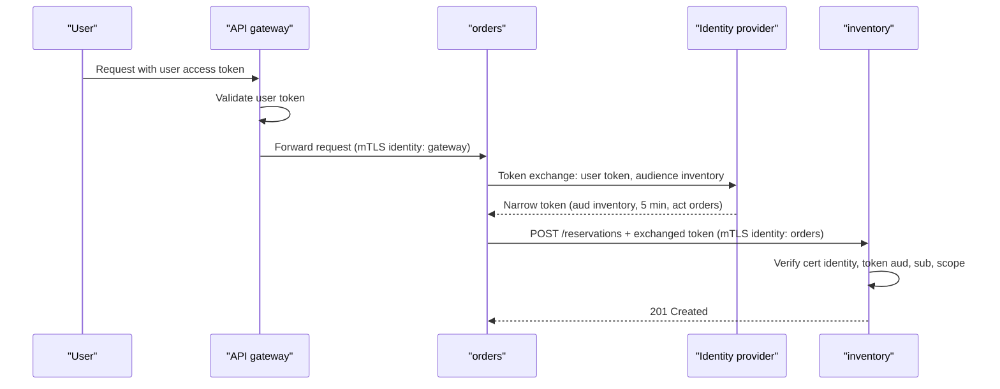

# Service-to-Service Authentication

> [!TIP]
> **In one line:** Inside a microservice system every call must prove which service is calling and be checked against what that service may do, because being on the internal network proves nothing.
>
> **In plain English:** A company badge reader on every office door, not just the lobby, is safer than trusting anyone who got past reception. Services need to show a badge to each other, and each door decides which badges may enter.
>
> **You'll be able to:** explain mTLS, workload identity (SPIFFE) and signed service tokens, and when each fits · choose between propagating a user token and exchanging it for a narrower one · validate a service token with correct audience, issuer and algorithm checks

## Why This Matters

In a monolith, "who is calling this function?" is answered by the language: it is another function in the same process. Once the functions become services, each internal endpoint is an HTTP or gRPC port that anything on the network can try to call. The old defence was a perimeter: put everything in a private network, firewall it from the internet, and treat any request that arrives from inside as trusted. That model has a well-known failure: the first time an attacker lands anywhere inside (a vulnerable dependency, a compromised build runner, a server-side request forgery bug that makes a public service fetch an internal URL), the whole system trusts them. This is lateral movement, and flat internal trust makes it easy.

The modern stance is **zero trust**, or more modestly, "never trust the internal network": authenticate every call, authorise it against the specific caller's identity, and encrypt traffic in transit. In a system with dozens of services, this has to be automatic and uniform, or it will be done inconsistently and fail in the gaps.

This chapter covers service identity and the credentials services use to prove it. It builds on user-facing authentication and authorisation in [Part 5](../05-authentication-authorization/README.md), on JWT fundamentals (see `../05-authentication-authorization/jwt-deeply-explained.md`), and on the edge role of the API gateway (see `api-gateway.md`), which authenticates *users* and then hands off to internal services.

## Core Concept

Two separate questions arise on every internal call, and conflating them causes most design mistakes:

1. **Who is the calling service?** (service identity, also called workload identity). The `orders` service calling `inventory` must prove it is `orders`, not some other pod or an attacker's script.
2. **On whose behalf is it acting?** (end-user context). `orders` may be handling Alice's request; should `inventory` know that, and should it limit what `orders` can do to what Alice may do?

Service identity gives **authentication of the workload**. User context gives **authorisation scope** so that a compromised or buggy service cannot, for example, read every user's data simply because it is allowed to talk to the database service.

There are three mainstream mechanisms for service identity:

- **Mutual TLS (mTLS).** Both sides present X.509 certificates during the TLS handshake. The server verifies the client's certificate against a trusted certificate authority (CA), and vice versa. Identity lives in the certificate (a name in the Subject Alternative Name field), authentication happens at the transport layer before any request bytes are read, and the channel is encrypted.
- **Signed service tokens.** The caller sends a signed token (typically a JWT) in the `Authorization` header. The callee verifies the signature, issuer, expiry and, crucially, the **audience** (that the token was minted for *this* service). Tokens carry claims (caller identity, scopes) and can carry user context.
- **Platform identity.** The cloud or orchestrator vouches for the workload (Kubernetes service account tokens, cloud IAM roles for workloads) and issues credentials automatically, which then feed into the two mechanisms above.

**SPIFFE** (Secure Production Identity Framework For Everyone) is a standard for naming and issuing workload identity, so you do not invent a scheme per cluster. A workload's identity is a **SPIFFE ID**, a URI such as `spiffe://prod.example.com/ns/shop/sa/orders`. It is delivered as a short-lived **SVID**, either an X.509 certificate (with the SPIFFE ID in the URI SAN) or a JWT. The reference implementation, SPIRE, attests workloads (verifying "this really is the orders pod" using platform evidence) and rotates SVIDs automatically, often every hour or less. Service meshes such as Istio and Linkerd implement the same idea in their own control planes.

## Mental Model

Consider a secure office building shared by many companies. The lobby has a guard (the API gateway, checking visitors, who are users). But inside, every floor, lab and server room has its own badge reader. Employees (services) carry badges issued by the building's security office (the CA or identity provider). The badge says who you are, expires every day, and is reissued automatically when you re-scan at the front. A door does not just check "is this a valid badge?" but "is this badge on my access list?" (authorisation), and an additional printed slip, "visiting on behalf of Alice, room 12 only", is the user context that narrows what the employee may do for this particular errand.

Stolen badges are a risk, which is why they are short-lived, and why no single employee's badge opens every door.

## How It Works

**mTLS in detail.** In ordinary TLS only the server proves its identity. In mTLS, the server also sends a `CertificateRequest`, and the client replies with its certificate and proves possession of the private key. The server validates the chain to a trusted CA, checks validity dates and revocation (in practice, by using very short certificate lifetimes instead of CRLs), and extracts the identity from the SAN. It then makes an authorisation decision: "may `spiffe://.../sa/orders` call `POST /reservations`?". Key operational facts: you need a CA and automated issuance and rotation (manual certificates expire and cause outages), the private key never leaves the workload, and a compromised key is useful only until its short expiry. mTLS is usually *terminated by a sidecar or proxy* (Envoy in a mesh), so application code never touches certificates and instead receives the verified caller identity in a header or via the connection metadata. That header is only trustworthy if the application accepts connections solely from the local proxy.

**Signed service tokens in detail.** A service obtains a token from an identity provider using its own credentials (OAuth 2.0 *client credentials* grant, see [Part 5](../05-authentication-authorization/README.md), or a platform-issued token), caches it until shortly before expiry, and sends it as `Authorization: Bearer ...`. The callee verifies:

- the **signature**, with an algorithm *you* pin (never trust the token's `alg` header to choose, and never accept `none`),
- `iss` (issuer is your identity provider),
- `aud` (**audience**: the token names *this* service; a token minted for `inventory` must be rejected by `billing`),
- `exp` and `nbf` with small clock-skew allowance,
- `sub` or `azp` identifying the caller, followed by an authorisation check on that identity and on `scope`.

The audience check is the one most often forgotten and is what stops a compromised low-value service from replaying a token it received to call a high-value one.

**Propagating user context: pass-through versus exchange.** When Alice's request enters at the gateway with her access token, there are two ways to carry her identity deeper:

- **Token propagation**: forward Alice's original token to every downstream. Simple, but it is a *bearer* credential: every service in the chain can replay it to anything that accepts it, its audience is the edge rather than the internal services, and one compromised service can impersonate Alice broadly until expiry.
- **Token exchange** (OAuth 2.0 Token Exchange, RFC 8693): the calling service presents Alice's token to the identity provider and receives a **new, narrower token**: audience set to the next service, scopes reduced, short lifetime, and a record of the acting service (the `act` claim) alongside the subject. Each hop gets a token meant only for that hop. More moving parts and an extra network call, but it limits blast radius and keeps a clear delegation trail.

A pragmatic split is common: use mTLS (or platform identity) to authenticate *which service* is calling, and put user context in a separate, signed, short-lived token or claims set, so that service identity and user identity are verified independently.

**Authorisation.** Authentication alone is useless if every authenticated service can call everything. Maintain an explicit allow-list: which caller identities may call which endpoints, enforced either in the mesh policy (`orders` may `POST` to `inventory` `/reservations`) or in the service, with the finer, resource-level checks (does Alice own this order?) always in the service itself. Deny by default.

## Architecture



## Request / Response Example

A service obtains its own token with the client credentials grant (secrets come from the environment or a secret manager, never source code):

```http
POST /oauth/token HTTP/1.1
Host: idp.internal
Content-Type: application/x-www-form-urlencoded
Authorization: Basic <base64 of client_id:client_secret>

grant_type=client_credentials&audience=inventory&scope=reservations%3Awrite
```

```json
{
  "access_token": "eyJhbGciOiJFUzI1NiIsImtpZCI6ImsxIn0...",
  "token_type": "Bearer",
  "expires_in": 300
}
```

Decoded payload of that token:

```json
{
  "iss": "https://idp.internal",
  "sub": "spiffe://prod.example.com/ns/shop/sa/orders",
  "aud": "inventory",
  "scope": "reservations:write",
  "iat": 1768041600,
  "exp": 1768041900
}
```

Token exchange on behalf of a user (RFC 8693):

```http
POST /oauth/token HTTP/1.1
Host: idp.internal
Content-Type: application/x-www-form-urlencoded

grant_type=urn:ietf:params:oauth:grant-type:token-exchange
&subject_token=<alice's access token>
&subject_token_type=urn:ietf:params:oauth:token-type:access_token
&audience=inventory
&scope=reservations:write
```

A call that fails the audience check is a 401 (credential not acceptable) while a valid credential for a caller not on the allow-list is a 403:

```http
HTTP/1.1 403 Forbidden
Content-Type: application/json

{"error": "forbidden", "detail": "caller 'billing' may not call POST /reservations"}
```

## Code Example

A FastAPI dependency for the callee that verifies a service JWT with PyJWT: pinned algorithm, issuer, audience, and an allow-list of caller identities per scope. A small client helper shows token caching.

```python
"""Callee-side verification of service tokens, plus a caching token client."""
import asyncio
import os
import time

import httpx
import jwt  # PyJWT
from fastapi import Depends, FastAPI, HTTPException, Request

ISSUER = os.environ["IDP_ISSUER"]                      # e.g. https://idp.internal
JWKS_URL = os.environ["IDP_JWKS_URL"]
AUDIENCE = "inventory"                                 # this service's own name
ALLOWED_CALLERS = {                                    # deny by default
    "spiffe://prod.example.com/ns/shop/sa/orders": {"reservations:write"},
}

_jwks = jwt.PyJWKClient(JWKS_URL, cache_keys=True)     # caches keys, refetches on unknown kid


async def verify_service_token(request: Request) -> dict:
    auth = request.headers.get("authorization", "")
    scheme, _, token = auth.partition(" ")
    if scheme.lower() != "bearer" or not token:
        raise HTTPException(401, "missing bearer token", headers={"WWW-Authenticate": "Bearer"})
    try:
        # PyJWKClient does blocking I/O on a cache miss, so keep it off the event loop.
        key = await asyncio.to_thread(_jwks.get_signing_key_from_jwt, token)
        claims = jwt.decode(
            token,
            key.key,
            algorithms=["ES256"],                      # pin it; never read alg from the token
            audience=AUDIENCE,                         # rejects tokens minted for other services
            issuer=ISSUER,
            leeway=30,                                 # seconds of clock skew
            options={"require": ["exp", "iat", "sub", "aud", "iss"]},
        )
    except jwt.PyJWTError:
        raise HTTPException(401, "invalid token", headers={"WWW-Authenticate": "Bearer"})
    return claims


def require_scope(scope: str):
    async def dep(claims: dict = Depends(verify_service_token)) -> dict:
        granted = ALLOWED_CALLERS.get(claims["sub"], set())
        token_scopes = set(str(claims.get("scope", "")).split())
        if scope not in granted or scope not in token_scopes:
            raise HTTPException(403, "caller not allowed")
        return claims
    return dep


app = FastAPI()


@app.post("/reservations", status_code=201)
async def reserve(claims: dict = Depends(require_scope("reservations:write"))):
    return {"reserved_by": claims["sub"]}


class TokenClient:
    """Caller side: fetch a client-credentials token and reuse it until near expiry."""

    def __init__(self, audience: str, scope: str) -> None:
        self._audience, self._scope = audience, scope
        self._token: str | None = None
        self._expires_at = 0.0
        self._lock = asyncio.Lock()

    async def get(self) -> str:
        if self._token and time.monotonic() < self._expires_at - 30:
            return self._token
        async with self._lock:                         # one refresh at a time
            if self._token and time.monotonic() < self._expires_at - 30:
                return self._token
            async with httpx.AsyncClient(timeout=3.0) as client:
                resp = await client.post(
                    f"{ISSUER}/oauth/token",
                    auth=(os.environ["CLIENT_ID"], os.environ["CLIENT_SECRET"]),
                    data={"grant_type": "client_credentials",
                          "audience": self._audience, "scope": self._scope},
                )
            resp.raise_for_status()
            body = resp.json()
            self._token = body["access_token"]
            self._expires_at = time.monotonic() + body["expires_in"]
            return self._token
```

If you use mTLS directly rather than through a mesh, uvicorn can require client certificates with `--ssl-certfile`, `--ssl-keyfile`, `--ssl-ca-certs` and `--ssl-cert-reqs 2` (require). On the client side, httpx accepts `cert=("client.pem", "client.key")` and `verify="ca.pem"`. The mechanics are simple; the hard part is automated issuance and rotation, which is why most teams delegate it to a mesh or SPIRE.

## Production Considerations

- **Automate rotation.** Short-lived credentials (minutes to hours) limit the damage of theft, but only work if issuance and renewal are automatic and reload without restarts. Expiring certificates are a classic outage cause.
- **Where to terminate mTLS.** A mesh sidecar or node-level proxy centralises certificates and policy and works for any language, at the cost of operational complexity and latency overhead. In-app mTLS has no extra hop but must be implemented per language.
- **Protect the identity provider and CA.** They are the root of trust and a high-value target. Keep root keys offline, use intermediate CAs, audit issuance, and make the IdP highly available because it is on the call path.
- **Separate identity from authorisation.** Maintain the allow-list as reviewed configuration (mesh policy as code), deny by default, and log every denial.
- **Protect secrets.** Client secrets and private keys come from a secret manager or platform identity, never from source code or images (see [Part 10](../10-api-security/README.md)). Prefer workload identity that needs no long-lived secret at all.
- **Cache keys and tokens correctly.** Cache the JWKS and refetch on an unknown `kid` (supporting rotation), cache tokens until shortly before expiry, and handle IdP outages by serving cached tokens until they expire.
- **Defence in depth.** Network policies still help (a service that never needs to talk to the billing database should not be able to reach it), but as an addition to authentication, not a substitute.
- **Audit and trace.** Log caller identity and user subject on every sensitive operation, tied to a trace id (see [Part 12](../12-observability/README.md)).

## Common Mistakes

- **"It's internal, so no auth."** One foothold then exposes everything.
- **Skipping the audience check.** Any token from the same issuer is accepted, so a token stolen from a low-privilege service opens a high-privilege one.
- **Letting the token pick the algorithm.** Accepting `none` or switching RS/HS algorithms has caused real vulnerabilities; pin the algorithm.
- **Forwarding the user's token everywhere.** Every service becomes a place from which the user can be impersonated.
- **Trusting identity headers.** A `X-Caller-Service` header is just text unless the app only accepts traffic from the proxy that sets it and the proxy strips client-supplied copies.
- **Long-lived shared secrets.** A static API key shared among services cannot say *which* service called and is rarely rotated.
- **Authentication without authorisation.** Every authenticated service can call every endpoint.

## Best Practices

- Give every workload its own identity (one per service, ideally per environment), never a shared credential.
- Use mTLS or platform identity for transport-level service authentication, and signed, audience-scoped tokens when you need claims or user context.
- Prefer token exchange (narrow, short-lived, per-hop) over forwarding the original user token, especially across trust boundaries.
- Keep credentials short-lived and rotated automatically.
- Enforce deny-by-default authorisation per caller and per endpoint, and keep resource-level checks inside the service.
- Test the failure cases: expired token, wrong audience, wrong issuer, unknown caller, expired certificate.

## AI Engineering Perspective

Agent systems make service-to-service authentication more important and harder. An agent calls tools, often other services or MCP servers (see [Part 17](../17-ai-agents-and-mcp/README.md)), and it does so with arguments generated by a model that can be manipulated by prompt injection. A tool server should therefore authenticate the *agent runtime* as a workload and authorise the *end user* it acts for, with the narrowest scope that task needs: token exchange per tool call, with a short lifetime, is a direct fit. Otherwise a single injected instruction can use the agent's broad credential to read or modify data the user never could.

LLM gateways (see [Part 14](../14-ai-api-engineering/README.md)) add another credential type: provider API keys. Keep those only in the gateway, give internal services gateway-issued, per-service tokens with budgets and scopes, and attribute every model call to a caller identity so cost and abuse are traceable. This is the same pattern as service tokens, applied to a metered, expensive resource.

## Exercises

**Beginner**
1. List three attacks that become possible if services trust any request coming from inside the private network.

**Intermediate**
2. A token minted for audience `inventory` is accepted by the `billing` service because it only checks the signature and issuer. Describe the attack, and show the one-line change to `jwt.decode` that closes it.

**Advanced**
3. Design identity and authorisation for a flow in which the gateway receives a user token, `orders` calls `inventory`, and `inventory` calls `warehouse`. Decide where you use mTLS, where you use token exchange, what each token's audience and lifetime are, and how `warehouse` can tell both which service and which user are involved.

## Key Takeaways

- Never trust the internal network: authenticate and authorise every service-to-service call.
- mTLS authenticates workloads at the transport layer; signed tokens carry claims and must be validated for signature, issuer, expiry and audience.
- Separate "which service is calling" from "on whose behalf", and prefer narrow, short-lived exchanged tokens over forwarding the user's token.
- Short-lived, automatically rotated credentials and deny-by-default policy contain the damage of a compromise.

### Check Yourself
<details markdown="1">
<summary>1. What does the `aud` (audience) claim protect against?</summary>

It ensures a token minted for one service is not accepted by another. Without checking it, a token captured by or issued to a low-privilege service could be replayed against a high-privilege one that trusts the same issuer.

</details>

<details markdown="1">
<summary>2. Why is token exchange safer than forwarding the user's original access token to every downstream service?</summary>

The forwarded token is a bearer credential valid everywhere its issuer is trusted, so any compromised service can replay it. An exchanged token is scoped to one audience with reduced scopes and a short life, and records which service acted, limiting damage and keeping an audit trail.

</details>

<details markdown="1">
<summary>3. A certificate used for mTLS expired at 03:00 and calls between two services started failing. What process gap does this reveal, and what would you change?</summary>

Certificate issuance and rotation were not automated or monitored. Use short-lived certificates issued and renewed automatically (a mesh or SPIRE), reload without restart, and alert well before expiry.

</details>

---
Back to the [Part 11 README](README.md).
