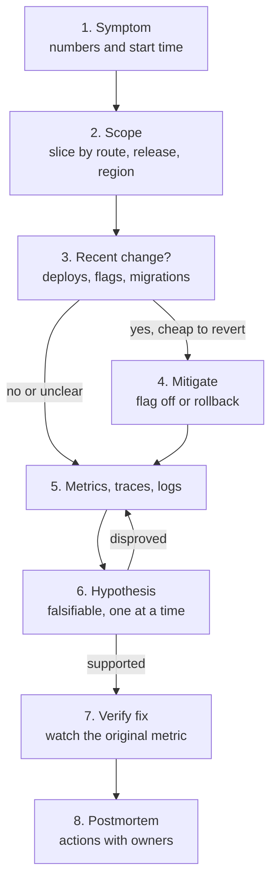

# Debugging Production APIs

> [!TIP]
> **In one line:** Debug production with a fixed order: define the symptom, narrow the scope, check what changed, mitigate first, then use metrics, traces and logs to test one hypothesis at a time.
>
> **In plain English:** It is like a doctor handling an emergency. First stop the bleeding, then ask where it hurts, what changed recently, and which tests will tell the possible causes apart, instead of guessing and operating on a hunch.
>
> **You'll be able to:** triage an incident from symptom to scope to recent change · decide between rollback, feature flag and fix-forward · move from metrics to traces to logs · run a blameless postmortem

## Why This Matters

Debugging production is not debugging on your laptop. You cannot pause the process, you may not reproduce the failure, real customers are affected while you think, and the most tempting actions (restarting things, editing config live, adding debug logging everywhere) are the ones that destroy evidence or make things worse. Under stress, engineers pattern-match to the last outage and chase it. A method protects you from that. It does two things: it shortens *time to mitigation* (ending the user pain), which is a different and more important number than time to root cause, and it makes the investigation reproducible so that someone else can pick it up at shift change.

The earlier chapters of this part supply the instruments: [Metrics](metrics.md) tell you something is wrong and how widely, [Tracing](tracing.md) tells you where in the request the time or failure sits, [Structured Logging](structured-logging.md) with [Request IDs](request-ids.md) tells you the details, [Error Monitoring](error-monitoring.md) groups the exceptions, and [SLI, SLO, SLA](sli-slo-sla.md) tells you how urgent it is. This chapter is the procedure for using them together.

## Core Concept

The method, in order:

1. **Symptom.** State it precisely, with numbers and a start time: "checkout p95 went from 90 ms to 6 s and overall 5xx rose from 0.1% to 3% starting about 14:03 UTC" beats "the site is slow". Confirm it is real (not a monitoring glitch, not one customer's network) and find out who reported it.
2. **Impact and scope.** How many users, which part? Slice the symptom by the dimensions your telemetry has: route, status class, release/version, region and zone, host or pod, tenant, client version, dependency. The goal is to find the dimension on which the problem *concentrates*. "Everything is slow" and "only `POST /checkout` on release 2026.11.3" lead to completely different investigations. A problem that appears on every dimension equally points to something shared (database, network, a global dependency); one that concentrates on one value points at that value.
3. **Recent change.** Most incidents follow a change: a deploy, a config or flag change, a schema migration, a dependency upgrade, a certificate or credential expiry, a traffic shift, an upstream vendor change, or a scheduled job. Overlay change events (deploys, flag flips, migrations) on your graphs. If the onset aligns with a change within a few minutes, that is your leading suspect, but correlation is not proof, so keep verifying.
4. **Mitigate first.** If a recent change is the suspect and reverting it is cheap and safe, revert before understanding. Prefer, in order: **feature-flag off** (seconds, no deploy), **rollback** to the last known good release (minutes; check that database migrations are backward-compatible), **traffic shift or failover**, **load shedding or rate limiting** to protect the rest, **scale out** only if the bottleneck is truly capacity, and only then **fix forward**. Mitigation buys time to investigate calmly, and the revert itself is evidence: if the symptom disappears, you have confirmed the cause. Announce what you are doing in the incident channel before you do it.
5. **Metrics, then traces, then logs.** Move from wide to narrow. Metrics give the shape and scope (rate, errors, duration, saturation, by dimension). Traces show, for a *specific slow or failed request*, where the time went and which dependency failed: pick an exemplar from the bad group and descend the waterfall. Logs, found via the request or trace ID, give the exact error and the surrounding detail. Each step narrows the next, which is far cheaper than grepping raw logs from the start.
6. **Hypothesis.** Write one explicit, falsifiable sentence: "Checkouts hold a DB connection while calling the fraud service, so the pool is exhausted." Then ask what you would *expect to see* if it is true (pool wait gaps in traces, pool-timeout errors, connection use near the limit) and look for exactly that, and for evidence against it. One change or test at a time; if you change three things and it recovers, you have learned nothing.
7. **Verify and monitor the fix.** Watch the same metric you started with until it is back to baseline for long enough to trust it, and watch for secondary effects (retries storm, backlog draining, cache cold start).
8. **Postmortem.** Blameless, written within days: timeline, impact, root and contributing causes, what went well, where you got lucky, and action items with owners. The most valuable items improve detection (why did customers tell us first?), mitigation speed (could the flag have been automatic?), and prevention (what test or canary would have caught it?).

**Reproduce safely.** Prefer, in order: reasoning from telemetry alone; replaying sanitised traffic against staging; sending a synthetic request flagged with a test header to one canary instance; and only last, targeted interactive inspection. Use **read-only** access by default (read replicas, read-only roles, log and trace viewers); never make ad-hoc writes without a second person and an audit trail; use time-limited, logged **break-glass** access; and do not enable DEBUG logging for all traffic mid-incident, since it can overload the logging pipeline. Raise the level for one instance or one request ID instead. Sampling profilers such as py-spy are low overhead and out-of-process, unlike debuggers that pause the process.

**Common cognitive traps.** Anchoring on the first theory, blaming the last unrelated deploy, saying "it is probably the database" before checking its saturation metric, trusting averages that hide a bimodal distribution, and mistaking a downstream symptom for the cause (the first error in time on the critical path is usually closer to the root). A second person asking "what would disprove this?" is the cheapest cure.

## Mental Model

Think of an air-traffic investigation done *while the plane is still in the air*. The first job is not to find out why the engine failed; it is to keep the plane flying, using the checklist (flag off, rollback). Only after the aircraft is stable does the crew open the flight recorder (logs), the maintenance history (recent changes) and the instrument panel (metrics) to work out what happened, and they write it up afterwards so the next crew benefits. The checklist exists precisely because people reason badly under pressure.

## How It Works

**The loop in practice.** Each pass of the loop consumes a few minutes: pick a dimension, slice, observe, decide. Keep a running, timestamped incident log in the channel (what you saw, what you tried, what happened); it doubles as the raw material for the postmortem and lets a newcomer join without interrupting you. Assign roles for anything beyond a trivial incident: one **incident commander** who coordinates and decides, one or two **investigators**, and a **communicator** who updates stakeholders; this prevents five people from independently restarting things.

**Useful questions per signal.** Metrics: which route, status, release or region concentrates the problem, what is saturated (CPU, connections, queue depth), and what else started at the same minute? Traces: which span is widest, is there *empty space* between spans (waiting for a pool connection, a lock or the event loop), which span first carries the error, and how does it compare to a fast trace of the same route? Logs: search by `request_id` or `trace_id`, not timestamp, and read the first error of a burst.

**Don't forget the boring causes.** Expired certificates and tokens, full disks, exhausted file descriptors, DNS changes, a cron job at the top of the hour, and retry storms that amplify a small failure. A "change" can be the calendar.

**Worked incident (a composite, with realistic numbers).** An orders API has 8 replicas, about 1,200 requests per second in total, of which checkout is about 60 per second (5%), and an SLO of 99.9% availability.

- **14:02** Release 2026.11.3 starts rolling out, finishing at 14:06. It adds a synchronous call to a new fraud-scoring service. The change is behind a feature flag, `fraud_precheck`, default on.
- **14:08** A burn-rate alert pages the on-call engineer: overall 5xx at 3.0% over 5 minutes against an allowed 0.1%, a burn rate of about 30 (the monthly budget would be gone in about 24 hours at that rate). The engineer acknowledges, opens an incident channel, and writes the symptom: "5xx 3.0%, started about 14:03."
- **14:09 Scope.** Slicing the 5xx rate by route shows `POST /checkout` at about 60% failing while all other routes stay under 0.1%. By region: equal in both. By release: failures only on 2026.11.3 (which is by now on all replicas, so the release split is only visible through the access logs; the script below produces it). Conclusion: the problem is specific to one route and the new release.
- **14:10 Recent change.** The deploy marker on the dashboard sits at 14:02, one minute before the first errors and six before the page. Leading suspect: 2026.11.3.
- **14:11 One trace.** A latency exemplar from the p99 panel opens a 5.4 s trace. The `POST /checkout` span has a 3.1 s gap at the start before the first database span, followed by a 2.1 s `fraud_check` CLIENT span. The empty 3.1 s is not any traced operation. Logs for that trace ID show `TimeoutError: QueuePool limit of size 10 overflow 0 reached, connection timed out, timeout 5.00`. Hypothesis: the pool is exhausted because the transaction is held open during the fraud call.
- **14:12 Mitigate.** Rolling back would take about 8 minutes through the pipeline; the flag flip takes seconds. The engineer announces "turning off `fraud_precheck`" and does so.
- **14:15** The checkout 5xx rate falls to 0.4% and p95 to 95 ms; the queue of waiting requests drains. The incident is mitigated: customer impact lasted about 12 minutes (14:03 to 14:15), detection took 5 minutes, mitigation 4 minutes after the page.
- **Why the arithmetic works (Little's law: connections in use = arrival rate x time held).** Before: 60 checkouts/s x 0.05 s held = 3 connections busy. After: 60/s x 2.1 s = 126 connections needed, against a capacity of 8 replicas x 10 = 80. Maximum sustainable throughput is 80 / 2.1, about 38 checkouts/s, so roughly 37% of checkout demand cannot be served in steady state; waiting requests then hit the 5 s pool timeout, clients retry, and the observed failure share is higher than 37%.
- **Follow-up (next day).** Move the fraud call outside the transaction, add a pool-wait metric and alert, add a load test with a slow fraud dependency, and give the new call a 500 ms timeout with a fail-open policy.

## Architecture



Note that mitigation comes before root-cause confirmation when a revert is cheap, and that the loop between hypothesis and evidence repeats until one survives.

## Request / Response Example

The incident from the narrative as seen by one customer, and what the engineer found with the request ID. The customer's failed call:

```http
POST /checkout HTTP/1.1
Host: api.example.com
Content-Type: application/json
traceparent: 00-4bf92f3577b34da6a3ce929d0e0e4736-00f067aa0ba902b7-01

{"cart_id": "c_5521", "payment_method": "pm_1"}
```

```http
HTTP/1.1 500 Internal Server Error
Content-Type: application/json
X-Request-ID: 7f2c91d0a4b84e3c9d51a6b2e0c4f188

{"error": {"code": "internal_error", "request_id": "7f2c91d0a4b84e3c9d51a6b2e0c4f188"}}
```

Searching the log store for that `request_id` gives the story in order (service, release and trace fields trimmed for space):

```json
{"timestamp":"2026-11-10T14:09:41.102Z","level":"info","event":"checkout_started","request_id":"7f2c91d0a4b84e3c9d51a6b2e0c4f188","release":"2026.11.3"}
{"timestamp":"2026-11-10T14:09:46.109Z","level":"error","event":"request_failed","request_id":"7f2c91d0a4b84e3c9d51a6b2e0c4f188","error_type":"TimeoutError","error":"QueuePool limit of size 10 overflow 0 reached, connection timed out, timeout 5.00","duration_ms":5007}
```

Five seconds between the two lines, equal to the pool timeout, is the signature: the request spent its whole life waiting for a connection and never reached the database.

## Code Example

Mitigation and analysis both want *read-only* tools you can run immediately. This script slices JSON access logs by any fields (route, release, region, status class) and prints request count, 5xx percentage and latency percentiles, which is step 2 (scope) of the method. It uses only the standard library, reads from stdin, tolerates torn lines, and writes nothing. Run on a synthetic log shaped like the incident it printed:

```text
route / release                             reqs   5xx %   p50 ms   p95 ms
/checkout / 2026.11.3                        415    60.5     4954     6360
/orders/{id} / 2026.11.2                    1034     0.0       60       86
/orders/{id} / 2026.11.3                    2024     0.0       60       85
/checkout / 2026.11.2                        210     0.0       61       83
/search / 2026.11.3                         1561     0.0       60       85
/search / 2026.11.2                          756     0.0       60       85
```

The single hot row is the concentration the method looks for: one route, one release.

```python
"""Scope an incident from JSON access logs (read-only, stdlib only).

Usage:
    python dbg.py --by route release < access.jsonl
    python dbg.py --by region --since 2026-11-10T14:00:00Z < access.jsonl
Each line is expected to look like:
    {"timestamp": "...Z", "route": "/checkout", "status": 200, "duration_ms": 41.2,
     "release": "2026.11.2", "region": "eu-1"}
"""
import argparse
import json
import math
import sys
from collections import defaultdict


def percentile(sorted_values: list[float], p: float) -> float:
    """Nearest-rank percentile on an already sorted list."""
    if not sorted_values:
        return float("nan")
    rank = max(1, math.ceil(p / 100 * len(sorted_values)))
    return sorted_values[rank - 1]


def main() -> None:
    ap = argparse.ArgumentParser()
    ap.add_argument("--by", nargs="+", required=True, help="fields to group by")
    ap.add_argument("--since", default="", help="ISO timestamp lower bound (string compare)")
    args = ap.parse_args()

    groups: dict[tuple, dict] = defaultdict(lambda: {"n": 0, "err": 0, "dur": []})
    skipped = 0
    for line in sys.stdin:
        try:
            ev = json.loads(line)
        except json.JSONDecodeError:
            skipped += 1          # never crash on a torn or partial line during an incident
            continue
        if args.since and ev.get("timestamp", "") < args.since:
            continue
        key = tuple(str(ev.get(f, "-")) for f in args.by)
        g = groups[key]
        g["n"] += 1
        g["err"] += 1 if int(ev.get("status", 0)) >= 500 else 0   # only 5xx count against us
        if "duration_ms" in ev:
            g["dur"].append(float(ev["duration_ms"]))

    print(f"{' / '.join(args.by):40} {'reqs':>7} {'5xx %':>7} {'p50 ms':>8} {'p95 ms':>8}")
    for key, g in sorted(groups.items(), key=lambda kv: -kv[1]["err"] / max(kv[1]["n"], 1)):
        d = sorted(g["dur"])
        print(f"{' / '.join(key):40} {g['n']:>7} {100 * g['err'] / g['n']:>7.1f} "
              f"{percentile(d, 50):>8.0f} {percentile(d, 95):>8.0f}")
    if skipped:
        print(f"(skipped {skipped} unparsable lines)", file=sys.stderr)


if __name__ == "__main__":
    main()
```

Two practical notes. First, percentiles here are computed with the nearest-rank method on the full sample, which is fine for an incident window of up to a few hundred thousand lines; for larger volumes use your log store's aggregation instead. Second, adding `--since` limits the window so you compare "after" to "before"; always run the same query for a healthy baseline, because a number without a baseline cannot be called abnormal.

## Production Considerations

- **Prepare before you need it.** Dashboards that slice by route, status class, release and region; deploy and flag-change markers on every graph; trace exemplars on latency histograms; request and trace IDs in logs and error bodies; and runbooks for the top failure modes. None of these can be built during the incident.
- **Make mitigation cheap.** Feature flags with a kill switch for every risky change, one-command rollbacks, a documented way to shed load, and progressive delivery (canary, then 10%, then 100%) so a bad release hits few users first and can auto-roll-back on SLO burn.

## Common Mistakes

- **Starting with logs.** Grepping raw logs without a scope is slow and misleading; slice with metrics and use traces to pick the request to read.
- **Investigating before mitigating** when a revert was cheap, extending customer impact for the sake of curiosity.
- **Changing several things at once**, then being unable to say what fixed it (or what made it worse).
- **Restarting first.** It sometimes helps, but it destroys evidence and hides the cause until it returns at 3 a.m.
- **Trusting averages** and single-sample anecdotes instead of percentiles and distributions.
- **Closing without follow-through**, with no owner or due date on the actions.

## Best Practices

- Write the symptom in numbers with a start time, and keep a timestamped incident log.
- Scope by slicing; look for the dimension where the problem concentrates before forming theories.
- Always check "what changed?" and put change events on the graphs; mitigate with the cheapest safe revert, announced first.
- Go metrics, then traces, then logs, and carry the request or trace ID between them.
- State one falsifiable hypothesis, predict the evidence, test it, and change one thing at a time.
- Default to read-only access, sanitised data and sampling profilers; use break-glass for anything else and log it.
- Hold blameless postmortems with owned action items focused on detection, mitigation and prevention.

## AI Engineering Perspective

Incidents in AI systems add failure modes that classic dashboards do not show: model-provider latency or rate limits, a silent change in a model version that alters output format, prompt or retrieval changes that degrade quality while every status code stays 200, and cost runaways from agent loops. The same method applies, with extra dimensions to slice on: model and version, prompt template version, tenant, feature, whether retrieval returned results, and finish reason. Treat prompt and model changes as deploys: put them behind flags, version them, mark them on graphs, and be able to roll them back within seconds. Because quality regressions are not errors, add outcome signals (schema-validity rate, refusal rate, user thumbs-down rate, evaluation scores on a sampled shadow set) as SLIs so that "the answers got worse at 14:00" is visible. See [Part 15](../15-production-ai-systems/README.md) for gateways, fallbacks and cost controls, and [Part 17](../17-ai-agents-and-mcp/README.md) for agent failure modes.

## Exercises

**Beginner**
1. Rewrite "the API is slow" as a precise symptom statement with a metric, a magnitude and a start time, using made-up numbers.
2. Run the script on a log file of your own (or the synthetic one) grouped by `route` and by `release`, and say which grouping reveals the problem.

**Intermediate**
3. For each of these, write the cheapest safe mitigation and what would tell you it worked: a bad deploy, a bad feature flag, a failing downstream dependency, a runaway client in a retry loop.
4. Using Little's law, compute the connections needed by an endpoint at 40 requests/s that holds a connection for 0.8 s, and compare with a pool of 6 replicas x 10 connections.

**Advanced**
5. Design a deploy pipeline with canary analysis that automatically rolls back when the canary's 5xx rate or p95 latency is worse than baseline, and state the false-positive risks.
6. Write a blameless postmortem for the worked incident, with timeline, contributing causes (including why detection took 5 minutes), and five action items with owners and dates.

## Key Takeaways

- Follow the order: symptom, scope, recent change, mitigate, then metrics, traces, logs, and a falsifiable hypothesis tested one change at a time.
- Time to mitigation matters more than time to root cause; feature flags and rollbacks make mitigation cheap, so build them before you need them.
- Slice by dimension to find where the problem concentrates, and carry request and trace IDs from metric to trace to log.
- Debug production read-only, with sanitised data and audited break-glass access, and finish every incident with a blameless postmortem and owned actions.

### Check Yourself

<details markdown="1">
<summary>1. Why mitigate (for example, turn off a flag) before you have confirmed the root cause?</summary>

Customers are being hurt every minute, and a cheap, safe revert both ends the impact and acts as an experiment: if the symptom disappears, the suspected change is confirmed. Investigation can then continue without time pressure.

</details>

<details markdown="1">
<summary>2. A trace shows a 3 s gap before the first database span, with no span covering it. What does that suggest?</summary>

The request spent that time waiting on something untraced, most commonly a connection-pool checkout, a lock or event-loop contention. Check pool wait metrics and pool-timeout errors in logs for that trace ID.

</details>

<details markdown="1">
<summary>3. All routes and all regions are slow at once, right after no deploy. What does that pattern suggest compared to a single-route failure?</summary>

A problem that shows on every dimension equally points to something shared, such as the database, network, a common dependency or a platform issue, whereas one concentrated on a route or release points to that specific code or change. Check shared saturation metrics and the status of dependencies.

</details>

---
Back to the [Part 12 README](README.md).
