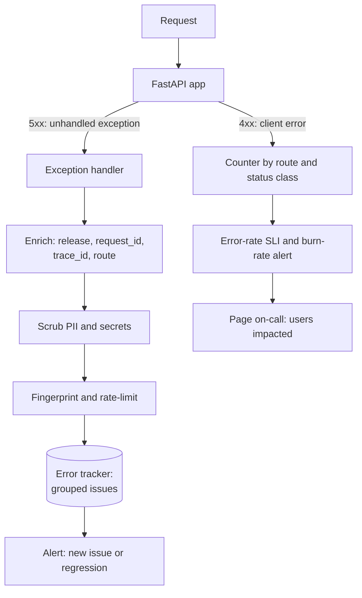

# Error Monitoring

> [!TIP]
> **In one line:** Error monitoring turns individual exceptions into grouped, release-tagged, scrubbed issues, separates client 4xx from server 5xx, and alerts on impact rather than on every occurrence.
>
> **In plain English:** Think of a repair shop's complaint desk. A good desk does not hand the mechanic every angry phone call; it files calls about the same fault into one folder, notes which car model it started with, and only rings the mechanic when many customers are affected.
>
> **You'll be able to:** separate exceptions from error-rate metrics · design fingerprints that group duplicates · tag releases and scrub PII · classify 4xx versus 5xx and avoid alert fatigue

## Why This Matters

Logs and metrics tell you that something is wrong. Neither is good at telling you *what is broken, since when, and for whom* in a form a human can act on. A log search for "error" returns 40,000 lines; a metric says the 5xx rate is 2.3%. Error monitoring fills the gap: it captures each unhandled exception with its stack trace and context, groups the thousands of occurrences into a handful of distinct **issues**, shows when each first appeared (ideally which release introduced it) and how many users it touches, and routes the new or worsening ones to the right owner. Done well it shortens the path from "alert" to "this line, this deploy". Done badly it produces a firehose of duplicate notifications that everyone mutes, and then the one that matters is missed.

This chapter builds on [Logging](logging.md), [Structured Logging](structured-logging.md) and [SLI, SLO, SLA](sli-slo-sla.md): logs are the evidence, the SLO is the yardstick, and error monitoring is the triage layer between them.

## Core Concept

Two related but different things get called "errors", and mixing them is the most common design error.

1. **Error rate (a metric).** The fraction of requests that fail, counted from status codes: `5xx / total`, per route, per release. It is cheap, aggregated, and has constant cost regardless of how many errors occur. It answers "how bad is it right now?" and is what an availability SLI is built from. It cannot tell you why.
2. **Exceptions (events).** Individual captured failures with a stack trace, request context and tags. They answer "what is it and where?". They are costly per event, so trackers rate-limit, deduplicate and group them, and you should not alert on the raw count.

Use both: the metric pages you, the exception tracker explains. A spike in the 5xx rate should link to the top new issues from the same time window and release.

**Grouping and fingerprinting.** A tracker computes a **fingerprint** for each event, and events with the same fingerprint form one **issue**. Default algorithms hash the exception type and the stack trace's in-application frames (function and file, not line numbers or messages with embedded IDs). The goals pull in opposite directions: too coarse and different bugs merge (every `KeyError` becomes one issue); too fine and one bug becomes thousands of issues (because the message contains an order number, or a line number shifted after a refactor). Good practice is to normalise messages (replace numbers and UUIDs), ignore library frames and exclude line numbers, and then override the fingerprint manually for known noisy cases such as database errors whose message embeds a query parameter.

**Release tagging.** Every event carries the `release` (a git SHA or version) and `environment`. That one tag is what answers "did this start with the last deploy?" and powers regression detection ("this issue was resolved in 1.4.2 and appears again in 1.4.5"). It also lets you connect an issue to the commit that touched those lines, and to roll back with confidence.

**Client errors versus server errors.** The status code family carries meaning. **5xx** means the server failed to do something it should have done: that is your bug or your dependency's outage, and it should be captured, alerted and counted against the SLO. **4xx** means the request was wrong (invalid body, missing auth, not found, rate limited): the server worked correctly. 4xx errors should be *counted* (a sudden rise in 401s or 422s often signals a bad client release, an expired credential or an attack), but they should not generate exception reports or page anyone individually. Two cautions: some 4xx are actually your bug in disguise (a 400 caused by your own SDK sending a malformed body, or a 404 because a route was accidentally removed), which is why you watch their *rate by route and client version*, and some 5xx are upstream's fault but still count against your SLO, since the user cannot tell the difference. Whether 429 and 499 (client closed request) count toward your SLI is a decision to document in the SLO, as in [SLI, SLO, SLA](sli-slo-sla.md).

**Alert fatigue.** If every exception pages someone, people learn to ignore pages. Alert on *impact and novelty*, not volume: page when the SLO burn rate is high (users are being hurt), notify a channel when a **new issue** appears or a **resolved issue regresses**, and send everything else to a dashboard or a daily digest. Put thresholds on the number of distinct users or requests affected, not on raw event count (one broken client in a retry loop can send 50,000 identical events).

## Mental Model

Imagine a hospital emergency desk. The triage nurse does not call the surgeon for each patient who sneezes (4xx: the system worked, the visitor was just mistaken); she logs them, and notices if sneezes triple overnight. For real emergencies (5xx), she groups patients by the same cause, so that thirty people from one contaminated buffet are one incident rather than thirty pages; she notes which shift and which menu started it (release tag); she covers patient names on the whiteboard (scrubbing); and she only wakes the surgeon when the number of seriously ill patients crosses a threshold or when a *new* kind of illness appears.

## How It Works

1. **Capture.** An SDK or your own handler catches unhandled exceptions (and optionally logged errors) at the framework boundary. In FastAPI that is an exception handler for `Exception`; background workers and scheduled jobs need their own hooks because they are outside the request path, and a worker that dies silently is a classic blind spot.
2. **Enrich.** Attach `release`, `environment`, request ID ([Request IDs](request-ids.md)), trace ID ([Tracing](tracing.md)), route template, user ID (not e-mail), and feature flags. Enrichment is what turns a stack trace into something you can act on.
3. **Scrub.** Strip or hash personal and secret data *before* the event leaves your process: authorization headers, cookies, request bodies, query strings with tokens, local variables captured in stack frames (some SDKs capture them), and free-text exception messages that embed e-mail addresses. Server-side scrubbing at the vendor is a second layer, not a replacement, since the data has already left your network.
4. **Fingerprint and send.** Compute the group key, send asynchronously with a short timeout and a bounded queue so that an outage of the error tracker cannot slow or break your API. Rate-limit per fingerprint (for example the first 10 events per minute, then a counter) to protect both the tracker and your budget.
5. **Triage.** The tracker shows issues ranked by recent frequency and affected users, with first-seen and last-seen, release, and breadcrumbs (the preceding log lines or events). Owners are assigned by code path or service.
6. **Close the loop.** Resolve in the release that fixes it, so that recurrence reopens the issue automatically. Review "new issue in this release" as part of every deploy; it is the cheapest regression test you have.

Sentry, Rollbar, Bugsnag and cloud-provider equivalents all implement this model, and OpenTelemetry can carry exceptions as span events (`record_exception`) into backends that surface them. You do not need a vendor to understand the mechanics, which is why the code below implements the core ideas directly.

## Architecture



The two paths on the right implement the split described above: the metric-based path decides *whether to page*, the exception path decides *what to look at first*.

## Request / Response Example

A client triggers a bug in the order service. The caller gets an opaque, stable error body containing an identifier they can quote, and no stack trace or internal message:

```http
GET /orders/3003 HTTP/1.1
Host: api.example.com
X-User-Email: ana@example.com
```

```http
HTTP/1.1 500 Internal Server Error
Content-Type: application/json

{"error": {"code": "internal_error", "error_id": "eff5cf893e41"}}
```

The tracker receives one event, grouped with the earlier two failures on orders 1001 and 2002 because the message was normalised and the in-app frames match:

```json
{
  "fingerprint": "eff5cf893e41",
  "type": "KeyError",
  "message": "'price missing for order <n>'",
  "release": "2026.11.3",
  "environment": "production",
  "count": 3,
  "context": {"path": "/orders/3003", "user_email": "[EMAIL]"}
}
```

## Code Example

A self-contained FastAPI module (tested with the TestClient) that shows the mechanics a tracker's SDK performs: normalisation, fingerprinting on in-app frames, scrubbing, release tagging, and 4xx/5xx classification with a per-route outcome counter. In production you would replace `report_exception` with your tracker's client (sending asynchronously with a timeout and bounded queue) and replace the `Counter` with a Prometheus counter.

```python
import hashlib
import os
import re
import traceback
from collections import Counter

from fastapi import FastAPI, HTTPException, Request
from fastapi.responses import JSONResponse
from starlette.exceptions import HTTPException as StarletteHTTPException

RELEASE = os.getenv("APP_VERSION", "dev")
ENVIRONMENT = os.getenv("DEPLOY_ENV", "local")
APP_DIR = os.path.dirname(os.path.abspath(__file__))  # frames under here are "ours"

SENSITIVE = re.compile(r"(password|token|secret|authorization|api[_-]?key)", re.I)
EMAIL = re.compile(r"[\w.+-]+@[\w-]+\.[\w.-]+")
VOLATILE = re.compile(r"\b[0-9a-f]{8}-[0-9a-f]{4}-[0-9a-f]{4}-[0-9a-f]{4}-[0-9a-f]{12}\b|\b\d+\b", re.I)

groups: dict[str, dict] = {}              # fingerprint -> {count, first_release, sample}
request_outcomes: Counter = Counter()     # (route, status_class) -> count, feeds the error-rate SLI


def normalize_message(msg: str) -> str:
    """Replace IDs and numbers so 'order 8842 not found' and 'order 9 not found' group together."""
    return VOLATILE.sub("<n>", msg)


def fingerprint(exc: BaseException) -> str:
    """Group by exception type plus the innermost frames in OUR code, not by message or line numbers."""
    frames = [f for f in traceback.extract_tb(exc.__traceback__) if f.filename.startswith(APP_DIR)]
    key_frames = [f"{os.path.basename(f.filename)}:{f.name}" for f in frames[-2:]]
    raw = "|".join([type(exc).__qualname__, *key_frames]) or type(exc).__qualname__
    return hashlib.sha1(raw.encode()).hexdigest()[:12]


def scrub(context: dict) -> dict:
    out = {}
    for k, v in context.items():
        if SENSITIVE.search(k):
            out[k] = "[REDACTED]"
        elif isinstance(v, str):
            out[k] = EMAIL.sub("[EMAIL]", v)
        else:
            out[k] = v
    return out


def report_exception(exc: BaseException, **context) -> str:
    fp = fingerprint(exc)
    g = groups.setdefault(fp, {"count": 0, "first_release": RELEASE, "sample": None})
    g["count"] += 1
    g["sample"] = {
        "type": type(exc).__qualname__,
        "message": normalize_message(str(exc))[:200],
        "release": RELEASE,
        "environment": ENVIRONMENT,
        "context": scrub(context),
    }
    return fp  # in production: send to your error tracker here (asynchronously, with a timeout)


app = FastAPI()


@app.middleware("http")
async def count_outcomes(request: Request, call_next):
    status = 500  # assume failure: if call_next raises, the generic 500 handler runs outside this middleware
    try:
        response = await call_next(request)
        status = response.status_code
        return response
    finally:
        route = request.scope.get("route")
        path = route.path if route else "unmatched"   # template, e.g. /orders/{order_id}
        request_outcomes[(path, f"{status // 100}xx")] += 1


@app.exception_handler(StarletteHTTPException)
async def http_errors(request: Request, exc: StarletteHTTPException):
    # 4xx is the client's problem: counted above, NOT reported as an exception.
    # A 5xx raised deliberately as HTTPException is ours, so it is reported.
    if exc.status_code >= 500:
        report_exception(exc, path=request.url.path)
    return JSONResponse({"error": {"status": exc.status_code, "detail": exc.detail}}, exc.status_code)


@app.exception_handler(Exception)
async def unhandled(request: Request, exc: Exception):
    fp = report_exception(exc, path=request.url.path, user_email=request.headers.get("x-user-email", ""))
    return JSONResponse({"error": {"code": "internal_error", "error_id": fp}}, status_code=500)


@app.get("/orders/{order_id}")
async def get_order(order_id: int):
    if order_id == 404:
        raise HTTPException(404, "order not found")
    if order_id > 1000:
        raise KeyError(f"price missing for order {order_id}")
    return {"id": order_id}
```

Running three requests that hit the same `KeyError` with different order IDs produced one group with `count: 3`, and the outcome counter showed `('/orders/{order_id}', '5xx'): 3`, `'4xx': 1` for the 404 and `'2xx': 1`. Note two details. The generic `Exception` handler runs in Starlette's outermost error middleware, outside user middleware, so the counting middleware assumes failure (`status = 500`) and counts in a `finally` block; otherwise unhandled exceptions would never be counted and the error-rate SLI would read too healthy. And `request.scope["route"]` is only populated after routing, which is why the template path is read after `call_next`.

## Production Considerations

- **Rate-limit and sample at the source.** A bug in a hot path can emit hundreds of thousands of events per minute. Cap per-fingerprint throughput, and keep the counter even when you drop the detail.
- **Never block on reporting.** Use a bounded in-memory queue and a background sender; on failure, drop and count rather than retry forever. Error reporting must not become the cause of the next outage.
- **Scrub twice.** In-process scrubbing (denylist keys, patterns, no request bodies, no captured local variables by default) plus vendor-side data scrubbing rules. Disable default PII collection such as IP address and user e-mail unless you have a documented need. Many frameworks' default integrations capture headers, so verify what actually leaves.
- **Source maps and symbolication** matter for compiled or minified code; Python traces are readable but ensure release and commit info are present so the tracker can link frames to source.
- **Ownership.** Route issues to teams by code path or service, and define a response expectation (new 5xx issue in production: triaged within one business day, for example).
- **Budget link.** Tie paging to SLO burn rate rather than raw counts. A multi-window burn-rate alert (fast window for severe, slow window for creeping) pages only when the error budget is being consumed meaningfully; see [SLI, SLO, SLA](sli-slo-sla.md). Error-monitoring issues then explain the burn.
- **Retention and compliance.** Events contain stack traces and context that can identify users; apply retention limits and honour deletion requests.
- **Non-HTTP failures.** Capture failures in workers, cron jobs and consumers, and alert on *absence* (a job that should run every hour but has not reported in two hours) since a crashed worker produces no exceptions at all.

## Common Mistakes

- **Alerting on raw exception count** instead of impact, creating pages for one chatty client.
- **Reporting 4xx as exceptions**, drowning real bugs in validation failures and bots.
- **Grouping by message**, so IDs and timestamps in messages create endless distinct issues, or **grouping by type only**, merging unrelated bugs.
- **No release tag**, which makes "what changed?" unanswerable and disables regression detection.
- **Leaking PII and secrets** through exception messages, captured variables, request bodies and breadcrumbs.
- **Counting only handled responses**, so unhandled exceptions are missing from the 5xx rate and the SLI looks better than reality.
- **Swallowing exceptions** (`except Exception: pass`) or logging-and-continuing without reporting, so failures are invisible. Equally, catching an exception, logging it, and re-raising it at every layer reports the same failure repeatedly; report once, where it is finally handled.
- **Ignoring background jobs**, where the worst failures happen quietly.

## Best Practices

- Keep the metric (error rate by route and release) and the exception tracker as separate, linked tools: one decides whether to page, the other explains why.
- Tag every event with release, environment, request ID and trace ID; deploy with the release tag set from CI.
- Treat 5xx as capture-and-alert, 4xx as count-and-watch, and document how 429, 499 and upstream failures count toward the SLO.
- Normalise messages, fingerprint on in-app frames, and override fingerprints for known noisy cases.
- Alert on new issues, regressions and burn rate; digest the rest; set thresholds on users affected.
- Scrub in-process by default and send the minimum context needed to act.

## AI Engineering Perspective

AI features add a category of failure that is neither a 4xx nor a classic exception: the model call succeeds with a 200 but the output is wrong, empty, truncated, refused or malformed (invalid JSON from a structured-output request, a tool call with bad arguments). Treat these as first-class *application errors* with their own counters and, when sampled, their own tracker issues: `llm_output_invalid`, `llm_refusal`, `tool_call_schema_error`, `finish_reason=length`. Upstream provider errors (429 rate limits, 529 overloaded, timeouts) should be classified separately from your own bugs, because they are retryable and often handled by fallbacks in an LLM gateway (see [Part 15](../15-production-ai-systems/README.md)); alert on *user-visible* failure after retries and fallbacks, not on each transient provider error. Agent loops can fail slowly (stuck retrying, runaway cost), so alert on step count, cost per run and loop-detection triggers as well as exceptions ([Part 17](../17-ai-agents-and-mcp/README.md)). Finally, prompts and completions in error context are sensitive; scrub them as hard as passwords.

## Exercises

**Beginner**
1. Run the example and call `/orders/404`, `/orders/1` and `/orders/1001`. Explain why only one of them creates an issue.
2. List which of these should be counted but not reported as exceptions: 401, 404, 422, 429, 500, 503.

**Intermediate**
3. Change `fingerprint` to include the line number and show how a harmless refactor splits one issue into two; then change it back.
4. Add a rate limiter to `report_exception` that stores the full sample for the first 5 events per fingerprint per minute and only increments the counter afterwards.

**Advanced**
5. Design the paging policy for an API with a 99.9% monthly availability SLO: which burn-rate windows page, which only notify, and how does a "new issue" notification differ from a page?
6. Write a scrubber for exception messages and request context that handles nested JSON, query-string tokens and card-number-like digit runs, and test it with deliberately leaky inputs.

## Key Takeaways

- Error rate (a metric from status codes) says how bad it is; captured exceptions (grouped events) say what it is. You need both, linked.
- Group by exception type and in-application frames with normalised messages; tag every event with release and environment so regressions are detectable.
- Count 4xx, capture and alert on 5xx; remember that some 4xx and some upstream failures still matter to users and SLOs.
- Reduce alert fatigue by alerting on burn rate, novelty and users affected, and scrub personal data before it leaves the process.

### Check Yourself

<details markdown="1">
<summary>1. Why should a 404 usually not be reported to the error tracker as an exception?</summary>

A 404 means the server correctly told the client the resource does not exist, so there is no server bug. It is counted as a metric (a spike by route can reveal a broken client or removed route) but would only bury real 5xx issues if reported.

</details>

<details markdown="1">
<summary>2. What goes wrong if the fingerprint uses the full exception message?</summary>

Messages that embed order numbers, UUIDs or timestamps make every occurrence look unique, so one bug becomes thousands of issues and counts and alerts become meaningless. Normalise the message and group on type plus in-app frames.

</details>

<details markdown="1">
<summary>3. Your 5xx rate on the dashboard looks fine, but customers report crashes. Where might the counting be wrong?</summary>

Unhandled exceptions may be handled by the framework's outermost error middleware, outside your own middleware, so your counter never sees them. Count with a default of failure and a `finally` block, or count at the proxy or ASGI server layer.

</details>

---
Back to the [Part 12 README](README.md).
