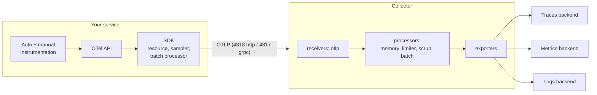
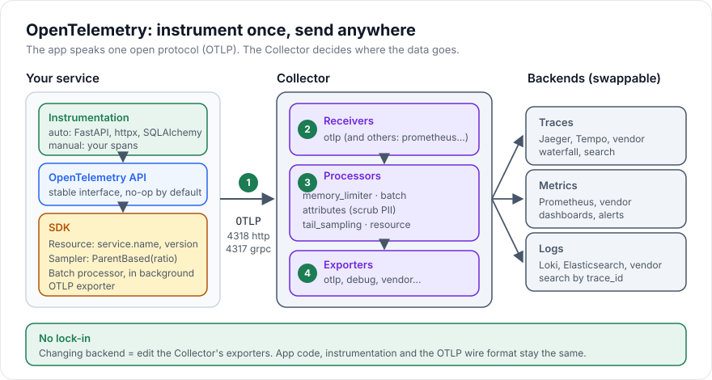

# OpenTelemetry

> [!TIP]
> **In one line:** OpenTelemetry is a vendor-neutral standard (API, SDK, OTLP protocol, Collector) for producing traces, metrics and logs once and sending them to any backend.
>
> **In plain English:** It is the universal power plug for monitoring data. Your app plugs into one standard socket, and you choose later, in a config file, which tool is on the other end of the wall.
>
> **You'll be able to:** distinguish API, SDK, OTLP and Collector · set up auto-instrumentation for FastAPI, httpx and SQLAlchemy · set resource attributes and a sampler · write a minimal Collector pipeline

## Why This Matters

Before OpenTelemetry (often shortened to OTel), every monitoring vendor shipped its own agent and its own client library. Instrumenting a service meant adopting one vendor's SDK, and switching vendors meant re-instrumenting every service, a cost that quietly became lock-in. Teams also ended up with three unrelated libraries for logs, metrics and traces, each inventing its own way to name things and carry context. OpenTelemetry, a Cloud Native Computing Foundation project formed from the merger of OpenTracing and OpenCensus, standardises the producing side: one set of APIs, one data model, one wire protocol (OTLP), and one vendor-neutral Collector. You instrument once and decide where the data goes by configuration.

For the earlier chapters of this part it is also the glue. [Tracing](tracing.md) used the OTel API to create spans; [Distributed Tracing](distributed-tracing.md) described context propagation, which OTel implements with the W3C `traceparent` header; [Metrics](metrics.md) and [Logging](logging.md) can flow through the same pipeline and share a `trace_id`.

## Core Concept

OpenTelemetry is several pieces that are easy to blur together, so separate them:

- **Signals.** Traces, metrics and logs (and, more recently, profiles in development) are the data types. Trace and metric support in the Python SDK is stable; the logs signal has been less settled, so check the current status in the Python documentation before depending on it, and keep structured stdout logs with a `trace_id` field as a robust baseline.
- **API.** The interfaces your code and libraries call (`trace.get_tracer`, `tracer.start_as_current_span`). The API package has no dependency on the SDK and, if no SDK is installed, every call is a cheap no-op. This is what lets library authors (httpx, SQLAlchemy) instrument themselves without forcing a monitoring choice on you.
- **SDK.** The implementation you install in your *application*: `TracerProvider`, samplers, span processors, exporters, the `Resource`. You configure it once at startup. Only applications, never libraries, should configure an SDK.
- **Instrumentation libraries.** Packages such as `opentelemetry-instrumentation-fastapi`, `-httpx` and `-sqlalchemy` that wrap a framework and create spans using the API. **Auto-instrumentation** means using these (or the `opentelemetry-instrument` launcher from `opentelemetry-distro`, which applies installed instrumentations without code changes); **manual instrumentation** means writing spans yourself for business logic. In practice you use both.
- **OTLP.** The OpenTelemetry Protocol, Protobuf messages over gRPC (default port 4317) or HTTP (port 4318, paths like `/v1/traces`). It is what the SDK exports and what Collectors and most backends ingest.
- **Collector.** A standalone process that receives telemetry, processes it, and exports it. It is optional but very useful in production.
- **Resource.** A set of attributes that describe *who is producing* the data (`service.name`, `service.version`, `deployment.environment.name`, host and container IDs) rather than any one span. Resource attributes are the backbone of filtering ("show me `orders-api` version 2026.11.3 in production"). Always set `service.name`; without it, backends show `unknown_service`.

## Mental Model

OTel is a shipping standard, like the intermodal container. The API is the standard box shape that every factory (library) packs goods into, without knowing which ship will carry them. The SDK is your company's loading dock: it decides how to batch boxes and how many to ship. OTLP is the container size and lashing rules, the same everywhere. The Collector is the port: it sorts, inspects, maybe relabels boxes, and puts them on whichever ship (backend) you contract this year. Changing the shipping line changes the port's routing sheet, not how any factory packs its boxes.

## How It Works

**Startup order.** At process start you create a `Resource`, build a `TracerProvider` with a sampler and one or more span processors (each wrapping an exporter), and register it globally with `trace.set_tracer_provider`. Only then do you instrument frameworks, because instrumentation reads the global provider when it creates tracers. Doing this after the app has begun handling requests, or setting the provider twice (the second call is ignored with a warning), are common sources of "no spans".

**Auto-instrumentation in FastAPI.** `FastAPIInstrumentor.instrument_app(app)` adds ASGI middleware that starts a SERVER span per request, named from the *route template* (`GET /orders/{order_id}`), and extracts incoming `traceparent`. By default it also emits internal spans for each ASGI `send` and `receive`, which is noisy; recent versions accept `exclude_spans=["send", "receive"]`. `excluded_urls` takes a comma-separated list of regular expressions for paths to skip, such as health checks. `HTTPXClientInstrumentor().instrument()` patches httpx so that every outgoing request gets a CLIENT span and a `traceparent` header injected automatically, which is the step that otherwise breaks traces. `SQLAlchemyInstrumentor().instrument(engine=engine.sync_engine)` wraps the engine; for an async engine you pass the underlying `sync_engine`. Check the instrumentation's supported library range: at the time of writing, the SQLAlchemy instrumentation declared support for versions below 2.1 and refused to instrument newer releases, so pin compatible versions.

**Manual spans** use the same provider, as in [Tracing](tracing.md); they nest correctly under the auto-created server span because both use the same contextvars-based current span.

**Context propagation formats.** The default propagators are W3C Trace Context and W3C Baggage. `Baggage` is a key-value bag that travels with the request to every downstream service. It is powerful and dangerous: it is copied into outbound headers to *every* hop, including third parties, so never put secrets or personal data in it, and keep it tiny. B3 and other formats can be enabled with `OTEL_PROPAGATORS` for legacy systems.

**Configuration by environment.** Almost everything above can be set without code through standard environment variables: `OTEL_SERVICE_NAME`, `OTEL_RESOURCE_ATTRIBUTES` (comma-separated `key=value`), `OTEL_EXPORTER_OTLP_ENDPOINT`, `OTEL_EXPORTER_OTLP_PROTOCOL` (`grpc` or `http/protobuf`), `OTEL_TRACES_SAMPLER` (for example `parentbased_traceidratio`) with `OTEL_TRACES_SAMPLER_ARG` (`0.1`), and `OTEL_PROPAGATORS`. The Python SDK's default exporter protocol and defaults can differ by version and by which exporter package you install, so set the protocol explicitly. Environment-based configuration is what lets a platform team change endpoints for all services without touching code.

**The Collector.** A Collector configuration declares **receivers** (how data comes in; `otlp` is the normal one), **processors** (transform in flight), **exporters** (where it goes) and **pipelines** that wire them per signal. Useful processors: `memory_limiter` (first in the chain, protects the Collector from running out of memory), `batch` (last, improves compression and throughput), `attributes` or `redaction` (delete or hash sensitive attributes centrally), `resource` (add metadata), `tail_sampling` (decide after the trace completes, see [Tracing](tracing.md)). Run it as a sidecar or node agent for low-latency local hand-off, and optionally as a central gateway for tail sampling and fan-out. Why add a hop at all? It moves retries, buffering, batching and credentials out of every service, lets you scrub data in one place, lets you send the same data to two backends (during a migration), and is the point at which vendor choice lives. The cost is one more component to deploy, size and monitor.

**Avoiding lock-in honestly.** OTLP is open, and most major backends ingest it natively. What stays vendor-specific is the *query language*, dashboards, alert rules, and proprietary features (for example AI-assisted analysis) built on top. Instrumentation is portable; operational knowledge and saved dashboards are not. A realistic goal is "switching is a project of weeks, not a rewrite of every service."

## Architecture





## Request / Response Example

Spans leave your service as an OTLP/HTTP request. The body is Protobuf (`application/x-protobuf`) in practice; the JSON form below is the equivalent encoding, shown because it is readable. Note that identifiers are hex strings in the OTLP/JSON encoding.

```http
POST /v1/traces HTTP/1.1
Host: otel-collector.observability.svc:4318
Content-Type: application/json

{
  "resourceSpans": [{
    "resource": {"attributes": [
      {"key": "service.name", "value": {"stringValue": "orders-api"}},
      {"key": "service.version", "value": {"stringValue": "2026.11.3"}}
    ]},
    "scopeSpans": [{
      "scope": {"name": "opentelemetry.instrumentation.fastapi"},
      "spans": [{
        "traceId": "4bf92f3577b34da6a3ce929d0e0e4736",
        "spanId": "00f067aa0ba902b7",
        "name": "POST /checkout",
        "kind": 2,
        "startTimeUnixNano": "1794290880100000000",
        "endTimeUnixNano": "1794290880520000000",
        "status": {"code": 0}
      }]
    }]
  }]
}
```

```http
HTTP/1.1 200 OK
Content-Type: application/json

{}
```

The nesting reflects the data model: one resource, containing instrumentation scopes, containing spans. A response with a `partialSuccess` object tells the client some spans were rejected.

## Code Example

First the application side. It configures the SDK exactly once, exports over OTLP/HTTP, and instruments FastAPI, httpx and SQLAlchemy. It was run against an in-memory SQLite database; a request to `/ping-db`, which runs `select 1`, produced a SERVER span for the route with `connect` and `select` CLIENT spans under it, all with `service.name=orders-api` (the exporter then failed to reach a Collector, as expected when none is running, which does not affect the request).

```python
import os
from contextlib import asynccontextmanager

from fastapi import FastAPI
from opentelemetry import trace
from opentelemetry.exporter.otlp.proto.http.trace_exporter import OTLPSpanExporter
from opentelemetry.instrumentation.fastapi import FastAPIInstrumentor
from opentelemetry.instrumentation.httpx import HTTPXClientInstrumentor
from opentelemetry.instrumentation.sqlalchemy import SQLAlchemyInstrumentor
from opentelemetry.sdk.resources import Resource
from opentelemetry.sdk.trace import TracerProvider
from opentelemetry.sdk.trace.export import BatchSpanProcessor
from opentelemetry.sdk.trace.sampling import ParentBased, TraceIdRatioBased
from sqlalchemy import text
from sqlalchemy.ext.asyncio import create_async_engine


def setup_tracing() -> TracerProvider:
    resource = Resource.create(
        {
            "service.name": os.getenv("OTEL_SERVICE_NAME", "orders-api"),
            "service.version": os.getenv("APP_VERSION", "dev"),
            "deployment.environment.name": os.getenv("DEPLOY_ENV", "local"),
        }
    )
    provider = TracerProvider(
        resource=resource,
        sampler=ParentBased(TraceIdRatioBased(float(os.getenv("TRACE_SAMPLE_RATIO", "1.0")))),
    )
    # Endpoint comes from OTEL_EXPORTER_OTLP_ENDPOINT / OTEL_EXPORTER_OTLP_TRACES_ENDPOINT;
    # with the HTTP exporter the default is http://localhost:4318/v1/traces.
    provider.add_span_processor(BatchSpanProcessor(OTLPSpanExporter()))
    trace.set_tracer_provider(provider)
    return provider


provider = setup_tracing()
engine = create_async_engine(os.getenv("DATABASE_URL", "sqlite+aiosqlite:///:memory:"))


@asynccontextmanager
async def lifespan(app: FastAPI):
    yield
    provider.shutdown()  # flush queued spans before the process exits


app = FastAPI(lifespan=lifespan)
FastAPIInstrumentor.instrument_app(app, excluded_urls="healthz", exclude_spans=["send", "receive"])
HTTPXClientInstrumentor().instrument()
SQLAlchemyInstrumentor().instrument(engine=engine.sync_engine)


@app.get("/ping-db")
async def ping_db() -> dict:
    # Produces a SERVER span for the route with `connect` and `select` CLIENT spans under it.
    async with engine.connect() as conn:
        await conn.execute(text("select 1"))
    return {"ok": True}
```

Install with `pip install opentelemetry-sdk opentelemetry-exporter-otlp-proto-http opentelemetry-instrumentation-fastapi opentelemetry-instrumentation-httpx opentelemetry-instrumentation-sqlalchemy`. Run with `OTEL_EXPORTER_OTLP_ENDPOINT=http://otel-collector:4318 uvicorn app:app`. The endpoint is read from the environment, so no address is hard-coded.

Now the Collector side, a minimal traces pipeline that receives OTLP, protects memory, scrubs a sensitive attribute, batches, and exports to any OTLP-capable backend (a Tempo or Jaeger service here) plus a `debug` exporter you can delete after testing:

```yaml
receivers:
  otlp:
    protocols:
      grpc:
        endpoint: 0.0.0.0:4317
      http:
        endpoint: 0.0.0.0:4318

processors:
  memory_limiter:
    check_interval: 1s
    limit_mib: 400
    spike_limit_mib: 100
  attributes/scrub:
    actions:
      - key: http.request.header.authorization
        action: delete
  batch: {}

exporters:
  otlp/backend:
    endpoint: tempo.observability.svc:4317   # swap this line to change vendor
    tls:
      insecure: true                         # dev only; use TLS in production
  debug:
    verbosity: basic

service:
  pipelines:
    traces:
      receivers: [otlp]
      processors: [memory_limiter, attributes/scrub, batch]
      exporters: [otlp/backend, debug]
```

Processor order is significant: `memory_limiter` first, `batch` last. Replace the backend endpoint with your own and add credentials through environment-variable expansion (`${env:BACKEND_TOKEN}`) in the Collector config, never in the file.

## Production Considerations

- **Version compatibility.** OTel Python packages ship as a coordinated set: API and SDK at 1.x, instrumentation packages at 0.x (beta, matching minor versions). Pin the whole set together and upgrade together; mixing releases causes subtle import and behaviour errors.
- **Semantic convention changes.** HTTP and database attribute names changed during stabilisation (for example `http.method` became `http.request.method`). Dashboards and alerts that key on old names break on upgrade; the `OTEL_SEMCONV_STABILITY_OPT_IN` mechanism exists to migrate gradually.
- **Overhead.** Auto-instrumentation adds per-request work, and the batch processor adds memory. Set queue sizes deliberately, sample, and measure latency and memory with and without it. Exporter failures should never fail requests; the export happens on a background thread, but a full queue silently drops spans, so alert on drops.
- **Collector topology.** Start with an agent per node or a small gateway deployment with at least two replicas, set `memory_limiter`, and monitor the Collector itself (its own metrics endpoint) for refused or dropped data. Tail sampling needs trace-ID-aware load balancing.
- **Multiprocess servers.** Gunicorn/uvicorn with several worker processes needs the provider created *per worker* (after fork), not in the master process, because background threads do not survive `fork`.
- **Security and cost.** Telemetry carries data about your system and sometimes about users. Use TLS and authentication between Collector and backends, scrub in the Collector, and watch cardinality in metrics (see [Metrics](metrics.md)).
- **Correlate logs.** The OTel logging instrumentation or a small processor adds `trace_id` and `span_id` to log records, linking [Structured Logging](structured-logging.md) with traces.

## Common Mistakes

- **Configuring the SDK in a library**, or calling `set_tracer_provider` more than once.
- **Instrumenting before the provider is set**, so instrumentation binds to the no-op provider and nothing is exported.
- **No `service.name`**, producing `unknown_service` and an unusable service map.
- **Creating the provider in a pre-fork master process**, then wondering why no spans leave the workers.
- **Running with a debugging `AlwaysOn` sampler in production** and paying for 100% of traces without a decision.
- **Putting high-cardinality or sensitive values in resource attributes or baggage**, which attach to everything or travel to every downstream hop.
- **Believing OTel removes all lock-in.** Instrumentation and transport become portable; dashboards, alerts and query skills do not.
- **Skipping shutdown flush**, losing the last batch of spans at deploy time.

## Best Practices

- Install the SDK only in application entry points; keep libraries on the API.
- Always set `service.name`, `service.version` and `deployment.environment.name`; drive endpoint, protocol and sampler from environment variables.
- Use auto-instrumentation for frameworks and clients, add manual spans for business steps, and exclude health checks and ASGI send/receive noise.
- Send to a Collector rather than directly to a vendor so scrubbing, batching, retries and routing are central; add `memory_limiter` and `batch`.
- Pin the OTel package set, read release notes on semantic-convention changes, and call `provider.shutdown()` on exit.
- Add `trace_id` to logs and keep both metrics and traces consistent in naming.

## AI Engineering Perspective

OpenTelemetry has a growing set of generative-AI semantic conventions (attributes like model name, token usage and operation type for LLM calls, and spans for agent steps), plus instrumentation libraries for popular LLM SDKs and frameworks. These conventions are still evolving, so treat attribute names as pinned-to-a-version. The practical value is large: a single trace can show the HTTP request, the vector search, the reranker and each model call with token counts, in one waterfall. Prompts and completions can be recorded as span events or attributes but are sensitive and big; most instrumentations make this opt-in, and the Collector's `attributes`/`redaction` processors are the right place to drop or hash them centrally before they reach a backend. Because LLM providers and LLM observability tools (several accept OTLP directly) change quickly, OTel's vendor neutrality matters more here than almost anywhere else. For where model-specific tracing fits in the larger design, see [Part 15](../15-production-ai-systems/README.md) and [Part 17](../17-ai-agents-and-mcp/README.md).

## Exercises

**Beginner**
1. Run the Collector with only the `debug` exporter (the official `otel/opentelemetry-collector-contrib` image), point the example at it, call an endpoint, and find your span in the Collector's output.
2. Remove `service.name` from the resource and observe the name that appears, then restore it.

**Intermediate**
3. Add `exclude_spans` and `excluded_urls` options and compare the span count per request before and after.
4. Add an `attributes` processor in the Collector that deletes a `user.email` attribute you add manually in code, and prove the backend never sees it.

**Advanced**
5. Configure a second exporter so the same traces go to two backends, and describe how you would use it to migrate vendors without downtime.
6. Run the app under gunicorn with four uvicorn workers; show what breaks if the provider is created in the master, and fix it using a post-fork hook.

## Key Takeaways

- OpenTelemetry separates the API (what code calls), the SDK (how data is processed), OTLP (the wire format) and the Collector (routing and processing); that separation is what removes vendor lock-in from instrumentation.
- Set the provider, resource (`service.name` first) and sampler once at startup, then instrument FastAPI, httpx and SQLAlchemy and add manual spans for business logic.
- Configure through standard `OTEL_*` environment variables and send to a Collector so scrubbing, batching and backend choice live in configuration.
- Pin versions, watch semantic-convention changes, and remember that dashboards and queries remain vendor-specific.

### Check Yourself

<details markdown="1">
<summary>1. What is the difference between the OpenTelemetry API and SDK, and why does it matter to library authors?</summary>

The API defines the interfaces and is a no-op without an SDK; the SDK implements batching, sampling and export. Libraries depend only on the API so they can be instrumented without forcing any exporter or vendor on the application.

</details>

<details markdown="1">
<summary>2. Your service exports nothing even though instrumentation is installed. Name two likely causes.</summary>

The instrumentation ran before the global tracer provider was set (so it bound to the no-op provider), or the provider was created in a pre-fork master process so workers never export. A wrong endpoint or a sampler dropping everything are other checks.

</details>

<details markdown="1">
<summary>3. Why put a Collector between your services and the vendor?</summary>

It centralises batching, retries, credential handling, scrubbing and tail sampling, and lets you change or duplicate destinations by editing configuration instead of redeploying every service. The price is one more component to operate.

</details>

---
Back to the [Part 12 README](README.md).
