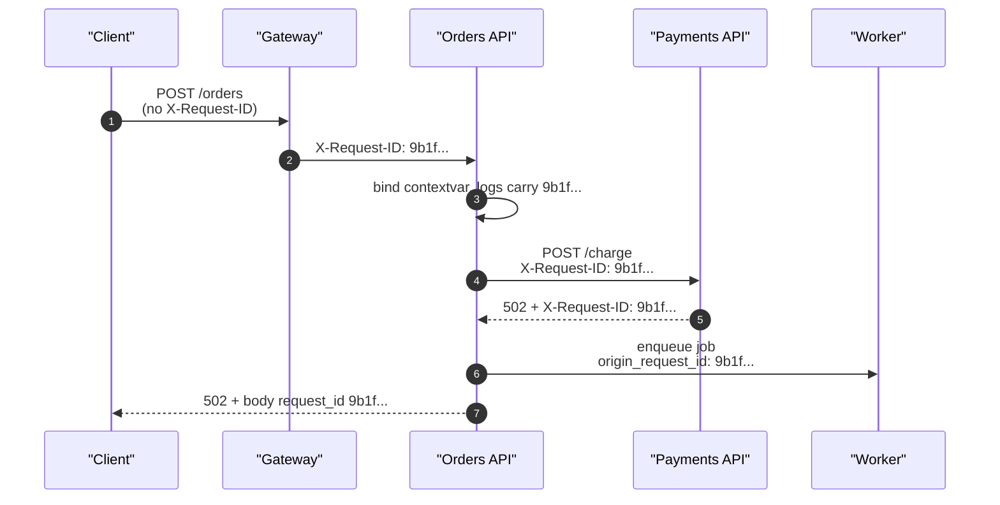

# Request IDs

> [!TIP]
> **In one line:** A request ID is a short unique label attached to a request at the edge, validated if supplied by a client, and carried into logs, outbound calls, jobs and error responses.
>
> **In plain English:** It is the case number on a support ticket. Whoever first receives the ticket stamps a number on it, and every person who touches it afterwards writes that same number on their notes, so the whole story can be pulled up with one lookup.
>
> **You'll be able to:** generate and safely accept an X-Request-ID · propagate it with contextvars to logs, httpx calls and background jobs · return it in error bodies · explain how it differs from a W3C traceparent

## Why This Matters

At 02:14 a customer emails: "My checkout failed, around two this morning." You have 40 replicas, four services and 90 million log lines for the night. Without a shared identifier, finding the one failing request means guessing on timestamps and user IDs, and hoping the user ID was logged. With a request ID, the customer (or the mobile app) quotes `req_9b1f...` from the error screen, and one search returns every log line the request produced in every service. [Logging](logging.md) named the request ID as the single highest-leverage logging habit; this chapter covers the details that make it actually work: where it is born, what to do with a client-supplied one, how it crosses process boundaries, and where it shows up in responses.

## Core Concept

A **request ID** (also called a correlation ID) is an opaque string that identifies one logical request across everything that handles it. The convention is the HTTP header `X-Request-ID`; some platforms use `X-Correlation-ID`, and cloud load balancers often inject their own (for example `X-Amzn-Trace-Id` on AWS ALBs, `X-Request-Id` on several proxies). It has four jobs:

1. **Generate** at the first trusted hop (edge proxy or gateway) if the request does not already have a *valid* one.
2. **Propagate** through the process (contextvars), to every log line, and onward to every outbound call and every asynchronous job triggered by the request.
3. **Return** to the caller in a response header and in error bodies, so humans can quote it.
4. **Record** it as a structured field everywhere (see [Structured Logging](structured-logging.md)).

It is not authentication, not authorization, and not a secret. Treat it as untrusted input when it comes from outside.

**Relation to W3C `traceparent`.** The Trace Context standard defines `traceparent: 00-<32 hex trace-id>-<16 hex parent-span-id>-<2 hex flags>`. A trace ID also identifies one request across services, so the two overlap. The differences matter: a trace ID has a strict format, is consumed by tracing SDKs which create span trees under it, and carries a *sampling flag*; a request ID is a free-form string you control, exists even when tracing is off or the request was sampled out, and is meant for humans and log search. In a modern stack with OpenTelemetry ([OpenTelemetry](opentelemetry.md)) the pragmatic choice is: keep a request ID for support and logs, put the `trace_id` on every log line as well, and return both. Some teams simply reuse the trace ID as the request ID; that is acceptable if tracing is on for every request, but it fails when requests are sampled out or when a client-supplied value collides with the format. See [Distributed Tracing](distributed-tracing.md) for propagation concepts.

## Mental Model

Think of the paper tag on a parcel in a sorting depot. The first depot prints a barcode; every later depot scans it, never re-prints a new one; if a customer arrives with their own homemade sticker saying "PRIORITY, open the vault", the depot does not trust it, and replaces it with its own barcode if it does not look like a valid label. The tag adds no information about the contents; it only lets everyone talk about the same parcel.

## How It Works

**Format.** A UUID4 in hex (32 characters) is the usual choice: random, collision-resistant for practical purposes, safe in headers and URLs, needs no coordination between replicas. Shorter IDs are friendlier to read out over the phone but collide more easily; time-ordered IDs (UUIDv7, ULID) have the benefit that IDs sort roughly by time, helping index locality in a log store. Whatever you choose, document the alphabet and length.

**Accepting an inbound ID.** Accepting a client-supplied ID is useful (a mobile app can generate one before the first attempt and reuse it across retries, so all attempts correlate) but it is untrusted input flowing into logs and headers. Risks: *log injection* (a value containing newlines or JSON fragments forging log lines), *header injection* when echoed back, unbounded length bloating logs, and *collision or spoofing* (a client reusing someone else's ID to pollute their traces). Validate strictly with an allowlist regex and a length cap, for example `^[A-Za-z0-9._-]{8,64}$`, and **generate a fresh ID when validation fails**, optionally logging the rejected one under a different field name. If you operate behind your own gateway, the safest design is that only the gateway accepts outside IDs and internal services trust the gateway's value.

**Propagation inside the process.** Store the ID in a `ContextVar` set by middleware. Every coroutine that runs while handling the request inherits it, including code in `await`ed functions and tasks created with `asyncio.create_task` (they copy the context at creation). Two traps: code run in a thread via `run_in_executor` does not automatically see the context unless you use `asyncio.to_thread` or `contextvars.copy_context().run(...)`; and a pure ASGI middleware that sets the variable must **reset** it in a `finally` so it does not leak between requests.

**Propagation across processes.** Contextvars end at the process boundary. For HTTP calls, inject the header on every outbound request; an httpx event hook does this in one place. For message queues and background jobs, write the ID into the message envelope (as a field or message header) at enqueue time and re-bind it at the start of the worker, because the worker runs later, possibly on another machine, with no request in scope. A job triggered by a request should usually *keep* the originating request ID as `parent_request_id` or `origin_request_id` and may also have its own `job_id`, since one request can fan out into many jobs and one job may run many times.

**Returning it.** Echo the ID in an `X-Request-ID` response header on *every* response, including 4xx and 5xx, and put it in the body of error responses (see the example). This is the piece teams forget, and it is what makes support tickets debuggable. Some gotchas: an exception handler registered for `Exception` is executed by Starlette's outermost error middleware, which sits *outside* your own middleware, so a contextvar that your middleware already reset is gone. The example stashes the ID on the ASGI scope's `state` as well, so it survives into that handler. Also check CORS: browser JavaScript can read a custom response header only if it is listed in `Access-Control-Expose-Headers`.

**Gateway and proxy interplay.** If a load balancer or API gateway already assigns an ID, decide who is authoritative. Typically the outermost trusted proxy sets or overwrites the header, the app accepts it (it came from a trusted network hop, which you may enforce by only honouring the header from known proxy addresses), and nothing downstream generates a second one. Two IDs for one request are the usual symptom of a missing decision.

## Architecture



The same string appears in the gateway log, both services' logs, the job message and the final error body. Searching for it in the log store reconstructs the whole path.

## Request / Response Example

A client retries with its own ID, which passes validation. Then a request with a malicious value gets replaced.

```http
GET /orders/1 HTTP/1.1
Host: api.example.com
X-Request-ID: client-abc-12345
```

```http
HTTP/1.1 200 OK
Content-Type: application/json
X-Request-ID: client-abc-12345

{"id": 1, "request_id": "client-abc-12345"}
```

A value such as `X-Request-ID: x"}\n{"level":"critical"` fails the allowlist regex, so the server generates `fda84874373849328a03d33493854690` instead and returns that. An unhandled server error returns the ID in both places:

```http
HTTP/1.1 500 Internal Server Error
Content-Type: application/json
X-Request-ID: d50feefef3a74c0e84d6cff6df2f91b1

{"error": {"code": "internal_error", "request_id": "d50feefef3a74c0e84d6cff6df2f91b1"}}
```

Notice the body never includes the exception message or stack trace; those stay in your logs, indexed by the same ID.

## Code Example

A complete, tested FastAPI module (the output above comes from running it with the TestClient). It uses a pure ASGI middleware rather than `BaseHTTPMiddleware` so that the response header is added at the `http.response.start` message and the contextvar lifetime is explicit.

```python
import contextvars
import re
import uuid

import httpx
from fastapi import FastAPI, Request
from fastapi.responses import JSONResponse
from starlette.types import ASGIApp, Message, Receive, Scope, Send

# Accept only short, boring IDs: letters, digits, dash, underscore, dot.
_SAFE_ID = re.compile(r"^[A-Za-z0-9._-]{8,64}$")

request_id_var: contextvars.ContextVar[str | None] = contextvars.ContextVar(
    "request_id", default=None
)


def new_request_id() -> str:
    return uuid.uuid4().hex


def accept_or_generate(raw: str | None) -> str:
    return raw if raw is not None and _SAFE_ID.fullmatch(raw) else new_request_id()


class RequestIdMiddleware:
    """Pure ASGI middleware: sets the contextvar and echoes the header on every response."""

    def __init__(self, app: ASGIApp) -> None:
        self.app = app

    async def __call__(self, scope: Scope, receive: Receive, send: Send) -> None:
        if scope["type"] != "http":
            await self.app(scope, receive, send)
            return
        raw = None
        for name, value in scope["headers"]:
            if name == b"x-request-id":
                raw = value.decode("latin-1")
                break
        rid = accept_or_generate(raw)
        token = request_id_var.set(rid)
        # Also stash it on the ASGI scope: the 500 handler runs in Starlette's outermost
        # ServerErrorMiddleware, after our contextvar has been reset.
        scope.setdefault("state", {})["request_id"] = rid

        async def send_with_id(message: Message) -> None:
            if message["type"] == "http.response.start":
                message.setdefault("headers", [])
                message["headers"].append((b"x-request-id", rid.encode("ascii")))
            await send(message)

        try:
            await self.app(scope, receive, send_with_id)
        finally:
            request_id_var.reset(token)


app = FastAPI()
app.add_middleware(RequestIdMiddleware)


@app.exception_handler(Exception)
async def unhandled(request: Request, exc: Exception):
    rid = getattr(request.state, "request_id", None)
    # Body and header both carry the ID so a user can quote it to support.
    return JSONResponse(
        status_code=500,
        content={"error": {"code": "internal_error", "request_id": rid}},
        headers={"X-Request-ID": rid} if rid else None,
    )


def outbound_client() -> httpx.AsyncClient:
    async def inject(request: httpx.Request) -> None:
        rid = request_id_var.get()
        if rid:
            request.headers["X-Request-ID"] = rid

    return httpx.AsyncClient(event_hooks={"request": [inject]}, timeout=5.0)


@app.get("/orders/{order_id}")
async def get_order(order_id: int):
    if order_id == 0:
        raise RuntimeError("boom")
    return {"id": order_id, "request_id": request_id_var.get()}


def enqueue_job(payload: dict) -> dict:
    # Context does not cross the queue, so copy the ID into the message.
    return {"payload": payload, "request_id": request_id_var.get()}
```

Wiring the ID into logs is one processor or binding call: with structlog, call `structlog.contextvars.bind_contextvars(request_id=rid)` in the middleware, as in [Structured Logging](structured-logging.md); with stdlib logging, add a `logging.Filter` that copies `request_id_var.get()` onto each record. To use the outbound client, create it once per application (for example in a lifespan handler) rather than per request: `client = outbound_client()`; the hook reads the contextvar at send time, so one shared client serves all requests correctly. When a worker dequeues a job, call `request_id_var.set(message["request_id"])` before running it.

## Production Considerations

- **Authoritative source.** Decide whether the gateway or the first service generates the ID, and make downstream services accept (never regenerate) valid inbound IDs.
- **Cost of validation is negligible; cost of skipping it is a security bug.** Keep the regex strict and cap length; log the rejected raw value only after escaping.
- **Cardinality.** Do not use request ID as an indexed label or metric dimension. It is unique by definition and would create one time series per request; keep it in the log body or as a high-cardinality trace attribute.
- **Retries.** A client retry should normally reuse the request ID (so attempts correlate) while idempotency is handled separately with an idempotency key; do not conflate the two. See [REST API design](../02-rest-api-design/README.md) and [production reliability](../06-production-reliability/README.md) for idempotency.
- **Webhooks and third parties.** Send your ID outward and record the vendor's ID (for example a payment provider's request reference) next to it, so a support case with the vendor can be matched.
- **Privacy.** Never derive the ID from user data (an e-mail hash, a user ID) because it will be logged, returned to browsers and shared with vendors.
- **Include it in SLO/incident tooling.** Dashboards for slow or failing requests should link out to a log search pre-filled with the ID; see [Metrics](metrics.md) and [Debugging Production APIs](debugging-production-apis.md).

## Common Mistakes

- **Trusting the inbound header blindly**, enabling log injection or ID spoofing.
- **Generating a new ID in each service**, so the logs of one request cannot be joined.
- **Forgetting to return the ID on error responses**, the exact case where users contact support.
- **Not propagating into background jobs and queues**, so the trail ends where the work gets interesting.
- **Resetting the contextvar before the error handler runs**, producing `null` request IDs in 500 responses.
- **Mixing the request ID with the trace ID without noticing sampling**, then finding that requests which were sampled out have no ID at all.
- **Using the ID as an idempotency key**, so two different operations from one retried request are deduplicated incorrectly or a replay is treated as new.

## Best Practices

- Accept `X-Request-ID` only if it matches a strict pattern and length; otherwise generate a UUID4 hex.
- Bind it once in middleware, store it in a `ContextVar`, and reset it in `finally`.
- Inject it on every outbound HTTP call with a client hook, and carry it in every queue message as `origin_request_id`.
- Return it in the `X-Request-ID` header and the error body of every error response; expose it in CORS if browsers must read it.
- Log `request_id` and `trace_id` together on every line so either can be the entry point to an investigation.

## AI Engineering Perspective

LLM applications multiply the number of hops per user action: gateway, retrieval, one or several model calls, tool calls, a safety classifier. A single request ID ties them together, and passing it as a header or metadata field to the model provider or an internal LLM gateway lets you match your own logs against the provider's usage records and latency, which is often the only way to explain "why was this one answer slow or expensive". For agents, the useful pattern is a two-level identifier: the originating `request_id` for the user's HTTP request plus a generated `agent_run_id` for the loop, so a run that outlives the request (it continues in a worker after the HTTP response returns) is still attached to the request that started it. Streaming endpoints should send the ID in the initial response headers, since there is no final body to carry it. Related design is covered in [Part 15](../15-production-ai-systems/README.md) and [Part 17](../17-ai-agents-and-mcp/README.md).

## Exercises

**Beginner**
1. Run the example and send requests with a valid ID, an invalid ID and no ID. Confirm the response header is always valid and always present.
2. Add `request_id` to a stdlib `logging.Filter` and print it from a handler.

**Intermediate**
3. Write a test that triggers an unhandled exception and asserts the 500 body and header contain the same ID as the one sent.
4. Extend the worker pattern: enqueue a job with `origin_request_id`, re-bind it in the worker, and verify the job's log lines can be found with the original request's ID.

**Advanced**
5. Add the active OpenTelemetry `trace_id` to every log line next to `request_id`, and build a small page or script that, given either ID, prints the other.
6. Design the trust boundary for a system with a CDN, an API gateway and internal services: which hops may supply an ID, which must overwrite it, and what is logged when a value is rejected.

## Key Takeaways

- A request ID is an opaque per-request label: generate at the edge, validate if supplied, propagate everywhere, return on every response.
- Treat inbound IDs as untrusted input; allowlist the format and length and replace anything else.
- Contextvars carry the ID within a process; HTTP headers and queue envelopes must carry it between processes.
- It complements, and does not replace, the W3C traceparent: it exists even when tracing is off and is meant for people and log search.

### Check Yourself

<details markdown="1">
<summary>1. Why must an inbound X-Request-ID be validated rather than logged as-is?</summary>

It is attacker-controlled data that ends up in logs and headers. Without an allowlist and length cap it can forge log lines, inject header content or spoof another request's identity, so invalid values are replaced with a fresh ID.

</details>

<details markdown="1">
<summary>2. A 500 response arrives with `"request_id": null`. What is the likely cause in a Starlette/FastAPI app?</summary>

The generic `Exception` handler runs in the outermost error middleware, after your middleware has reset the contextvar. Storing the ID on the ASGI scope state, which the handler can read from the request, avoids it.

</details>

<details markdown="1">
<summary>3. A background job fails an hour after the user's request. How do you find the originating request's logs?</summary>

The enqueue code copied the request ID into the message as `origin_request_id`, and the worker re-bound it at start, so the job's logs carry the same ID. Searching that ID returns the request, the enqueue and the job together.

</details>

---
Back to the [Part 12 README](README.md).
