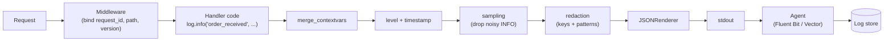

# Structured Logging

> [!TIP]
> **In one line:** Emit each log event as a JSON object with stable field names, bind per-request context once through contextvars, redact before rendering, and budget volume like money.
>
> **In plain English:** Instead of writing sentences into a diary, you fill in a form for every event: the same boxes every time, so a computer can sort and count them. You staple the request's name tag to the form automatically, and you black out anything private before it leaves the building.
>
> **You'll be able to:** configure structlog (or stdlib) for JSON output in FastAPI · attach request-scoped fields with contextvars · redact secrets and PII in one processor · reduce log cost with levels, sampling and cardinality discipline

## Why This Matters

[Logging](logging.md) established the basics: levels, stdout, a request ID, and what never to log. This chapter is about the step after "we log JSON": making those logs *queryable, safe and affordable* once you have a dozen replicas and several million lines an hour. Three problems appear almost immediately. First, free-text messages drift (`"payment failed"`, `"Payment Failure for order 8842"`, `"order=8842 pay-fail"`), so no single query finds them all. Second, the per-request fields (request ID, user, route) get threaded through function arguments by hand, and every forgotten call site is a log line you cannot correlate. Third, the bill: ingestion is typically priced per gigabyte, and a single chatty `INFO` line on a hot path can outweigh the rest of your logging combined.

Structured logging solves these as one design: a fixed event vocabulary, context attached implicitly, a processing pipeline in which redaction and sampling happen in exactly one place, and conscious limits on what goes into the indexed fields.

## Core Concept

A **structured log** is an event record: a short, stable **event name** plus a flat-ish set of typed **key-value fields**. The message is not a sentence for humans to parse; it is an identifier you can group by. `"order_received"` with `order_id=8842` and `item_count=3` replaces `"Received an order with 3 items (id 8842)"`. The variable data lives in fields, never interpolated into the event name, so the name stays constant across millions of occurrences and `count by event` is meaningful.

Three ideas make this work in practice:

1. **A processor pipeline.** Libraries such as `structlog` model logging as a chain of functions that each receive the event dictionary and return it (possibly modified) before a final renderer turns it into JSON. Adding a timestamp, merging request context, redacting secrets, and dropping noisy events are each one small function. Because every event passes through the same chain, policy lives in one place instead of being sprinkled over call sites.
2. **Ambient context via `contextvars`.** Python's `contextvars` module gives each asyncio task (and each thread) its own copy of a variable. If middleware binds `request_id` into a context variable at the start of a request, every log call made anywhere below it, in any `await`ed function, can read it without it being passed as an argument. This is the structured-logging counterpart of a thread-local, and unlike a thread-local it is correct under `asyncio`, where thousands of requests interleave on one thread.
3. **Schema discipline.** Field names are an API between your code and your future queries. Pick conventions (`snake_case`, `duration_ms` always milliseconds, `status` always an int, `user_id` never `uid` in one file and `userId` in another) and keep them.

structlog can run standalone, or as a formatter on top of the standard library's `logging` module so that third-party libraries (uvicorn, SQLAlchemy, httpx) emit the same JSON. The standard-library route uses `structlog.stdlib.ProcessorFormatter`; the standalone route, shown below, is simpler and fine for application code. Either way the output contract is identical.

## Mental Model

Think of a hospital intake form. A nurse does not write a paragraph about each patient; she fills a form with fixed boxes (name, time, complaint, vitals) so the records office can later answer "how many patients with chest pain arrived on Tuesday night?" without reading every page. The patient's wristband (request ID) is scanned at every station so the nurse never retypes it. And before the form is filed, a clerk with a marker blacks out the insurance number. The form is the schema, the wristband is the contextvar, and the clerk is the redaction processor: three separate responsibilities, each done once, in the same place for everyone.

## How It Works

**Event flow.** A call such as `log.info("order_received", payload=payload)` creates an event dictionary `{"event": "order_received", "payload": ...}`. If the configured level filters it out (`DEBUG` when the minimum is `INFO`), `structlog.make_filtering_bound_logger` short-circuits cheaply and no processors run. Otherwise the dictionary visits each processor in order: `merge_contextvars` copies in whatever the middleware bound, `add_log_level` adds `level`, `TimeStamper` adds an ISO-8601 UTC timestamp, then your sampling and redaction functions, then `format_exc_info` turns an exception into a string, and finally `JSONRenderer` serialises to one line written to stdout.

**Order matters.** Redaction must come after everything that can add data (context merge, any processor that attaches a request body) and before rendering. Sampling should come early so dropped events do not pay for later processing, but after `add_log_level` because the decision depends on level.

**Contextvars lifetime.** Values bound in the middleware before `call_next` are visible in the endpoint, because Starlette runs the endpoint in a task that was created inside that context. A value bound *inside* the endpoint (`user_id` after authentication) is visible to later log calls in the same task, but it is **not** visible back in the middleware's final "request completed" line when you use `BaseHTTPMiddleware`, because the endpoint ran in a copied context. If you need the user on the completion line, have the endpoint store it on `request.state` and read it there, or write the access log from a pure ASGI middleware. Always call `clear_contextvars()` at the start of a request so a value never leaks from one request to the next in long-lived tasks.

**Log levels as policy.** Levels are only useful if the team shares a definition. A workable policy: `ERROR` means a request failed for a reason that is *our* fault and a human may need to look (5xx, unhandled exception, lost data); `WARNING` means degraded but handled (retry succeeded, fallback used, a 4xx from an abusive client in aggregate); `INFO` is one line per request plus significant business events (order created); `DEBUG` is everything else, off by default and switchable per process at runtime. The recurring mistake is logging client errors such as 404 and 422 at `ERROR`, which buries real failures; see [Error Monitoring](error-monitoring.md) for the 4xx/5xx split.

**Redaction.** Two complementary rules. Key-based: any field whose name is in a denylist (`password`, `authorization`, `token`) is replaced. Pattern-based: strings are scanned for shapes such as e-mail addresses or card-like digit runs. Key-based rules are precise but only catch what you named; pattern-based rules catch leaks inside free text but produce false positives and cost CPU. Neither is complete. The more reliable defence is *not binding sensitive objects at all*: log `user_id`, not the user; log request body *keys*, not values.

**Cardinality and cost.** Two different things get called "cardinality". In log stores that index fields (Loki labels, Datadog indexed facets, Elasticsearch keyword fields), the number of distinct values of an *indexed* field drives storage and query cost: `user_id` or `request_id` as an indexed label is a classic way to melt a Loki cluster, whereas leaving them in the unindexed line body is cheap. Separately, the *volume* of lines scales with traffic times lines-per-request times bytes-per-line. A request that logs 12 lines of 600 bytes at 2,000 requests per second produces about 14 MB/s, or roughly 1.2 TB a day. Cutting to 3 lines of 400 bytes drops that to about 2.4 MB/s (about 200 GB/day), a 6x saving before any sampling.

**Sampling noisy logs.** Events whose individual instances carry little information (health checks, cache hits, per-item loop iterations) can be sampled: keep 1 in N and record `sample_rate` so counts can be reconstructed. Never sample `WARNING` and above, and prefer deterministic sampling when you need all lines of one request kept or dropped together (hash the request ID and compare to a threshold). Random per-line sampling breaks the story of any single request.

## Architecture



The application owns everything left of `stdout`; the agent and store own parsing, retention and indexing. Keeping that boundary means a slow log backend can never block request handling.

## Request / Response Example

One request through the example service below produces two lines. The caller supplies an `X-Request-ID`; the e-mail and password in the body are masked before anything is written.

```http
POST /orders HTTP/1.1
Host: api.example.com
Content-Type: application/json
X-Request-ID: req-1

{"user_id": 42, "email": "ana@example.com", "password": "hunter2"}
```

```json
{"event": "order_received", "payload": {"user_id": 42, "email": "[EMAIL]", "password": "[REDACTED]"}, "request_id": "req-1", "path": "/orders", "http_method": "POST", "service": "orders-api", "version": "2026.11.3", "user_id": 42, "level": "info", "timestamp": "2026-11-10T06:08:00.295533Z"}
{"event": "request_completed", "status": 200, "duration_ms": 1.9, "request_id": "req-1", "path": "/orders", "http_method": "POST", "service": "orders-api", "version": "2026.11.3", "level": "info", "timestamp": "2026-11-10T06:08:00.295905Z"}
```

Notice that both lines carry the same `request_id`, `service` and `version` although the handler never mentioned them, and that `user_id` appears only on the line logged after the endpoint bound it (the limitation described above).

## Code Example

This runnable FastAPI service (structlog 25+, FastAPI, Python 3.11+) configures the pipeline once at import time. It was exercised with FastAPI's `TestClient`, which produced the output above (the `version` field there came from `APP_VERSION`).

```python
import logging
import os
import random
import re
import time
import uuid

import structlog
from fastapi import FastAPI, Request

SENSITIVE_KEYS = {"password", "token", "authorization", "api_key", "cookie", "card_number"}
EMAIL_RE = re.compile(r"[\w.+-]+@[\w-]+\.[\w.-]+")


def redact(value, depth=0):
    """Recursively mask sensitive keys and e-mail-shaped strings."""
    if depth > 5:  # bound recursion on pathological payloads
        return "[TRUNCATED]"
    if isinstance(value, dict):
        return {
            k: "[REDACTED]" if str(k).lower() in SENSITIVE_KEYS else redact(v, depth + 1)
            for k, v in value.items()
        }
    if isinstance(value, (list, tuple)):
        return [redact(v, depth + 1) for v in value]
    if isinstance(value, str):
        return EMAIL_RE.sub("[EMAIL]", value)
    return value


def redaction_processor(logger, method_name, event_dict):
    return redact(event_dict)


def sample_noisy(logger, method_name, event_dict):
    """Keep a fraction of events flagged noisy=True, only at INFO. WARNING+ is never dropped."""
    rate = float(os.getenv("NOISY_LOG_SAMPLE_RATE", "0.01"))
    if event_dict.get("noisy") and event_dict.get("level") == "info":
        if random.random() > rate:
            raise structlog.DropEvent
        event_dict["sample_rate"] = rate  # lets dashboards scale counts back up
    event_dict.pop("noisy", None)
    return event_dict


def configure_logging() -> None:
    level = getattr(logging, os.getenv("LOG_LEVEL", "INFO").upper(), logging.INFO)
    structlog.configure(
        processors=[
            structlog.contextvars.merge_contextvars,   # request-scoped fields
            structlog.processors.add_log_level,        # adds "level" (sampling needs it)
            structlog.processors.TimeStamper(fmt="iso", utc=True),
            sample_noisy,
            redaction_processor,                       # after all data has been added
            structlog.processors.format_exc_info,
            structlog.processors.JSONRenderer(),
        ],
        wrapper_class=structlog.make_filtering_bound_logger(level),
        logger_factory=structlog.PrintLoggerFactory(),  # stdout, one line per event
        cache_logger_on_first_use=True,
    )


configure_logging()
log = structlog.get_logger()
app = FastAPI()


@app.middleware("http")
async def request_logging(request: Request, call_next):
    structlog.contextvars.clear_contextvars()  # never inherit a previous request's fields
    structlog.contextvars.bind_contextvars(
        # NOTE: accepting a client-supplied ID unvalidated is unsafe; see request-ids.md
        request_id=request.headers.get("x-request-id", uuid.uuid4().hex),
        http_method=request.method,
        path=request.url.path,  # prefer the route template (/orders/{id}) to avoid unbounded values
        service="orders-api",
        version=os.getenv("APP_VERSION", "dev"),
    )
    start = time.perf_counter()
    try:
        response = await call_next(request)
    except Exception:
        # log.exception records the traceback in the "exception" field
        log.exception("request_failed", duration_ms=round((time.perf_counter() - start) * 1000, 1))
        raise
    log.info(
        "request_completed",
        status=response.status_code,
        duration_ms=round((time.perf_counter() - start) * 1000, 1),
        noisy=request.url.path == "/healthz",  # health checks are sampled
    )
    return response


@app.get("/healthz")
async def healthz():
    return {"ok": True}


@app.post("/orders")
async def create_order(payload: dict):
    structlog.contextvars.bind_contextvars(user_id=payload.get("user_id"))
    log.info("order_received", payload=payload)  # redacted by the processor
    if payload.get("boom"):
        raise RuntimeError("payment gateway timeout")
    return {"id": 8842}
```

Run it with `LOG_LEVEL=INFO APP_VERSION=2026.11.3 uvicorn app:app`. Two caveats. `redact` allocates new dictionaries for every event, which is fine at INFO volume but worth measuring if you log large payloads at high rates. And uvicorn's own access log is a second, unstructured stream; disable it (`--no-access-log`) because the middleware already emits a structured one.

## Production Considerations

- **Set the schema once, review it like an API.** Keep a short document of canonical fields (`request_id`, `trace_id`, `user_id`, `status`, `duration_ms`, `error_type`). Field renames break dashboards and alerts silently.
- **Correlate with traces.** Add the active `trace_id` and `span_id` to every line (see [OpenTelemetry](opentelemetry.md)), so a log search jumps to the trace and vice versa. Request IDs are covered in [Request IDs](request-ids.md).
- **Bound field size.** Truncate strings (for example to 2 KB) and cap list lengths in a processor. One log line carrying a 5 MB response body can be dropped or can slow the agent.
- **Backpressure is the agent's problem.** Writing to stdout is cheap, but if the container's log pipe fills because the collector stalls, writes can block. Size the agent's buffers and monitor drops.
- **Exceptions are special.** Multi-line tracebacks inside a JSON string are fine; multi-line plain text is not. Group by `error_type` and a stable event name, and send the exceptions to an error tracker as well ([Error Monitoring](error-monitoring.md)).
- **Runtime level switch.** Provide an authenticated admin endpoint or signal handler that raises one process to `DEBUG` for ten minutes, then reverts automatically.
- **Audit logs are different.** Security and compliance events need integrity, longer retention and no sampling; do not route them through the same sampled, short-retention pipeline.

## Common Mistakes

- **Interpolating data into the event name** (`log.info(f"order {order_id} created")`). The event no longer groups, and values you meant to search sit in free text.
- **Binding contextvars without clearing them**, so a worker that reuses a task leaks the previous request's `user_id` into the next one's logs.
- **Redacting after rendering** or in the formatter of one handler only; a second handler, an exception string or a library's own logger bypasses it.
- **Indexing high-cardinality fields** such as `request_id` or full URLs as labels, which multiplies index size and can make queries time out.
- **Sampling per line instead of per request**, which leaves traces of requests with a random half of their lines.
- **Logging whole request and response bodies "just in case"**. It inflates cost and creates a PII store that is retained far longer than the request.
- **Assuming contextvars cross every boundary.** They do not propagate into new processes, into threads started with `threading.Thread` (unless you copy the context), or into work you hand to a queue; those need explicit propagation.

## Best Practices

- Use constant, snake_case event names and put every variable in a field; treat event names and field names as a reviewed schema.
- Bind request-scoped context once in middleware with `bind_contextvars` and call `clear_contextvars` at the start of each request.
- Put redaction and sampling in the processor chain, make redaction a denylist plus structural avoidance (log IDs, not objects), and add tests that feed known secrets through it.
- Define level semantics in writing: `ERROR` means actionable server-side failure, not a 404.
- Estimate daily volume (requests per second x lines x bytes) before shipping a new log line on a hot path, and set a per-service ingestion budget.
- Keep indexed fields low-cardinality (service, level, route template, status class) and leave identifiers in the body.

## AI Engineering Perspective

LLM-backed endpoints change the economics and the risk of logging. A single chat completion can carry a 30 KB prompt and a 5 KB response, so logging them verbatim at INFO turns each request into tens of kilobytes, and the prompt is often the most sensitive data in the system. A sound pattern is to log *metadata by default* (model name, prompt and completion token counts, latency, finish reason, cache hit, tool names called, estimated cost) and capture full prompts only for a small deterministic sample, a flagged evaluation session, or an explicitly consented debug window, stored in a separate, short-retention, access-controlled sink. Token counts and cost as structured fields let you aggregate spend per tenant or per feature with a log query. Streaming responses need care: log once at stream end with total tokens and time-to-first-token, not once per chunk. For agent loops, bind an `agent_run_id` through contextvars alongside the request ID so every tool call and model call in a run is correlated; the later parts on [RAG](../16-rag-apis/README.md) and [agents](../17-ai-agents-and-mcp/README.md) build on this.

## Exercises

**Beginner**
1. Run the example, call `POST /orders` with a body containing `password` and an e-mail address, and confirm both are masked. Then add `ssn` to the denylist and verify.
2. Rewrite three f-string log calls from a script you own into constant event names with fields.

**Intermediate**
3. Add a `trace_id` field to every line by reading the current OpenTelemetry span in a processor (after reading [OpenTelemetry](opentelemetry.md)), falling back to `None` when no span is active.
4. Implement deterministic per-request sampling: keep all lines for 5% of request IDs (hash `request_id`) and always keep `WARNING` and above.

**Advanced**
5. Configure structlog's `ProcessorFormatter` so uvicorn, SQLAlchemy and your application loggers all emit the same JSON schema, and write a test that proves a secret in an exception message is redacted.
6. Given 3,000 requests per second, 8 lines per request and 450 bytes per line, compute daily volume and propose a plan to cut it by 70% without losing the ability to debug any single failed request.

## Key Takeaways

- A structured log is a constant event name plus typed fields; variable data never goes in the name.
- Bind request context once with contextvars, clear it per request, and remember it does not cross processes, threads or queues automatically.
- Put redaction and sampling in the processor pipeline so policy is enforced in one place, and prefer not logging sensitive objects at all.
- Log cost is requests x lines x bytes; control it with level policy, sampling noisy events (never warnings and errors) and low-cardinality indexed fields.

### Check Yourself

<details markdown="1">
<summary>1. Why should the event name stay constant while variable values go in fields?</summary>

A constant name lets you group and count occurrences of the same event across millions of lines, and typed fields let you filter on values. If values are interpolated into the name, every line looks unique to the query engine.

</details>

<details markdown="1">
<summary>2. Why does `user_id`, bound inside the endpoint, not appear on the `request_completed` line written by a `BaseHTTPMiddleware`?</summary>

The endpoint runs in a task with a copy of the context, so variables bound there do not flow back to the middleware. You would store the value on `request.state` or log from a pure ASGI middleware instead.

</details>

<details markdown="1">
<summary>3. Your log bill tripled after a release. Name two things you would check first.</summary>

Check for a new high-frequency INFO or DEBUG line on a hot path (volume = requests x lines x bytes), and for newly logged large fields such as bodies or prompts. Then sample or demote the noisy event and truncate large fields.

</details>

---
Back to the [Part 12 README](README.md).
