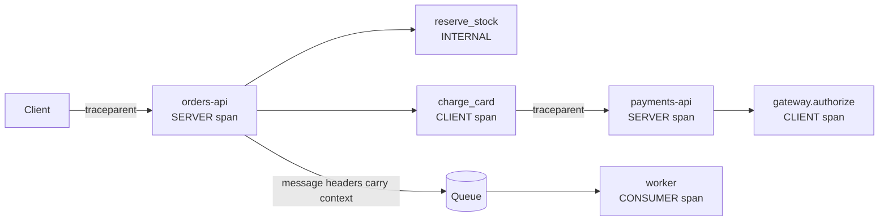
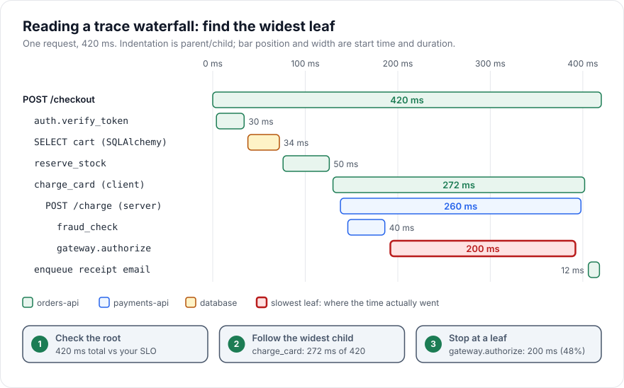

# Tracing

> [!TIP]
> **In one line:** Instrument the code you own with spans that carry useful attributes, events and an honest status, propagate context across every hop, and sample deliberately.
>
> **In plain English:** A trace is a stopwatch you can start inside a stopwatch. You time the whole request, and within it you time each step, writing short notes next to the slow or broken ones. Afterwards you read the timings as a chart and see exactly where the minutes went.
>
> **You'll be able to:** create spans with attributes, events and error status · propagate context over HTTP and queues · choose between head and tail sampling · read a trace waterfall to find the slow span

## Why This Matters

[Distributed Tracing](distributed-tracing.md) explained *what* a trace is and why context must flow between services. This chapter is the hands-on layer: you will put spans into your own code and learn to read the result. Automatic instrumentation (covered in [OpenTelemetry](opentelemetry.md)) gives you spans for incoming HTTP requests, outgoing HTTP calls and database queries, which is a good skeleton, but it cannot know that `reserve_stock` is a business step worth timing, that a retry happened, or which order was being processed. Those facts live in your code, and the difference between a trace that says "POST /checkout took 420 ms" and one that says "the payment gateway took 200 ms for order 8842 after one retry" is manual instrumentation done well.

Tracing also answers a question metrics cannot. A p99 latency graph tells you that something got slow; a single trace shows you which dependency, in which service, on which code path. Logs can tell the same story only if someone remembered to log every step with timing; a trace gives you the timing and the structure for free.

## Core Concept

A **span** is a named, timed operation with a start time, an end time, a **kind**, a set of **attributes**, optional **events**, a **status**, and links to its context: a `trace_id` shared by all spans in the trace, its own `span_id`, and its parent's span ID (absent for the root). A **trace** is the set of spans with one `trace_id`, forming a tree through parent IDs.

**Span kinds** tell the backend how to draw the edges: `SERVER` (handling an incoming request), `CLIENT` (making an outgoing request), `PRODUCER` and `CONSUMER` (publishing to and receiving from a queue), and `INTERNAL` (the default, work inside the process). A CLIENT span in one service and the SERVER span it triggers in another are separate spans, and the gap between them is network and queueing time.

**Attributes** are key-value pairs describing the span: `http.request.method`, `db.system`, plus your own, namespaced (`app.order_id`, `app.sku`). They are what you filter and group by in the backend ("show slow `charge_card` spans where `app.amount_cents > 50000`"). Values should be strings, numbers, booleans or arrays of those. **Events** are timestamped notes inside a span (`retry`, `cache.miss`, `stock.reserved`), used for things that happened at a moment rather than over a duration. **Status** is `UNSET` (default, "no error reported"), `ERROR`, or `OK`. By convention you set `ERROR` for failures and leave `OK` alone; instrumentation libraries set `ERROR` on a server span only for 5xx responses, because a 404 or 422 is the server working correctly. Setting an exception on the span with `record_exception` adds an event with the type, message and stacktrace.

**Context** is the ambient "current span". In Python's OpenTelemetry API it is stored in `contextvars`, so a span started with `start_as_current_span` becomes the parent of any span started below it in the same task, including across `await` points, with no argument passing. This is the same mechanism that carries the request ID in [Request IDs](request-ids.md).

## Mental Model

Picture the itemised receipt of a restaurant order. The whole order is the root span, "Table 7, 19:02 to 19:41". Each course is a child, and the main course has its own children, "kitchen cooks steak 14 min" and "waiter delay 6 min". A span's attributes are the details printed beside each line (medium-rare, no onions); an event is a note stamped at one instant ("19:23 customer sent the wine back"). When the bill is too long you do not reread the entire evening; you scan the widest line, then the widest line inside it, until you reach the one step where the time vanished. Reading a trace is exactly that descent.

## How It Works

**Creating spans.** `tracer.start_as_current_span("name")` is a context manager: it starts a span, makes it current, and ends it when the block exits, recording any escaping exception as an event and setting ERROR status by default (`record_exception=True`, `set_status_on_exception=True`). Use a `with` block rather than manual `start_span`/`end`, because forgetting to end a span means it is never exported.

**Naming.** Span names must be low-cardinality: `GET /orders/{id}`, `reserve_stock`, `SELECT orders`, never `GET /orders/8842`. High-cardinality data belongs in attributes. A name with an ID in it breaks grouping, aggregation and often the backend's storage.

**What to put in attributes.** Prefer identifiers over objects (`app.order_id`, not the order), business dimensions you will want to slice by (tenant, plan, feature flag, model name), and sizes or counts (`app.item_count`). Do not add secrets or personal data; spans are exported to a third-party backend and retained like logs (see [Structured Logging](structured-logging.md) for redaction). Keep values small; many backends truncate attributes at a limit (the SDK default per-value limit is unlimited unless configured, so set `OTEL_ATTRIBUTE_VALUE_LENGTH_LIMIT`).

**Propagation over HTTP.** Before an outgoing call, `propagate.inject(headers)` writes the current context into a dict, producing a `traceparent` header (and `tracestate`, and `baggage` if used). On the receiving side, instrumentation calls `propagate.extract(headers)` to build a context and starts the SERVER span as a child of it. With `opentelemetry-instrumentation-httpx` and the FastAPI instrumentation this happens automatically; the manual calls matter for custom transports.

**Propagation over queues.** A message queue breaks the chain unless you carry the context in the message. At publish time, inject into a carrier dictionary and store it in message headers or the envelope; in the worker, `extract` it and attach it before starting a CONSUMER span. For batch consumers that process many messages in one span, use **links** (`trace.Link(span_context)`) instead of a parent, since one span cannot have many parents. Note the semantics: a trace that includes asynchronous work may stretch far beyond the original request's duration, and the user-facing latency is just the root span's synchronous part.

**Sampling.** Recording every span is affordable at low traffic and prohibitive at high traffic (storage, network and CPU). Sampling decides which traces to keep.

- **Head sampling** decides at the root, when the trace starts, before anything is known about it. The simplest is a probability, such as `TraceIdRatioBased(0.1)`, which deterministically keeps about 10% of trace IDs; wrapping it in `ParentBased` makes every service follow the root's decision, so traces are kept or dropped whole. It is cheap (unsampled traces generate almost no data) and predictable, but it is blind: with a 10% rate, 90% of your errors and slow requests are discarded too. A request that fails once in 1,000 is retained roughly once in 10,000.
- **Tail sampling** decides after the trace completes, by buffering spans somewhere (typically the OpenTelemetry Collector's tail sampling processor) and applying rules: keep all traces with an error, keep all traces slower than 1 s, keep 5% of the rest. It keeps exactly the interesting traces. The costs are real: every span must be sent to the sampling tier (so SDK and network overhead is not reduced), the tier holds spans in memory for the decision window (for example 30 s), and all spans of a trace must reach the *same* collector instance, which requires trace-ID-aware load balancing in multi-replica setups. A trace longer than the window is decided on partial data.
- **Combination.** A common production design: generous head sampling where it is safe (for example always sample, or 50%) plus a tail-sampling tier that retains errors, slow traces and a baseline; or a low head rate plus separate, always-on metrics for error rate and latency so that dashboards do not depend on traces being kept. Metrics computed from *unsampled* data stay accurate; metrics computed from sampled spans need to be scaled by the sampling rate.

**Reading a waterfall.** Each row is a span; the horizontal axis is time; indentation is parentage. Procedure: (1) check the root's total against your latency target; (2) find the widest child on the critical path; (3) descend until a leaf holds the time; (4) look at gaps, because white space between a parent's start and its first child, or between siblings, is time in your own code, in the event loop, or waiting for a connection; (5) look at shape, since a staircase of near-identical short spans is an N+1 query or a sequential loop that could be concurrent, while a wide stack of overlapping spans is already parallel; (6) compare to a fast trace of the same route.

## Architecture





The diagram follows the same request as the flowchart: root span, children for each step, a cross-service hop, and the slowest leaf highlighted. Descending the widest bars leads straight to `gateway.authorize`.

## Request / Response Example

Context crosses the HTTP hop in a `traceparent` header: version `00`, 32-hex trace ID, 16-hex parent span ID (the caller's `charge_card` CLIENT span), and flags where bit `01` means "sampled".

```http
POST /charge HTTP/1.1
Host: payments.internal
Content-Type: application/json
traceparent: 00-4bf92f3577b34da6a3ce929d0e0e4736-00f067aa0ba902b7-01

{"order_id": 8842, "amount_cents": 4990}
```

A finished span as exported (simplified from the SDK's console exporter) looks like this:

```json
{
  "name": "charge_card",
  "context": {"trace_id": "0x4bf92f3577b34da6a3ce929d0e0e4736", "span_id": "0x00f067aa0ba902b7"},
  "kind": "SpanKind.CLIENT",
  "parent_id": "0x53995c3f42cd8ad8",
  "start_time": "2026-11-10T06:08:00.100Z",
  "end_time": "2026-11-10T06:08:00.372Z",
  "status": {"status_code": "ERROR", "description": "charge failed"},
  "attributes": {"app.order_id": 8842, "app.amount_cents": 4990},
  "events": [{"name": "exception", "attributes": {"exception.type": "TimeoutError"}}],
  "resource": {"service.name": "orders-api"}
}
```

## Code Example

This FastAPI module uses only the OpenTelemetry API and SDK (opentelemetry-api and opentelemetry-sdk 1.x). It builds spans by hand, records an event, marks an error, shows head sampling, and injects and extracts context for both an HTTP call and a queue message. It was run with a `TestClient`; the console exporter prints each finished span as JSON.

```python
import asyncio
import json
import os

from fastapi import FastAPI
from opentelemetry import context, propagate, trace
from opentelemetry.sdk.resources import Resource
from opentelemetry.sdk.trace import TracerProvider
from opentelemetry.sdk.trace.export import BatchSpanProcessor, ConsoleSpanExporter
from opentelemetry.sdk.trace.sampling import ParentBased, TraceIdRatioBased
from opentelemetry.trace import SpanKind, Status, StatusCode

provider = TracerProvider(
    resource=Resource.create({"service.name": "orders-api"}),
    # Head sampling: keep 10% of new traces, but always follow the parent's decision.
    sampler=ParentBased(TraceIdRatioBased(float(os.getenv("TRACE_SAMPLE_RATIO", "0.1")))),
)
provider.add_span_processor(BatchSpanProcessor(ConsoleSpanExporter()))
trace.set_tracer_provider(provider)
tracer = trace.get_tracer("orders.checkout", "1.0.0")

app = FastAPI()


async def reserve_stock(sku: str, qty: int) -> None:
    with tracer.start_as_current_span("reserve_stock") as span:
        span.set_attribute("app.sku", sku)
        span.set_attribute("app.quantity", qty)
        await asyncio.sleep(0.01)
        span.add_event("stock.reserved", {"warehouse": "eu-1"})


async def charge_card(order_id: int, amount_cents: int) -> None:
    with tracer.start_as_current_span("charge_card", kind=SpanKind.CLIENT) as span:
        span.set_attribute("app.order_id", order_id)
        span.set_attribute("app.amount_cents", amount_cents)
        try:
            await asyncio.sleep(0.02)
            if amount_cents > 100_000:
                raise ValueError("amount over limit")
        except Exception as exc:
            span.record_exception(exc)
            span.set_status(Status(StatusCode.ERROR, "charge failed"))
            raise


def inject_headers() -> dict[str, str]:
    headers: dict[str, str] = {}
    propagate.inject(headers)  # writes traceparent (and tracestate/baggage if present)
    return headers


def make_message(payload: dict) -> str:
    carrier: dict[str, str] = {}
    propagate.inject(carrier)
    return json.dumps({"payload": payload, "otel": carrier})


def handle_message(raw: str) -> None:
    msg = json.loads(raw)
    ctx = propagate.extract(msg["otel"])
    token = context.attach(ctx)
    try:
        with tracer.start_as_current_span("process_order_email", kind=SpanKind.CONSUMER):
            pass
    finally:
        context.detach(token)


@app.post("/checkout")
async def checkout(order_id: int, amount_cents: int):
    with tracer.start_as_current_span("checkout") as span:
        span.set_attribute("app.order_id", order_id)
        await reserve_stock("sku-1", 2)
        await charge_card(order_id, amount_cents)
        return {"ok": True, "headers": inject_headers(), "msg": make_message({"o": order_id})}
```

Points to note. `ParentBased(TraceIdRatioBased(...))` samples a new trace with probability `TRACE_SAMPLE_RATIO` and, when an incoming `traceparent` already carries a decision, follows it. The `BatchSpanProcessor` exports on a background thread in batches so request latency is unaffected, though spans still in its queue can be lost on abrupt process exit unless you call `provider.shutdown()` or `force_flush()` at shutdown. In `charge_card`, the exception is recorded, the status is set, and the exception is re-raised so FastAPI still returns a 500; swallowing it would hide the failure from callers. The `make_message` and `handle_message` pair shows the queue pattern; in real code the carrier dictionary becomes the broker's message headers.

## Production Considerations

- **Overhead.** Creating a span costs microseconds; exporting costs CPU and network. Use batch processors, keep attribute counts modest, and do not create spans inside tight loops (a span per list item in a 10,000-element loop is both slow and unreadable). Put the count in an attribute instead.
- **Trace storage cost scales with spans per trace.** Twelve spans per request at 1,000 requests per second with 10% head sampling is 1,200 spans per second; at roughly 500 bytes per span that is about 52 GB per day before compression. Decide the sampling rate from a budget, not a feeling.
- **Incomplete traces.** If one service drops the header or samples independently, traces arrive in fragments. Make `ParentBased` the standard everywhere and test propagation with an end-to-end check.
- **Tail sampling infrastructure.** Run it as a dedicated Collector tier behind a load balancer that routes by trace ID, set the decision wait longer than your slowest legitimate request, and monitor the Collector's dropped-span metrics.
- **Link traces to logs and metrics.** Put `trace_id` on log lines and use exemplars on latency histograms so a p99 spike links to a real trace ([Metrics](metrics.md)).
- **Sensitive data.** Attributes are not redacted by default; apply the same denylist you use for logs, and never put request bodies in attributes.

## Common Mistakes

- **High-cardinality span names** such as raw URLs with IDs, which fragment aggregation and inflate storage.
- **Not ending spans**, or ending them in the wrong order with manual `start_span`, producing missing or wrongly nested spans.
- **Swallowing exceptions** after `record_exception`, or setting ERROR on 4xx client faults, which pollutes error rates.
- **Losing context at boundaries**: `threading.Thread`, `run_in_executor` without `contextvars`, `asyncio` tasks created from a different context, queues with no carrier, or a manual `httpx` call on an uninstrumented client.
- **Only tracing the happy path**, so the traces that exist are the least interesting ones.
- **Treating a low head-sampling rate as an error rate.** If 10% of traces are kept, 10% of the errors are visible unless a tail rule keeps them.
- **Spans for everything.** A trace with 400 spans is as unreadable as no trace; instrument boundaries (network, database, queue, major business steps), not every function.

## Best Practices

- Instrument boundaries and business steps manually on top of automatic instrumentation, with low-cardinality names and a few useful attributes.
- Set ERROR status only for real failures; record the exception once, where it is handled.
- Use `ParentBased` samplers everywhere so traces stay whole, and add tail sampling for errors and slow requests when you can operate the infrastructure.
- Carry context through every queue and job with an explicit carrier, and use links for batch consumers.
- Name attributes with an `app.` or domain prefix and document them as a schema; follow OpenTelemetry semantic conventions for standard ones.
- Flush the tracer provider on shutdown.

## AI Engineering Perspective

LLM calls are the slowest, most expensive and least predictable spans in a modern request, so they deserve first-class instrumentation. A useful `llm.call` span carries the model name, input and output token counts, finish reason, whether the response came from a cache, and an estimated cost, and an event for time-to-first-token in streaming responses. OpenTelemetry's generative-AI semantic conventions define attribute names for these (they are still marked as experimental and have changed between releases, so pin versions and check the current spec). In RAG pipelines the waterfall shows whether latency is in embedding, vector search, reranking or generation, which are four different fixes. In agent loops each tool call becomes a child span of an agent step span, so a trace shows the full plan, act and observe chain; because loops can be long, sample them with a tail rule that keeps runs with errors, high step counts or high cost. Prompts and completions are sensitive and large: record them as span events or attributes only for sampled or opted-in traces, and respect redaction. See [RAG APIs](../16-rag-apis/README.md) and [AI agents and MCP](../17-ai-agents-and-mcp/README.md).

## Exercises

**Beginner**
1. Run the example with `TRACE_SAMPLE_RATIO=1`, call `/checkout` successfully and with `amount_cents=500000`, and compare the exported spans: where do the status and the exception event appear?
2. Rename `reserve_stock` to `reserve_stock_sku-1` to see why span names must be low-cardinality, then explain what would happen with a million SKUs.

**Intermediate**
3. Add a retry loop around `charge_card` that records a `retry` event with the attempt number on the span, and show in the output how many events appear.
4. Send the message produced by `make_message` through a real queue (Redis list, for example) and confirm the worker's `process_order_email` span has the same `trace_id` as the request.

**Advanced**
5. Write the Collector `tail_sampling` configuration that keeps all traces containing an ERROR, all traces over 1 s, and 5% of the rest, and describe how you would route spans of one trace to one Collector replica.
6. Given 2,000 requests per second, 15 spans per request and 600 bytes per span, compute daily storage for 100%, 10% head and a tail policy that keeps 3% errors and slow traces plus 2% baseline.

## Key Takeaways

- A span is a timed, named operation with kind, attributes, events and status; the current span lives in contextvars so children nest automatically.
- Low-cardinality names, a few meaningful attributes, and honest error status make traces searchable and trustworthy.
- Context must be injected and extracted at every boundary, including queues, where batch consumers use links.
- Head sampling is cheap but blind; tail sampling keeps errors and slow traces but needs buffering infrastructure. Read a waterfall by descending the widest child to a leaf and inspecting gaps and staircases.

### Check Yourself

<details markdown="1">
<summary>1. Why should a span name be `GET /orders/{id}` rather than `GET /orders/8842`?</summary>

Names are grouping keys. Embedding the ID creates a new name per order, so aggregation, latency percentiles and storage all degrade; the ID belongs in an attribute.

</details>

<details markdown="1">
<summary>2. With a 5% head-sampling rate, why will you miss most of your rare errors, and what fixes it?</summary>

The decision is made at the start of the trace, before anyone knows it will fail, so about 95% of failing traces are dropped as well. Tail sampling (keep every trace that contains an error) or separate always-on error metrics fixes it.

</details>

<details markdown="1">
<summary>3. A waterfall shows 40 near-identical short database spans in a row under one handler. What is it and how do you fix it?</summary>

It is an N+1 query pattern, one query per item. Fix by batching, joining or eager loading so a single query fetches all rows.

</details>

---
Back to the [Part 12 README](README.md).
