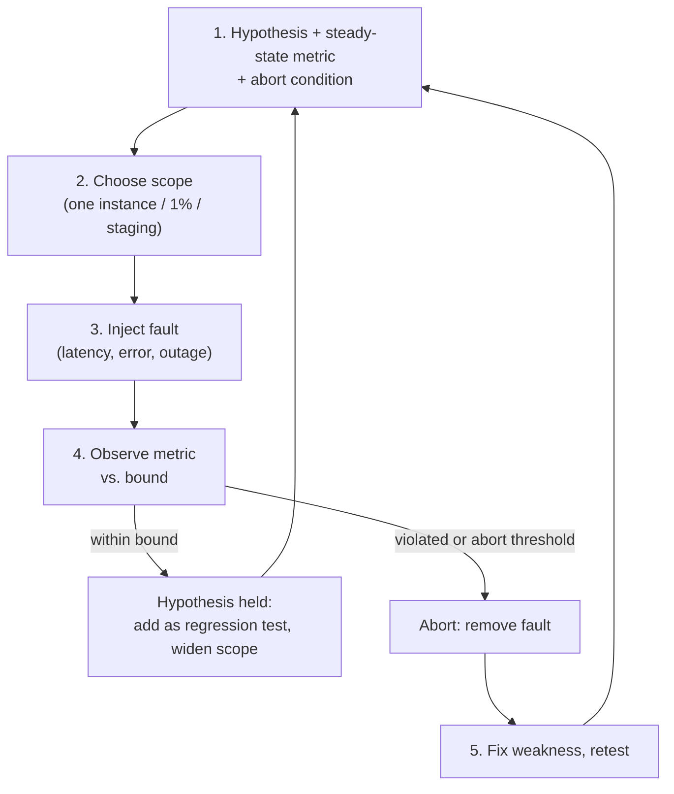
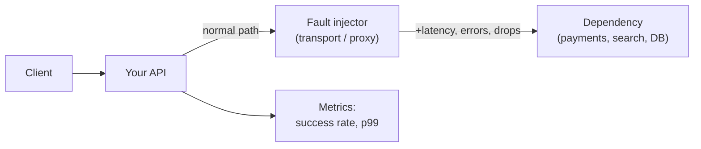

# Chaos Testing Basics

> [!TIP]
> **In one line:** Chaos testing injects controlled faults such as latency, errors, and dead dependencies to check a stated hypothesis about steady state, finding resilience gaps before real failures do.
>
> **In plain English:** A fire drill does not start a real fire; it checks that people know the exit and that the doors open. Chaos testing is a fire drill for your API: you deliberately break one small thing on purpose, with a plan and a way to stop, and see whether the rest keeps working the way you claimed it would.
>
> **You'll be able to:** write a hypothesis tied to a steady-state metric · limit blast radius and run experiments safely, starting in staging · inject latency and errors in Python tests with a fault-injecting httpx transport

## Why This Matters

Every resilience mechanism in this handbook, such as timeouts, retries, circuit breakers, fallbacks, and graceful degradation in [Part 6](../06-production-reliability/README.md), is a claim about how the system behaves when something goes wrong. The uncomfortable fact is that these claims are rarely tested. Retry logic gets written once and is only exercised in an actual outage. A circuit breaker's thresholds are guesses. A fallback path may have a bug that has been dormant for a year because the primary path never failed. Failure handling is the least-executed code in your system, which makes it the most likely to be broken when you finally need it.

Chaos testing exists to execute that code on your schedule, in a controlled way, and to learn from it while the stakes are low. It is not about randomly breaking things for fun. It is the experimental method applied to reliability: state what you believe, perturb the system in a limited way, measure whether the belief held, and fix the gap if it did not. [Stress testing](stress-testing.md) asks how the system behaves under too much load; chaos testing asks how it behaves when its parts misbehave.

## Core Concept

**Chaos engineering**, a discipline popularised by Netflix, is defined by a handful of ideas that distinguish it from careless fault injection.

1. **Steady state.** Choose a measurable signal that indicates the system is working for users, ideally a business-level or service-level one: successful checkout rate, p99 latency of `GET /orders`, the share of requests returning non-5xx. This is your yardstick; an experiment with no steady-state metric is just breaking things. See SLIs and SLOs in [Part 12](../12-observability/README.md).
2. **Hypothesis.** A falsifiable statement of the form "when X fails, the steady-state metric stays within bound Y." For example: "If the recommendations service returns 500 for 100% of calls, `GET /home` still returns 200 within 800 ms for at least 99% of requests because we fall back to a cached list."
3. **Fault injection.** Introduce a real-world failure mode: added latency, error responses, dropped connections, a dependency being unreachable, a slow database, a killed instance, a full disk, or an expired certificate.
4. **Minimal blast radius.** Limit who and what is affected: one instance, one percent of traffic, one test tenant, a staging environment. Define abort conditions before starting.
5. **Learn and fix.** If the hypothesis holds, you have evidence (and a regression test). If it fails, you have found a weakness, which is the whole point. Fix it and repeat.

Faults worth injecting map to the failures real distributed systems produce: **latency** (the slow dependency is more dangerous than the dead one because it ties up threads, connections, and timeouts), **errors** (5xx, malformed responses, 429s), **unavailability** (connection refused, DNS failure, timeouts), **partial failure** (one of three replicas, one availability zone), and **resource exhaustion** (CPU, memory, disk, descriptors).

## Mental Model

A vaccine trains the immune system by exposing it to a weakened form of the threat in a controlled setting, so the body's response is tested and learned before the real infection arrives. Chaos tests are the weakened pathogen: a small, bounded fault that exercises your defences while you are watching and able to intervene. The dose matters: start small, observe, and increase only after the system has shown it can handle the last dose.

## How It Works

**Pick a target and the question.** Start from what you believe is resilient. Good first experiments come from your architecture diagram: every arrow to a dependency is an opportunity to ask "what if this is slow, wrong, or gone?" Check the claims your code makes: a timeout of 2 seconds, three retries with jitter, a circuit breaker that opens after five failures.

**Define steady state and instrument it.** If you cannot see the metric during the experiment, you cannot run it. Make sure the dashboards, logs, and traces for the metric exist and that you can tell fault-induced errors apart from normal background errors, for example by tagging injected failures.

**Write the hypothesis and the abort condition.** For instance: "Adding 1.5 seconds of latency to the payments provider for 5 minutes will cause checkout p99 to rise but error rate to remain under 1% because we have a 3-second timeout and a circuit breaker. Abort if error rate exceeds 5% or if any real customer-facing alert fires."

**Choose the injection point.** There are several levels, from cheap to realistic:

- **In-process (test level).** Wrap your HTTP client transport, database session, or Redis client with a layer that randomly adds delay or raises errors. This runs in ordinary unit and integration tests, is deterministic when seeded, and is where most teams should start. The Code Example does this.
- **Proxy or sidecar.** Put a fault-injecting TCP/HTTP proxy between your service and a dependency. Tools such as Toxiproxy let you add latency, bandwidth limits, or connection resets to a specific link, and service meshes such as Istio can inject delays and aborts for a percentage of requests via routing rules. Check each tool's current documentation for configuration syntax.
- **Platform level.** Kill containers or pods, stop a node, throttle CPU, or partition the network, using the orchestrator's tooling or a chaos platform (for example Chaos Mesh, LitmusChaos, or cloud-provider fault injection services). This tests infrastructure-level recovery such as restarts, rescheduling, and failover.
- **Application feature flags.** Build a fault switch into a non-production environment (a header or flag that makes a dependency adapter fail) so test suites can trigger failures on demand.

**Run in the safest environment that can answer the question.** Start in a test or staging environment under synthetic traffic. Only after the system has passed there, and with strong observability and a quick abort path, consider limited experiments in production, which is the only place real traffic patterns and real configuration exist. Production experiments need an agreed process, stakeholders notified, a time window, and an automatic rollback of the fault.

**Run, observe, abort if needed, then analyse.** Inject the fault for a fixed duration, watch the steady-state metric, then remove the fault and confirm recovery (the system returning to baseline is part of the hypothesis). Record what happened versus what you predicted.

**Turn learning into permanent protection.** The in-process version of every successful experiment becomes an automated test that runs in CI. Experiments that revealed gaps become tickets, and after the fix you rerun them. Over time the scope grows ("game days" where a team rehearses a larger failure together) and parts can be automated and scheduled.

## Architecture





## Request / Response Example

A fault proxy adds failure at one link. With a hypothesis that checkout tolerates a slow payment provider, the observed traffic during the experiment might look like this.

```http
POST /v1/checkout HTTP/1.1
Host: staging.api.example.com
X-Chaos-Experiment: payments-latency-1500ms
Content-Type: application/json

{"cart_id": "c_8821"}
```

```http
HTTP/1.1 200 OK
X-Request-ID: 9d41ab07
Server-Timing: payments;dur=1534, total;dur=1602

{"order_id": "ord_5541", "status": "paid"}
```

Here the injected 1.5 seconds shows in `Server-Timing` but the request succeeded, which supports the hypothesis for latency. The same experiment with 5 seconds of delay should return a fast, intentional error instead of hanging, for example:

```http
HTTP/1.1 503 Service Unavailable
Retry-After: 5
Content-Type: application/problem+json

{"title": "Payment provider unavailable", "status": 503}
```

If it instead hangs for 30 seconds and returns `500`, you have found a missing timeout, exactly the kind of weakness chaos testing exists to surface.

## Code Example

A fault-injecting `httpx` async transport that wraps any real or fake transport, plus tests that check a client's resilience claims. A seeded random generator keeps the experiments repeatable. The client under test claims: "an attempt is abandoned after 0.2 seconds and failed calls are retried up to three times."

```python
# chaos_httpx.py
import asyncio
import random

import httpx


class FaultInjectingTransport(httpx.AsyncBaseTransport):
    """Wraps another transport and injects latency, errors, or dropped connections.

    Use only in tests and non-production environments. A fixed `seed` makes the
    sequence of injected faults reproducible, so a failing experiment can be rerun.
    """

    def __init__(
        self,
        inner: httpx.AsyncBaseTransport,
        *,
        latency_s: float = 0.0,
        latency_prob: float = 0.0,
        error_status: int = 503,
        error_prob: float = 0.0,
        drop_prob: float = 0.0,
        seed: int | None = None,
    ) -> None:
        self._inner = inner
        self._latency_s, self._latency_prob = latency_s, latency_prob
        self._error_status, self._error_prob = error_status, error_prob
        self._drop_prob = drop_prob
        self._rng = random.Random(seed)
        self.injected = {"latency": 0, "error": 0, "drop": 0}   # for the experiment report

    async def handle_async_request(self, request: httpx.Request) -> httpx.Response:
        if self._rng.random() < self._drop_prob:
            self.injected["drop"] += 1
            raise httpx.ConnectError("chaos: connection dropped", request=request)
        if self._rng.random() < self._latency_prob:
            self.injected["latency"] += 1
            await asyncio.sleep(self._latency_s)               # the slow dependency
        if self._rng.random() < self._error_prob:
            self.injected["error"] += 1
            return httpx.Response(
                self._error_status, headers={"X-Chaos": "injected"}, request=request
            )
        return await self._inner.handle_async_request(request)

    async def aclose(self) -> None:
        await self._inner.aclose()


# The client code whose resilience we are testing.
async def fetch_with_retry(
    client: httpx.AsyncClient, url: str, *, attempts: int = 3, deadline_s: float = 0.2
) -> httpx.Response | None:
    for attempt in range(attempts):
        try:
            r = await asyncio.wait_for(client.get(url), timeout=deadline_s)
            if r.status_code < 500:
                return r
        except (httpx.TransportError, asyncio.TimeoutError):
            pass
        await asyncio.sleep(0.01 * 2**attempt)                 # tiny backoff for the test
    return None                                                # caller falls back to a default


def _healthy_backend() -> httpx.MockTransport:
    return httpx.MockTransport(lambda req: httpx.Response(200, json={"ok": True}))


# Hypothesis 1: with 30% injected 503s, 3 attempts still succeed >= 95% of the time.
# Expected failure rate per call is 0.3**3 = 2.7%, so 95% leaves a margin.
def test_retries_absorb_intermittent_errors():
    async def run() -> float:
        chaos = FaultInjectingTransport(_healthy_backend(), error_prob=0.3, seed=1234)
        async with httpx.AsyncClient(transport=chaos, base_url="http://dep") as c:
            results = [await fetch_with_retry(c, "/x") for _ in range(300)]
        assert chaos.injected["error"] > 0                     # the fault really fired
        return sum(r is not None for r in results) / len(results)

    assert asyncio.run(run()) >= 0.95


# Hypothesis 2: a dependency that is 100% slow must not hang the caller beyond budget.
def test_slow_dependency_is_bounded_by_deadline():
    async def run() -> tuple[httpx.Response | None, float]:
        chaos = FaultInjectingTransport(_healthy_backend(), latency_s=5.0, latency_prob=1.0)
        async with httpx.AsyncClient(transport=chaos, base_url="http://dep") as c:
            loop = asyncio.get_running_loop()
            start = loop.time()
            result = await fetch_with_retry(c, "/x", attempts=2, deadline_s=0.1)
            return result, loop.time() - start

    result, elapsed = asyncio.run(run())
    assert result is None          # gave up and fell back
    assert elapsed < 1.0           # 2 attempts x 0.1 s plus backoff, nowhere near 5 s
```

The same wrapper works around `httpx.ASGITransport(app=app)` for in-process integration tests against your FastAPI app, or around a real `httpx.AsyncHTTPTransport()` in a staging-only configuration enabled by an environment variable. For retries on non-idempotent requests, remember the idempotency requirements from [Part 2](../02-rest-api-design/README.md): chaos tests are a good way to prove a retried `POST` does not double-charge.

## Production Considerations

- **Get the blast radius and abort path right first.** Automatic rollback of the fault, a time limit, and a human who can stop it, before any production experiment. If you cannot undo it in seconds, shrink it.
- **Observability is a prerequisite.** Without metrics, logs, and traces you cannot judge the hypothesis or spot collateral damage. Chaos testing a system you cannot observe produces anecdotes.
- **Coordinate and communicate.** Tell on-call, support, and dependent teams. An experiment that triggers a real page without warning wastes trust.
- **Exclude unsafe faults.** Experiments that could corrupt or lose data, breach security boundaries, or affect third parties' systems belong only in isolated environments.
- **Mind injected failures in analytics and billing.** Tag requests and filter them out of business metrics.
- **Combine with game days.** A scheduled, team-wide exercise that practises incident response (detection, escalation, rollback) tests people and runbooks as well as software.
- **Resilience patterns have a cost.** Retries multiply load on a struggling dependency; test that retry budgets and jittered backoff prevent retry storms, as described in [Part 6](../06-production-reliability/README.md).

## Common Mistakes

- **Starting in production** without having proven the experiment in staging or in tests.
- **No hypothesis or metric,** so nobody can say whether the experiment passed.
- **Breaking too much at once.** Large first experiments make cause and effect impossible to separate and risk real outages.
- **Forgetting latency.** Teams test "dependency down" (fast failure) but not "dependency slow", which is the case that exhausts connection pools and threads.
- **Treating success as proof of safety.** One passing experiment shows the system handled that fault at that moment; conditions change, so rerun regularly.
- **Not fixing what you find,** which turns chaos testing into a reporting exercise.
- **Randomness without a seed,** which makes test failures non-reproducible and tempts people to rerun until green.

## Best Practices

- Start with in-process fault injection in CI, then a staging environment, then carefully scoped production experiments.
- Write the hypothesis, steady-state metric, blast radius, and abort condition down before every experiment.
- Inject the faults real systems produce, in this order of value: latency, partial errors, dependency unavailable, instance loss, resource exhaustion.
- Seed random fault generators and log every injected fault so runs can be replayed.
- Convert each experiment that taught you something into an automated regression test.
- Verify recovery after removing the fault, not just behaviour during it.
- Review incidents for experiment ideas: every outage is a hypothesis you did not test.

## AI Engineering Perspective

LLM-dependent systems have an unusually rich failure menu, and most of it is cheap to simulate. Inject provider `429`s and `529`-style overload responses, multi-second time-to-first-token, a stream that stops halfway through a response, malformed JSON where your code expects structured output, a tool call that references a function that does not exist, and an embedding or vector store outage in a retrieval pipeline. Each maps to a decision your system should have made in advance: fall back to a second provider, return a partial answer, degrade to a non-AI path, or fail fast with a clear error. Agents add a loop-specific hypothesis: "if a tool fails three times, the agent stops and reports instead of retrying forever or burning budget." The same fault-injecting transport pattern works around a provider SDK's HTTP layer. See [Part 15](../15-production-ai-systems/README.md) for fallback chains and gateways and [Part 17](../17-ai-agents-and-mcp/README.md) for agent failure handling.

## Exercises

**Beginner**
1. Write a hypothesis, steady-state metric, and abort condition for "the product search dependency is unavailable" on an API you know. What should the endpoint return?

**Intermediate**
2. Extend `FaultInjectingTransport` with a mode that returns a `200` with a truncated or malformed JSON body. Write a test showing your client's parsing code handles it without crashing.
3. Use the transport to show that retries without jitter against a failing dependency produce synchronised bursts, then add jitter and compare the request timeline.

**Advanced**
4. Plan a production game day for a checkout flow: list three experiments in increasing blast radius, the steady-state metric, abort conditions, communications, and what you would automate afterwards.

## Key Takeaways

- Chaos testing is hypothesis-driven: define a steady-state metric, inject a controlled fault, and check whether the metric stays in bounds.
- Control blast radius and have abort conditions; start in tests and staging before any production experiment.
- Latency injection is as important as outages, because slow dependencies exhaust shared resources.
- Every experiment that teaches you something should end as an automated regression test and a fix.

### Check Yourself
<details markdown="1">
<summary>1. What are the essential parts of a chaos experiment?</summary>

A steady-state metric, a falsifiable hypothesis, a controlled fault injection with limited blast radius and abort conditions, observation of the metric, and follow-up to fix any weakness found. Without the metric and hypothesis it is just breaking things.

</details>

<details markdown="1">
<summary>2. Why is a slow dependency often more dangerous than a dead one?</summary>

A dead dependency fails fast and is easy to handle. A slow one holds threads, connections, and requests open, which exhausts pools and queues in the caller and can cascade, so it is the failure that timeouts and circuit breakers are really for.

</details>

<details markdown="1">
<summary>3. Your team wants to inject failures in production next week but has no dashboards for checkout success rate. What do you recommend?</summary>

Build the observability first and prove the experiment in staging or in-process tests. Without a visible steady-state metric you cannot test the hypothesis or detect collateral damage, so a production experiment would be unsafe.

</details>

---
Back to the [Part 13 README](README.md).
