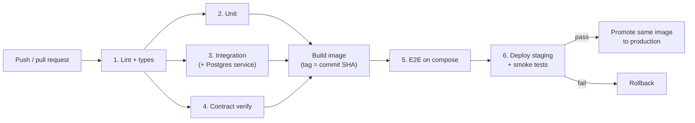
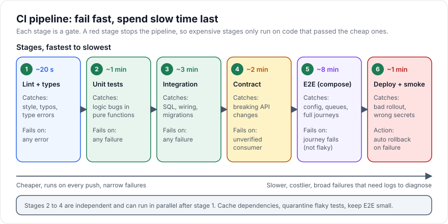

# CI/CD Testing Pipelines

> [!TIP]
> **In one line:** A CI/CD pipeline runs your tests as ordered gates from fastest to slowest, so every change gets quick feedback and only code that passed the cheap checks reaches the expensive ones.
>
> **In plain English:** A factory inspects parts at several stations: a quick glance at the door, then a measuring check, then a full test drive, and finally a spot check after the car reaches the showroom. Putting the fast checks first means a defective door is caught in seconds instead of after the test drive. A testing pipeline is that line of stations for your code.
>
> **You'll be able to:** order test stages by speed and value and decide what fails the build · write a GitHub Actions workflow with a Postgres service, caching, and parallel jobs · manage flaky tests and quality gates with a clear policy

## Why This Matters

Writing good tests is only half the job; the other half is making them run, every time, in the same way, before a change can reach users. A test suite that depends on a developer remembering to run it will eventually be skipped on the Friday afternoon that matters. A pipeline turns the suite into a gate that nobody has to remember.

The design of the pipeline decides whether tests help or hinder. A pipeline that takes 45 minutes encourages developers to batch up large changes, context-switch while waiting, and merge without waiting for results. A pipeline whose results are unreliable, failing at random, teaches the team to click "re-run" and ignore red, which means a real failure eventually slips through. A pipeline with no stages runs everything on every change and burns money and patience. The goal is fast, trustworthy feedback: the cheapest tests first, the most valuable tests always, slow tests in parallel or later, and a clear rule for what blocks a merge or a deploy.

## Core Concept

**Continuous integration (CI)** means merging small changes to a shared branch frequently, with an automated build and test run on every change. **Continuous delivery (CD)** extends the same automation to producing a deployable artifact and moving it through environments, and **continuous deployment** goes further by releasing automatically when all gates pass. In all three, the test pipeline is the safety mechanism that makes frequent change safe.

The core design principle is the **shift-left, fail-fast ordering**: run tests in order of cost, so failures are found as early and as cheaply as possible. It mirrors the testing pyramid from [unit-testing.md](unit-testing.md): many fast checks at the base, few slow ones at the top.

| Stage | Typical time | Catches | Fails the build when |
|---|---|---|---|
| Lint, format, type check | seconds | Style, obvious errors, type mismatches | Any violation |
| Unit tests | under a minute | Logic bugs in isolation | Any failure |
| Integration tests (with real Postgres) | a few minutes | SQL, wiring, migrations, serialization ([integration-testing.md](integration-testing.md), [test-databases.md](test-databases.md)) | Any failure |
| Contract verification | minutes | Breaking API changes ([contract-testing.md](contract-testing.md)) | Unverified or broken consumer contract |
| Build image + end-to-end tests | several minutes | Config, deployment shape, journeys ([end-to-end-testing.md](end-to-end-testing.md)) | A journey fails (after flaky policy) |
| Deploy to staging, then smoke tests | about a minute | Bad rollout, wrong secrets, unreachable dependency | Smoke check fails, triggering rollback |
| Optional: load and stress tests | longer | Performance regressions ([load-testing.md](load-testing.md), [stress-testing.md](stress-testing.md)) | Latency or error threshold exceeded; usually scheduled, not per push |

A **quality gate** is a rule that decides whether a change may proceed: all required checks green, coverage on changed lines above a threshold, no new high-severity vulnerabilities, contracts verified, and approvals present. Gates are enforced by branch protection (required status checks) so that "green" means "allowed to merge" rather than "advisory".

## Mental Model

Think of airport security. The first checkpoint (ticket and ID) is fast and turns away most problems; the scanner is slower and catches more; a manual search is rare and expensive. You do not search every passenger's bag manually before checking their ticket, because that wastes everyone's time. A pipeline arranges its checks the same way and, like an airport, takes extra care before the plane (production) actually leaves.

## How It Works

**1. Trigger on the right events.** Run the pipeline on every pull request (so feedback arrives before merge) and on pushes to the main branch (so the merged result is tested and can be released). Cancel in-progress runs for the same branch when a new commit arrives to save compute.

**2. Order and parallelize.** Stages that are independent run as parallel jobs: after lint passes, unit, integration, and contract jobs can run at the same time, and the total time becomes the slowest of them rather than the sum. Stages with real dependencies (build the image, then test it, then deploy it) are sequential and declared with `needs`. Within a job, split a long test suite across multiple runners (a matrix of shards) or across CPU cores with `pytest-xdist`. When running databases in parallel, use a database per worker as described in [test-databases.md](test-databases.md).

**3. Real dependencies as services.** CI runners can start service containers next to your job. A Postgres service with a health check gives integration tests a real database without any manual setup. For multi-service end-to-end tests, build the images once and bring up a Docker Compose stack with `docker compose up --wait`.

**4. Caching.** Most pipeline time goes to setup, not tests. Cache the package manager's download cache keyed by the lock file hash, so unchanged dependencies are not downloaded again; cache Docker layers; reuse a built image across jobs through the registry or an artifact. Cache keys must include whatever invalidates the cache (the lock file, the Python version) so stale caches never mask a dependency change.

**5. Test selection ("test impact").** Running everything is simplest and safest. As the suite grows, you can run less on pull requests: path filters skip the docs-only or frontend-only changes, `pytest-testmon` selects tests affected by changed code, and monorepo tools build a dependency graph. The risk is missed regressions, so the usual compromise is selective runs on pull requests and the full suite on main and nightly.

**6. Flaky-test policy.** A flaky test passes and fails on the same code. Flakiness is a bug in the test or in the system, and it is contagious, because once people expect random failures they stop investigating real ones. A workable policy is: (a) never merge on "re-run until green" without recording it; (b) measure flake rate per test from historical results; (c) quarantine a test that is demonstrably flaky: it keeps running and reporting but no longer blocks the build; (d) every quarantined test has an owner and a ticket and a deadline, after which it is fixed or deleted. Blanket automatic retries can be used for known-infrastructure noise but they hide real intermittent failures such as race conditions, so report every retry.

**7. Artifacts and diagnosis.** Upload JUnit XML, coverage reports, logs, and failure screenshots or HTTP traces as artifacts so a red build can be diagnosed without re-running it. Print the slowest tests (`pytest --durations=10`) to keep runtime in check.

**8. Deploy with a gate and a way back.** After the tests pass on main, build an immutable image tagged with the commit SHA, deploy to staging, run the smoke tests, and promote the same image to production, never rebuilding between environments. If post-deploy smoke checks or health metrics fail, roll back automatically. Canary and blue-green releases ([Part 18](../18-production-architecture/README.md)) limit the damage of anything the tests missed.

**9. Secure the pipeline itself.** Secrets come from the CI platform's secret store and are scoped to the jobs and environments that need them; pull requests from forks should not receive them. Give workflows the minimum token permissions, pin third-party actions to a version or commit SHA, and use short-lived cloud credentials via OpenID Connect rather than long-lived keys. See [Part 10](../10-api-security/README.md).

## Architecture





## Request / Response Example

Pipelines expose their decisions through the platform's API and through status checks on the pull request. For example, branch protection requires named checks, and the platform reports each one back on the commit (response abridged below).

```http
GET /repos/acme/orders-api/commits/9fceb02/check-runs HTTP/1.1
Host: api.github.com
Accept: application/vnd.github+json
Authorization: Bearer <token from CI secret store>
```

```http
HTTP/1.1 200 OK
Content-Type: application/json

{
  "total_count": 4,
  "check_runs": [
    {"name": "lint",        "status": "completed", "conclusion": "success"},
    {"name": "unit",        "status": "completed", "conclusion": "success"},
    {"name": "integration", "status": "completed", "conclusion": "failure"},
    {"name": "contract",    "status": "in_progress", "conclusion": null}
  ]
}
```

A required check with `conclusion: "failure"` blocks the merge button, and the failing job's logs and uploaded artifacts show why.

## Code Example

A GitHub Actions workflow with a lint job, a unit and integration job using a Postgres service, parallel contract verification, and an end-to-end job that depends on all of them. The caching uses the official `setup-python` pip cache keyed on the requirements file. Replace names and the contract job's commands with your own.

```yaml
# .github/workflows/ci.yml
name: ci
on:
  pull_request:
  push:
    branches: [main]

# New commits cancel older runs of the same branch.
concurrency:
  group: ci-${{ github.ref }}
  cancel-in-progress: true

permissions:
  contents: read              # least privilege for the default token

jobs:
  lint:
    runs-on: ubuntu-latest
    steps:
      - uses: actions/checkout@v4
      - uses: actions/setup-python@v5
        with:
          python-version: "3.12"
          cache: pip                          # cache keyed on requirements files
      - run: pip install -r requirements-dev.txt
      - run: ruff check . && ruff format --check . && mypy app

  test:
    needs: lint
    runs-on: ubuntu-latest
    services:
      postgres:
        image: postgres:16                   # same major version as production
        env:
          POSTGRES_PASSWORD: ci-${{ github.run_id }}   # unique per run: no fixed credential in the repo
        ports: ["5432:5432"]
        options: >-
          --health-cmd "pg_isready -U postgres"
          --health-interval 5s
          --health-timeout 5s
          --health-retries 10
    env:
      # Read by tests/conftest.py (see test-databases.md)
      TEST_DATABASE_URL: postgresql+asyncpg://postgres:ci-${{ github.run_id }}@localhost:5432/postgres
    steps:
      - uses: actions/checkout@v4
      - uses: actions/setup-python@v5
        with:
          python-version: "3.12"
          cache: pip
      - run: pip install -r requirements-dev.txt
      - name: Unit and integration tests (parallel, with coverage)
        run: >-
          pytest -n auto --durations=10
          --cov=app --cov-report=xml --cov-fail-under=80
          --junitxml=reports/junit.xml
      - uses: actions/upload-artifact@v4
        if: always()                          # keep reports even when tests fail
        with:
          name: test-reports
          path: reports/

  contract:
    needs: lint
    runs-on: ubuntu-latest
    steps:
      - uses: actions/checkout@v4
      - uses: actions/setup-python@v5
        with:
          python-version: "3.12"
          cache: pip
      - run: pip install -r requirements-dev.txt
      # Verify the provider against published consumer contracts and diff the OpenAPI spec.
      # The exact commands depend on your broker and tooling.
      - run: pytest tests/contract -q

  e2e:
    needs: [test, contract]
    runs-on: ubuntu-latest
    steps:
      - uses: actions/checkout@v4
      - name: Start the stack
        run: docker compose -f compose.ci.yml up --build --wait
      - uses: actions/setup-python@v5
        with:
          python-version: "3.12"
          cache: pip
      - run: pip install -r requirements-dev.txt
      - run: pytest tests/e2e -q
        env:
          E2E_BASE_URL: http://localhost:8000
      - name: Dump logs on failure
        if: failure()
        run: docker compose -f compose.ci.yml logs --no-color > e2e-logs.txt
      - uses: actions/upload-artifact@v4
        if: failure()
        with:
          name: e2e-logs
          path: e2e-logs.txt
```

A flaky-test quarantine can be implemented with a marker in `conftest.py` so the test still runs and reports but stops blocking merges:

```python
# conftest.py
import pytest


def pytest_configure(config):
    config.addinivalue_line(
        "markers", "quarantine(reason, ticket): known-flaky test; runs but does not block"
    )


def pytest_collection_modifyitems(config, items):
    for item in items:
        marker = item.get_closest_marker("quarantine")
        if marker:
            # strict=False: a failure is XFAIL (reported, not blocking); a pass is XPASS.
            ticket = marker.kwargs.get("ticket", "NO-TICKET")
            reason = marker.kwargs.get("reason", "flaky")
            item.add_marker(pytest.mark.xfail(reason=f"quarantined [{ticket}]: {reason}", strict=False))
```

Usage: `@pytest.mark.quarantine(reason="races with worker", ticket="API-412")`. Review the quarantine list weekly: a test that stays there past its deadline should be fixed or deleted.

## Production Considerations

- **Pipeline speed is a product metric.** Track time from push to green and the p90 across the team. A common target for the pull-request path is ten minutes or less; past that, split suites, add caching, or move slow checks to post-merge or nightly.
- **Required checks and branch protection.** A gate that is not enforced is documentation. Require the stable job names as status checks, and require branches to be up to date or use a merge queue so the tested code is the merged code.
- **Cost.** Parallel runners and long E2E suites cost money. Cancel superseded runs, cache aggressively, run expensive suites on main and nightly instead of on every push, and use path filters for unaffected areas.
- **Same image everywhere.** Build once, tag by commit SHA, and promote the identical artifact through staging and production; tests on a rebuilt artifact do not prove anything about the one you ship.
- **Database migrations in the pipeline.** Test migrations from scratch in CI, and review destructive ones carefully; deploy order (migrate then code, expand then contract) matters for zero-downtime releases.
- **Scheduled suites.** Load, stress, soak, and live-sandbox drift checks run on a schedule with alerts, not on each push.
- **Observability of the pipeline.** Record test duration and pass or fail per test over time so you can see slow and flaky tests rather than guess.
- **Secrets and forks.** Do not expose secrets to workflows triggered by pull requests from forks, and avoid running untrusted code with write tokens.

## Common Mistakes

- **Everything in one giant serial job,** so feedback is slow and one failure hides all the others.
- **Slow tests first,** so a lint error is discovered after twenty minutes.
- **No caching,** or cache keys that never change and serve stale dependencies.
- **"Re-run until green"** as a standard response to failures, which hides real intermittent bugs and trains the team to ignore red.
- **Tests that pass in CI but not locally (or vice versa),** because the environments differ; use containers and pinned versions so developers can reproduce CI.
- **Gates that are advisory,** such as coverage reports nobody enforces, or a required check that can be bypassed.
- **Deploying a different artifact than the one tested.**
- **Coverage worship.** A percentage threshold encourages low-value tests; gate on changed-line coverage and on meaningful checks, and treat the number as a smoke signal.
- **Long-lived credentials in CI variables** instead of short-lived, scoped ones.

## Best Practices

- Order stages by cost, run independent stages in parallel, and fail fast.
- Run real Postgres as a service container and the same major version as production.
- Cache dependencies and image layers with keys derived from lock files.
- Make a clear flaky policy: measure, quarantine with owner and deadline, then fix or delete.
- Enforce gates with required status checks, and keep the required job names stable.
- Build once, promote the same immutable artifact, smoke-test after every deploy, and roll back automatically on failure.
- Upload reports, logs, and traces as artifacts so failures can be diagnosed without re-running.
- Keep the pull-request path fast and put slow, broad suites on main and on a schedule.

## AI Engineering Perspective

LLM features need their own pipeline stages because their failure modes differ. The deterministic parts (prompt assembly, parsing, tool dispatch, retrieval queries) run in the ordinary unit and integration stages against scripted fakes, as in [api-mocking.md](api-mocking.md), so pull requests never spend tokens. Quality is checked by an **evaluation stage**: a fixed dataset of prompts with expected properties (valid JSON, correct citations, no policy violations, tool called with right arguments) scored on each change to a prompt, model version, or retrieval setting, with a threshold that blocks regressions and a budget cap so cost is predictable. Because model output varies, evals compare score distributions or use tolerances, and live-model checks run on a schedule or only when AI-related paths change (a good use of path filters). Keep API keys for provider calls scoped to the eval job and never exposed to fork builds. See [Part 15](../15-production-ai-systems/README.md) for evaluation and cost controls, and [Part 14](../14-ai-api-engineering/README.md) for provider APIs.

## Exercises

**Beginner**
1. Write a minimal workflow that installs dependencies with caching and runs `pytest` on every pull request. Check in the logs that the second run restores the cache.

**Intermediate**
2. Add a Postgres service container with a health check and run your integration tests against it. Then split the work into separate lint, unit, and integration jobs and compare total pipeline time.
3. Implement the quarantine marker above, quarantine one deliberately flaky test, and confirm it is reported but does not fail the build.

**Advanced**
4. Design the pipeline for a monorepo with three services where only affected services should be tested on a pull request. Specify how you select tests, what always runs on main, how contracts between services are verified, and how the same image is promoted to production.

## Key Takeaways

- Order stages from fastest to slowest and fail fast; parallelize independent jobs and cache dependencies to keep feedback quick.
- Use real Postgres service containers, contract verification, a small E2E stage, and post-deploy smoke tests with rollback.
- A flaky test is a bug: measure it, quarantine it with an owner and a deadline, then fix or remove it.
- Gates only matter when enforced by required checks, and the artifact you test must be the artifact you deploy.

### Check Yourself
<details markdown="1">
<summary>1. Why should lint and unit tests run before end-to-end tests in a pipeline?</summary>

They are far cheaper and catch many problems within seconds or a minute, so a failure stops the pipeline before the slow, expensive stages run. This gives developers faster feedback and saves compute.

</details>

<details markdown="1">
<summary>2. What is wrong with fixing flaky tests by automatically re-running failures until they pass?</summary>

It hides genuinely intermittent bugs, such as race conditions, and lets flake rates grow unseen, training the team to ignore red builds. It is better to measure flakiness, quarantine the test with an owner and deadline, and fix the cause.

</details>

<details markdown="1">
<summary>3. Tests pass on a PR, but production breaks after deploy because the image was rebuilt from the same commit with a newer base image. What pipeline principle was violated?</summary>

Build once and promote the same immutable artifact. Tests only vouch for the artifact they ran against, so the image tested in CI should be the one deployed, identified by a commit-SHA tag or digest, with post-deploy smoke tests as a final check.

</details>

---
Back to the [Part 13 README](README.md).
