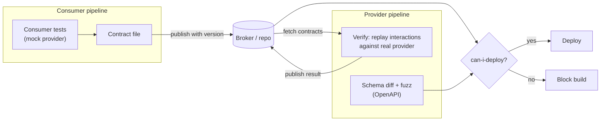
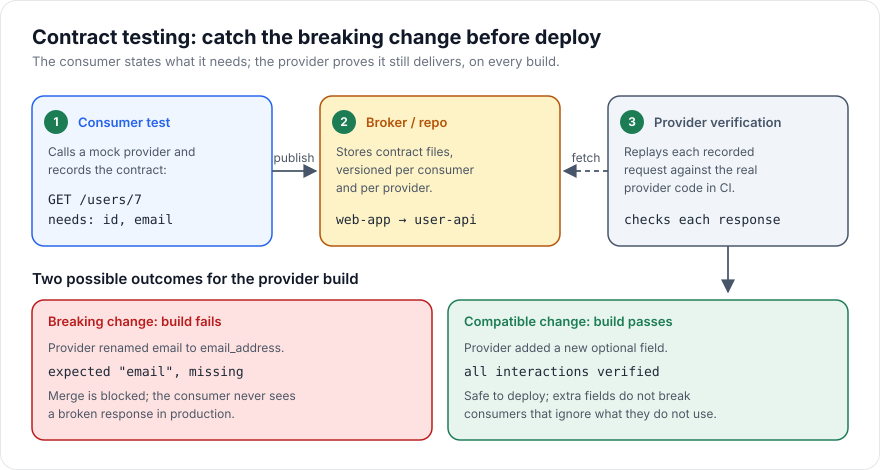

# Contract Testing

> [!TIP]
> **In one line:** Contract tests record what each consumer needs from an API and verify the provider still delivers it on every build, catching breaking changes without deploying both services together.
>
> **In plain English:** When two teams share a document template, the safest habit is for the reader to list which boxes they actually look at, and for the writer to check that list before changing the template. Contract testing automates that check between an API and the code that calls it. A breaking change fails a build instead of a customer's request.
>
> **You'll be able to:** explain consumer-driven contracts versus OpenAPI schema validation · write a consumer contract and verify it against a FastAPI provider · gate breaking changes in CI and tie them to your versioning policy

## Why This Matters

In a system with several services, the most common cause of a production outage after a "safe" deploy is not a bug inside one service; it is a disagreement between two. A provider renames `email` to `email_address`, makes a field nullable, changes an enum value, or tightens validation. Every test in the provider's repository passes, because the provider's own tests were updated with the change. The consumer's tests pass too, because they run against a hand-written mock that still returns `email`. The two green builds meet for the first time in production.

You could catch this with [end-to-end tests](end-to-end-testing.md) that run every service together, but that is slow, needs every team's service deployable at once, and tells you late. Contract testing moves the check earlier and makes it independent: each side tests against a shared, versioned description of the interaction, in its own pipeline, without the other side running. That is what makes it practical in a microservice architecture ([Part 11](../11-microservices-distributed-systems/README.md)) where you cannot spin up the whole world for every commit.

## Core Concept

An **API contract** is an explicit, machine-checkable statement of what requests a consumer will make and what responses it relies on. There are two main flavours, and they answer different questions.

**Consumer-driven contracts (Pact-style).** Each consumer writes tests that exercise its own client code against a mock provider. While the test runs, the framework records every interaction: the request (method, path, headers, body) and the minimum response the consumer needs. That recording is the contract. The provider then fetches all contracts from its consumers and replays each recorded request against the real provider, asserting that the response satisfies it. The key idea is that contracts describe only what consumers *use*, not everything the provider offers. A provider may therefore add fields, add endpoints, or change fields nobody reads, and no contract fails. It is only a change that breaks a real consumer that turns the build red.

**Schema-based validation (OpenAPI-style).** The provider publishes an OpenAPI document (FastAPI generates one automatically) and a tool such as Schemathesis generates requests from that schema, sends them to the running service, and checks that responses conform to the documented schemas and status codes. This tests the provider against its *own* promises, finds crashes and undocumented responses with generated inputs, and needs no cooperation from consumers. It cannot tell you whether a particular consumer depends on a field the schema marks optional.

| | Consumer-driven contract | OpenAPI schema validation |
|---|---|---|
| Source of truth | What consumers actually use | What the provider documents |
| Catches | Changes that break a real consumer | Provider drifting from its own spec, 500s on odd inputs |
| Needs consumer cooperation | Yes (consumers publish contracts) | No |
| Best for | Internal services with known consumers | Public APIs with unknown consumers |
| Blind spot | Consumers you do not know about | Whether anyone depends on the optional parts |

They are complementary. A mature setup uses schema validation to keep the provider honest about its spec and consumer contracts to know exactly who would break.

## Mental Model

Picture a power plug and a socket. The consumer is the plug, the provider the socket. Contract testing is not plugging the two into each other in a lab; it is each side checking against a shared drawing of the pins. The plug maker records which pins the plug actually uses; the socket maker checks every new socket design against all recorded drawings. If a redesign removes a pin somebody uses, the drawing check fails at the factory, long before anybody gets a shock at home.

## How It Works

**1. The consumer writes an interaction test.** In its own test suite the consumer arranges for its HTTP client to call a local mock server, declares the interaction ("when I `GET /users/7`, I expect status 200 and a body with an integer `id` and a string `email`"), runs its real client code, and confirms it handles the response. The contract file is a by-product of tests the consumer would write anyway.

**2. The contract is published.** The file goes to a broker (the Pact Broker or PactFlow is the usual one) or, for small setups, a shared repository or artifact store. It is tagged with the consumer's name and version (typically the git SHA) and branch.

**3. The provider verifies.** In the provider's CI, a verification step downloads the contracts of all relevant consumer versions, starts the provider (often in-process with fakes for downstream dependencies), and replays each interaction. Because contracts may assume particular data ("user 7 exists"), a contract can name a **provider state** such as `user 7 exists`; the provider registers a setup function for each state name that arranges its test data. The result is published back to the broker.

**4. A gate answers "can I deploy?".** Before deploying either side, the pipeline asks the broker whether the version about to ship is verified compatible with the versions currently running in the target environment. Pact's `can-i-deploy` tool exists for this. This is what turns the contract from documentation into a safety mechanism: a provider change that breaks a deployed consumer cannot be promoted, and a consumer that needs a field the provider does not yet serve cannot ship ahead of it.

**5. Schema checks run alongside.** The provider's pipeline also exports or fetches `openapi.json` and does two things. A *diff* step compares it with the previous released spec and flags breaking changes (removed fields or endpoints, narrowed types, newly required request parameters, removed enum values). A *fuzz* step runs a schema-based test tool against the running service with generated inputs. Tooling for both exists (for example `oasdiff` for diffs and Schemathesis for generative testing); check each tool's current documentation for exact flags, since CLIs change between major versions.

**6. Breaking changes follow a policy.** Not every red build is a mistake: sometimes a break is intended. Contract tests tell you who is affected; your versioning approach decides what to do. Additive changes (new optional fields, new endpoints) are compatible and need no version bump. Genuinely breaking changes go through the process in [API Versioning](../02-rest-api-design/api-versioning.md): introduce a new version or a deprecated-then-removed field, migrate consumers, and only then drop the old shape. A failing contract gives you the list of consumers to migrate and tells you when it is finally safe to remove the old behaviour, because the last contract depending on it has been updated.

**Be tolerant readers.** Contract testing works best when consumers follow Postel's principle: ignore unknown fields and depend only on what they need. A consumer that fails on an extra field turns every additive change into a breaking one.

## Architecture





## Request / Response Example

A recorded interaction, in a simplified Pact-like JSON shape, is the contract.

```json
{
  "consumer": "web-app",
  "provider": "user-api",
  "interactions": [
    {
      "description": "get a user by id",
      "providerState": "user 7 exists",
      "request": { "method": "GET", "path": "/users/7", "headers": { "Accept": "application/json" } },
      "response": {
        "status": 200,
        "body": { "id": 7, "email": "ada@example.com" },
        "matchingRules": { "body": { "id": "integer", "email": "string" } }
      }
    }
  ]
}
```

The matching rules matter: the consumer does not care that the id is 7 or the email is ada's, only the types, so the provider may return any valid user. Against the real provider, the replay looks like this.

```http
GET /users/7 HTTP/1.1
Accept: application/json

HTTP/1.1 200 OK
Content-Type: application/json

{"id": 7, "email": "ada@example.com", "display_name": "Ada", "created_at": "2025-01-03T09:12:00Z"}
```

This passes: the extra `display_name` and `created_at` are ignored. After the provider renames `email` to `email_address`, the same replay returns `{"id": 7, "email_address": "..."}` and verification fails with a message that `email` is missing.

## Code Example

Real Pact libraries exist for Python, but their API differs between major versions, so this example implements the same idea in about fifty lines to show the mechanism. The consumer derives its contract from the Pydantic model it actually parses responses with; the provider verifies it against a FastAPI app with provider-state setup.

```python
# contract_demo.py  (run with: pytest contract_demo.py)
from typing import Callable

from fastapi import FastAPI, HTTPException
from fastapi.testclient import TestClient
from pydantic import BaseModel

# ------------------------------------------------------------------ provider
app = FastAPI()
USERS: dict[int, dict] = {}          # stand-in for a database


class UserOut(BaseModel):
    id: int
    email: str                        # rename this and verification fails
    display_name: str | None = None   # extra field: consumers ignore it


@app.get("/users/{user_id}", response_model=UserOut)
def get_user(user_id: int):
    if user_id not in USERS:
        raise HTTPException(404, "not found")
    return USERS[user_id]


# ------------------------------------------------------------------ consumer
class UserView(BaseModel):
    """What the consumer actually reads. Extra fields are ignored by default."""
    id: int
    email: str


def build_contract() -> dict:
    # The contract is derived from the consumer's own model, so it cannot
    # claim to need more (or less) than the consumer's code really uses.
    schema = UserView.model_json_schema()
    return {
        "consumer": "web-app",
        "provider": "user-api",
        "interactions": [{
            "description": "get a user by id",
            "providerState": "user 7 exists",
            "request": {"method": "GET", "path": "/users/7"},
            "response": {
                "status": 200,
                "required": {n: p["type"] for n, p in schema["properties"].items()},
            },
        }],
    }


# ---------------------------------------------------- provider verification
JSON_TYPES = {"integer": int, "string": str, "number": (int, float), "boolean": bool}

def type_ok(value, typ: str) -> bool:
    # bool is a subclass of int in Python; do not let True satisfy "integer".
    if isinstance(value, bool) and typ != "boolean":
        return False
    return isinstance(value, JSON_TYPES[typ])


# Provider states: named setup functions the provider owns.
STATES: dict[str, Callable[[], None]] = {
    "user 7 exists": lambda: USERS.update({7: {"id": 7, "email": "ada@example.com"}}),
}


def verify(contract: dict, client: TestClient) -> list[str]:
    failures: list[str] = []
    for i in contract["interactions"]:
        USERS.clear()
        STATES[i["providerState"]]()                       # arrange provider data
        req = i["request"]
        resp = client.request(req["method"], req["path"])
        exp = i["response"]
        if resp.status_code != exp["status"]:
            failures.append(f'{i["description"]}: status {resp.status_code} != {exp["status"]}')
            continue
        body = resp.json()
        for field, typ in exp["required"].items():
            if field not in body:
                failures.append(f'{i["description"]}: missing field "{field}"')
            elif not type_ok(body[field], typ):
                failures.append(f'{i["description"]}: "{field}" is not {typ}')
        # Extra fields in the body are deliberately not a failure.
    return failures


def test_provider_satisfies_consumer_contract():
    assert verify(build_contract(), TestClient(app)) == []
```

In a real pipeline `build_contract()` runs in the consumer's CI and writes a file to the broker, and `verify()` runs in the provider's CI against every published contract. For the schema side, FastAPI already serves the spec at `/openapi.json`; point your schema-testing tool at it and your OpenAPI diff tool at the old and new versions of the file.

## Production Considerations

- **Which consumer versions to verify.** Verify the provider against the contracts of each consumer's main branch and of whatever version is deployed in each environment (Pact calls these selectors). Verifying only the latest contract misses a consumer still running last month's code.
- **Provider states are the maintenance cost.** Keep them few, named by business meaning ("order 12 is paid"), and implemented as cheap data setup against fakes or a test database, not by driving other endpoints. See [test-databases.md](test-databases.md).
- **Pending and WIP contracts.** A brand-new consumer contract should not instantly break the provider's main build. Brokers support "pending" pacts that are verified and reported without failing, until they first pass.
- **Message and event contracts.** The same idea works for queue messages and webhooks: the consumer states the fields it reads from an event, and the producer verifies that its emitted payloads satisfy them. Events outlive deployments in queues, so this is where schema evolution bites hardest.
- **Not a replacement for behaviour tests.** A contract checks shape and basic semantics, not business correctness. The provider's own [unit](unit-testing.md) and [integration](integration-testing.md) tests still own the logic.
- **Don't over-specify.** A contract that pins exact values or full response bodies re-creates tight coupling and fails on harmless changes. Use type matchers and list only the fields the consumer reads.

## Common Mistakes

- **Hand-written mocks with no verification.** A consumer mock that nobody checks against the real provider is a contract in name only; it drifts silently. Generate the mock from, or verify it against, a real contract. See [api-mocking.md](api-mocking.md).
- **Contracts that assert everything the provider returns,** so any additive change fails the build and the team learns to ignore failures.
- **Verifying against production data or live dependencies,** which makes verification flaky. Use provider states against controlled data.
- **Treating the OpenAPI document as the contract without testing it.** A spec that nothing enforces is documentation that will drift; run schema validation against the running service.
- **No deploy gate.** Publishing contracts but not asking "can I deploy?" before release means incompatibilities are still discovered in production.
- **Ignoring unknown consumers.** For public APIs, contract tests only protect consumers who publish contracts; pair them with spec diffs and a strict deprecation policy.

## Best Practices

- Let consumers own their contracts and derive them from the code that parses the response.
- Make consumers tolerant readers: depend on specific fields, ignore the rest.
- Run an OpenAPI diff on every provider pull request and fail on removals, type narrowing, and newly required inputs; allow additions.
- Use `can-i-deploy` (or an equivalent check) as a required pipeline step before promotion.
- Pair a break with the process in [API Versioning](../02-rest-api-design/api-versioning.md): expand, migrate consumers, then contract.
- Version contracts with the git SHA and branch so you can reason about "what is deployed where".
- Use schema-based fuzzing for public endpoints to find crashes and undocumented status codes, accepting that it tests the spec, not any specific consumer.

## AI Engineering Perspective

LLM-facing interfaces are contracts too, and often brittle ones. A tool or function definition given to a model is a schema: if an API changes a parameter name, the model's tool call fails at runtime in a way no compiler flags. Deriving tool schemas from the same OpenAPI document that the provider validates against (and running a contract check that every tool maps to an existing operation) turns silent agent breakage into a failed build. The same applies to structured-output schemas that downstream code parses, and to the model-provider SDK payloads you depend on: a small contract test against recorded provider responses detects when a vendor changes a field. See [Part 17](../17-ai-agents-and-mcp/README.md) for tool and MCP schemas, and [Part 14](../14-ai-api-engineering/README.md) for structured outputs.

## Exercises

**Beginner**
1. Add a `created_at` field to the demo provider and confirm the contract still passes. Then rename `email` and confirm verification fails with a readable message.

**Intermediate**
2. Extend the contract with a second interaction for `GET /users/999` expecting `404`, with provider state "user 999 does not exist". Explain why the provider state is necessary.
3. Export the FastAPI OpenAPI document before and after a change that makes a response field optional, diff them, and decide whether the change is breaking for consumers and for clients that generate code from the spec.

**Advanced**
4. Design a pipeline for three services where service A consumes B and B consumes C: where do contracts get published, which selectors does each provider verify, and what does `can-i-deploy` check before B ships?

## Key Takeaways

- A contract records what a consumer actually relies on; the provider replays it in CI so breaking changes fail the provider's build, not production.
- Consumer-driven contracts protect known consumers; OpenAPI validation keeps the provider faithful to its published spec; use both.
- Additive changes are compatible, but consumers must be tolerant readers for that to hold.
- The deploy gate and a versioning policy turn contract failures into an orderly migration instead of an incident.

### Check Yourself
<details markdown="1">
<summary>1. What is the difference between a consumer-driven contract and an OpenAPI schema?</summary>

A consumer-driven contract records only the parts of the API that a specific consumer uses, so it fails when a real consumer would break. An OpenAPI schema describes everything the provider promises, so it validates the provider against its own spec but cannot show who depends on which field.

</details>

<details markdown="1">
<summary>2. Why should consumers ignore unknown response fields, and what goes wrong if they do not?</summary>

Ignoring unknown fields lets providers add fields safely. If a consumer rejects unexpected fields, every additive change becomes breaking, and teams must coordinate releases, which defeats the point of independent deployment.

</details>

<details markdown="1">
<summary>3. The provider team wants to remove a deprecated field. How do contracts help them do it safely?</summary>

Verification against all consumers' contracts shows exactly which consumers still require the field. Once those consumers update and republish contracts without it, the verification passes and the field can be removed, following the deprecation steps in the versioning policy.

</details>

---
Back to the [Part 13 README](README.md).
