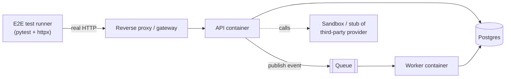
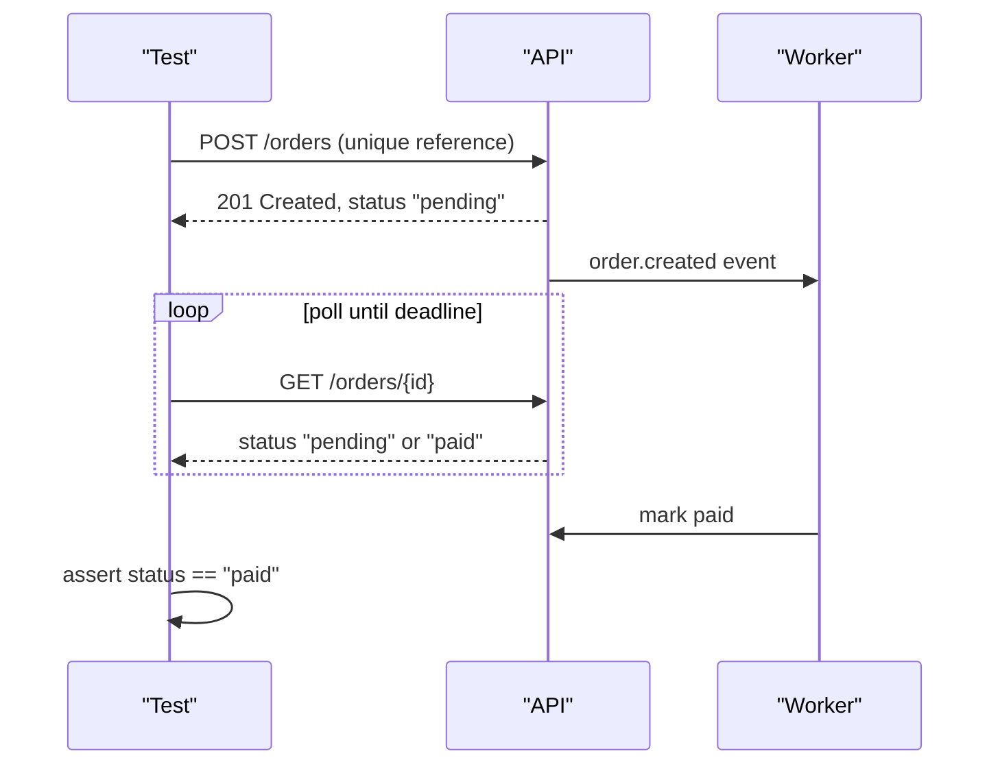

# End-to-End Testing

> [!TIP]
> **In one line:** End-to-end tests drive a whole deployed system through its public interface to prove that a few critical user journeys work, so keep them few, isolated, and deterministic.
>
> **In plain English:** Before a restaurant opens, the owner does not just taste each ingredient; someone walks in, orders, gets served, and pays. An end-to-end test is that dress rehearsal for your API, run against everything wired up for real. Because so many moving parts are involved, you only rehearse the handful of journeys that would hurt most if they broke.
>
> **You'll be able to:** decide which journeys deserve an end-to-end test · write a journey test with unique data and condition-based waits instead of sleeps · run a post-deploy smoke test that is safe against a live environment

## Why This Matters

Unit tests prove your functions are right and [integration tests](integration-testing.md) prove your app talks correctly to its database. Neither proves that the thing you actually ship works: the container image, the environment variables, the reverse proxy, the migration that ran at deploy time, the message queue and the background worker that consume events. A common production incident is "every test was green, and the service could not start because a secret was named `DB_URL` in the code and `DATABASE_URL` in the deployment manifest." Only a test that touches the deployed shape of the system can catch that.

End-to-end (E2E) tests are also the most expensive tests you own. They are slow (seconds to minutes), they depend on many components being healthy at once, and when they fail the cause could be anywhere. Teams that over-invest in them end up with a flaky suite that everyone learns to re-run and ignore, which is worse than having no suite. The skill is not writing E2E tests; it is choosing a small number of them, and building them so a failure means something.

## Core Concept

An **end-to-end test** exercises a complete user-visible journey through the system's real external interface, with as many real components as practical: the HTTP API, the database, the queue, the worker, and any internal services. For a backend API the "interface" is HTTP, so an E2E test is usually a script that makes a sequence of real network calls against a running environment and asserts on the observable outcome.

Three properties separate E2E from the layers below it:

| Property | Integration test | End-to-end test |
|---|---|---|
| Process boundary | App runs inside the test process | App runs as a separate deployed process or container |
| Dependencies | Database real, others usually faked | Everything first-party is real; third parties are sandboxed or stubbed |
| What it can catch | Wiring, queries, serialization | Deployment config, networking, migrations, async pipelines, cross-service contracts |
| Failure diagnosis | Usually obvious | Needs logs and traces from several services |

The "few and valuable" principle follows from the [testing pyramid](unit-testing.md): lots of fast unit tests at the base, fewer integration tests in the middle, and a thin layer of E2E tests on top. A reasonable budget for a service is somewhere between five and thirty journeys, chosen by business impact: sign up and log in, create an order and see it paid, the main read path. Everything else, such as validation edge cases and error codes, belongs lower down where it is cheap.

## Mental Model

Think of the pyramid as a security checkpoint at an airport. Unit tests are the hundreds of small checks on individual parts before they are assembled. Integration tests check the sub-assemblies. The E2E test is the one flight you actually take before the airline sells tickets: expensive, slow, and you cannot afford many, so you pick the route that carries the most passengers. If the flight fails you still need the earlier checks to tell you which part was at fault.

## How It Works

**1. An environment to run against.** E2E tests need the system running somewhere. Common choices are a Docker Compose stack started in CI (API, Postgres, Redis, worker), an ephemeral per-pull-request environment in a cluster, or a long-lived staging environment. Compose is the cheapest and most reproducible; staging is the most realistic but is shared, so its state drifts and parallel runs can interfere. Whatever you choose, the tests receive a `BASE_URL` from an environment variable and do not know or care how the environment was created.

**2. Journey-shaped tests.** One test is one story: register a user, log in, create a resource, read it back, delete it. Journeys are deliberately long because the point is the seams between steps. They talk to the system only through its public API, never by writing to the database directly. (Seeding through the database is a reasonable shortcut at the integration layer, but at E2E level it would bypass the very path you want to prove.)

**3. Data isolation.** A shared environment means other tests, other developers, and other CI runs are writing at the same time. The cure is to make every test create its own uniquely named data (a random email, a UUID in a resource name), never assume the database is empty, never assert on global counts, and clean up what it created, ideally in a `finally` or fixture teardown. Tests that depend on execution order or on leftover state from a previous run are the single largest source of E2E flakiness.

**4. Waiting correctly.** Many journeys cross an asynchronous boundary: you `POST /orders`, a queue delivers an event, a worker marks the order paid. The naive fix is `sleep(5)`. It is wrong both ways: too short and the test flakes on a slow day, too long and the suite wastes minutes. The right tool is a **poll-until** helper: repeatedly check a condition with a short interval until it is true or a deadline passes, then fail with a message that says what was last observed. The deadline is a budget you choose from how long the pipeline legitimately takes under normal load, with margin.

**5. Smoke tests after deploy.** A **smoke test** is the smallest possible E2E check run immediately after a deployment against the live environment: is the service up, can it reach its database, can a read-only request succeed. It is typically a handful of calls that take seconds, and it gates promotion (a canary stays at 5% or a rollback triggers if it fails). Smoke tests against production must be read-only or use a dedicated test tenant whose data is clearly labelled and excluded from analytics and billing.

**6. Third parties.** You generally should not hit real payment or email providers from E2E tests: they rate limit, charge, and fail for reasons that are not yours. Use the provider's sandbox where it is reliable, or a stub service in the stack. See [api-mocking.md](api-mocking.md) for how to keep such stubs honest.

## Architecture





The runner sits outside the system, exactly like a real client. The only coupling between the test and the system is the public contract and a base URL, which is what lets the same tests run against Compose in CI and against staging after a deploy.

## Request / Response Example

A journey step and the polling that follows it look like this on the wire.

```http
POST /v1/orders HTTP/1.1
Host: staging.api.example.com
Authorization: Bearer <token from login step>
Content-Type: application/json
Idempotency-Key: e2e-7c1f0b2a

{"sku": "BOOK-42", "quantity": 1, "reference": "e2e-7c1f0b2a"}
```

```http
HTTP/1.1 201 Created
Location: /v1/orders/ord_01HZX3
Content-Type: application/json

{"id": "ord_01HZX3", "status": "pending", "reference": "e2e-7c1f0b2a"}
```

Seconds later, a poll sees the worker's effect:

```http
GET /v1/orders/ord_01HZX3 HTTP/1.1

HTTP/1.1 200 OK
{"id": "ord_01HZX3", "status": "paid", "reference": "e2e-7c1f0b2a"}
```

Note the `e2e-` prefix and random suffix: it makes the data unique per run and lets an operator find and purge leftovers by prefix if cleanup ever fails.

## Code Example

A compact pytest module with a poll helper, a unique-data fixture, and a smoke test. It assumes `BASE_URL` and test credentials come from the environment.

```python
# tests/e2e/test_order_journey.py
import os
import time
import uuid
from collections.abc import Callable
from typing import TypeVar

import httpx
import pytest

T = TypeVar("T")

BASE_URL = os.environ["E2E_BASE_URL"]            # e.g. http://localhost:8000
# Credentials for a dedicated test account; never hardcode them.
E2E_EMAIL_DOMAIN = os.environ.get("E2E_EMAIL_DOMAIN", "e2e.example.test")


def wait_until(
    probe: Callable[[], T | None],
    *,
    timeout: float = 20.0,
    interval: float = 0.5,
    what: str = "condition",
) -> T:
    """Poll `probe` until it returns a truthy value or the deadline passes.

    Replaces time.sleep(): returns as soon as the condition holds, and on
    failure reports the last observed value so the failure is diagnosable.
    """
    deadline = time.monotonic() + timeout
    last: T | None = None
    while time.monotonic() < deadline:
        last = probe()
        if last:
            return last
        time.sleep(interval)
    raise AssertionError(f"timed out after {timeout}s waiting for {what}; last={last!r}")


@pytest.fixture
def run_id() -> str:
    # Unique per test so parallel runs and reruns never collide.
    return f"e2e-{uuid.uuid4().hex[:8]}"


@pytest.fixture
def client():
    # Explicit timeouts: a hung call must fail the test, not hang CI.
    with httpx.Client(base_url=BASE_URL, timeout=httpx.Timeout(10.0)) as c:
        yield c


@pytest.fixture
def auth_client(client: httpx.Client, run_id: str):
    """Register a fresh user through the public API and log in."""
    email = f"{run_id}@{E2E_EMAIL_DOMAIN}"
    password = uuid.uuid4().hex                      # random, never reused
    r = client.post("/v1/users", json={"email": email, "password": password})
    assert r.status_code == 201, r.text
    r = client.post("/v1/auth/token", json={"email": email, "password": password})
    assert r.status_code == 200, r.text
    client.headers["Authorization"] = f"Bearer {r.json()['access_token']}"
    user_id = r.json()["user_id"]
    yield client
    # Best-effort cleanup so staging does not fill with test users.
    client.delete(f"/v1/users/{user_id}")


def test_order_is_created_and_paid(auth_client: httpx.Client, run_id: str):
    r = auth_client.post(
        "/v1/orders",
        json={"sku": "BOOK-42", "quantity": 1, "reference": run_id},
        headers={"Idempotency-Key": run_id},
    )
    assert r.status_code == 201, r.text
    order_id = r.json()["id"]
    assert r.json()["status"] == "pending"

    # The worker runs asynchronously: poll for the effect, do not sleep.
    def paid() -> dict | None:
        body = auth_client.get(f"/v1/orders/{order_id}").json()
        return body if body["status"] == "paid" else None

    order = wait_until(paid, timeout=30, what=f"order {order_id} to become paid")
    assert order["reference"] == run_id


@pytest.mark.smoke
def test_smoke_readiness(client: httpx.Client):
    """Post-deploy smoke test: read-only, finishes in about a second."""
    r = client.get("/readyz")                        # checks DB connectivity inside the app
    assert r.status_code == 200, r.text
    assert client.get("/v1/products", params={"limit": 1}).status_code == 200
```

Run the full journey in CI after `docker compose up --wait`, and run only `pytest -m smoke` against the live environment after each deploy. Register the `smoke` marker in `pytest.ini` to avoid warnings.

## Production Considerations

- **Environment parity versus cost.** Compose in CI catches configuration and wiring errors but not infrastructure differences such as a managed database version or a real load balancer's timeouts. Many teams run Compose-based E2E on every pull request and a smaller smoke suite on staging and production after deploy.
- **Flaky test policy.** Track pass rate per test. A test that fails and then passes on retry is flaky; quarantine it (run it but do not block merges), file a ticket with an owner and a deadline, and fix or delete it. Blanket automatic retries hide real intermittent bugs such as race conditions in your own code, so use them sparingly and always report that a retry happened.
- **Observability in tests.** Send a correlation ID header (such as `X-Request-ID`) from the test and print it on failure so you can find the logs and trace across services. See [Part 12](../12-observability/README.md).
- **Safety against shared environments.** Use a dedicated tenant or account, label all created data, make cleanup idempotent, and cap how many resources a run can create. Never run destructive journeys against production.
- **Time and clocks.** Journeys involving expiry or scheduling should shorten the configured durations in the test environment rather than waiting, or use a controllable clock where the system supports it.
- **Cost of parallelism.** Running journeys in parallel is only safe once data isolation is real. Introduce parallelism after the isolation work, not before.

## Common Mistakes

- **Testing everything end to end.** Validation rules, every error code, and every permission combination belong in unit and integration tests. E2E suites that grow beyond what a team can keep green become ignored.
- **`time.sleep` for synchronization.** It guarantees either flakiness or slowness. Poll on a condition with a deadline.
- **Shared mutable state.** Fixed usernames, assertions like "the list has exactly 3 items", and tests that rely on a previous test's data produce failures that appear only in parallel or on reruns.
- **Bypassing the API with direct database writes** in the middle of a journey, which hides precisely the integration problems the test exists to find.
- **No timeouts on HTTP calls.** A stuck connection hangs the whole pipeline instead of failing one test.
- **Hitting real third parties.** Rate limits, outages, and charges make the suite unreliable and sometimes costly.
- **Treating a red E2E as "probably flaky".** Once the team believes that, the suite no longer protects anything.

## Best Practices

- Select journeys by business impact and keep a written list of them; add one only when you can say what failure it would catch that lower layers cannot.
- Give every test its own uniquely named data and clean up in teardown; make teardown tolerant of partial failure.
- Use condition-based waiting with an explicit deadline and a helpful failure message.
- Keep the suite fast enough to run on every merge (aim for single-digit minutes) and separate a tiny smoke subset for post-deploy use.
- Make the tests environment-agnostic: only a base URL and credentials from environment variables.
- Capture evidence on failure: request and response bodies, correlation IDs, and container logs as CI artifacts.
- Pair E2E with [contract testing](contract-testing.md) so that cross-service compatibility is verified cheaply and early, leaving E2E to confirm the assembled whole.

## AI Engineering Perspective

LLM-backed endpoints make E2E testing awkward because the output is non-deterministic and each real call costs money and time. The practical approach is to split the journey: run the deterministic parts (auth, retrieval, tool execution, persistence, streaming protocol) end to end against a stubbed model that returns canned completions or scripted tool calls, and keep a very small number of live-model smoke checks that assert on structure rather than wording, such as "the response is valid JSON matching the schema and includes at least one citation". Agent workflows deserve journey tests that assert on the sequence of tool calls and the final state they produced, not on prose. For quality of the generated text itself, use offline evaluation sets rather than E2E assertions; see [Part 15](../15-production-ai-systems/README.md) and [Part 17](../17-ai-agents-and-mcp/README.md).

## Exercises

**Beginner**
1. Write a smoke test that checks `/healthz` returns 200 and that an unauthenticated `GET /v1/orders` returns 401. Explain why that second check is a useful post-deploy signal.

**Intermediate**
2. Take a test that does `time.sleep(5)` before asserting an async effect and rewrite it with `wait_until`. Measure how the suite duration and flake rate change over 20 runs.
3. Make an E2E journey safe to run in parallel with itself: identify every piece of shared state and replace it with run-scoped data.

**Advanced**
4. Design the E2E strategy for a system with five services: decide which journeys to cover, which environment each runs in, how third parties are stubbed, and how a failure is traced to the responsible service.

## Key Takeaways

- E2E tests prove the deployed, assembled system works; they catch configuration, networking, migration, and async pipeline failures that lower layers cannot.
- Keep them few and journey-shaped; push everything cheaper down the pyramid.
- Flakiness is mostly shared state and sleeps: use unique per-test data and poll-until with a deadline.
- Run a tiny read-only smoke subset after every deploy, and treat a red E2E as a real signal.

### Check Yourself
<details markdown="1">
<summary>1. What can an end-to-end test catch that an integration test running the app in-process cannot?</summary>

Problems that only exist in the deployed shape of the system: wrong environment variable names, container or proxy misconfiguration, migrations that did not run, and asynchronous pipelines across a queue and worker. An in-process test never exercises those boundaries.

</details>

<details markdown="1">
<summary>2. Why is `time.sleep(5)` a poor way to wait for a background worker?</summary>

It is a guess about timing: too short and the test fails on a slow run, too long and every run wastes time. Polling a condition with a deadline returns as soon as the work finishes and fails with a clear message only when it genuinely does not.

</details>

<details markdown="1">
<summary>3. Your E2E suite passes alone but fails intermittently when two CI jobs run against the same staging environment. What is the likely cause and fix?</summary>

Shared mutable state: fixed usernames, global count assertions, or leftover data collide between runs. Fix it by creating uniquely named data per test (random suffix), asserting only on data the test created, and cleaning up in teardown.

</details>

---
Back to the [Part 13 README](README.md).
