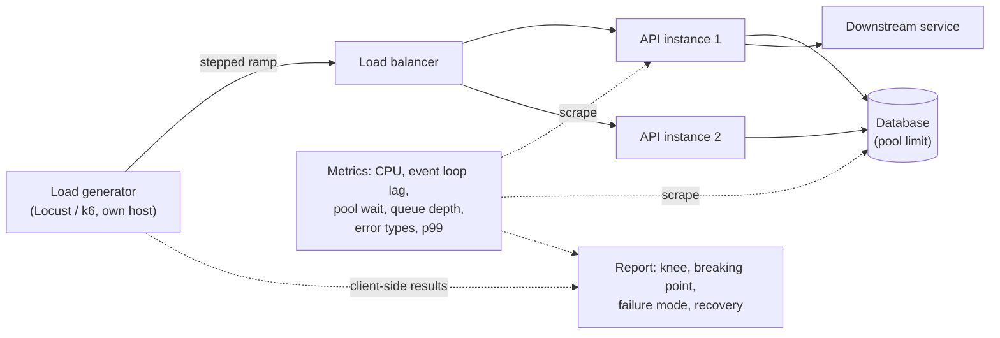
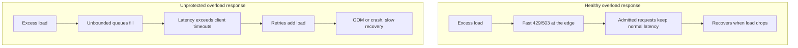

# Stress Testing

> [!TIP]
> **In one line:** Stress testing pushes an API past expected load to learn where it breaks, how it fails, and whether it recovers, so failure is designed, not discovered.
>
> **In plain English:** A bridge is rated for a certain weight, but engineers also want to know what happens if too many trucks cross: does it sag slowly, or snap? Stress testing is the same question for your API. You keep adding traffic past the comfortable limit and watch what gives first, and whether things go back to normal once the crowd leaves.
>
> **You'll be able to:** design ramp, spike, and soak stress profiles · identify the saturated resource and the failure type from the right signals · run a stress test safely with guardrails

## Why This Matters

[Load testing](load-testing.md) answers "does the system meet its latency and error targets at the traffic we expect?" That is necessary but insufficient, because real traffic does not respect forecasts. A marketing email, a retry storm after a partial outage, a viral link, or a misbehaving client can multiply load in minutes. What happens at 3x or 10x capacity is a design property of your system, whether you examined it or not.

Systems fail in very different ways when overloaded. One service degrades gracefully: it sheds excess requests quickly with `503` or `429`, keeps serving the rest at normal latency, and returns to health when the surge passes. Another one accepts every request into unbounded queues, latency climbs from 80 ms to 40 seconds, clients time out and retry, retries add load, memory fills, the process is killed, and recovery takes an hour after the traffic is gone. Both have the same capacity number on a load-test report. Only stress testing reveals which one you built, and it is far cheaper to learn that on a test cluster on a Tuesday than during a launch.

## Core Concept

A **stress test** deliberately drives load beyond the system's designed capacity to determine three things:

1. **The breaking point:** the load at which the system stops meeting its objectives, and then the load at which it stops functioning at all.
2. **The failure mode:** what actually happens past that point (errors, timeouts, crashes, data corruption, cascading failure into dependencies).
3. **Recoverability:** whether, once load returns to normal, the system returns to normal without manual intervention.

Several test shapes target different questions:

| Shape | Profile | Question it answers |
|---|---|---|
| **Ramp (step) stress** | Increase load in steps until failure | Where is the knee of the curve, and which resource saturates first? |
| **Spike** | Jump from low to very high load for a short period, then drop | Can autoscaling, pools, and queues absorb a sudden surge, and how fast do we recover? |
| **Soak (endurance)** | Moderate-to-high steady load for hours | Are there slow leaks: memory, file descriptors, connections, disk, growing latency? |
| **Breakpoint** | Ramp continuously until a failure threshold is crossed | What is the maximum sustainable rate? |

Under overload, almost every system follows the same curve. Below saturation, throughput rises with offered load and latency is flat. At the **knee**, one resource saturates and latency begins to climb, because requests wait in a queue for it. Beyond that, throughput plateaus (or even falls, if the system wastes work on timeouts and context switching) and the excess load is either rejected or waits. Queueing theory tells you why latency explodes rather than rises gently: as utilization of a resource approaches 100%, average wait time grows without bound, so a system at 95% utilization is far slower than one at 80%.

## Mental Model

Imagine a shop with one checkout lane. Up to a point, every customer is served promptly. As more arrive than the cashier can handle, a line forms and everyone waits longer. A well-run shop puts up a sign ("lane full, come back later") when the line reaches the door, so the people already in line are still served in reasonable time. A badly run shop lets everyone in; the line goes around the block, people give up halfway and come back again, and the cashier spends time on customers who have already left. Stress testing finds out which shop you run, and the fix, a sign at the door, is **load shedding**.

## How It Works

**Define the objective first.** Decide what "failure" means before the test: for example p99 latency above 2 seconds, error rate above 1%, or the process restarting. Without a threshold you cannot name a breaking point.

**Use a production-like environment, scaled and isolated.** Overload results are only meaningful if the configuration (worker counts, connection pool sizes, database size, instance types, network limits) resembles production. A small dev box with a 10-row database tells you about the dev box. It must also be isolated: stress tests degrade shared databases and neighbours. Never aim one at production without the guardrails listed below.

**Generate load open-loop where it matters.** Closed-loop generators (N virtual users each waiting for a response before sending the next request) slow down automatically when the server slows down, which hides overload: the generator politely backs off. Real internet traffic is open-loop: users arrive at a rate regardless of how the server is coping. To see true overload behaviour, use an arrival-rate model where the tool supports it (k6 offers arrival-rate executors; Locust can approximate this with a custom load shape and high user counts, but remains closed-loop per user). Be aware of this limit when interpreting results, and make sure the load generator itself is not the bottleneck: watch its CPU and network.

**Ramp in steps and hold each step.** For example, raise from 50 to 100 to 200 to 400 requests per second, holding each for two or three minutes so metrics stabilise, and note where latency and errors depart from the baseline. The last stable step is your practical capacity; the first failing step is the breaking point.

**Watch saturation, not just the load generator's output.** The generator tells you what clients experienced; the server's metrics tell you why. Follow the USE method (utilization, saturation, errors) for every resource, and the golden signals for the service:

- **CPU** utilization and run-queue length; event loop lag for async Python (a blocked loop shows as latency on everything).
- **Memory** growth and the OOM-killer; garbage collection pauses.
- **Connection pools:** database pool checked-out versus size, and time spent waiting for a connection. This is the most common first bottleneck in FastAPI plus SQLAlchemy services; see [Part 4](../04-databases-and-apis/README.md).
- **Queues:** depth and age of the oldest item for task queues, plus the server's accept backlog.
- **Database:** active connections, lock waits, slow queries, replication lag.
- **File descriptors and sockets:** `EMFILE`, ephemeral port exhaustion, `TIME_WAIT` build-up.
- **Error types, not just counts:** `429` and quick `503` mean deliberate shedding; `500` means unhandled failure; client-side timeouts and connection resets mean the system stopped answering. These are three very different failure modes.
- **Latency percentiles** (p50, p95, p99), because overload hits the tail first. See [Part 7](../07-caching-performance/README.md) on latency percentiles.

**Verify graceful degradation.** Past the breaking point, check that the protections you designed actually engage: rate limits return `429` with `Retry-After`, a bounded concurrency limit or queue rejects excess quickly, timeouts bound every downstream call, circuit breakers open when a dependency fails, and non-essential features are switched off. See [Part 6](../06-production-reliability/README.md). Then check the system's behaviour *after* the surge: does error rate drop within seconds, do pools and queues drain, do restarted instances become ready (readiness probes), or does it remain wedged?

**Check for metastable failure.** Some systems stay broken after the trigger is gone because a self-sustaining loop takes over: retries keep load above capacity, caches are cold so every request hits the database, and queues are full of stale work whose clients have already given up. A good stress test ends with a drop back to normal load and watches whether the system actually recovers.

## Architecture





## Request / Response Example

During a healthy overload the API sheds load quickly and tells clients when to return.

```http
GET /v1/search?q=widgets HTTP/1.1
Host: staging.api.example.com

HTTP/1.1 503 Service Unavailable
Retry-After: 2
Content-Type: application/problem+json
X-Request-ID: 5b1e2c9d

{"type": "about:blank", "title": "Server is at capacity", "status": 503, "detail": "Retry shortly."}
```

An unprotected system does not return anything useful at the same moment; the test client records a client-side timeout after 30 seconds, or a connection reset when the process dies. When you read results, count these separately from HTTP errors because they represent the worse failure mode: the system gave no answer at all.

## Code Example

A Locust file with a custom load shape that steps up traffic, holds each step, and then drops back to a low level so you can observe recovery. The host and token come from environment variables. (Locust's `LoadTestShape.tick()` returns a `(user_count, spawn_rate)` tuple, or `None` to stop the test.)

```python
# locustfile.py
# Run headless against a TEST environment only:
#   LOCUST_HOST=https://staging.api.example.com \
#   STRESS_TOKEN=... locust -f locustfile.py --headless --csv stress
import os

from locust import HttpUser, LoadTestShape, between, task

TOKEN = os.environ["STRESS_TOKEN"]          # a dedicated low-privilege test credential


class ApiUser(HttpUser):
    wait_time = between(0.5, 1.5)           # think time between requests per user

    def on_start(self):
        self.client.headers["Authorization"] = f"Bearer {TOKEN}"

    @task(8)
    def read_products(self):
        # catch_response lets us decide what counts as failure beyond HTTP status.
        with self.client.get("/v1/products?limit=20", catch_response=True,
                             name="GET /v1/products") as r:
            if r.status_code in (429, 503):
                # Deliberate shedding: record separately from real failures.
                r.failure(f"shed:{r.status_code}")
            elif r.status_code != 200:
                r.failure(f"error:{r.status_code}")
            else:
                r.success()

    @task(2)
    def search(self):
        self.client.get("/v1/search", params={"q": "widgets"}, name="GET /v1/search")


class SteppedStress(LoadTestShape):
    """Ramp in steps, hold each, then drop to a low level to observe recovery."""

    step_seconds = 180                          # hold each step long enough to stabilise
    steps = [50, 100, 200, 400, 800]            # concurrent users per step
    spawn_rate = 50                             # users started per second
    recovery_users = 20                         # low load after the final step
    recovery_seconds = 300

    def tick(self):
        t = self.get_run_time()
        ramp_end = self.step_seconds * len(self.steps)
        if t < ramp_end:
            return self.steps[int(t // self.step_seconds)], self.spawn_rate
        if t < ramp_end + self.recovery_seconds:
            return self.recovery_users, self.spawn_rate     # does latency return to baseline?
        return None                                         # stop the test
```

If you prefer k6, the same shape is expressed with the `ramping-arrival-rate` executor, which is open-loop: it holds a request rate regardless of response time, so overload is not masked. Whichever tool you use, save the raw results (CSV or JSON) and chart latency percentiles and error types against time alongside your server metrics; the knee is easiest to see on a single timeline.

## Production Considerations

- **Safety guardrails.** Never run a stress test against production by default. If you must (a pre-launch capacity check with the business's agreement), do it off-peak with a hard abort threshold on real-user error rate, a kill switch for the generator, a notified on-call, dedicated test accounts, synthetic or clearly-labelled data, and no traffic to third-party services that bill or rate-limit you. Prefer a production-sized staging environment.
- **Protect shared dependencies.** Stub or rate-limit calls to third parties and shared databases; you do not want to knock over a partner or a neighbouring team.
- **Autoscaling confounds results.** Run once with autoscaling pinned to find per-instance capacity, and once with it enabled to measure reaction time to a spike; scale-out takes minutes, and a spike can be over, or catastrophic, before new instances are ready.
- **Backpressure and shedding.** The main output of stress testing is the decision to add limits: concurrency caps, bounded queues, per-client rate limits ([Part 6](../06-production-reliability/README.md)), and priority so health checks and critical endpoints survive. Re-run the test to confirm the limits work.
- **Cost.** Large tests cost money (instances, egress, and especially LLM tokens if the endpoint calls a provider). Budget them and stub the provider.
- **Automate a small version.** A short ramp against a pinned environment can run nightly and alert on capacity regressions; reserve the long soak for pre-release.

## Common Mistakes

- **Testing only to the expected peak,** and then reporting "we have headroom" without ever seeing a failure.
- **Letting the load generator be the bottleneck** (single small machine, too many virtual users), then blaming the server for numbers that measure the generator.
- **Closed-loop tests that hide overload,** because slow responses reduce the offered request rate.
- **Reading average latency.** Averages stay calm while the p99 goes to 30 seconds; always plot percentiles.
- **Ignoring recovery.** A system that survives the spike but stays degraded for an hour has not passed.
- **Unrealistic data and traffic mix,** such as one cached URL, an empty database, or only reads, which exercises none of the real bottlenecks.
- **Running against production without limits,** causing the very outage the test was meant to prevent.

## Best Practices

- Write down the failure thresholds and the question before you run; record the result as capacity numbers and a named failure mode.
- Ramp in steps with holds, and chart client results next to server saturation metrics on a shared time axis.
- Prefer an open-loop arrival rate for overload questions and verify the load generator is not saturated.
- Decide how the service should fail (fast `429`/`503` with `Retry-After`, bounded queues, timeouts everywhere) and verify it does.
- Always include a post-peak recovery phase, and a soak run before major releases to catch leaks.
- Turn each finding into a tracked fix: a pool size, a limit, an index, or a circuit breaker, then re-test.
- Run in an isolated, production-shaped environment with abort conditions.

## AI Engineering Perspective

LLM endpoints change the stress profile because the bottleneck is usually not your CPU. Provider rate limits (requests and tokens per minute), long-lived streaming connections that hold a worker or socket for tens of seconds, and GPU-bound self-hosted inference with a fixed batch capacity all saturate far earlier than a typical CRUD endpoint, and every request has a monetary cost. Stress your own gateway and queues against a stubbed or fixed-latency fake model so you measure your system, not the vendor's quota, and run a separate, small, budget-capped test to observe how you behave when the real provider returns `429`s and slow tails: do you shed, queue with a deadline, or fall back? See [Part 15](../15-production-ai-systems/README.md) for gateways, fallback chains, and rate limiting of token budgets.

## Exercises

**Beginner**
1. Run the Locust file against a local FastAPI app with a deliberately slow endpoint. Identify the step at which p95 latency first doubles and call that the knee.

**Intermediate**
2. Set your database pool to 5 and a request handler that holds a connection for 200 ms. Predict the maximum throughput per instance, then verify it with a ramp test and by watching pool wait time.
3. Add a concurrency limit that returns `503` with `Retry-After` when more than N requests are in flight, and compare the failure mode before and after.

**Advanced**
4. Design a spike test for a system with autoscaling that takes three minutes to add capacity. Define success criteria, what you will shed during the gap, and how you will detect a metastable state afterwards.

## Key Takeaways

- Stress testing looks past expected load for the breaking point, the failure mode, and recovery; capacity numbers alone do not tell you how the system fails.
- The knee appears where one resource saturates and queueing makes latency climb sharply; find that resource with saturation metrics, not just client results.
- Healthy overload behaviour is fast, bounded rejection; unhealthy behaviour is unbounded queues, timeouts, retry storms, and slow recovery.
- Use realistic, isolated environments and strict guardrails; avoid production unless safeguards and approval exist.

### Check Yourself
<details markdown="1">
<summary>1. What three things does a stress test aim to find that a load test at expected traffic does not?</summary>

The breaking point, the failure mode beyond it, and whether the system recovers after load drops. A load test only confirms the targets are met at planned traffic.

</details>

<details markdown="1">
<summary>2. Why can a closed-loop load generator make an overloaded server look healthier than it is?</summary>

Each virtual user waits for a response before sending the next request, so as the server slows the offered rate falls automatically. Real clients keep arriving at their own rate, so the true load, and the queue it creates, is higher than the test shows.

</details>

<details markdown="1">
<summary>3. At 2x capacity your API's p99 hits 40 seconds, then stays high for ten minutes after the test ends. What is probably happening and what would you change?</summary>

Likely unbounded queueing plus client retries leave the system in a self-sustaining overloaded state. Add bounded concurrency or queues that shed excess with fast `503`/`429`, enforce timeouts and retry budgets, and re-test the recovery phase.

</details>

---
Back to the [Part 13 README](README.md).
