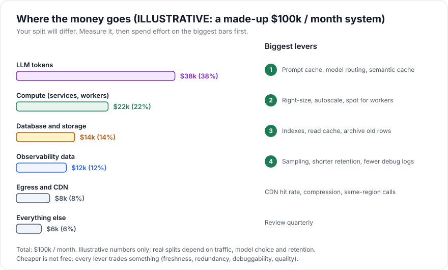
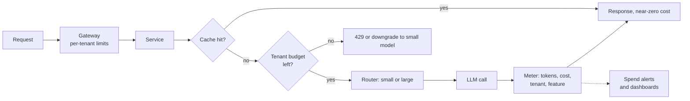

# Cost Management

> [!TIP]
> **In one line:** Know where the money goes, express it as cost per request, user and tenant, then pull the few levers (caching, routing, sizing, retention, limits) that matter, without silently trading away reliability.
>
> **In plain English:** Running a system is like running a restaurant: you cannot lower the bill by guessing, you first work out what each dish costs and which ingredients dominate. Then you change the expensive things, such as buying in bulk or not throwing food away, while making sure the customers still get a good meal.
>
> **You'll be able to:** break a monthly bill into drivers and unit costs with stated assumptions · choose levers by savings and risk · set budgets and alerts that stop a runaway cost before the invoice does

## Why This Matters

Every previous chapter in this part added capability: more layers, more replicas, more telemetry, more models. Each addition has a price, and in a system with LLM calls the price is variable and driven by user behaviour, not by how many servers you provisioned. A traditional API costs roughly the same whether a user sends ten requests or a thousand, because compute is mostly provisioned capacity. An LLM-backed endpoint bills per token, so one enthusiastic user, one verbose prompt template or one retry loop can multiply the bill overnight.

Cost is also an architecture constraint, not an accounting afterthought. A feature that costs $0.40 to serve but earns $0.05 is a bug whatever its latency. A team that cannot say "what does one chat request cost us" cannot decide whether to use a bigger model, whether caching is worth building, or whether a pricing tier is viable. Teams that discover cost only on the monthly invoice discover it after the money is gone.

This chapter is the economic counterpart of [Scaling Strategy](scaling-strategy.md) and [Failure Scenarios](failure-scenarios.md). It shows how to find the drivers, measure unit economics, estimate with real arithmetic, and apply levers with open eyes about what each one costs in reliability, freshness or quality.

## Core Concept

**Cost management** is a loop with four steps: *attribute* spend to its drivers, *normalize* it into unit costs, *optimize* the largest drivers with the least risky levers, and *govern* with budgets and alerts so regressions are caught in hours. The unit of analysis matters more than the total. Total spend rises with success; **unit cost** (per request, per active user, per tenant, per feature) tells you whether the business is healthy.

Five cost categories dominate in the architecture from this part:

- **Compute**: gateway, services and workers. Mostly provisioned capacity, so cost tracks instance count and size, not request count, until you autoscale.
- **Database and storage**: primary, replicas, storage, backups, IOPS. Stateful, so expensive to scale and slow to shrink.
- **Network egress**: data leaving a cloud region or provider. Often small for JSON APIs, large for media or cross-region chatter.
- **Observability data**: ingestion and retention of logs, metrics and traces. Grows with traffic and with how carelessly you log.
- **LLM tokens**: per-token billing, split into input and output (output is usually priced several times higher), with discounts for cached input on some providers. Variable, behaviour-driven and frequently the largest line in an AI product.

## Mental Model

Think of the system as a **utility bill for a building with two kinds of meters**. Some costs are like rent: fixed per month whether anyone shows up (reserved compute, a database instance). Others are like electricity: they rise with every use (tokens, egress, log volume). Rent is reduced by right-sizing the space; electricity is reduced by using less per visit, such as turning off lights in empty rooms (cache), using efficient appliances (cheaper models for easy tasks) and installing a meter with a cut-off (budgets and rate limits).

A single bill total never tells you which room is wasting power. You need a sub-meter per tenant and per feature, which in software means tagging every cost-bearing event with who and what caused it.

## How It Works

**Step 1: Attribute.** Tag every resource with an owner, environment and service (cloud tags or labels), so the cloud bill splits by service. For variable costs, record the driver at the source: the AI gateway logs input tokens, output tokens, model and computed cost per call with the tenant ID and feature name ([Cost Tracking](../15-production-ai-systems/cost-tracking.md)); the observability pipeline reports bytes ingested per service. Shared costs (a database used by five services) are allocated by a stated rule, such as share of queries or storage, and imperfect allocation is acceptable if it is consistent.

**Step 2: Normalize into unit economics.** Divide monthly cost by a meaningful volume. Useful units: cost per 1,000 API requests, cost per chat request, cost per active user per month, cost per tenant, cost per gigabyte stored. Compare against revenue per same unit. The distribution matters as much as the mean: the 95th-percentile user often costs ten times the median, and a flat subscription with token-priced backend costs makes the heaviest users unprofitable.

**Step 3: Estimate with arithmetic.** Here is a worked example. Every number is an *assumption* to replace with your own measurements, and prices are placeholders, not any vendor's list.

Assumptions: 100 million API requests per month, of which 2 million are LLM chat requests from 50,000 active users (40 chats per user per month on average). A chat request averages 2,000 input tokens (system prompt, history, retrieved context) and 400 output tokens. Illustrative prices: a large model at $3 per million input tokens and $15 per million output tokens; a small model at $0.25 and $1.25.

- Large-model cost per chat: 2,000 × $3 / 1,000,000 + 400 × $15 / 1,000,000 = $0.006 + $0.006 = **$0.012**.
- Small-model cost per chat: 2,000 × $0.25 / 1M + 400 × $1.25 / 1M = $0.0005 + $0.0005 = **$0.001**.
- All chats on the large model: 2,000,000 × $0.012 = **$24,000 per month**.

Other lines under the same assumptions: compute for gateway, services and workers around 60 vCPU on average at $0.04 per vCPU-hour × 730 hours ≈ $1,750; database primary plus one replica and storage ≈ $2,800; egress of 100M responses × 20 KB = 2 TB at $0.09/GB ≈ $180; observability of 100M requests × about 10 log lines × 1 KB = 1 TB of logs at $0.50 per GB = $500, plus roughly $800 for metrics and trace storage, ≈ $1,300. The total is about **$30,000 per month**, and the LLM line is roughly 80% of it. The illustrative breakdown in the figure below is a different, less chat-heavy platform where the same categories split more evenly; the lesson is to measure *your* split, because it can differ wildly.



Unit economics from the example: $30,000 / 50,000 users = **$0.60 per active user per month**, and the LLM share is $24,000 / 2,000,000 = $0.012 per chat. Now test the tail: a heavy user sending 1,000 chats per month costs $12 in tokens alone. If the plan is $10 per month, that user loses money, which tells you a per-tenant cap or usage-based tier is a product requirement, not a nicety.

**Step 4: Optimize with levers.** Rank by savings and risk.

- **Model routing.** Send easy tasks (classification, short extraction) to the small model. If 70% of chats can go small at acceptable quality, the cost becomes 0.3 × $0.012 + 0.7 × $0.001 = $0.0043 per chat, so the LLM line drops from $24,000 to about $8,600, a 64% reduction. The risk is quality: you must measure it with an evaluation set, and route misclassification costs you answer quality ([Model Routing](../15-production-ai-systems/model-routing.md)).
- **Prompt caching.** If 1,500 of the 2,000 input tokens are a stable prefix and cached input is billed at 10% of the normal rate (an assumption; providers differ), large-model input falls from 2,000 × $3 = $6,000 per million requests to (500 × $3 + 1,500 × $0.30) = $1,950, saving $0.00405 per chat, about 34% of the per-chat cost. It rewards putting stable content first in the prompt ([Prompt Caching](../15-production-ai-systems/prompt-caching.md)).
- **Semantic and response caching.** A 10% hit rate on repeated questions removes 10% of calls. The risk is serving a stale or subtly wrong answer ([Semantic Caching](../15-production-ai-systems/semantic-caching.md)). Classic caching for the database follows [Why Caching Matters](../07-caching-performance/why-caching-matters.md).
- **Shorten the prompt.** Trim history, cap retrieved chunks, and set `max_tokens`. Output tokens cost several times more than input, so capping verbosity is often the cheapest change.
- **Batching and off-peak.** Offline jobs (summaries, embeddings, evaluations) can use batch APIs at a discount where offered, trading latency for price.
- **Right-sizing and autoscaling.** Match instance size to measured utilization; scale in off-peak; run stateless workers on interruptible capacity. Trade-off: less headroom, and spot interruptions need idempotent jobs.
- **Reserved or committed capacity** for the steady baseline, and on-demand only for peaks. Trade-off: commitment lock-in if demand drops.
- **Retention and sampling for telemetry.** Cut debug logs in production, sample traces (keeping all errors and slow requests), and shorten retention for high-volume data. Trade-off: less data when debugging; see [Observability in Production](observability-in-production.md).
- **Rate limits and quotas.** Per-tenant request and token limits ([Token Rate Limits](../15-production-ai-systems/token-rate-limits.md), [Rate Limiting](../06-production-reliability/rate-limiting.md)) turn an unbounded cost into a bounded one.
- **Data lifecycle.** Move cold rows and old backups to cheaper storage; drop unused indexes and replicas.

**Step 5: Govern.** Set a budget per environment, service and tenant. Alert on *forecast* and on *rate*, not only on the monthly total: "spend in the last hour is 5x the trailing weekly average for this hour" catches a retry storm in an hour instead of at invoice time. Add hard limits where a runaway is dangerous: a provider-side spend cap and a per-tenant budget in the AI gateway. Review the top ten cost movers weekly; make cost visible in the same dashboards as latency.

## Architecture



The cheapest request is the one that never reaches the model: the cache answers first, the budget check bounds the worst case, the router picks the cheapest adequate model, and the meter feeds the alerts that catch drift.

## Request / Response Example

A tenant that has exhausted its monthly AI budget receives a clear, machine-readable refusal, and a normal response reports the cost metadata that a client or dashboard can use:

```http
POST /v1/chat HTTP/1.1
Host: api.example.com
Authorization: Bearer <token>
Content-Type: application/json

{"conversation_id":"c_88","message":"Draft a reply to this customer"}

HTTP/1.1 429 Too Many Requests
Content-Type: application/problem+json
Retry-After: 864000
X-Request-ID: 91c0d2f4-7e1a-4b6d-a3a2-0d5b8e6f2c10

{"type":"https://api.example.com/problems/budget-exceeded",
 "title":"Monthly AI budget exhausted",
 "status":429,
 "detail":"Tenant t_42 has used 100% of its 50.00 USD monthly AI budget. Upgrade or wait for reset.",
 "budget_resets_at":"2026-12-01T00:00:00Z"}
```

A successful call from the same tenant, earlier in the month, would carry usage in the body so the cost is observable end to end:

```json
{"reply":"Hi Dana, thanks for your patience...",
 "usage":{"model":"small-1","input_tokens":1850,"output_tokens":210,"cost_usd":0.0007}}
```

Model names and prices are placeholders.

## Code Example

A per-tenant monthly budget guard for the AI gateway using `redis.asyncio`. It reserves an *estimated* cost atomically before the call, rejects if the reservation pushes the tenant over budget, then settles to the actual cost. Costs are stored as integer micro-dollars to avoid floating-point drift. The Redis URL comes from the environment.

```python
import os
import time

import redis.asyncio as redis

r = redis.from_url(os.environ["REDIS_URL"])

# Placeholder prices in USD per 1M tokens. Note: $ per 1M tokens equals
# micro-dollars per token, so cost in micro-dollars = tokens * price.
PRICES = {"small-1": (0.25, 1.25), "large-1": (3.0, 15.0)}


def cost_micro_usd(model: str, input_tokens: int, output_tokens: int) -> int:
    price_in, price_out = PRICES[model]
    return round(input_tokens * price_in + output_tokens * price_out)


def budget_key(tenant_id: str) -> str:
    return f"budget:{tenant_id}:{time.strftime('%Y%m', time.gmtime())}"


class BudgetExceeded(Exception):
    pass


async def reserve(tenant_id: str, estimate: int, limit: int) -> str:
    """Atomically add the estimate; INCRBY returns the new total, so two
    concurrent requests cannot both squeeze under the limit."""
    key = budget_key(tenant_id)
    total = await r.incrby(key, estimate)
    await r.expire(key, 40 * 24 * 3600)  # month key cleans itself up
    if total > limit:
        await r.decrby(key, estimate)  # roll back our own reservation
        raise BudgetExceeded(tenant_id)
    return key


async def settle(key: str, estimate: int, actual: int) -> None:
    await r.incrby(key, actual - estimate)  # correct the reservation


async def call_with_budget(tenant_id: str, model: str, prompt_tokens: int,
                           max_output: int, limit: int, call_llm):
    # Worst case: the model uses the whole max_output allowance.
    estimate = cost_micro_usd(model, prompt_tokens, max_output)
    try:
        key = await reserve(tenant_id, estimate, limit)
    except redis.RedisError:
        # Explicit policy: if the budget store is down, fail OPEN so the product
        # keeps working, relying on the provider-side hard cap as the backstop.
        return await call_llm(model)
    try:
        result = await call_llm(model)  # returns object with .input_tokens/.output_tokens
    except Exception:
        await settle(key, estimate, 0)  # call failed: release the reservation
        raise
    await settle(key, estimate,
                 cost_micro_usd(model, result.input_tokens, result.output_tokens))
    return result
```

Limits to state plainly: a crash between `reserve` and `settle` leaves the reservation in place (a small over-count, which errs on the safe side); reservations use the worst-case output so the guard is conservative; and failing open means the backstop must be a hard cap at the provider or account level. A stricter product might fail closed instead; the choice is a business decision to make deliberately.

## Production Considerations

- **Cost is a reliability trade-off.** Most savings remove slack: fewer replicas, no standby region, shorter retention, smaller instances, aggressive caching. Each cut should come with a named failure it now tolerates less well. Dropping from three replicas to two saves a third of compute but halves what you can lose; compare against the scenarios in [Failure Scenarios](failure-scenarios.md) before cutting.
- **Cheapest is not best.** Routing every request to the smallest model, or sampling away all traces, lowers the bill and raises incident time and user churn. Track quality and incident metrics next to cost so savings are not paid for invisibly.
- **Retries multiply cost.** A retry on an LLM call is a second bill. Cap retries, use budgets that count attempts, and avoid retrying non-idempotent expensive jobs blindly ([Retries](../06-production-reliability/retries.md)).
- **Autoscaling can scale the bill.** A bug or an attack scales instances, tokens and logs together. Put upper bounds on autoscaling and alert on cost rate.
- **Hidden costs.** Cross-region traffic, NAT gateway fees, log ingestion for health checks, idle development environments and orphaned volumes add up. A monthly sweep for unused resources usually pays for itself.

## Common Mistakes

- **Optimizing the wrong thing.** Spending weeks to save 5% on egress while LLM tokens are 80% of spend. Measure first.
- **Looking only at totals.** A rising bill with rising revenue can be healthy; a flat bill with a collapsing margin per user is not. Use unit costs.
- **No per-tenant attribution.** Without it, one tenant's runaway usage is invisible until the invoice, and you cannot price fairly.
- **Unbounded context.** Sending entire conversation history on every turn makes input tokens grow quadratically over a long chat.
- **Cutting redundancy to save money.** Removing the replica that makes failover possible converts a cost saving into an outage.

## Best Practices

- Tag every resource and record tenant, feature and model on every metered event.
- Report unit costs (per 1,000 requests, per chat, per active user, per tenant) on the same dashboard as latency and errors.
- Do back-of-envelope estimates with written assumptions before building a feature, and compare to measured numbers afterwards.
- Apply levers in order of savings per unit of risk: prompt trimming and caching first, then routing with evaluation, then infrastructure right-sizing.
- Put per-tenant budgets and token limits in the AI gateway, plus a provider-side hard cap as a backstop.
- Alert on spend rate versus trailing baseline and on forecast to month end.
- Document, for each saving, which reliability or quality property it spends.

## AI Engineering Perspective

LLM cost is distinctive because **the same user-facing feature can differ by 100x in cost depending on implementation**: model size, prompt length, caching, and whether an agent loops. Agents are the sharpest example. An agent that plans, calls tools and re-reads its growing context on each step multiplies tokens per task: ten steps with a 6,000-token context is 60,000 input tokens, plus outputs, for a single user request. Give agents a step limit, a token budget per task, and a cost metric per completed task, not just per call ([Agent Architecture](../17-ai-agents-and-mcp/agent-architecture.md)).

The strongest levers are structural. The [LLM Gateway](../15-production-ai-systems/llm-gateways.md) is the right place to enforce budgets, apply [model routing](../15-production-ai-systems/model-routing.md), cache, and record per-call cost, so teams cannot accidentally bypass them. RAG pipelines add their own cost: embedding generation, vector storage and the retrieved tokens injected into every prompt, so tuning chunk count and size is a cost decision as well as a quality decision ([RAG APIs](../16-rag-apis/README.md)).

Finally, treat quality as the constraint that cost optimization must not violate. Every lever that substitutes a cheaper path (smaller model, cached answer, shorter context) needs an evaluation set and an online quality proxy, so the saving is real rather than deferred churn. The tracking data you collect for cost, tokens and fallbacks overlaps heavily with the signals in [Observability in Production](observability-in-production.md); build them once.

## Exercises

**Beginner**
1. Using the prices in this chapter, compute the cost of one chat with 3,000 input tokens and 600 output tokens on the large and small models.
2. List the five cost categories for your own system and write one measurable driver for each.

**Intermediate**
3. A tenant on a $20 per month plan sends 800 chats per month. Using the example's average token counts, compute margin on tokens alone for the large model, the small model, and a 50/50 split.
4. Extend the budget guard to apply a soft limit at 80% that downgrades to the small model, and a hard limit at 100% that returns 429.

**Advanced**
5. Design an experiment to introduce model routing safely: how you would build the evaluation set, what quality metric gates the rollout, and what rate and cost alerts you would watch during a staged ramp.
6. A support agent averages 8 tool-calling steps with a context that starts at 3,000 tokens and grows by 1,200 tokens per step. Estimate input tokens per task, show how it grows with step count, and propose three changes that bend the curve.

## Key Takeaways

- Attribute spend to drivers and express it as unit cost per request, user and tenant; totals alone mislead.
- Do the arithmetic with written assumptions; in AI products, tokens often dominate and are driven by user behaviour.
- Rank levers (caching, routing, trimming, right-sizing, retention, limits) by savings per unit of risk, and name what each one gives up.
- Govern with per-tenant budgets, rate-based alerts and provider hard caps, so runaway cost is bounded in hours.
- Cost cuts that remove redundancy or telemetry are reliability decisions; make them deliberately.

### Check Yourself

<details markdown="1">
<summary>1. Name three of the cost categories in this architecture and one lever for each.</summary>

For example: LLM tokens (model routing or prompt caching), observability data (sampling and shorter retention), and compute (right-sizing or autoscaling). Each category has different drivers, so the levers differ.

</details>

<details markdown="1">
<summary>2. Why is unit cost a better health measure than total monthly spend?</summary>

Total spend naturally rises with growth, so it cannot tell you whether the business is healthy. Cost per request, user or tenant compared against revenue shows whether each unit of growth is profitable and exposes heavy users who cost more than they pay.

</details>

<details markdown="1">
<summary>3. A team proposes cutting from three database replicas to one to save money. What do you check before approving?</summary>

Check what failures the system would then survive, using the failure scenarios: with one replica a single failure removes read scaling and failover capacity. Compare the saving against the expected cost of downtime and against the SLO's error budget, and consider cheaper levers such as caching or right-sizing first.

</details>

---
Back to the [Part 18 README](README.md).
