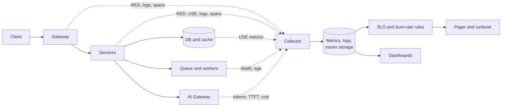

# Observability in Production

> [!TIP]
> **In one line:** Instrument every hop of the architecture with metrics, structured logs and traces tied by one request ID, alert on SLO burn rate, and add token, cost and quality signals for AI paths.
>
> **In plain English:** A car dashboard does not show you every part of the engine; it shows the few gauges that tell you whether to keep driving or pull over. Production observability is choosing those gauges for each stage of a request, so when something is wrong you can tell where and why within minutes, and the person on call has a checklist instead of a guess.
>
> **You'll be able to:** decide what to measure at each layer of the architecture · write burn-rate alerts that page for real problems only · add AI-specific signals (tokens, time to first token, cost, quality) to the same dashboards

## Why This Matters

[Part 12](../12-observability/README.md) taught the three pillars separately: [metrics](../12-observability/metrics.md), [logs](../12-observability/logging.md) and [traces](../12-observability/distributed-tracing.md), plus the vocabulary of [SLIs, SLOs and SLAs](../12-observability/sli-slo-sla.md). Knowing the pillars does not tell you what to instrument in a system with a CDN, a gateway, several services, a database, a cache, a queue, workers and an AI gateway. Teams that instrument by habit end up with thousands of metrics, terabytes of unsearchable logs, and still cannot answer "why is checkout slow for tenant 42 since 14:10?"

The cost of that gap is paid at 3 a.m. An alert fires; the on-call engineer has ten minutes before customers notice. If the dashboard cannot say which hop is slow, if logs cannot be joined to a specific request, and if nobody wrote down what to do, the incident lasts an hour instead of ten minutes. Observability is not a tool purchase. It is a design choice about which questions your system must be able to answer, made before the incident.

AI-backed endpoints add new questions: why did the response take eight seconds, how many tokens did it burn, did quality quietly degrade after a prompt change, and what did that one request cost? A system that answers the classic questions but not these will pass its uptime SLO while being slow, expensive and wrong.

## Core Concept

**Observability** is the ability to ask new questions about a running system from its outputs without shipping new code. Three practical ideas make it usable at architecture scale:

1. **Instrument by hop, using a standard method.** For every request-serving component use **RED**: Rate (requests per second), Errors (failure ratio), Duration (latency distribution, as percentiles per [Latency and Percentiles](../07-caching-performance/latency-and-percentiles.md)). For every resource (CPU, DB connections, queue depth, worker pool) use **USE**: Utilization, Saturation, Errors. RED tells you *users are hurt*; USE tells you *which resource is the cause*.
2. **Correlate everything with one ID.** A single request ID (and trace ID) is attached to the metric exemplar, every log line and every span, so you can jump from "p99 spiked" to the traces behind it to the exact log lines.
3. **Alert on symptoms tied to an SLO, not on causes.** Page when users are being hurt faster than the error budget allows (burn rate), not when a CPU graph crosses 70%. Causes go on dashboards and in tickets.

## Mental Model

Think of a hospital intensive-care ward. Every patient has a few vital signs on a monitor (RED: heart rate, blood pressure, oxygen), and the nurse is paged when a vital sign crosses a threshold that predicts harm soon, not whenever any number wiggles. If a patient crashes, the chart (logs) and the bedside timeline of interventions (traces) explain what happened in order. Lab tests (USE-style resource checks) are ordered *after* a vital sign worries someone, to find the cause. And every chart carries the same patient ID, so records from different departments line up.

A ward that monitored only the building's electricity and water would be useless for the patient. Likewise, dashboards that show host CPU but not request error ratio watch the building, not the patient.

## How It Works

Walk the request path from [Request Flow, End to End](request-flow.md) and decide, hop by hop, what to emit.

**Edge and load balancer.** Metrics: request rate, 4xx and 5xx ratio, cache hit ratio, TLS handshake errors, and origin latency. This is where you see "is the internet reaching us at all?" A rising 5xx ratio here with healthy services behind means the problem is the edge or the connection to the origin.

**Gateway.** RED per route and per tenant tier. Add counts of 401, 403 and 429 responses, because a surge of 429s is either an abusive client or a limit set too low, and a surge of 401s may be a broken token rotation or an attack. The gateway is also where the request ID is born: generate it if the client did not supply one, return it in the `X-Request-ID` response header, and propagate it downstream as part of the trace context.

**Application services.** RED per endpoint using the *route template* (`/orders/{id}`), never the raw path, or you will create a new time series for every order ID. Add business signals that RED cannot see, such as orders created per minute: a service can return 200 for every request while orders silently stop. USE for the pools inside the service: DB connection pool in use versus size, event-loop lag, worker thread utilization.

**Data layer.** For Postgres: query latency, connections in use, lock waits, replication lag, slow-query log. For Redis: hit ratio, evictions, memory, command latency. A falling cache hit ratio explains a rising database load before the database alerts do. Saturation (pool exhaustion, replication lag) is the leading indicator; error counts are the lagging one.

**Queue and workers.** Queue depth, oldest-message age, processing duration, retry and dead-letter counts. Oldest-message age is the one that matters: depth of 10,000 may be fine at 5,000 jobs per second and terrible at 5 per second. Alert on age against the freshness the product promises.

**AI gateway and providers.** Per provider and model: request rate, error ratio by type (timeout, 429, 5xx, content filter), latency, **time to first token** (the delay the user perceives on a streamed reply), total duration, input and output tokens, estimated cost, cache hit rates, and fallback activations. See [AI Observability](../15-production-ai-systems/ai-observability.md) for the detail; here the point is that these live on the *same* dashboards and carry the *same* request ID.

**Logs.** Structured JSON, one event per line, with `request_id`, `trace_id`, `tenant_id` (an identifier, not personal data), `route`, `status` and `duration_ms`. Log at decision points and failures, not every function call. Never log secrets or raw personal data; see [Security in Production](security-in-production.md). Sample or drop debug logs under load, but never sample audit logs.

**Traces.** One trace per request with a span per hop: gateway, service, each DB query batch, cache call, queue publish, AI gateway call and provider call. Spans answer "where did the 900 ms go?" Propagate context across the queue too, so a worker's span links back to the request that enqueued the job. Keep a fixed percentage of normal traces plus 100% of errors and slow requests (tail-based sampling) to control cost.

**SLOs and burn-rate alerts.** Choose a small number of user-facing SLIs, for example "99.9% of `POST /orders` requests succeed within 800 ms over 30 days". The error budget is 0.1% of requests. **Burn rate** is how fast you are spending that budget: burn rate 1 spends it exactly over the window; burn rate 14.4 spends 2% of a 30-day budget in one hour. A widely used pattern pairs a long and a short window so an alert fires quickly but resets quickly:

| Severity | Burn rate | Long window | Short window | Budget consumed if sustained |
|---|---|---|---|---|
| Page now | 14.4 | 1 h | 5 min | 2% in 1 h |
| Page | 6 | 6 h | 30 min | 5% in 6 h |
| Ticket | 1 | 3 days | 6 h | 10% in 3 days |

Both windows must exceed the threshold: the long window proves it is significant, the short one proves it is still happening.

**Dashboards that answer questions.** Build a small top-level dashboard: SLO status and budget remaining, RED for the entry route, then one row per hop. Each panel should answer a question an on-call engineer actually asks ("is the database the bottleneck?"), and each should link to the relevant traces and logs. A wall of fifty graphs answers nothing.

**Runbooks.** Every paging alert links to a runbook with: what the alert means, how to confirm, the first three things to check, mitigations (roll back, shed load, fail over per [Failure Scenarios](failure-scenarios.md), disable a feature flag), and who to escalate to. Update the runbook in the postmortem of every incident it failed to help with.

## Architecture



Every hop emits to one collector. SLO rules read the stored metrics and page a human with a runbook link; dashboards read the same data for investigation. Because all signals share a request ID, a person can pivot from an alert to a trace to a log line without guessing.

## Request / Response Example

A slow, streamed chat request, seen through its correlated signals. The client receives the request ID in the response header:

```http
POST /v1/chat HTTP/1.1
Host: api.example.com
Authorization: Bearer <token>
Content-Type: application/json

{"conversation_id":"c_88","message":"Summarize my last three orders"}

HTTP/1.1 200 OK
Content-Type: text/event-stream
X-Request-ID: 2d8f4a0e-91b3-4f7a-8c52-6a7e0b1f3c11
Traceparent: 00-4bf92f3577b34da6a3ce929d0e0e4736-00f067aa0ba902b7-01
```

The log line for the same request, emitted by the AI gateway when the stream completes:

```json
{"ts":"2026-11-10T14:12:07Z","level":"info","msg":"llm.call.complete",
 "request_id":"2d8f4a0e-91b3-4f7a-8c52-6a7e0b1f3c11",
 "trace_id":"4bf92f3577b34da6a3ce929d0e0e4736","tenant_id":"t_42",
 "provider":"provider_a","model":"large-1","status":"ok",
 "ttft_ms":640,"duration_ms":4120,"input_tokens":1850,"output_tokens":410,
 "cost_usd":0.0119,"prompt_cache_hit":true,"fallback_used":false}
```

From one ID you can find the trace (which hop was slow), the log (how many tokens, what it cost) and, via the exemplar on the latency histogram, the dashboard panel that flagged it. Provider names, model names and prices here are placeholders.

## Code Example

Request-scoped context with structured logs, RED metrics using the `prometheus_client` library, and a burn-rate check. The metric labels use the route template, not the raw path, to keep cardinality bounded.

```python
import contextvars
import json
import logging
import re
import time
import uuid

from fastapi import FastAPI, Request
from fastapi.responses import JSONResponse
from prometheus_client import Counter, Histogram, make_asgi_app

request_id_var: contextvars.ContextVar[str] = contextvars.ContextVar("request_id", default="-")


class JsonFormatter(logging.Formatter):
    """One JSON object per line; every line carries the request id."""

    def format(self, record: logging.LogRecord) -> str:
        payload = {"ts": self.formatTime(record), "level": record.levelname,
                   "msg": record.getMessage(), "request_id": request_id_var.get()}
        payload.update(getattr(record, "fields", {}))
        if record.exc_info:  # log.exception(...): keep the type and traceback in the JSON line
            payload["exception"] = self.formatException(record.exc_info)
        return json.dumps(payload)


handler = logging.StreamHandler()
handler.setFormatter(JsonFormatter())
log = logging.getLogger("app")
log.addHandler(handler)
log.setLevel(logging.INFO)

REQUESTS = Counter("http_requests_total", "Requests", ["route", "method", "status"])
LATENCY = Histogram("http_request_duration_seconds", "Latency", ["route"],
                    buckets=(0.05, 0.1, 0.25, 0.5, 0.8, 1.5, 3, 10))

app = FastAPI()
app.mount("/metrics", make_asgi_app())  # scrape endpoint; keep it off the public ingress


@app.middleware("http")
async def observe(request: Request, call_next):
    # Inbound IDs are untrusted: accept only a short, safe format, else generate one.
    raw = request.headers.get("x-request-id", "")
    rid = raw if re.fullmatch(r"[A-Za-z0-9._-]{8,64}", raw) else str(uuid.uuid4())
    request_id_var.set(rid)
    start = time.perf_counter()
    status = 500  # if call_next raises, we still record a 500
    try:
        try:
            response = await call_next(request)
        except Exception:
            # Starlette's outer error handler would build a 500 without our header,
            # so answer here and keep the ID the client can quote to support.
            log.exception("request.unhandled")
            response = JSONResponse(
                {"error": {"code": "internal_error", "request_id": rid}}, status_code=500
            )
        status = response.status_code
        response.headers["X-Request-ID"] = rid
        return response
    finally:
        elapsed = time.perf_counter() - start
        route = request.scope.get("route")
        template = route.path if route else "unmatched"  # bounded cardinality
        REQUESTS.labels(template, request.method, str(status)).inc()
        LATENCY.labels(template).observe(elapsed)
        log.info("request.complete", extra={"fields": {
            "route": template, "status": status, "duration_ms": round(elapsed * 1000)}})


def burn_rate(error_ratio: float, slo: float) -> float:
    """How many times faster than 'exactly on budget' we are consuming budget."""
    return error_ratio / (1.0 - slo)


def should_page(err_1h: float, err_5m: float, slo: float = 0.999) -> bool:
    # Fire only if BOTH windows burn at >= 14.4x: significant and still happening.
    return burn_rate(err_1h, slo) >= 14.4 and burn_rate(err_5m, slo) >= 14.4
```

In production you would compute these ratios in your metrics backend (for example as recording rules) rather than in application code; the function shows the arithmetic. With a 99.9% SLO, an error ratio of 1.5% gives a burn rate of 15, which pages. Note one limit: `request.scope["route"]` is set after routing, so unmatched paths all collapse into one label, which is the behavior you want against scanners.

## Production Considerations

- **Cardinality is the budget.** Each distinct label combination is a time series. Labels such as user ID, order ID or raw URL explode storage and cost. Put high-cardinality detail in logs and traces, not metric labels. This connects directly to [Cost Management](cost-management.md): observability data is often the third or fourth largest line on the bill.
- **Retention tiers.** Keep metrics at full resolution for days and downsample for months; keep logs hot for a week or two and cold-archive what compliance requires; keep traces briefly. Audit logs follow their own retention rules.
- **Observe the observer.** Alert if the collector drops data or a scrape fails. Silence is not health; add a "dead man's switch" alert that fires if the alerting pipeline itself stops reporting.
- **Synthetic checks.** Probe key journeys from outside every minute. Real traffic tells you what users experienced; probes tell you about a quiet 3 a.m. outage when there is no traffic to alert on.
- **Alert quality.** Every page must be actionable and urgent. Track pages per on-call shift; if most are noise, fix or delete the alerts. Alert fatigue is a reliability risk.
- **Deploy markers.** Overlay deploys and feature-flag changes on dashboards; most incidents start with a change.
- **Privacy.** Telemetry holds user data. Apply the same redaction and access rules you apply to the database.

## Common Mistakes

- **Alerting on causes.** Paging on CPU or memory instead of user-visible symptoms creates noise and still misses real outages.
- **High-cardinality labels.** Putting `user_id` or the raw path in a metric label is the classic way to crash a metrics system and inflate the bill.
- **Averages instead of percentiles.** A mean latency of 200 ms can hide a p99 of 6 seconds that hits your biggest customers.
- **Unstructured logs with no request ID.** Without a join key, logs from five services cannot be tied to one failing request.
- **Dashboards nobody can interpret.** Graphs without units, thresholds or a question attached do not help during an incident.
- **No runbook.** An alert that says "latency high" with no next step wastes the first ten minutes.
- **Ignoring AI-specific signals.** Uptime and latency can look healthy while token usage doubles or answer quality collapses after a prompt edit.

## Best Practices

- Start from SLOs for two or three critical journeys, then instrument backward to the hops that serve them.
- Use RED for services and USE for resources, and keep one dashboard row per hop in request order.
- Generate or accept a request ID at the gateway, propagate trace context everywhere including through queues, and echo the ID to the client.
- Page on multi-window burn rate; open tickets for slow burns; keep cause-based alerts as dashboard annotations.
- Emit business metrics next to technical ones so "200 OK but nothing happens" is visible.
- Tag AI calls with model, prompt version, tenant and request ID so tokens, latency and cost are attributable.
- Review alerts and runbooks after every incident and delete what did not help.

## AI Engineering Perspective

AI paths need four extra signal families, all joined to the same request ID. First, **latency in two parts**: time to first token (what a user feels while the reply streams; see [Streaming LLM Responses](../14-ai-api-engineering/streaming-llm-responses.md)) and total duration, plus inter-token pace if a stall mid-stream matters. Alert on TTFT percentiles separately, because a provider can keep total duration acceptable while making the first token slow.

Second, **tokens and cost per request**, recorded by the AI gateway: input tokens, output tokens, cached tokens, and the computed cost. Aggregate by tenant, route, model and prompt version, so "spend doubled" resolves to "the new summarization prompt added 3,000 tokens of context". See [Cost Tracking](../15-production-ai-systems/cost-tracking.md) for the accounting and [Cost Management](cost-management.md) for budgets.

Third, **provider health and fallback signals**: error types per provider, fallback activation rate, and circuit-breaker state. A fallback that silently activates for a week means you are paying for a more expensive model or accepting lower quality without noticing.

Fourth, **quality**. Classic SLOs cannot see a model that answers fluently and wrongly. Add cheap online proxies (user thumbs-down rate, regeneration rate, tool-call failure rate, guardrail trigger rate, citation-present rate for RAG) and run an offline evaluation set on every prompt or model change, alerting if scores regress. These are noisy, so treat them as trends with thresholds, not as hard pages. For agents, trace each step (model call, tool call, result) as spans in one trace so a multi-step failure can be replayed; [AI Observability](../15-production-ai-systems/ai-observability.md) covers the data model. Be deliberate about storing prompts and outputs: they are the most useful debugging data and also the most sensitive, so sample, redact and expire them.

## Exercises

**Beginner**
1. For `POST /orders`, write the RED metrics you would emit and the label set for each, avoiding any label with unbounded values.
2. Convert a 99.9% monthly SLO into an error budget in minutes of full outage (30 days) and in failed requests for 10 million requests.

**Intermediate**
3. Add the request-ID middleware to a FastAPI app, then verify that one request produces the same ID in the response header and in every log line it triggers, including a log from inside a background task.
4. Design the burn-rate alert pair for a 99.5% SLO. Compute the error ratios that trigger the 14.4x and 6x pages.

**Advanced**
5. Propagate trace context through a queue: the producer injects it into the message, the worker extracts it, and the worker span links to the producer span. Describe what happens to the trace if the job is retried three times.
6. Design the AI-specific dashboard and three alerts (TTFT, cost per request, fallback rate) for the chat endpoint, including how you would detect a quality regression after a prompt change with limited labelled data.

## Key Takeaways

- Instrument per hop with RED for services and USE for resources, using bounded-cardinality labels.
- One request ID and trace context across logs, metrics exemplars and spans is what makes a multi-service incident debuggable.
- Page on SLO burn rate with two windows; put causes on dashboards, not pagers.
- Dashboards and runbooks exist to answer on-call questions, so design them around those questions.
- AI paths add TTFT, tokens, cost, fallback and quality signals that classic uptime metrics cannot see.

### Check Yourself

<details markdown="1">
<summary>1. What is the difference between RED and USE, and when do you use each?</summary>

RED (rate, errors, duration) describes request-serving components from the user's side; USE (utilization, saturation, errors) describes resources such as pools, CPUs and queues. RED tells you users are affected, and USE helps find which resource is the cause.

</details>

<details markdown="1">
<summary>2. Why does a burn-rate alert require both a long and a short window?</summary>

The long window shows the problem is big enough to threaten the budget, while the short window shows it is still happening now. Using only the long window keeps paging after the issue is fixed, and using only the short one pages on harmless blips.

</details>

<details markdown="1">
<summary>3. Uptime and p95 latency are green, but finance reports LLM spend doubled this week. Which signals and dimensions would you check first?</summary>

Look at tokens and cost per request grouped by model, route, tenant and prompt version, and at the fallback rate and cache hit rate. A prompt change adding context, a lost prompt-cache hit, or a fallback to a pricier model are the usual causes.

</details>

---
Back to the [Part 18 README](README.md).
