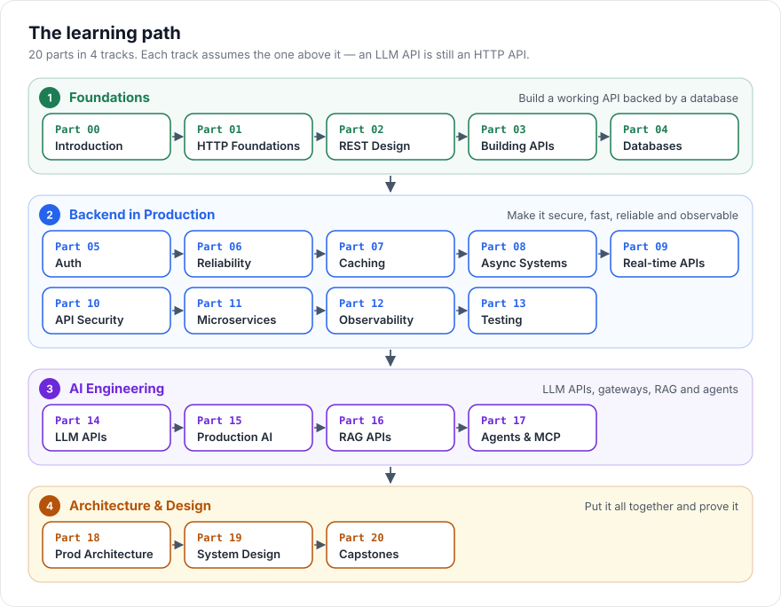

---
hide:
  - navigation
  - toc
---

✅ <b>142 chapters</b> · free &amp; open source · MIT licensed

# Learn API engineering, from your first HTTP request to production AI systems.

A structured, beginner-friendly curriculum. Every concept starts with a plain-English summary and a diagram, then goes all the way down to real code and production trade-offs.

  <a class="hb-btn hb-btn-primary" href="00-introduction/">Start learning →</a>
  <a class="hb-btn hb-btn-ghost" href="study-plan/">Pick a study plan</a>
  <a class="hb-btn hb-btn-ghost" href="https://github.com/himanshu231204/api-engineering-handbook">GitHub</a>

  
<b>20</b>Parts

  
<b>142</b>Chapters

  
<b>400+</b>Self-check questions

  
<b>10</b>Capstone projects

## The path

Four tracks, one after another. Each track assumes the one before it: an LLM API is still an HTTP API, and a RAG pipeline is still a database-and-queue problem.

  <a class="hb-track" style="--c:#1c7c54" href="01-api-foundations/">
    Track 1 · Parts 0–4
    <b>Foundations</b>
    HTTP, REST design, FastAPI, PostgreSQL. You'll build a working API backed by a real database.
  </a>
  <a class="hb-track" style="--c:#2563eb" href="05-authentication-authorization/">
    Track 2 · Parts 5–13
    <b>Backend in Production</b>
    Auth, reliability, caching, queues, webhooks, security, observability and testing.
  </a>
  <a class="hb-track" style="--c:#6d28d9" href="14-ai-api-engineering/">
    Track 3 · Parts 14–17
    <b>AI Engineering</b>
    LLM APIs, gateways, cost control, RAG pipelines, agents and MCP servers.
  </a>
  <a class="hb-track" style="--c:#b45309" href="18-production-architecture/">
    Track 4 · Parts 18–20
    <b>Architecture &amp; Design</b>
    End-to-end architecture, 10 system-design case studies and capstone projects.
  </a>

## How every chapter teaches

Every chapter has the same shape, so you always know where you are.

  
<b>1</b><h3>TL;DR</h3>
One line, plus a plain-English version with no jargon.

  
<b>2</b><h3>Mental model</h3>
An everyday analogy, so the idea sticks before the details arrive.

  
<b>3</b><h3>Diagrams</h3>
See the flow: who calls whom, in what order, and what can fail.

  
<b>4</b><h3>Real code</h3>
Commented FastAPI, Pydantic and SQLAlchemy you can run.

  
<b>5</b><h3>Production</h3>
Trade-offs, common mistakes, and what changes at scale.

  
<b>6</b><h3>Check yourself</h3>
Three quiz questions with hidden answers, plus exercises at three levels.

## Where to start

| If you are... | Start here |
|---|---|
| New to backend development | [Part 0 — Introduction](00-introduction/README.md), then follow the [Study Plan](study-plan.md) (Track A) |
| Comfortable with CRUD, want production depth | [Part 5 — Authentication](05-authentication-authorization/README.md) (Study Plan Track B) |
| Building AI-powered APIs | [Part 14 — AI API Engineering](14-ai-api-engineering/README.md) (Study Plan Track C) |
| Prepping for system design interviews | [Part 19 — Case Studies](19-system-design-case-studies/README.md) and the [Diagrams](../diagrams/) page |
| Ready to build something end-to-end | [Capstone Projects](20-capstone-projects/README.md) |

## Learn by doing

  
<h3>▣ 12 runnable examples</h3>
From raw HTTP sockets to an LLM gateway and a RAG API. Each one is a small FastAPI project with its own README.

  
<h3>↗ 10 capstone projects</h3>
Full specs (requirements, schema, endpoints, checklist) for an auth service, webhooks, a payment API, RAG and more.

  
<h3>✓ Track your progress</h3>
Tick off chapters on the <a href="progress/">progress tracker</a>. It's saved in your browser.

