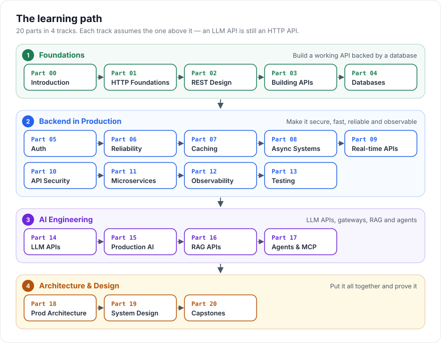

# Study Plan

> [!TIP]
> **In one line:** Pick a track, give it 6–8 focused hours a week, and finish every part with a small build — reading alone won't make it stick.
>
> **In plain English:** This page turns the 20 parts into a week-by-week schedule. Each week you read a few chapters, run the matching example, and answer the quiz at the end of each chapter. Every few weeks you build a capstone project to prove you can do it on your own.
>
> **You'll be able to:** choose the right track for your background · plan your weeks · know when you've actually learned a part

The detailed "why this order" reasoning lives in [Learning Roadmap](00-introduction/learning-roadmap.md). This page is the practical schedule.

## How to Study One Chapter (≈ 45–60 minutes)

Every chapter has the same shape, so you can use the same routine every time:

| Step | What to do | Time |
|---|---|---|
| 1. **TL;DR box** | Read the green box at the top. You now know where the chapter is going. | 1 min |
| 2. **Why → Core Concept → Mental Model** | Read slowly. If an analogy clicks, write it in your own words. | 10 min |
| 3. **Diagrams** | Trace each diagram with your finger — say every arrow out loud ("the client sends…, then…"). | 5 min |
| 4. **Request / Response + Code** | Type the code out (don't copy-paste) and run it if it's runnable. Change one thing and predict the result before running it. | 20 min |
| 5. **Common Mistakes** | For each mistake, ask "have I done this?" | 5 min |
| 6. **Check Yourself** | Answer each question *before* opening it. Two of three right = move on. Otherwise re-read the section the answer points to. | 5 min |
| 7. **Exercises** | Do the Beginner one now; come back for Intermediate/Advanced on review day. | 10+ min |

Then tick the chapter off on the [Progress Tracker](https://himanshu231204.github.io/api-engineering-handbook/progress/) (on the website).

!!! tip "The one rule that matters"
    **Explain it to someone else.** After each part, write a 5-sentence explanation of its main idea as if to a friend who doesn't code. If you can't, you've found exactly what to re-read.

## Choose Your Track

| Your background | Track | Length |
|---|---|---|
| Can code, but never built a backend/API | **Track A — Complete** | 16 weeks |
| Built some CRUD APIs, want production depth | **Track B — Backend Engineer** | 10 weeks |
| Solid backend already, building with LLMs | **Track C — AI Engineer** | 8 weeks |

### Track A — Complete (16 weeks, ~6–8 h/week)

| Week | Read | Build / Practise |
|---|---|---|
| 1 | [Part 0](00-introduction/README.md) + [Part 1](01-api-foundations/README.md) chapters 1–5 | Run `examples/http-basics` and send a raw HTTP request by hand |
| 2 | [Part 1](01-api-foundations/README.md) chapters 6–11 | Use `curl -v` against any public API and label every line of output |
| 3 | [Part 2 — REST Design](02-rest-api-design/README.md) | Design (on paper) the endpoints for a library app |
| 4 | [Part 3 — Building APIs](03-building-apis/README.md) | Run `examples/fastapi-crud`; add one new endpoint with validation |
| 5 | [Part 4 — Databases](04-databases-and-apis/README.md) | Move your endpoint onto PostgreSQL with a migration |
| 6 | Review week | **Capstone 1 — CRUD API** ([spec](../projects/01-crud-api/README.md)) |
| 7 | [Part 5 — Auth](05-authentication-authorization/README.md) | Run `examples/authentication`; decode a JWT by hand |
| 8 | [Part 6 — Reliability](06-production-reliability/README.md) | Add timeouts + retries with jitter to an outbound call |
| 9 | [Part 7 — Caching](07-caching-performance/README.md) + [Part 8 — Async](08-async-systems/README.md) | Run `examples/redis-cache` and `examples/background-jobs` |
| 10 | [Part 9 — Real-time & Webhooks](09-realtime-and-webhooks/README.md) | Run `examples/webhooks`; break the signature on purpose |
| 11 | [Part 10 — Security](10-api-security/README.md) | Audit your Capstone 1 against the OWASP API Top 10 |
| 12 | [Parts 11–13 — Microservices, Observability, Testing](11-microservices-distributed-systems/README.md) | **Capstone 2 or 4** ([auth service](../projects/02-authentication-service/README.md) / [webhooks](../projects/04-webhook-system/README.md)) |
| 13 | [Part 14 — AI API Engineering](14-ai-api-engineering/README.md) | Run `examples/llm-streaming` |
| 14 | [Part 15 — Production AI](15-production-ai-systems/README.md) + [Part 16 — RAG](16-rag-apis/README.md) | Run `examples/llm-gateway` and `examples/rag-api` |
| 15 | [Part 17 — Agents & MCP](17-ai-agents-and-mcp/README.md) + [Part 18](18-production-architecture/README.md) | Run `examples/ai-agent` |
| 16 | [Part 19 — Case Studies](19-system-design-case-studies/README.md) | **Capstone 7 or 8** ([RAG](../projects/07-production-rag/README.md) / [LLM gateway](../projects/08-llm-gateway/README.md)) |

### Track B — Backend Engineer (10 weeks)

Skim Parts 1–2 (do only the Check Yourself quizzes — read a chapter fully only when you miss a question), then:

| Week | Read | Build |
|---|---|---|
| 1 | Quizzes for [Parts 1–2](01-api-foundations/README.md), then [Part 3](03-building-apis/README.md) | `examples/fastapi-crud` |
| 2 | [Part 4 — Databases](04-databases-and-apis/README.md) | Fix an N+1 query in your own code |
| 3 | [Part 5 — Auth](05-authentication-authorization/README.md) | [Capstone 2 — Auth Service](../projects/02-authentication-service/README.md) |
| 4 | [Part 6 — Reliability](06-production-reliability/README.md) | Add a circuit breaker around a flaky dependency |
| 5 | [Part 7](07-caching-performance/README.md) + [Part 8](08-async-systems/README.md) | [Capstone 5 — Document Pipeline](../projects/05-document-processing/README.md) |
| 6 | [Part 9 — Webhooks & Real-time](09-realtime-and-webhooks/README.md) | [Capstone 4 — Webhooks](../projects/04-webhook-system/README.md) |
| 7 | [Part 10 — Security](10-api-security/README.md) | Security-review one of your capstones |
| 8 | [Parts 11–12](11-microservices-distributed-systems/README.md) | Add structured logs + a trace id end to end |
| 9 | [Part 13 — Testing](13-api-testing/README.md) + [Part 18](18-production-architecture/README.md) | Load-test a capstone; find the bottleneck |
| 10 | [Part 19 — Case Studies](19-system-design-case-studies/README.md) | [Capstone 3 — Payment API](../projects/03-payment-api/README.md) |

### Track C — AI Engineer (8 weeks)

Take the Check Yourself quizzes for [Parts 5–9](05-authentication-authorization/README.md) first — AI systems are still APIs, and these parts are where most LLM-app bugs actually live.

| Week | Read | Build |
|---|---|---|
| 1 | [Part 14](14-ai-api-engineering/README.md) chapters 1–5 | Count tokens for a real prompt and estimate its cost |
| 2 | [Part 14](14-ai-api-engineering/README.md) chapters 6–10 | `examples/llm-streaming`; add a tool call |
| 3 | [Part 15 — Production AI](15-production-ai-systems/README.md) | `examples/llm-gateway`; add a fallback provider |
| 4 | [Part 16 — RAG](16-rag-apis/README.md) chapters 1–5 | `examples/rag-api`; try two chunk sizes and compare answers |
| 5 | [Part 16 — RAG](16-rag-apis/README.md) chapters 6–10 | [Capstone 7 — Production RAG](../projects/07-production-rag/README.md) |
| 6 | [Part 17 — Agents & MCP](17-ai-agents-and-mcp/README.md) | `examples/ai-agent`; add a max-steps guard |
| 7 | [Part 18](18-production-architecture/README.md) + AI case studies in [Part 19](19-system-design-case-studies/README.md) | [Capstone 9 — Agent API](../projects/09-ai-agent-api/README.md) |
| 8 | Review | [Capstone 10 — Production AI SaaS](../projects/10-production-ai-saas/README.md) |

The runnable examples live in the repository's [`examples/`](https://github.com/himanshu231204/api-engineering-handbook/tree/main/examples) folder; each has its own README with setup steps.

## How to Know You've Learned a Part

You're ready to move on when you can do all four, without notes:

1. **Draw** the part's main diagram from memory.
2. **Explain** the part's core idea in five plain sentences.
3. **Answer** at least two of three Check Yourself questions in every chapter.
4. **Build** the part's example from an empty folder, looking things up only in docs.

## Review Rhythm

- **End of every week:** re-take the Check Yourself quizzes from the week *before* last (spaced repetition beats re-reading).
- **Every 4 weeks:** browse the [Diagrams](../diagrams/) page and explain each diagram out loud.
- **Before interviews:** the [cheatsheets](../resources/cheatsheets/http-methods.md) and [interview questions](../resources/interview-questions/backend-engineer.md).
